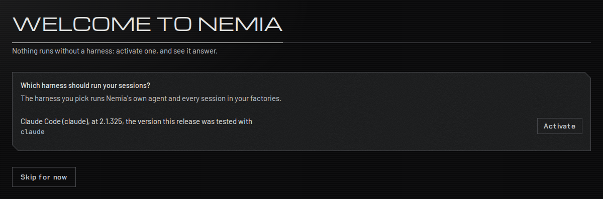

# Nemia

[](https://github.com/emyann/nemia/actions/workflows/ci.yml)

**Nemia — Recruit intelligence.** Said NEH-mee-ah.

Nemia runs teams of agents. You give it a piece of work, written as a card; a team of agents does it in steps, and a person decides
where it matters. What comes out is a landing: the work merged on your base branch, after a check has passed on the merged tree.

## Install

```bash
curl -fsSL https://github.com/emyann/nemia/releases/latest/download/install.sh | sh
```

It works on macOS (Apple silicon or Intel), on Linux (x64 or arm64), and on Windows in a WSL terminal. On a laptop it starts Nemia on
this machine alone and opens the board's welcome page in your browser, at `http://localhost:8787/welcome`. The welcome walks you
through four milestones: a harness, a first factory, a first volume and a first card.



## What Nemia offers

- **Factories.** A factory is where your workflows run, with the agents it hires.
- **Workflows of agent steps.** A workflow is a folder of markdown files, and each file is one step, done by an agent.
- **Checks.** A step's check is a command the run executes after the step signs off; its exit code decides whether the run goes on,
  and the agent's own word does not.
- **Gates that wait on you.** Where a step has a gate, nothing after it starts until you approve.
- **Cards and landings.** A card says what is wanted; starting it makes a run, and a run ends in a landing on your base branch.
- **A board.** It shows your runs and takes what you decide.
- **Claude Code or Codex as the harness.** The harness runs every session in your factories; a release carries none, and the welcome
  page activates the one you choose.


## Learn more

- [Getting started](apps/docs/src/content/docs/getting-started.mdx): from one line to a first landed change.
- [How a run lives](apps/docs/src/content/docs/how-a-run-lives.mdx)
- [Workflows](apps/docs/src/content/docs/workflows.mdx)
- [Factories](apps/docs/src/content/docs/factories.mdx)
- [Install](apps/docs/src/content/docs/install.mdx): what the installer does, its flags, and the server's path.

## Working on Nemia

- [Working on Nemia](docs/working-on-nemia.md): the layers, running from a checkout, and the project's history.
- [The quota on the board](apps/api/README.md)
- [CLAUDE.md](CLAUDE.md), the contributor guide; [docs/architecture.md](docs/architecture.md); [docs/playbook-operator.md](docs/playbook-operator.md).

## License

MIT ([LICENSE](LICENSE)). The vendored skills and the design system kit keep their own licences, in
[THIRD_PARTY_NOTICES.md](THIRD_PARTY_NOTICES.md).
