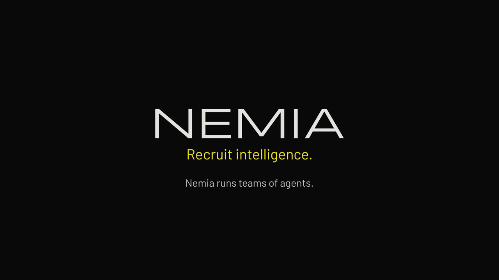
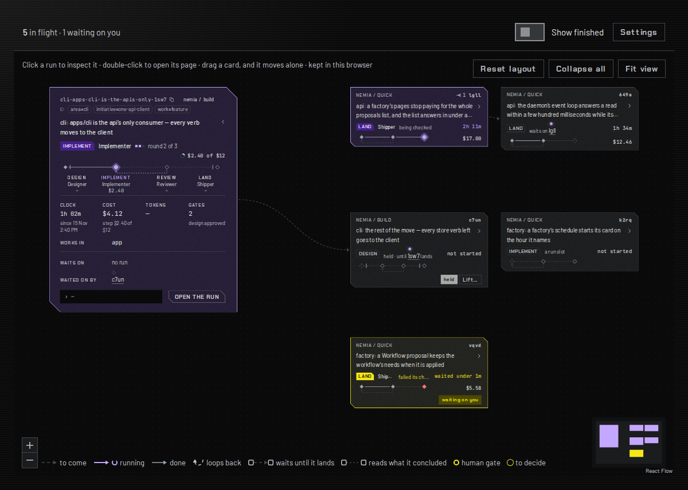

# Nemia

[](https://github.com/emyann/nemia/actions/workflows/ci.yml)

**Nemia — Recruit intelligence.** Pronounced NEH-mee-ah.

Nemia runs teams of agents. You describe a piece of work on a card. A team of agents does it in steps, and you decide at the points
that matter. The result is a landing: the work is merged into your base branch once a check passes on the merged code.

[](docs/film/nemia.mp4)

A one-minute tour of Nemia (silent, with captions). The screens show sample data.

## Install

```bash
curl -fsSL https://github.com/emyann/nemia/releases/latest/download/install.sh | sh
```

Nemia runs on macOS (Apple silicon or Intel), Linux (x64 or arm64), and Windows in a WSL terminal. On a laptop, Nemia runs locally
and opens its welcome page in your browser at `http://localhost:8787/welcome`. The welcome page guides you through four milestones:
a harness, a first factory, a first volume, and a first card.


## Features

- **Factories.** A factory is where your workflows run, with the agents it hires.
- **Workflows of agent steps.** A workflow is a folder of Markdown files. Each file is one step, and an agent does it.
- **Checks.** A check is a command that runs after a step finishes. Its exit code decides whether the run continues, not the agent.
- **Gates that wait on you.** When a step has a gate, nothing after it starts until you approve.
- **Cards and landings.** A card describes what you want. Starting it creates a run, and the run ends with a landing on your base
  branch.
- **A board.** See your runs and make your decisions in one place.
- **Claude Code or Codex as the harness.** The harness runs every agent session in your factories. Nemia doesn't ship one: you choose
  it on the welcome page.



## Learn more

- [Getting started](apps/docs/src/content/docs/getting-started.mdx): from the install line to your first landed change.
- [How a run lives](apps/docs/src/content/docs/how-a-run-lives.mdx)
- [Workflows](apps/docs/src/content/docs/workflows.mdx)
- [Factories](apps/docs/src/content/docs/factories.mdx)
- [Install](apps/docs/src/content/docs/install.mdx): what the installer does, its options, and how to install a server.

## Contributing

- [Working on Nemia](docs/working-on-nemia.md): the architecture, running from source, and the project's history.
- [The quota on the board](apps/api/README.md)
- [CLAUDE.md](CLAUDE.md), the contributor guide; [docs/architecture.md](docs/architecture.md); [docs/playbook-operator.md](docs/playbook-operator.md).

## License

MIT ([LICENSE](LICENSE)). The vendored skills and the design system kit keep their own licenses, listed in
[THIRD_PARTY_NOTICES.md](THIRD_PARTY_NOTICES.md).
