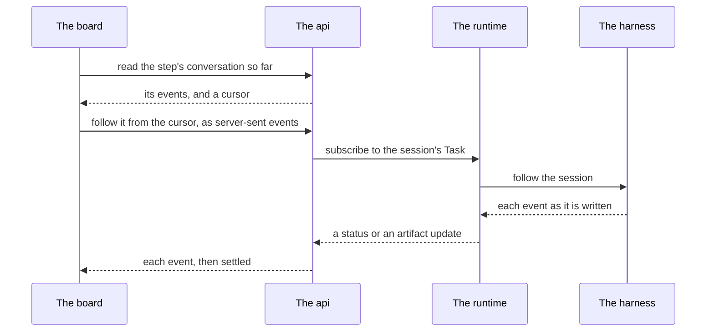

A2A (Agent2Agent) is an open protocol that lets one agent talk to another. The runtime uses it as its single interface to every
harness: Claude Code, Codex, a plain command, and agents that someone else runs at an address. Each harness is an A2A agent, and the
runtime is its client. Whatever the harness, the runtime asks it the same things, in the same terms.

**It owns** the connection between the runtime's engine and each harness: how a session is started, read, sent a message, and
stopped.

**It never touches** a workflow. A2A lives inside the runtime, and nothing above the runtime uses it. Only
`packages/agent-runtime/src/a2a/` imports the A2A library (`packages/agent-runtime/test/a2a-boundary.test.ts`), and neither of the
runtime's entry points exports any of its names.

**Its entry point** is the runtime's engine, which calls it for every harness.

## Two kinds of agent

- **A harness on this machine** (`claude`, `codex`, `command`) is an A2A agent that runs in the runtime's own process. The runtime
  reaches it through the A2A client, with no network in between (`packages/agent-runtime/src/a2a/client.ts`). The agent that answers
  (`packages/agent-runtime/src/a2a/handler.ts`) keeps no state: it reads every answer fresh from the harness and the journal. So a
  runtime restarted mid-session can answer for a session it never started.
- **A remote agent** is an A2A agent that someone else runs. The runtime reaches it over HTTP at its address, or through its agent
  card (`packages/agent-runtime/src/a2a/remote.ts`). It runs however its operator configured it. The runtime sends only the brief, the
  session to continue, and the shape of the closeout it expects.

## A task

In A2A, a Task is a piece of work an agent is doing. For the runtime, **a session is an A2A Task**, named after its attempt:
`ae/<task>/<n>`. The Task's context, its `contextId`, is the harness's own id for the conversation. So every attempt that continues
the same conversation shares one context.

- A Task's state is the session's state: working, waiting for input, completed, failed, or canceled. A task held open for a person
  shows `INPUT_REQUIRED`.
- The session's closeout is the Task's one Artifact, named `closeout`.
- If a harness refuses to start a session, it answers `REJECTED`, and the attempt ends as `unstartable`.

## A send

In A2A, a Message is what one agent sends to another. The runtime sends three kinds:

- **A spawn** starts a session. It is a user Message marked with the runtime's extension, and its one text part is the brief. If it
  continues a conversation, that conversation is its `contextId`. The harness's arguments (`config`) travel unread in its metadata.
- **`say`** is a follow-up Message on the session's Task: a person's message to a session while it runs, or between turns.
- **A stop** is A2A's cancel.

Listing which sessions exist is done with `observe`. For the few things A2A has no call for, such as a session's logs or a harness's
quota, the runtime's extension adds methods: `findSession`, `sessionLogs`, `releaseSession`, `sessionTranscript`, `observeSessions`,
`harnessQuota`, and `harnessModels`.

## A subscription

In A2A, a client can subscribe to a Task and receive each change as it happens (`SubscribeToTask`, in
`packages/agent-runtime/src/a2a/follow.ts`). The runtime answers a subscription with the Task, then sends each change as a status or
artifact update, until the session settles.

Not every harness supports this:

| Harness                 | Streamed | What a follower receives                                                                                                                |
| ----------------------- | -------- | --------------------------------------------------------------------------------------------------------------------------------------- |
| `claude`, a job         | yes      | its state, each message's text in pieces as it is written, and each transcript event once                                               |
| `claude`, held attached | yes      | its state, the pieces of text it is writing, and each transcript event once, across its turns and holders                               |
| `codex`                 | yes      | its state, and each event once and in order, each message whole                                                                         |
| `command`               | no       | nothing: a process keeps no conversation, only its output                                                                               |
| a remote agent          | yes      | its Task's own stream if its card offers one; otherwise its Task, read every second (`packages/agent-runtime/src/a2a/remote-follow.ts`) |

This subscription is A2A's, and covers one session. It is different from the feed subscription that wakes
[Nemia](/nemia/#her-subscription), which belongs to the orchestrator.

## How the board follows a session live

When you open a running step on the board, its conversation updates as the agent writes. Each layer relays the one below it, and
**nothing above the runtime polls a session on a timer**:

1. The board reads the step's conversation once, then opens an EventSource on its stream route, starting where the read ended
   (`apps/web/src/lib/useStepTranscript.ts`).
2. The API serves that route, `/api/runs/:id/steps/:step/transcript/stream` (`apps/api/src/steps/steps.ts`), with one upstream
   connection per step, however many people follow it, and relays what the runtime streams. A dropped connection resumes after the
   last event it received.
3. Sometimes a step can't be streamed live: its harness doesn't stream sessions, or its stream failed. Then the stream quietly says
   why, and re-reads the conversation every few seconds (`STEP_BEAT_MS`) from where it left off. Each time, it checks whether live
   streaming is possible again. It never gives up on a step: it ends when the step's task settles, or when nobody is watching.

The board follows the whole store the same way. The feed, the stream of everything the daemon writes, is relayed as server-sent
events on `/api/feed/stream` (`apps/api/src/gauges/feed.ts`, read by `apps/web/src/lib/useFeed.ts`).

## Sources

This page is based on `packages/agent-runtime/README.md` (_Beneath the harnesses: an A2A seam_, _A remote A2A agent as a harness_),
and on `packages/agent-runtime/src/a2a/client.ts`, `packages/agent-runtime/src/a2a/handler.ts`,
`packages/agent-runtime/src/a2a/follow.ts`, `packages/agent-runtime/src/a2a/remote.ts`,
`packages/agent-runtime/src/a2a/remote-follow.ts`, `apps/api/src/steps/steps.ts`, and `apps/web/src/lib/useStepTranscript.ts`.
