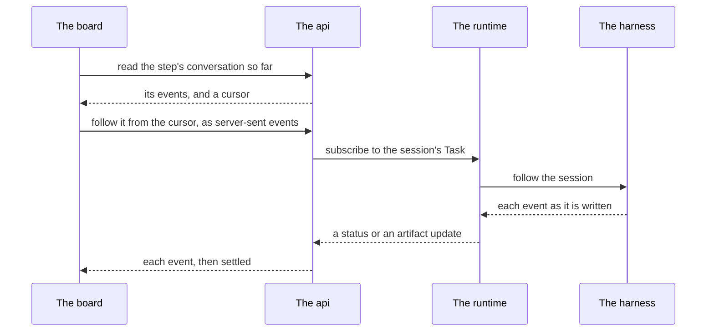

A2A (Agent2Agent) is an open protocol for one agent to talk to another. The runtime uses it as its one interface to every harness: Claude
Code, Codex, a plain command, and an agent someone else runs at an address. Each harness is an A2A agent, and the runtime is its
client. So whatever a harness is, the runtime asks it the same things, in the same words.

**It owns** the seam between the runtime's engine and each harness: how a session is started, read, told something and stopped.

**It never touches** a workflow. A2A is inside the runtime; nothing above the runtime speaks it. Only
`packages/agent-runtime/src/a2a/` imports the A2A library (`packages/agent-runtime/test/a2a-boundary.test.ts`), and neither of the
runtime's entries exports a name of it.

**It is reached through** the runtime's engine, which calls it for every harness.

## Two kinds of agent

- **A harness on this machine** (`claude`, `codex`, `command`) is an A2A agent that runs in the runtime's own
  process. The runtime reaches it through the A2A client with no network between them (`packages/agent-runtime/src/a2a/client.ts`).
  The agent that answers (`packages/agent-runtime/src/a2a/handler.ts`) holds nothing: every answer is read again from the harness and
  the journal, so a runtime restarted mid-session answers for a session it never started.
- **A remote agent** is an A2A agent another party runs, reached over HTTP at its address, or from its agent card
  (`packages/agent-runtime/src/a2a/remote.ts`). It runs as its operator configured it: the runtime sends only the brief, the session it
  continues, and the shape of the closeout it asks for.

## A task

In A2A, a Task is a piece of work an agent is doing. For the runtime, **a session is an A2A Task**, named for its attempt,
`ae/<task>/<n>`. The Task's context, its `contextId`, is the harness's own id for the conversation, so every attempt that continued one
conversation shares one context.

- A Task's state is the session's state: working, waiting for input, completed, failed or canceled. A task held open for a person reads
  `INPUT_REQUIRED`.
- What the session closed with is the Task's one Artifact, named `closeout`.
- A harness that refuses to start a session answers `REJECTED`, and the attempt ends `unstartable`.

## A send

In A2A, a Message is what one agent sends another. The runtime sends three kinds:

- **A spawn** starts a session. It is a user Message marked with the runtime's extension, whose one text part is the brief. The
  conversation it continues, if any, is its `contextId`, and the harness's arguments (`config`) travel unopened in its metadata.
- **`say`** is a follow-up Message on the session's Task: a person's words to a session while it runs, or between turns.
- **A stop** is A2A's cancel.

Reading which sessions exist is a listing (`observe`). A few things A2A has no call for, such as a session's logs or a harness's quota,
are methods of the runtime's extension: `findSession`, `sessionLogs`, `releaseSession`, `sessionTranscript`, `observeSessions` and
`harnessQuota`.

## A subscription

In A2A, a client may subscribe to a Task to be sent each change as it happens (`SubscribeToTask`, in
`packages/agent-runtime/src/a2a/follow.ts`). The runtime answers a subscription with the Task, then each moment as a status or an
artifact update, until the session settles.

Not every harness can be followed this way:

| Harness                 | Streamed | What a follower is handed                                                                                                            |
| ----------------------- | -------- | ------------------------------------------------------------------------------------------------------------------------------------ |
| `claude`, a job         | yes      | its state, each message's text in pieces as it is written, and each event of its transcript once                                     |
| `claude`, held attached | yes      | its state, the pieces of the text it is writing, and each event of its transcript once, across its turns and its holders             |
| `codex`                 | yes      | its state, and each event once and in order, each message whole                                                                      |
| `command`               | no       | nothing: a process keeps no conversation, only its output                                                                            |
| a remote agent          | yes      | its Task's own stream where its card offers one; else its Task read every second (`packages/agent-runtime/src/a2a/remote-follow.ts`) |

This subscription is A2A's, to one session. It is not the feed subscription whose selectors wake [Nemia](/nemia/#her-subscription), which is
the orchestrator's.

## How the board follows a session live

When you open a running step on the board, its conversation moves as the agent writes. That works as a chain, each layer relaying the
one below it, and **nothing above the runtime reads a session again on a timer**:

1. The board reads the step's conversation once, then opens an EventSource on its stream route, from where the read ended
   (`apps/web/src/lib/useStepTranscript.ts`).
2. The api serves that route, `/api/runs/:id/steps/:step/transcript/stream` (`apps/api/src/steps/steps.ts`), with one upstream per
   step, whoever follows it, and relays what the runtime streams. A dropped connection resumes after the last event it was sent.
3. Where no live stream of a step can be had — its harness does not stream the session, or the stream it had failed — the stream says
   why, quietly, and reads the conversation again every few seconds (`STEP_BEAT_MS`) from where it left off, asking each time whether
   it can be followed live again. It gives up on no step: it ends when the step's task settles, or when nobody is reading.

The board follows the store as a whole the same way: the feed, the line of everything the daemon writes, is relayed as server-sent
events on `/api/feed/stream` (`apps/api/src/factory/feed.ts`, read by `apps/web/src/lib/useFeed.ts`).

## Sources

This page is written from `packages/agent-runtime/README.md` (_Beneath the harnesses: an A2A seam_, _A remote A2A agent as a harness_),
and from `packages/agent-runtime/src/a2a/client.ts`, `packages/agent-runtime/src/a2a/handler.ts`,
`packages/agent-runtime/src/a2a/follow.ts`, `packages/agent-runtime/src/a2a/remote.ts`,
`packages/agent-runtime/src/a2a/remote-follow.ts`, `apps/api/src/steps/steps.ts` and `apps/web/src/lib/useStepTranscript.ts`.
