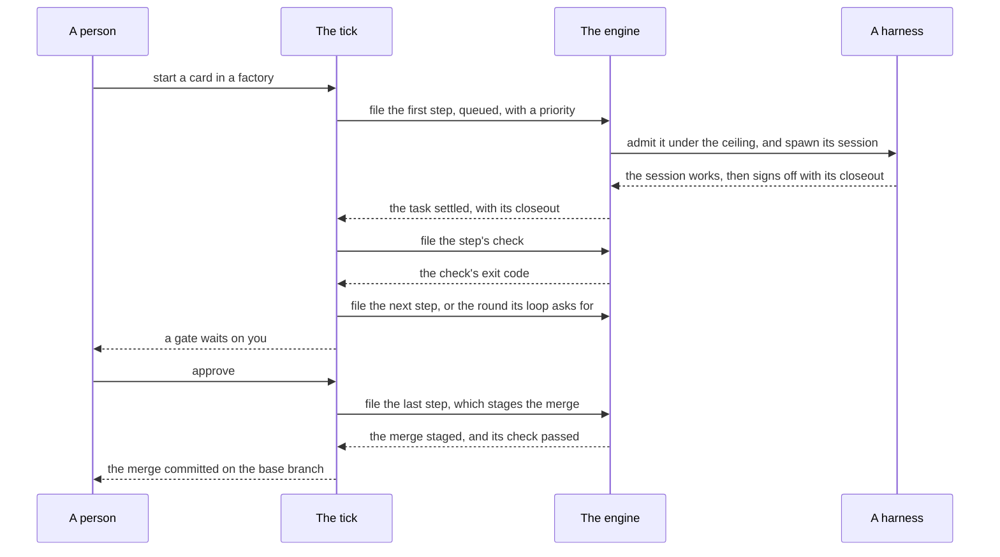

A run is one execution of a workflow for a card. This page follows a run from the moment it starts to the moment its work is merged,
and shows what moves it forward at each point. Two loops do this work, one in each package, and both work the same way.

## Two loops, both level-triggered

- **The tick** is the orchestrator's loop. On each pass, it reads every run's record and what the runtime reports about each task.
  It asks one pure function what should happen to the run now (`assess`, in `packages/agent-orchestrator/src/tick/assess.ts`), and
  does it: start a step, start a check, or end a run. Its pass is `tickRun` (`packages/agent-orchestrator/src/tick/tick.verb.ts`).
- **The engine** is the runtime's loop. On each pass, it reads each task's journal and what the harness reports about its session. It
  asks `decide` (`packages/agent-runtime/src/core/domain.ts`) for the one thing to do, and does it: admit, spawn, stop, or record an
  end.

Both loops run every few seconds in one process: the store's daemon. Each daemon pass runs the runtime's pass first, then the
orchestrator's, which judges every run on what the runtime just reported. There is one daemon per store
(`~/.agent-workflows/daemon.json`, `WF_ROOT`): the API's process, or `nemia up` on a machine without the board.

**Level-triggered** means each pass reads the whole world again and carries nothing over to the next pass. Nothing is remembered as
"I just did this": everything that happened is on disk, in a record or a journal, and is read again. So if you stop the daemon
mid-run and start it an hour later, it picks up exactly where things stand. A session that kept running while no daemon was ticking
is found and judged.

## From a card to a branch

1. **A card.** A short Markdown brief. It can wait in the inbox (`~/.agent-workflows/inbox/`) until someone starts it. Once started,
   the card stays and shows its run's phase. The inbox lists the cards still open. To see cards whose run has ended, use a
   filter (`nemia inbox --all`, or Closed on the Inbox page).
2. **The start.** `nemia start` in a [factory](/factories/) writes the run's record. The record freezes the workflow folder as it is
   now, every step's agent and hire, and the check commands. Nothing the run does later reads the folder again.
3. **The tick starts a step.** On its next pass, the tick finds a step whose `after` is satisfied. It submits that step's task to the
   runtime, queued, with the run's momentum as its priority. Only the tick writes the run's record.
4. **The engine runs it.** On its own pass, the engine admits the queued task when its pool has room and spawns its session on the
   harness. From then on, it compares the journal with the harness on every pass, until the session ends.
5. **The closeout and the check.** The session signs off with its [closeout](/workflows/#the-closeout). The tick sees the task
   settle, commits what the step left, and starts its check. The engine runs the check like any other task, and its exit code is the
   verdict.
6. **What comes next.** The tick asks `assess` again. The answer is the next step, a retry if the check failed, a new round if a
   reviewer asked for one, or nothing while a [gate](/workflows/#a-gate) waits for a person.
7. **The end.** When the last step has passed, the run ends with its branch. `nemia decide <run>` says where the branch stands and
   how to merge it. Merging it is up to the person or the workflow's own steps.

### A card a trigger starts

You don't have to start a card by hand. A factory's **card trigger** selects cards by their labels
(`nemia factory trigger <factory> <name> --labels <key>=<value> --to <workflow>`, or its template's `triggers`). Each matching card in
the factory that isn't already queued by hand or started gets queued. It goes to the workflow the card names, or to the trigger's
target if the card names none. It is ordered with the hand-queued cards by when it was created. Nothing is written on the card: each
pass reads it again, so removing its label takes it out of the queue.

If two triggers would send a card that names no workflow to two different workflows, the card **clashes**. It waits, and the inbox
and the factory's settings name the triggers, until a selector or the card's labels change.

A trigger spends quota only if its target can reach something that runs an agent: a session or a judge, in the target itself or in a
workflow that one of its workflow nodes starts a run of. A target that reaches only scripts, table or script conditions, and card nodes
costs nothing, however many cards the trigger queues. The factory's settings show which kind each trigger is, separately from what it
is queueing right now.

A routing workflow passes work on with a **workflow node** (`workflow: build`). The node starts a run of the workflow it names, right
away and without filing a card. The new run is handed the run that started it as context, and its brief is the title the node's
condition gave. With `brief: card`, its brief is the run's own card as it was given (its body, labels and files), along with the route
taken and the reason its condition gave. The run that started it never includes the new run's time or cost, and it ends as it does
today. A run page links the two.

A card follows its work from run to run: its runs, its state and the cards that wait on it all cover the run it started and every run
that run's nodes started. A card that waits on it is released only when the last of them succeeds. If a run went to the wrong
workflow, `nemia inbox resend <card>` sends the card on again from its latest run, and `nemia resend <run>` does the same for a run
that has no card behind it.

A **card node** can instead send the run's card back to the inbox, unqueued, with the label edits its `relabel:` lists
(`card: backlog`). The edits use kubectl's syntax: `key=value` sets a key, and `key-` removes one. A label key can have a prefix, as in
Kubernetes, such as sdlc/stage. sdlc's [front door](/sdlc/#its-workflows) is a routing workflow.

### A card that waits on others

A card can list the cards it **waits on** in its `after:`, by name and comma-separated, or when it is created, with one
`--after <card>` per card. Until all of them have succeeded, no trigger queues the card and the tick doesn't start it, even if it was
queued by hand. A listed card has succeeded when a run started from it has (as `nemia ls` says its status), when a person ran `nemia release`
on that run, or when the work of the card has: a run a workflow node started from it counts, and the last run of its work decides, as does the card its run passed the work on to or the card it was sent on as. When
the last one has succeeded, the next pass queues the card like any other, and its run starts from the base branch as it is then. So you can
put a whole chain in the sprint at once, each card waiting on the one before, and the factory runs them in order.

The inbox, the Card's `status.waitingOn`, and the board list a waiting card with each card it waits on, where that work stands now,
and that card's state. This is read on every pass, and nothing is written on the card. A wait that only a person can release is
**stalled**. That happens when a name is unknown to the store, when `after:` lines form a cycle, or when a card's run failed or was cancelled and was not released, or its start was refused. The inbox line says so and gives the fix, and the feed says so once when the stall begins and once
when it clears. To fix it, send the card on, change this card's `after:`, release the run with `nemia release`, or start this card by hand. You can still start a waiting card
by hand: the wait doesn't block it, and the start lists the cards that have not succeeded yet.

## Who writes what

Each file has exactly one writer, so the two loops never conflict:

- **The run's record** is written only by the tick.
- **A task's journal** is written only by the runtime.
- **A person's actions**, such as a cancel or an answer, go in their own files, read alongside the record.
- **The feed**, the log of everything that happened, is written by the daemon and followed by the board and by [Nemia](/nemia/).

## Sources

This page is based on `packages/agent-orchestrator/README.md` (_Following it_, _One daemon per store_, _Deciding what lands_) and
`packages/agent-runtime/README.md` (_The model_, _`tick` and `up`, and why both_), and on
`packages/agent-orchestrator/src/tick/assess.ts`, `packages/agent-orchestrator/src/tick/tick.verb.ts`, and
`packages/agent-runtime/src/core/domain.ts`.
