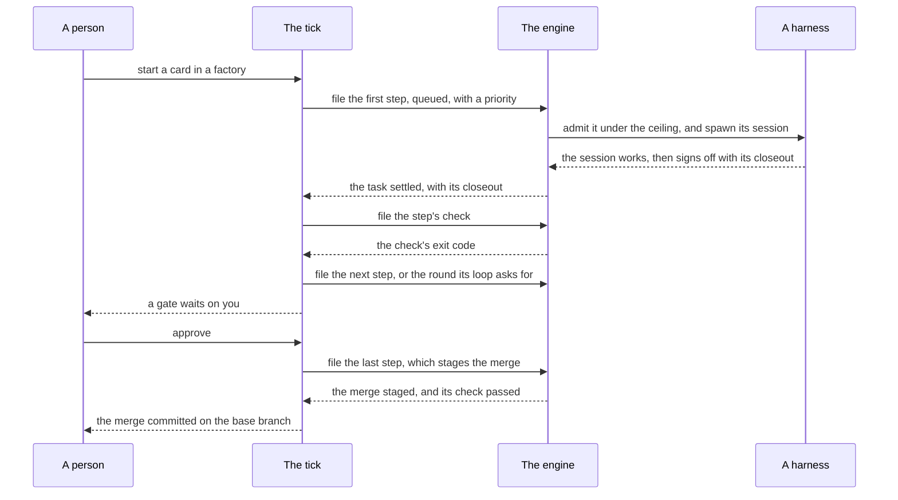

A run is one go of a workflow on a card. This page follows one from the moment it is started to the moment its work is merged, and
shows who moves it at each point. Two loops do the moving, one in each package, and both work the same way.

## Two loops, both level-triggered

- **The tick** is the orchestrator's loop. On each pass it reads every run's record and what the runtime says of each task, asks one
  pure function what should happen to the run now (`assess`, in `packages/agent-orchestrator/src/tick/assess.ts`), and does it: files
  a step, files a check, commits a landing. Its pass is `tickRun` (`packages/agent-orchestrator/src/tick/tick.verb.ts`).
- **The engine** is the runtime's loop. On each pass it reads each task's journal and what the harness says of its session, asks
  `decide` (`packages/agent-runtime/src/core/domain.ts`) for the one thing to do, and does it: admits, spawns, stops, records an end.

Both loops run in one process, the store's daemon, every few seconds: a pass of the daemon is the runtime's pass first, then the
orchestrator's, judging every run on what the runtime just reported. There is one daemon per store
(`~/.agent-workflows/daemon.json`, `WF_ROOT`): the api's process, or `nemia up` on a machine with no board.

**Level-triggered** means each pass reads the whole world again and carries nothing to the next pass. Nothing is remembered as "I just
did this": what was done is on disk, in a record or a journal, and is read again. So a daemon stopped mid-run and started again an
hour later picks up exactly where things stand, and a session that ran on while no daemon ticked is found and judged.

## From a card to a landing

1. **A card.** A short markdown brief, which may wait in the inbox (`~/.agent-workflows/inbox/`) until someone starts it.
2. **The start.** `nemia start` in a [factory](/factories/) writes the run's record: the workflow folder as it is now, every step's
   agent and hire, the check commands, all frozen on the record. Nothing the run does later reads the folder again.
3. **The tick files a step.** On its next pass, the tick finds a step whose `after` is satisfied and files its task with the runtime,
   queued, with the run's momentum as its priority. The tick writes the run's record; nothing else does.
4. **The engine runs it.** On its own pass, the engine admits the queued task when its pool has room, spawns its session on the
   harness, and from then on compares the journal with the harness on every pass, until the session ends.
5. **The closeout and the check.** The session signs off with its [closeout](/workflows/#the-closeout). The tick sees the task settle,
   commits what the step left, and files its check, which the engine runs like any other task. Its exit code is the verdict.
6. **What comes next.** The tick asks `assess` again: the next step, a try again if the check refused, a round if a reviewer asked for
   one, or nothing, while a [gate](/workflows/#a-gate) waits for a person.
7. **The landing.** The last step stages the merge of the run's branch onto the base, and signs off. The tick files the check on the
   merged tree, then commits the merge on exit 0, or aborts it on anything else (`landEnding`, in
   `packages/agent-orchestrator/src/ending/ending.verb.ts`).

## Who writes what

Each file has one writer, so two loops never fight over it:

- **The run's record** is written by the tick alone.
- **A task's journal** is written by the runtime alone.
- **A person's facts**, such as a cancel or an answer, go in files of their own, read beside the record.
- **The feed**, the line of everything that happened, is written by the daemon and followed by the board and by
  [Nemia](/nemia/).

## Sources

This page is written from `packages/agent-orchestrator/README.md` (_Following it_, _One daemon per store_, _Deciding what ships_) and
`packages/agent-runtime/README.md` (_The model_, _`tick` and `up`, and why both_), and from
`packages/agent-orchestrator/src/tick/assess.ts`, `packages/agent-orchestrator/src/tick/tick.verb.ts` and
`packages/agent-runtime/src/core/domain.ts`.
