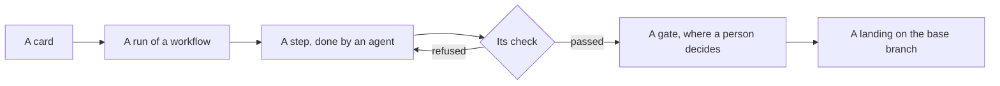

Nemia runs teams of agents. You give it a piece of work, written as a card. A team of agents does the work in steps, and a person
decides where it matters. What comes out is a landing: the work merged on your base branch, after a check has passed on the merged
tree.

## A card in, a landing out

A card goes through these stages:

1. **A card.** It is a short markdown brief that says what is wanted. It may wait in the inbox until someone starts it.
2. **A run.** Starting a card makes a run of one workflow. A workflow is a folder of markdown files, and each file is one step
   (`packages/agent-orchestrator/README.md`, _The format_).
3. **The steps.** Each step is done by an agent: a session on a harness, such as Claude Code or Codex, with its own instructions,
   tools and fence, and the skills it is given: folders of instructions and files for one kind of work. A step signs off with a
   closeout: its outcome, its summary, and the fields its workflow asks of it. Steps run in order, and a step whose work can be
   judged has a check. The check is a command the run executes after the step signs off. Its exit code decides whether the run goes
   on; the agent's own word does not. Where a reviewing step asks for more, the steps of its loop run again: another round.
4. **Gates.** Where a step has a gate, nothing after it starts until a person approves.
5. **A landing.** The last step of a run stages the merge of the run's branch on the base. The run checks the merged tree, then
   commits it if the check passes, or aborts the merge if it fails (`landingDue`).

## Who decides what

- **Agents** do the work, one step each. An agent never decides whether its own work is good.
- **A check** decides with its exit code. A check that did not finish is not a refusal; it is run again.
- **A person** decides at a gate, and decides what lands.
- **Nemia** is also the store's own agent. She can operate the factories a person has raised above `manual`, within the level the person
  set.

## Where things live

Nemia is four parts in layers: the runtime, the orchestrator, the api and the board. Each part owns one thing, and each reaches only
the part below it. [The map](/map/) shows each part, what it owns, and how the parts talk to each other.

Each part and idea then has a page of its own: [the runtime](/runtime/) and [A2A](/a2a/), [workflows](/workflows/),
[agents](/agents/) and [factories](/factories/), [how a run lives](/how-a-run-lives/), and [Nemia](/nemia/), the store's own agent.
The [glossary](/glossary/) gives each term one line, and [Getting started](/getting-started/) the commands to try it.

## Sources

This page is written from the code's own documents: `README.md`, `docs/architecture.md`,
`packages/agent-orchestrator/README.md` and `packages/agent-runtime/README.md`.
