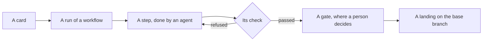

Nemia runs teams of agents. You describe a piece of work on a card. A team of agents does it in steps, and you decide at the points
that matter. The result is a landing: the work is merged into your base branch once a check passes on the merged code.

## A card in, a landing out

Every piece of work goes through these stages:

1. **A card.** A short Markdown brief that describes what you want. It can wait in the inbox until someone starts it.
2. **A run.** Starting a card creates a run of one workflow. A workflow is a folder of Markdown files, and each file is one step
   (`packages/agent-orchestrator/README.md`, _The format_).
3. **The steps.** An agent does each step. An agent is a session on a harness, such as Claude Code or Codex. It has its own
   instructions, tools, and fence, plus the skills you give it (folders of instructions and files for one kind of work). When a step
   finishes, it signs off with a closeout: its outcome, a summary, and any fields its workflow asks for. Steps
   run in order. A step whose work can be judged has a check: a command the run executes after the step signs off. The check's
   exit code decides whether the run continues, not the agent. When a review step asks for changes, the steps of its loop run again.
   Each pass is a round.
4. **Gates.** When a step has a gate, nothing after it starts until a person approves.
5. **A landing.** The last step of a run stages a merge of the run's branch into the base branch. The run checks the merged code. If
   the check passes, the merge is committed. If it fails, the merge is aborted (`landingDue`).

## Who decides what

- **Agents** do the work, one step each. An agent never judges its own work.
- **A check** decides with its exit code. If a check doesn't finish, that isn't a failure: it runs again.
- **A person** decides at a gate, and decides what lands.
- **Nemia** is also the name of the store's built-in agent. She can operate any factory you have raised above `manual`, within the level you set.

## How it fits together

Nemia has four parts, stacked in layers: the runtime, the orchestrator, the API, and the board. Each part owns one thing and talks
only to the part below it. [The map](/map/) shows each part, what it owns, and how the parts connect.

Each part and idea has its own page: [the runtime](/runtime/) and [A2A](/a2a/), [workflows](/workflows/), [agents](/agents/) and
[factories](/factories/), [how a run lives](/how-a-run-lives/), and [Nemia](/nemia/) herself. The [glossary](/glossary/) defines
each term in one line. [Getting started](/getting-started/) takes you from the install line to your first landed change.

## Sources

This page is based on `README.md`, `docs/architecture.md`, `packages/agent-orchestrator/README.md`, and
`packages/agent-runtime/README.md`.
