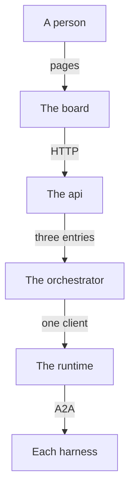

Nemia has four parts, in layers. Each part owns one thing and is reached through a short list of entries, its public contract. Each
part reaches only the part below it: nothing reaches up, and nothing skips a layer. Each of these borders is held by a test that
fails the suite when the border is crossed (`docs/architecture.md`).

## Who talks to whom

- A person uses the board, or the `nemia` command, which is the orchestrator's own face.
- The board reaches the api over HTTP, and nothing else (`apps/web/test/structure.test.ts`).
- The api reaches the orchestrator through its three public entries alone: `agent-orchestrator`, `agent-orchestrator/run` and
  `agent-orchestrator/workflow` (`packages/agent-orchestrator/test/contract.test.ts`).
- The orchestrator reaches the runtime's behaviour through one client, `packages/agent-orchestrator/src/runtime-client.ts`, and its
  words through a pure door, `agent-runtime/vocabulary` (`packages/agent-orchestrator/test/boundary.test.ts`).
- The runtime reaches every harness over A2A. Claude Code, Codex and a plain command are each an A2A agent the runtime runs, reached
  in its own process (`packages/agent-runtime/src/a2a/client.ts`); a remote agent is reached over the network, at its address
  (`packages/agent-runtime/src/a2a/remote.ts`).

The packages speak Effect, and the api is the system's public interface: whatever is not a package's own code reaches Nemia through
the api's routes.

## The runtime

`packages/agent-runtime`, and its command `ae`.

**It owns** agent sessions on a harness, run durably. A session is either a job that runs to its end, or a long-lived session that
runs until it is stopped (`restartPolicy`). The runtime owns how a session runs: its command, its mounts, its restarts and its spend,
the journal of each task, the attempts, and admitting queued tasks under a ceiling. Its whole judgement is one pure function, `decide`,
in `packages/agent-runtime/src/core/domain.ts`.

**It never touches** a second workload. Anything that knows about two sessions, such as "implement, then review", belongs to the layer
above. No workflow word (a workflow, a step, a gate, a factory, a closeout, Nemia) appears in its source (`WORKFLOW_WORDS` in
`packages/agent-orchestrator/test/words.test.ts`).

**It is reached through** its two entries: `agent-runtime` (`packages/agent-runtime/src/index.ts`), and `agent-runtime/vocabulary`
(`packages/agent-runtime/src/vocabulary.ts`), the harnesses' words with no input or output. Neither exports `decide`.

**It talks to the harnesses over A2A.** A2A is the runtime's one interface to every harness: Claude Code, Codex, a plain command, or a
remote agent at an address. A session is an A2A Task, starting one is a message, and stopping one is a cancel. Only
`packages/agent-runtime/src/a2a/` imports the A2A library (`packages/agent-runtime/test/a2a-boundary.test.ts`).

A task's whole life, from queued to an end, is a statechart drawn from its code: see [the lifecycle of a task](/runtime/#the-lifecycle-of-a-task)
on the runtime's page, and [A2A](/a2a/) for how it reaches each harness.

## The orchestrator

`packages/agent-orchestrator`, and its command `nemia` (`wf` is its old name, kept as an alias).

**It owns** what a session means. It reads a folder of markdown as a workflow, and runs it: which task to file next, what a person
must decide, and what the run's record says. Run slots, worktrees and landing, what a check means, budgets across tries, gates, the
inbox, factories, levels, stats and agent definitions are all its own. Its judgement is one pure function too, `assess`, in
`packages/agent-orchestrator/src/tick/assess.ts`; the daemon ticks, reads the world, asks `assess`, and acts.

**It never touches** whether the work is good: that is decided in a step, by an agent or a check. It imports no harness library, and it
reaches git only through its place skill (`packages/agent-orchestrator/test/git-calls.test.ts`).

**It is reached through** its three entries: `agent-orchestrator` (`packages/agent-orchestrator/src/runner.ts`), the controllers and
the refusals by kind; `agent-orchestrator/run` (`packages/agent-orchestrator/src/run.ts`), `assess` and the words a run is described
in; and `agent-orchestrator/workflow` (`packages/agent-orchestrator/src/workflow.ts`), the format, pure.

**Inside it,** every file is one of four kinds: pure, store, controller, or the client (`packages/agent-orchestrator/test/boundary.test.ts`).

How a run moves through it, pass by pass, is [How a run lives](/how-a-run-lives/); what a workflow, an agent and a factory are is on
their own pages: [Workflows](/workflows/), [Agents](/agents/), [Factories](/factories/).

**Nemia, the store's own agent,** is a long-lived session that the daemon's keeper files while any factory is above `manual`, and
stops once none is. Her levels, her machine and what she may do are on [her page](/nemia/).

## The api

`apps/api`.

**It owns** the workflows behind HTTP: its routes, and the feed as a stream, read through the orchestrator's live reader
(`followFeed`). Its process is the store's daemon, unless it is started to tick nothing (`apps/api/src/main.ts`).

**It never touches** the runtime: its source imports the orchestrator's three entries alone, and no runtime or harness library
(`packages/agent-orchestrator/test/imports.boundary.test.ts`).

**It is reached through** its routes. It is the system's public interface. A refusal from the orchestrator comes back with one status
per kind (`REFUSAL_STATUS` in `apps/api/src/app.ts`).

## The board

`apps/web`, the pages people look at.

**It owns** what a person sees and clicks: the runs, their steps, the gates waiting, the factories and the library.

**It never touches** a package. It imports none of them, names no store folder, and builds no command of its own: a command or a
folder it shows is text the api answered (`STORE_PATHS` and `COMMAND_TEXT` in `apps/web/test/structure.test.ts`). It decodes each
answer it reads with a schema of its own.

**It is reached through** its pages.

## Sources

This page is written from `docs/architecture.md`, `README.md`, `packages/agent-runtime/README.md` and
`packages/agent-orchestrator/README.md`.
