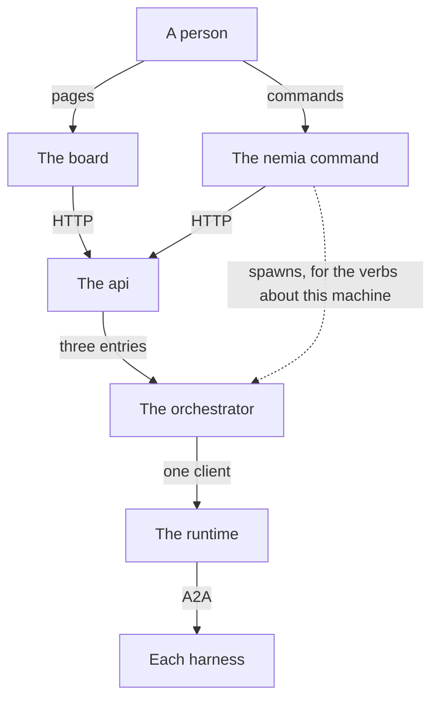

Nemia has four parts, stacked in layers. Each part owns one thing, and other code reaches it only through a short list of entry
points: its public contract. Each part talks only to the part directly below it. Nothing reaches up, and nothing skips a layer. A
test guards each of these boundaries and fails the suite if one is crossed (`docs/architecture.md`).

## Who talks to whom

- You use the board, or the `nemia` command (`apps/cli`) next to it. The order is `web, cli → api → orchestrator → runtime`.
- The board talks only to the API, over HTTP (`apps/web/test/structure.test.ts`).
- The `nemia` command asks the API over HTTP for every command about a store. For commands about the machine you type them on (its
  service, its releases, a template's folder), it spawns the orchestrator's own command. It imports none of Nemia's packages, and
  from the API only the shapes of its responses (`apps/cli/test/structure.test.ts`).
- The API reaches the orchestrator only through its three public entry points: `agent-orchestrator`, `agent-orchestrator/run`, and
  `agent-orchestrator/workflow` (`packages/agent-orchestrator/test/contract.test.ts`).
- The orchestrator reaches the runtime's behavior through one client, `packages/agent-orchestrator/src/runtime-client.ts`, and its
  vocabulary through a pure entry point, `agent-runtime/vocabulary` (`packages/agent-orchestrator/test/boundary.test.ts`).
- The runtime reaches every harness over A2A. Claude Code, Codex, and a plain command are each an A2A agent that the runtime runs in
  its own process (`packages/agent-runtime/src/a2a/client.ts`). A remote agent is reached over the network, at its address
  (`packages/agent-runtime/src/a2a/remote.ts`).

The packages are written with Effect. The API is the system's public interface: anything outside a package's own code reaches Nemia
through the API's routes.

## The runtime

`packages/agent-runtime`, with its command `ae`.

**It owns** agent sessions on a harness, and runs them durably. A session is either a job that runs to completion, or a long-lived
session that runs until it is stopped (`restartPolicy`). The runtime owns how a session runs: its command, its mounts, its restarts,
and its spending. It also owns each task's journal, the attempts, and admitting queued tasks under a limit. All of its decisions come
from one pure function, `decide`, in `packages/agent-runtime/src/core/domain.ts`.

**It never touches** a second workload. Anything that knows about two sessions, such as "implement, then review", belongs to the
layer above. No workflow term (a workflow, a step, a gate, a factory, a closeout, Nemia) appears in its source (`WORKFLOW_WORDS` in
`packages/agent-orchestrator/test/words.test.ts`).

**Its entry points** are two: `agent-runtime` (`packages/agent-runtime/src/index.ts`), and `agent-runtime/vocabulary`
(`packages/agent-runtime/src/vocabulary.ts`), the harnesses' vocabulary, with no input or output. Neither exports `decide`.

**It talks to the harnesses over A2A.** A2A is the runtime's only interface to every harness: Claude Code, Codex, a plain command, or
a remote agent at an address. A session is an A2A Task. Starting one sends a message, and stopping one sends a cancel. Only
`packages/agent-runtime/src/a2a/` imports the A2A library (`packages/agent-runtime/test/a2a-boundary.test.ts`).

A task's whole life, from queued to finished, is a statechart drawn from its code. See [the lifecycle of a task](/runtime/#the-lifecycle-of-a-task)
on the runtime's page, and [A2A](/a2a/) for how the runtime reaches each harness.

## The orchestrator

`packages/agent-orchestrator`, with its command `nemia` (`wf` is its old name, kept as an alias).

**It owns** what a session means. It reads a folder of Markdown as a workflow and runs it: which task to start next, what a person
must decide, and what the run's record says. It also owns run slots, worktrees, where a run's branch stands, what a check means, budgets across tries,
gates, the inbox, factories, levels, stats, and agent definitions. Its decisions also come from one pure function, `assess`, in
`packages/agent-orchestrator/src/tick/assess.ts`. The daemon ticks: it reads the world, asks `assess`, and acts.

**It never touches** whether the work is good: a step decides that, through an agent or a check. It imports no harness library, and
it reaches git only through its place skill (`packages/agent-orchestrator/test/git-calls.test.ts`).

**Its entry points** are three: `agent-orchestrator` (`packages/agent-orchestrator/src/runner.ts`), with the controllers and the
refusals by kind; `agent-orchestrator/run` (`packages/agent-orchestrator/src/run.ts`), with `assess` and the terms that describe a
run; and `agent-orchestrator/workflow` (`packages/agent-orchestrator/src/workflow.ts`), the workflow format, pure.

**Inside it,** every file is one of four kinds: pure, store, controller, or the client (`packages/agent-orchestrator/test/boundary.test.ts`).

[How a run lives](/how-a-run-lives/) shows how a run moves through it, pass by pass. Workflows, agents, and factories each have their
own page: [Workflows](/workflows/), [Agents](/agents/), [Factories](/factories/).

**Nemia, the store's built-in agent,** is a long-lived session. The daemon's keeper starts her while any factory is above `manual`,
and stops her once none is. Her levels, her state machine, and what she may do are on [her page](/nemia/).

## The API

`apps/api`.

**It owns** the workflows behind HTTP: its routes, and the feed as a stream, read through the orchestrator's live reader
(`followFeed`). Its process is the store's daemon, unless it is started not to tick (`apps/api/src/main.ts`).

**It never touches** the runtime. Its source imports only the orchestrator's three entry points, and no runtime or harness library
(`packages/agent-orchestrator/test/imports.boundary.test.ts`).

**Its entry points** are its routes. It is the system's public interface. A refusal from the orchestrator comes back with one HTTP
status per kind (`refusedAs` in `apps/api/src/objects/refused.ts`).

## The board

`apps/web`, the pages people use.

**It owns** what you see and click: the runs, their steps, the gates waiting for you, the factories, and the library.

**It never touches** a package. It imports none of them, names no store folder, and builds no command of its own: any command or
folder it shows is text the API returned (`STORE_PATHS` and `COMMAND_TEXT` in `apps/web/test/structure.test.ts`). It decodes each
response with a schema of its own.

**Its entry points** are its pages.

## Sources

This page is based on `docs/architecture.md`, `README.md`, `packages/agent-runtime/README.md`, and
`packages/agent-orchestrator/README.md`.
