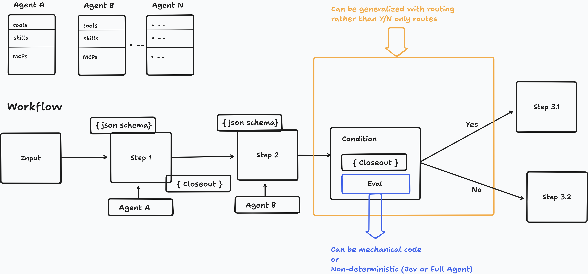
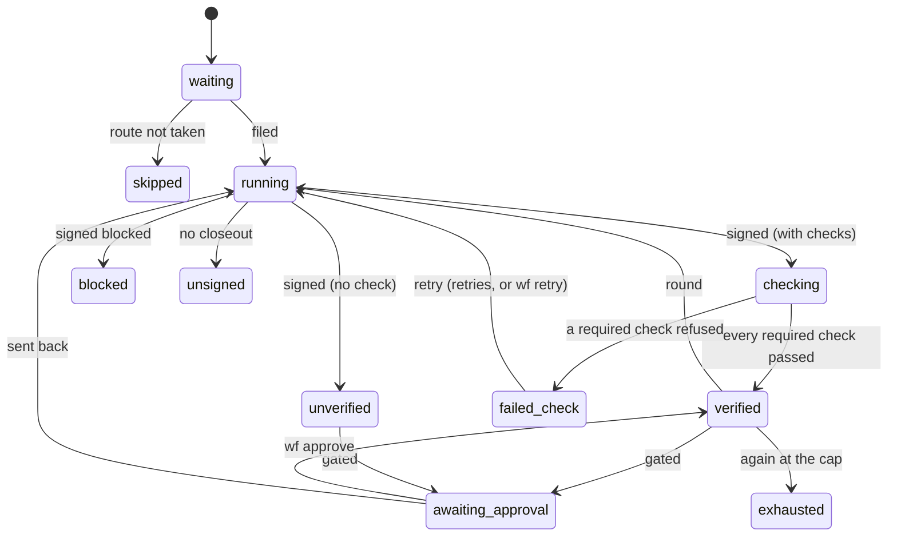
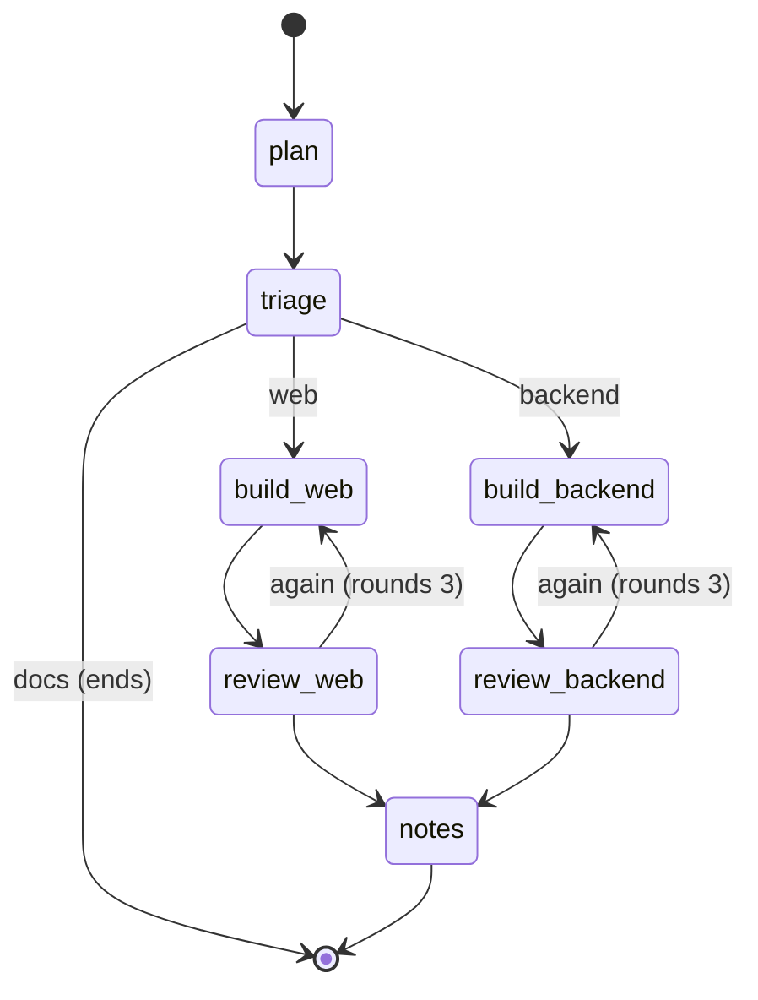

# Design, 2026-09-29: Routing — conditions between steps, gates and checks as properties, the inbox routed to a team

A design note for the owner to approve. It changes no code. It rests on the owner's drawing and words of 2026-09-29 and on the source as it
is at `0cd51c2a`. It names functions rather than line numbers, because feature-folder slices 5 to 7 are about to move `verbs.ts`,
`tick.ts` and `cli.ts`. It builds on `docs/design-2026-09-29-git-out.md` (contracts, decoding, scripts), on
`docs/design-2026-09-28-feature-folders.md` (where files go), on `docs/eval-2026-09-25-composable-workflows/REPORT.md` (teams, results,
sends) and on `docs/pivot-2026-09-18.md` §2 (Jev, and the dispatcher measured).



## What the owner asked

The drawing shows agents A, B … N, each with its tools, skills and MCP servers, unified behind A2A. It also shows a workflow: an
**input**, then **Step 1** (agent A, a JSON schema, a closeout), then **Step 2** (agent B, its schema), then a **Condition** holding a
closeout and an **Eval**, which routes *Yes* to Step 3.1 and *No* to Step 3.2. Two notes sit on it: the condition "can be generalized
with routing rather than Y/N only routes", and the eval "can be mechanical code or non-deterministic (Jev or full agent)".

The owner's words, 2026-09-29:

- The input "is basically our inbox right now but … it could also come from an integration, let's say my email."
- "A condition should be like a step as well." Its eval "could be a predicate provided by the author of the workflow … or it could be
  non-deterministic, where it is a script calling a Jev API or a full agent that is part of the team and decides, based on the closeout,
  where it should be routed."
- "I don't see a gate as a condition. I see a gate as a property … sometimes there is *input required* on a node, and that's how I see a
  gate." They meant to draw it as a square around a step.
- "I think check should work like GitHub Actions checks. There should be several commands or non-deterministic stuff that the user can
  run or provide. … When we go to GitHub, we probably won't have check anymore … I don't know if check should be a condition. Maybe you
  tell me."
- "There will need to be a supervisor or a long-running session that is routing input to the appropriate workflow. … it would be nice if I
  can just drop something in the inbox and the system just knows what the right team is."
- "I think it would be interesting to have it as a state machine as well", as the runtime's lifecycle is.

Two rules bind every answer below:

- **A tick carries nothing between passes.** Every route is a fact on disk that the pass reads again, never something it remembers.
- **No model is called in a tick or in `wf decide`.** The 2026-09-18 Jev evaluation concluded that a judgement fits only as a task filed
  from the pass, like a check, whose answer is journalled once and read back. Jev is "not deterministic, but consistent. An answer must be
  asked once and recorded." The same evaluation measured a dispatcher on the owner's 75 runs. The web question held (P 0.83, R 1.00). The
  plan question did not: at 0.8 / 0.2 it would have parked 46 of 75 cards.

## In one paragraph

A **condition** is a step whose work is to answer one name from a closed list of **routes** its file declares (`routes: web, backend`). A
step after it says which route it takes (`when: web`). The steps on the routes not taken read **`skipped`**, which is the one new step
word. A join runs when at least one parent satisfied it and every other parent is skipped. The answer always comes from a fact written
once per try:

- a field of a signed closeout, which covers both an author's predicate and a full agent's answer;
- or the output of a script filed as the condition's own task on the check harness, whose log the engine keeps. That includes a script
  that calls Jev.

Any answer that does not decode is never a route. The condition stops, as `blocked` does, until a person names the route (`wf route`) or
asks again (`wf retry`).

**Gates** stay a property of a step: A2A's *input required*, drawn as a frame around the node. **Checks** become several named checks per
step, and each verdict becomes a fact a condition may route on. Today's four rules keep what they mean: `check:` is one named check, a
`loop:` is a condition with a way back, and `gate:` and `blocked` stay as they are. The **inbox** gets the same condition one level up.
Its routes are the team folders, and a person confirms each answer until measured agreement earns the dispatcher more. **Two machines**
print themselves: a step's lifecycle, and each workflow's graph of steps and routes, which the board lights with a run's path.

## Today's four rules, as the code runs them

The run routes on four fixed rules. Each is written into the pure pass (`status/status.ts`, `tick/assess.ts`), not into the folder.

| rule | the ways out | where the code decides |
|---|---|---|
| `check:` / `retries:` | exit 0: `verified`. A number other than 0: `failed (check)`, and `retries:` re-files the step (`retriesDue`). No number: the check did not finish, no try is spent, and a person runs `wf retry --recheck` | `ownStatus` reads the check task's phase. `refusedCheck` (`record/record.ts`) tells a refusal from a check that did not finish. `readVerdict` (`check/check.ts`) reads the `[wf check] exit N` trailer off the task's log. `retries:` is declared in `step/step.ts`, and the tries it covers are counted and filed by `retriesDue` (`retry/retry.ts`) |
| `loop:` / `again` / `rounds:` | `again: false`: onward. `again: true` below the cap: a round (the target continued, then each step between, then the looping step). `again: true` at the cap: `exhausted`, and a person runs `wf round` or `wf accept` | `askedAgain` (one reader, for five uses), `capOf` (`DEFAULT_ROUNDS = 3`), `roundIn`, `roundsDue`. `ownStatus` makes a non-boolean `again` `unsigned`. At load, `loopSpan` and `validateLoops` (`workflow/validate.ts`) apply: a loop is a chain, one loop per step, no remote target, no `resume:` inside, and no `replies` field on the target |
| `gate:` | `wf approve`: onward. `wf retry --message`: sent back to the step itself, or to its `after` if it was never filed (`sendBackTo`) | `hasGate`, `atGate` (a gated step signed off, with no approval for the try it is on), `approvedFirst` and `waitsAtGate` (an ending in the checkout, approved before it is filed). Approvals are a person's files, `approve-<step>-<try>` in the run's asks folder (`approvalFile`) |
| `blocked` | none: a stop, to a person | `ownStatus` reads the closeout's `outcome` first. `stopsFollowers` makes it final. `assess` names the run `failed` and adds `stoppedOn: 'blocked'` |

Two corrections to the brief's reading. First, the check is three-way, not two-way: *did not finish* is a third outcome, and it is a
person's. Second, a step with no check signs off `unverified`, not `verified`. Both words satisfy `after` (`satisfiesAfter`), and five
other words stop followers besides `blocked`: `unsigned`, `denied`, `over budget`, `budget exhausted`, `exhausted`. None of those is a
route either. They are the machinery's stops, and they stay.

The package README says "**No key is control flow.** No conditions, no expressions, no templating", because "a judgement belongs to a step
with an agent in it", and it calls the loop "an agent's word the run routes on, and a count, with no condition and no expression". This
design **keeps that rule and widens its one exception**:

- A route is a name from a closed list the folder declares. It is not a value an expression computes.
- The answer is a fact: a closeout field, or a task's journalled output.
- The tick never evaluates anything. It reads which name was said, as it reads `again` today.

`again` was already a condition with two routes. This names it one.

## 1. A condition step

### Its file

```md
<!-- triage.md -->
after: plan
input: plan
routes: web, backend, docs
route: from plan.surface
---
Which team's build the plan goes to: the plan names the surface it changes.
```

- **`routes:`** is the closed list of names, at least two, each a word (`[a-z][a-z0-9-]*`).
- **`route:`** says how the list is answered: one of the four kinds in §2.
- **`input:`** names the closeouts it reads, as `input:` works today: each producer is in `after` and declares `output:`.
- **No workspace of its own.** A condition cuts no worktree and commits nothing. It runs where its first parent worked, and a follower
  takes its workspace as if it followed that parent directly. Load refuses `workspace:`, `check:`, `retries:`, `resume:` and `budget:` on
  a condition, apart from `budget:` on the agent kind. Only the agent kind has a session to spend on.
- **Its body** is what the step is for, as every step's is. For the agent kind, the body is also what the agent is told.

A step after it names the route it takes:

```md
<!-- build-web.md -->
after: triage
when: web
---
```

- **`when: <route>`**, or `when: web, docs`, sits beside `after: <condition>`. A step with `when:` waits on exactly one condition. A step
  after a condition with no `when:` runs on every route, as a step after any other step does.
- `when:` was chosen over `on:`: GitHub Actions uses `on:` for a workflow's trigger, and the owner reads these files with GitHub in mind.

### A route not taken: `skipped`

`skipped` is the one new `StepStatus`. A step reads `skipped` when it was never filed and either:

- its `when:` does not include the route its condition answered on the try the condition is on; or
- every step in its `after` is skipped.

It is worked out on every pass from the conditions' answers, by a pure `skippedBy(steps, run, routeOf)` beside `stepStatus`. It spreads
down the graph and carries nothing between passes.

**Once a follower is filed, the route is settled for the run.** A condition gets a new answer only while none of the steps after it has
been filed, on any route. That is the rule `retryable` (`retry/retry.ts`) already keeps for a try of a satisfied step: it is offered only
while `noneFiled`. So `wf route`, and `wf retry` of a condition, are refused once a follower is filed:
`triage: build-web was filed on route web, so the run has taken it. Cancel the run and start it again to take another route.` A new
answer can therefore un-skip only steps that were never filed, and no branch that ran is left beside one that a new route takes. A round
never files a condition again, because load keeps conditions out of a loop's span (below).

What the other rules make of it:

- **Neither `satisfiesAfter` nor `stopsFollowers`.** A step after a skipped one waits for its other parents.
- **A join runs** when every parent is satisfied or skipped and at least one is satisfied (`assess`'s ready loop). When every parent is
  skipped, it is skipped too.
- **A fan-in's workspace** merges only the parents that ran. When one parent ran, the join forks from it. `workspaceFor` gets the ran list
  rather than `after`.
- **The run succeeds** when every step is satisfied or skipped and at least one step ran. `assess`'s `overall` changes by that one clause.
- **`wf ls`, `wf decide` and the board** say `skipped (triage: docs)`, naming the condition and the route it took. The board dims the
  node.

A new status has a known cost (`packages/agent-orchestrator/CLAUDE.md`):

- `stepState` and `wordState` in the web's `lib/status.ts` (until they know it, it reads `working`);
- `stepGraph`, the web's `offersOf`, the package's `listing` and `phaseOfView`;
- a refresh of `test/fixtures/git-runs-before.json`, with its diff read.

A new step key costs `KINDS`, `WorkflowStepSpec`/`specOf` and the web mirror with `UNSET`. This design adds `routes:`, `route:`, `when:`,
`checks:` and `ends:`.

### What load refuses

Each refusal is a `WorkflowError` in the voice `validateLoops` already uses: the step, the line, why it cannot run, and the fix.

- `build-web: \`when: mobile\`, and triage's routes are web, backend and docs: name one of them, or add mobile to triage's \`routes:\`.`
- `build-web: \`when: web\`, and build-web waits on no condition: add the condition to \`after:\`, or delete the line.` The same fix is
  offered when the step waits on two conditions: "name the one whose route it takes".
- `triage: \`routes:\` names docs, and no step says \`when: docs\`: add a step for it, or say \`ends: docs\` to end the run there.` A route
  nobody takes is refused unless `ends:` names it. A run that ends on an `ends:` route succeeds.
- `triage: \`route: from plan.surface\`, and plan's output schema gives surface as web, backend, mobile: the enum must be triage's routes
  exactly.` This check runs on the field kind, at load, where the schema is frozen with the step.
- A route may never go back. An edge back to an earlier step is a `loop:` and nothing else, and every loop is capped (`rounds:`, or
  `DEFAULT_ROUNDS`). So "a route back with no cap" cannot be written. `validateLoops` stays the one place a back edge is judged, and C10
  (§9) points a condition's `loop:` through it.
- **A loop does not cross a condition.** A round files its whole span again (`loopSpan`), and a condition in it would be asked again
  after its followers were filed, which the rule above refuses. So a loop's span holds no condition but the looping step itself, and no
  step with `when:` but its target: `review: \`loop: plan\`, and triage, a condition, is between plan and review: a round would ask it
  again after its routes were taken. Only the step that says \`loop:\` may be a condition. Loop back to a step after triage, on one
  route.` The looping step is excepted because it is never asked again after a follower is filed. When it answers the route its `loop:`
  takes (C10's `again`), a round is filed and none of its followers is. When it answers another route, its followers are filed and no
  round is due. The route `loop:` takes counts as taken for the rule that every route has a taker. A loop may run on one route: its target
  says `when:`, and the looping step follows it. On another route both are `skipped`, and a skipped step says no `again`, so no round is
  due. A loop across a join is already refused, because a loop's steps are a chain (`validateLoops`).
- A condition that no route of another condition can reach is still reachable through `after`. An unreachable step can only arise from a
  `when:` that names no declared route, and that is refused above.

## 2. The eval kinds, one contract

Every kind answers the same thing:

```ts
type RouteAnswer = { route: string; why?: string; evidence?: unknown } | { unsure: string; evidence?: unknown };
```

- The answer is decoded strictly by an Effect Schema struct in a `*.store.ts`, since `boundary.test.ts` refuses Effect in a pure file.
- `route` must be one of the condition's `routes`. Unknown fields are ignored, as in the git-out contracts.
- `unsure` is an answer. As the pivot's dispatcher lesson says, "a split that flips between askings is a card the person should see".
- The request, for the kinds that are handed one, is `{ v: 1, routes, closeouts: { <producer>: <its declared output> } }`: the fields each
  producer's `output:` declares, as a step reading them through `input:` is given them today.

| kind | written | where it runs | the fact read back | a restart |
|---|---|---|---|---|
| **field**: the author's predicate as a schema | `route: from plan.surface` | nowhere. The pure pass reads a field of a signed closeout | the producer's closeout, immutable for its try | reads the same closeout |
| **script**: the author's predicate as code | `route: script routes/surface.ts` | the condition's own task (`stepTaskId`), on the check harness: `node <frozen script>` | the last line of the task's stdout, in the log the engine keeps. The tick writes it onto the step's record once per try (`StepRecord.route`), as it writes `landed` | adopts the task by its derived id, and reads its log or the record |
| **Jev**: a script that calls Jev | `route: script routes/jev-surface.ts` | as the script kind | as the script kind. `evidence` carries the pinned model, the question, a hash of the state and the probabilities | as the script kind. It is never asked twice for one try |
| **agent**: a full agent of the team | `route: agent` (with `agent:` or the role keys) | the condition's own session, read-only, in its first parent's workspace | its closeout. The run adds `route: enum(routes)` to its schema, as it adds `replies` to a loop's target | reads the same closeout |

**Why the field kind is the predicate.** The brief offered "an expression". An expression is a second program that the tick would
evaluate, which is what the README refuses. The producer's `output:` schema already constrains what an agent may say (`declaredOutput`
holds the closeout to it), and `again` is a field of this kind. An author who needs more than a named field — a count, a threshold, a
comparison — writes the script kind. The script is code the author owns, frozen and run as a task, never inside the pass.

**The script kind, and where it departs from the git-out scripts.** A place verb in the git-out design runs inside the tick, with the
request on stdin. A route script cannot: it is the author's code, it may call a model, and a tick may call none. So it is filed like a
check:

- It is frozen at `wf start`, as `output:` freezes its schema: the file's text goes on the record with the step and is written to the
  run's folder before it is filed. No command comes from a checkout.
- It runs under the check harness's own shell (`CHECK.command`: `nice`, `env`, `sh -c`). The check harness hands no stdin, so the request
  is a file the tick writes, named in the environment as `WF_REQUEST`. The name passes `readCheckBrief`'s `WF_` filter. This is the
  composable evaluation's card 4 (`WF_OUTPUT`) under the name a request takes.
- The answer is the last non-empty line of stdout before the `[wf check] exit N` trailer. The trailer and the log are already what
  `readVerdict` and `refusalOf` read, so no new channel is built. The composable evaluation's receipt file (`WF_RECEIPT`) is for an act
  with effects in the world; a route has none.
- The deadline is the check's (`CHECK_DEADLINE_SECONDS`). A route script that needs longer is doing a step's work.

**The Jev kind** is a script, not a new mechanism. Two facts from the code change the brief's premise:

- The judge package is gone from the repository, so there is no client to reuse. The script calls the SDK or the HTTP endpoint itself.
- A check does not see only its `WF_` names. `CHECK.command` runs `env NAME=value … sh -c`, which adds to the daemon's environment rather
  than replacing it. That is how a check's `gh` finds its keyring (composable evaluation, §4). So a `TYPESAFE_API_KEY` in the daemon's
  environment already reaches a route script. What is open is whether it should reach every check too (open question 3).

Two things hold the Jev kind back:

- TypeSafe's retention terms are still unread (pivot §8, item 6), and a route script would send closeouts from a private repository. The
  Jev card waits on the owner reading them.
- Thresholds are the author's, inside the script, and should be measured on held-out cards before a route trusts them. The pivot's 0.8 /
  0.2 parked most cards on the plan question.

**The agent kind** is a step in all but its workspace:

- It has a session, a budget and a closeout.
- It is read-only: load refuses a mode that writes, so on Claude it takes `permissionMode: dontAsk` with read tools only, and on codex
  `sandbox: read-only`.
- A remote A2A agent (`harness: a2a:<name>`) can be one, since nothing continues its session.
- This is the "full agent that is part of the team" of the owner's words.

**What a restart meets.** Every kind is answered by a fact written once for the try:

- a closeout, which the runtime journals and a later try does not overwrite;
- or a task under a derived id that a restarted pass adopts rather than files again (`stepTaskId`, as `checkTaskId` does for a check).

The tick copies a script's answer onto the record once, so it is read from there even if the engine's log is later pruned. Only a new try
asks again, and only a person files one (`wf retry`), before any follower is filed.

**An answer that does not decode.** It is never a route, never the first route and never a default:

- **The field and agent kinds.** A closeout whose `route` is missing or outside the list is `unsigned`, exactly as a non-boolean `again` is
  today. A field kind's value outside the enum makes the *producer* `unsigned`, since its closeout did not keep its schema.
- **The script and Jev kinds.** Each case has one word, and each is already a `StepStatus`:
  - exit 0 with a last line that does not decode: `unsigned`, as a session that ends cleanly with no closeout;
  - a non-zero exit: `failed`. The script ran and said nothing the run can use;
  - no exit number (timed out, killed, no trailer, `refusedCheck`'s *did not finish*): `stopped`.

  Load refuses `retries:` on a condition, so the run files no try of its own for any of these. Only a person files the next one.
- **`unsure`, from any kind.** The condition reads `blocked`, with the words beside it, as an agent's `blocked` does.

A person then either:

- names the route, with `wf route <run> <step> <route>`. This writes `route-<step>-<try>` in the run's asks folder, one writer, as
  `approvalFile` does, and the pass reads it before the condition's own answer;
- or files a new try with `wf retry <run> <step>`.

`wf decide` offers both, with the routes listed. Both are refused once a follower is filed (§1).

## 3. Gates: a property, *input required*

The owner's reading is the code's. `gate: true` is already a property, read by `hasGate`, and its JSDoc in `step/step.ts` says "Not
control flow: the run files nothing on a condition, it waits for a person's word". The runtime already has the word: a held Claude task
that signed and waits for a person reads `input-required`, A2A's own task state, which the board shows (`wordState` in the web's
`lib/status.ts`). A gate is the same wait at the step's level, after the step and its checks.

- **`gate:` is unchanged**, and it may sit on a condition. A gated condition holds its answered route for a person. `wf approve` confirms
  the route, `wf route` changes it, and `wf retry --message` asks again. All three are open, since nothing after a gated step is filed
  before it is approved. That is how a new dispatcher or a new Jev route earns trust inside a workflow: gated first, ungated once measured.
- **The board draws a frame** around a gated node: a dashed border labelled *input required*. It turns solid and amber while the step is
  `awaiting approval`, and it reads *approved* once the try is approved. The frame comes from the spec (`gate` is already on
  `WorkflowStepSpec`) and from the run's `Decision`. The api already has both, so no new endpoint is needed. `approvedFirst` endings draw
  the frame before the node runs.
- **"Send back" is the gate's, not a route.** `wf retry --message` is a person's word that goes to one step (`sendBackTo`) as a new try.
  A route is the folder's graph, which an author declares and load checks. A person's word is outside that graph: it can go to any step,
  at any time, and no load could check it. The loop's `again` stays the agent's route, since the agent says it and the folder bounds it.
  On the workflow's machine (§7), send-back is not an edge. On a run's lit path, a try that a person sent back is drawn as a dashed person
  edge from the gate to the step it re-filed, read off `tries`.

## 4. Checks: the owner's question answered

**A check is a property of a step, and its verdict is a fact a condition may route on. It is not a condition.**

- A check measures the step's own work, in the step's own workspace, after the step signs off. It decides whether the step is done
  (`verified`), not where the run goes next. `retries:` makes a refused check the step's own business: try again, in the same workspace.
- A condition decides where the run goes, and makes nothing. Turning a check into a condition would give it two jobs, and a step whose
  check refused would read `verified` with a route to itself. `retries:` already says that, better.

### Several named checks, like GitHub Actions' checks

```md
<!-- implement.md -->
checks: implement.checks.json
retries: 1
---
```

```json
{
  "test": { "run": "npm test" },
  "types": { "run": "npm run typecheck" },
  "size": { "run": "node scripts/size.ts", "required": false }
}
```

- **A file beside the step, not a map in the frontmatter.** The frontmatter is flat `key: value` (`readKeys`), and `output:` already names
  a JSON file that is frozen with the step at `wf start`. `checks:` does the same. `check: <command>` stays, and means
  `{ "check": { "run": "<command>" } }`: one required check named `check`. Load refuses both keys on one step.
- **Each check is its own task:** `<run>-<step>-check-<name>` (`-try<n>-check-<name>` on later tries), derived and adopted as
  `checkTaskId` is. The check named `check` keeps today's id, so a run in flight keeps its task.
- **A step is `verified` when every required check passed**, as GitHub's required status checks gate a merge. One required check that
  refused gives `failed (check)`. One that did not finish is not a refusal, and is `wf retry --recheck` for that check alone.
- **A check that is not required** reports and gates nothing. Its verdict (`passed`, `refused`, `unfinished`) is a field a condition may
  route on: `route: from implement.checks.size`, with `routes: passed, refused, unfinished`.
- **`wf decide` and the board** list each check by name, with its verdict and its tails (`refusalSection` per check), as a pull request's
  checks box does.

### A judge check

"Non-deterministic stuff the user can provide" is a check whose command is a script that asks a model:

- a script that calls Jev and exits 0 or 1 on the author's threshold;
- or one that runs a one-question `claude -p`.

It is filed, journalled and read like any check, with the same rule: *only a number is a verdict*. A judge that needs a session, a budget
and a closeout is not a check. It is a step (the shipped `review`), and a condition after it routes on its closeout.

### Results from outside

When the repository is on GitHub, a check may run there instead: `{ "ci": { "from": "place" } }`.

- Its verdict comes through the place's contract, in the git-out shape: a `checks` verb of the place skill, request `{ repo, branch, tip }`,
  answer `{ checks: [{ name, conclusion: 'success' | 'failure' | 'neutral' | 'pending', url? }] }`, decoded in `place.store.ts`.
- An answer that is unread is never a verdict.
- The board reads the snapshot the tick writes, and runs nothing. That is the git-out rule that "data reaches the board through
  contracts".

It cannot replace every local check. **A workflow step never pushes** (root `CLAUDE.md`), so nothing reaches GitHub until a send
publishes the branch (composable evaluation, card 12). The rounds of implement and review happen before that, and they need a verdict
now. So:

- **Local checks stay** for every step before the branch is published.
- **The ending's checks can move to GitHub** once a send publishes the branch. The ship's check then becomes "the remote checks on the
  published tip passed", read through the place. The owner is right that `check:` as today's one local command largely goes then. The
  property does not.

### What `retries:` becomes

`retries:` stays a count on the step, not on each check. After any required check refuses, the run files the step again, and the try's
brief names the check that refused and its tails. A per-check count would let a flaky check buy tries for the rest, and the retry files
the whole step anyway.

## 5. How today's four rules fold in

| today | becomes | a folder written today | `wf decide` and the board |
|---|---|---|---|
| `check:` / `retries:` | a property: one named check, `check`. `retries:` unchanged | unchanged. It reads as `checks: { check }` | unchanged words (`failed (check)`, `wf retry --recheck`). The board's check box lists one check |
| `loop:` / `again` / `rounds:` | a condition with a way back. The looping step's `again` is a field-kind route (`again`, `on`), and `loop:` names where `again` goes | unchanged, and the code path stays until C10. The board draws the loop as a route edge labelled `again`, with its cap | unchanged (`exhausted`, `wf round`, `wf accept`). The edge is lit on the run with the round count |
| `gate:` | unchanged: a property (*input required*). It may sit on a condition | unchanged | unchanged words. The board adds the frame |
| `blocked` | unchanged: the agent's word to a person, a stop and never a route. A condition's `unsure` reads the same | unchanged | unchanged |

Frozen runs decode through `FrozenStepSchema` unchanged: every new key is an optional field, and a record frozen before them has none.

**C10 folds the loop into a condition only if it deletes code.** `askedAgain`'s one reader, `roundsDue`, `owedFields` and the round's
continuation of its target are richer than "an edge back". If routing a loop through a condition only adds a second path, the loop stays
a key and the board merely draws it as a route.

## 6. Routing the inbox to a team

This is the same condition one level up. The **input** is an inbox card (`$WF_ROOT/inbox/<name>.md`). Later it may be an integration,
such as email, that writes cards through a contract of its own: it files a card, and no code of ours reads a mailbox. The **routes** are:

- the team folders the store lists when it asks (`loadWorkflows` over the home and repository roots);
- `none fits`;
- `not ready`.

The **eval** is one of the same kinds:

| kind | for the inbox |
|---|---|
| field | a card that already says `workflow:` has routed itself. That is today's manual route, and it stays first |
| script / Jev | asks for *properties*, not folders (pivot §2.4: seen on a page, needs a plan, clarity), and maps them to a folder by code |
| agent | a supervisor session reads the card and the teams' descriptions and answers a route, with `evidence` |

**Where it runs.** The inbox pass files a task for each card with no `workflow:` and no answer on disk. Its id is derived from the card's
name and a digest of its text (`inbox-<name>-<digest8>-route`). An unchanged card is never asked twice, an edited one is asked again, and
a restart adopts the task. The tick writes the answer to a file of its own beside the card (`inbox/.routes/<name>.json`). The card stays
the person's file (one writer per file).

**What the measurement says to build.**

- Ask for properties, because "the descriptions of the options are the program". The engine card got "none of these" because the READMEs
  said how a workflow runs, not when to use it.
- Keep the web property, which held.
- Default to a planned folder rather than trust the plan question, which did not hold. This matches the owner's standing preference for a
  workflow with a plan step.
- Treat `unsure` and `not ready` as answers. Catching an unclear card before an implement session guesses is worth more than the folder.

**A person confirms.** The answer is a proposal shown on the card, in the inbox and on the board:

- It shows the route, the words and the evidence.
- `wf inbox queue <name> --workflow <team>`, or the board's button, writes `workflow:` and `queued:` on the card: the person's own verb.
- Each confirmation and each override is a labelled pair. The board shows agreement per route.
- Auto-queue is a setting per route, off by default. It is meant for when agreement has held on enough cards to trust, and a threshold the
  owner sets (open question 5). It is never allowed for `none fits` or `not ready`.

**What it needs from the designs around it.**

- *Recruit or create* (not written yet), as a need:
  - a closed list of teams, each with a line that says *when* to use it. A folder's README has no frontmatter (git-out, open question 1),
    so the line needs a home: a `when:` in an agent-card-like file per team, shaped like A2A's Agent Card `skills` (pivot P3);
  - and a way for `none fits` to become a proposal to recruit or create a team, which a person approves.
- *Composable workflows*:
  - teams as folders with `extends:`, so the routes are presets and their extensions, not one folder per combination;
  - what a card must carry for a team: `repo:`, a connection. A dispatcher may not route a card to a team whose inputs it lacks;
  - the floors: a dispatcher never lowers an approval.

**What it may never do alone:**

- start a run, until its route is trusted, and never on `none fits` or `not ready`;
- create, change or extend a team or an agent;
- approve a gate, accept a loop, raise a budget or a cap;
- merge or ship;
- edit or drop a person's card;
- start past `WF_MAX_RUNS`.

## 7. Two machines, drawn by their code

### A step's lifecycle in a run

There is no machine object today. `ownStatus`, `standing` and `assess` work out one of 15 words on every pass, from facts. That is right
for a level-triggered pass, and it stays. What is missing is a drawing that cannot drift from those functions.

- **A pure table of edges** in `packages/agent-orchestrator/src/status/step-machine.ts`, of kind `PURE`:
  - `STEP_EDGES: { from: StepStatus; event: string; to: StepStatus }[]`;
  - a `diagram()` that prints Mermaid;
  - a `stepMachineGraph()` in the `LifecycleGraph` shape (`initial`, `states`, `final`, `edges`) that the api's `MachineGraph` already
    takes.
- **No XState.** `agent-runtime/test/xstate-boundary.test.ts` holds XState to the runtime's `lifecycle.ts`. The table decides nothing.
  It describes what `ownStatus` may do.
- **The states:** `waiting`, `running`, `checking`, `verified`, `unverified`, `awaiting approval`, `skipped`, and the stops. The events:
  `filed`, `signed`, `check passed`, `check refused`, `approved`, `sent back`, `retry`, `round`, `route not taken`.



The sketch above is a sketch. The code's own diagram goes between markers, and its drift tests are:

- **A `diagram:step` marker** in `packages/agent-orchestrator/README.md`, beside *Going round again*, in the exact shape
  `test/diagrams.test.ts` requires: `node -e "import('./packages/agent-orchestrator/src/status/step-machine.ts').then((m) =>
  console.log(m.diagram()))"`, a no-argument function, inside `packages/*/`. This document holds no marker: the test refuses one outside
  a package.
- **Every status is a state.** The table is typed so that a `StepStatus` with no state is a compile error (`satisfies Record<StepStatus,
  …>` over its states).
- **Every transition the pass makes is an edge.** A test replays the scenarios the status tests already build (the fake engine, a record
  moved by hand from one fact to the next), reads `stepStatus` before and after each move, and refuses a pair the table does not have. The
  fixture that breaks it: a scenario that moves `waiting` straight to `verified`.
- **The board** gets it as `step` in `apps/api/src/machines/machines.ts` `MACHINES`, beside `lifecycle`. The Debug panel draws it with the
  code it has.

### A workflow's own machine

Each workflow folder is a machine: steps as states, `after`, routes, loops and the gate's wait as transitions.

- **`workflowGraph(steps)`**, pure, in `packages/agent-orchestrator/src/workflow/`, exported on `agent-orchestrator/workflow`. It replaces
  the api's own `graphOf` (`apps/api/src/runs/graph.ts`), so the api draws what load validates and derives nothing itself.
- **`GraphEdge`** gains `{ from, to, kind: 'route', route }`. Gates are node properties (the frame), not edges.



Each loop runs on one route and is a chain: its target says `when:`, and its reviewer waits on the target alone, so the folder loads under
`validateLoops` and the rule in §1 that a loop does not cross a condition. `notes` joins the two routes. On `web`, `build_backend` and
`review_backend` are skipped, and `notes` runs after `review_web` alone, forking from its workspace. On `docs`, every step after triage
is skipped and the run ends.

- **Lit with a run's path.** `WorkflowCanvas` draws the folder, and `RunCanvas` draws a run, lit as the Debug panel lights a task's
  lifecycle (`litAt`, `takenRoutes` in the web's `lib/lifecyclePath.ts`). The path is read off the record: the steps filed, in the order
  of their tries, the route each condition took (`StepRecord.route`, or its closeout), and the rounds. Skipped steps are dimmed. Routes not
  taken are drawn thin.
- **Its drift test:** a `diagram:` marker in `packages/agent-orchestrator/docs/` for the package's own folder,
  `packages/agent-orchestrator/workflows/` (implement, then review looping back to it), through a no-argument function that reads it
  (`packageWorkflowDiagram()` in a store file, since it reads the folder). Turbo sees that folder, since it is inside the package, so a
  change to its wiring without its picture fails even a cached `npm test`. The root's `workflows/` (dev-planned and the rest) is outside
  every package's inputs: a marker on one of those would only fail under `npx turbo run test --force`, as the root `CLAUDE.md` warns. They
  are drawn live instead, by the same function the board uses, so they have no picture to drift.

## 8. The agent column

What an agent carries today (`AGENT_KEYS`, `packages/agent-orchestrator/src/agents/agents.ts`):

- **Its own keys:** `description`, `skills` and `systemPrompt`.
- **Role keys** a step takes as defaults: `harness`, `model`, `effort`, `context`, `permissionMode`, `sandbox`, `tools`, `disallowedTools`,
  `allowedTools`, `remote` and `output`. The fences (push, a forced delete) sit on each worker's `disallowedTools`.
- **`harness: a2a:<name>`** makes the agent a remote A2A agent the store's `a2a-agents.json` declares. It takes none of the keys that tell
  a harness of ours how to run. The runtime also serves its own sessions over A2A (`agent-runtime/src/a2a/`). That is the "unified behind
  A2A" of the drawing.
- **MCP servers are the gap.** Claude Code's `mcpServers` is refused by name (`CLAUDE_CODE_REFUSED`: "the repository's `.mcp.json` is what
  its sessions load").

The planned `mcp:` (`packages/agent-orchestrator/docs/features.md`, *What it leaves*) cannot narrow yet, for two reasons:

- Every Claude spawn names the checkout's `.mcp.json` (`checkoutMcpConfig`, then `claudeMcpArgs` in the runtime's `harness/mcp.ts`). The
  task's `mcp` adds servers beside that file and cannot withhold it.
- `--tools` does not narrow a server's tools, which was measured.

So an agent's `mcp:` that means "these servers and no others" needs one runtime field first:

- a harness flag under `config.claude` that leaves the checkout's file out. It is the harness's own flag, as git-out's `trustFrom` is.
- The Kubernetes test: batch/v1 has no field for it. A Job mounts what it is given, and this is what it is given.

Then `mcp:` joins the role keys. It is its own card, apart from routing. A condition's agent needs no MCP server.

## 9. The migration, in small cards

All of them come after the orchestrator's feature-folder slices 5, 6 and 7 and Effect card 7 ("controllers one at a time … then `tick`
last and alone"), because they move `verbs.ts`, `tick.ts` and `cli.ts`, which these cards change. A card that edits a file a slice moves
is filed `--after` that slice's run. Each card is one refusal family or one page.

| card | what | after |
|---|---|---|
| C1 | The step machine: `step-machine.ts`, its `diagram:step` marker, the replay test, `MACHINES.step`. No behaviour changes | the slices, Effect 7 |
| C2 | `workflowGraph` in the package, the api's `graphOf` retired, `kind: 'route'` edges, the gate frame on the board | C1 |
| C3 | `routes:` / `route: from` / `when:` / `ends:`, `skipped`, the join rule, load's refusals, `git-runs-before.json` refreshed | C2 |
| C4 | The script kind: the frozen script, `WF_REQUEST`, the answer off the log, `StepRecord.route`, `wf route` | C3 |
| C5 | The agent kind: the run's `route` enum in the closeout schema, read-only refusals | C3 |
| C6 | Named `checks:`: the file, a task per check, required and not, per-check `--recheck` | C3 |
| C7 | Outside results: the place's `checks` verb, after git-out's contract cards | C6, git-out's place cards |
| C8 | The Jev kind: an example route script and its measurement on held-out runs | C4, the owner's reading of TypeSafe's terms |
| C9 | The inbox's proposal: the route task, `inbox/.routes/`, the board's confirm, agreement per route | C4, the recruit-or-create design |
| C10 | `loop:` as a condition's way back, only if it deletes code | C3 |

## 10. What a run in flight meets

- **Its frozen folder has none of the new keys.** `FrozenStepSchema` decodes it, no step reads `skipped`, and every step joins as today.
- **Its checks keep their ids.** The check named `check` is `<run>-<step>-check`, as now, so a check filed before C6 is adopted after it.
- **Loops keep today's rounds.** C10 changes nothing a record holds.
- **`git-runs-before.json` does not move** until C3, and C3's refresh is read line by line: a run with no condition must read as before.
- **The daemon restarts** after each card merges, as after any change to `src`.

## Open questions, each with a recommendation

1. **The script kind's answer: the last stdout line, or a file (`WF_ANSWER`)?** *Recommend* the last line. The log is already kept and
   read (`readVerdict`, `refusalOf`), and a file is one more thing to find after a restart. Take a file only if a route script's stdout is
   shown to be noisy in practice.
2. **`when:` or `after: triage:web`?** *Recommend* `when:`. `after` stays a list of step names, which every reader of it already parses,
   and the route is a separate fact that load checks against the condition.
3. **The Jev key.** It already reaches a route script through the daemon's environment, and through every check too. *Recommend* leaving
   it there for C8 and saying so in the card, then narrowing it with the composable evaluation's connections (card 10), where a
   person's file holds a credential and a script is given it by name.
4. **Does a gated condition confirm the route, or the closeout it read?** *Recommend* the route. The person sees the closeout beside it,
   but what `wf approve` spends is the answer. A closeout cannot change under it, since a new try of the producer is refused once a step
   after it is filed (`noneFiled`), and a condition of the field kind, which has no task, counts as filed once one of its followers is.
5. **When may the dispatcher queue on its own?** *Recommend* per route, after 20 confirmed cards with no override on that route, and never
   for `none fits` or `not ready`. The owner sets the number. The board shows the count.
6. **Where the step machine's marker lives: the README or `docs/`?** *Recommend* the README, beside *Going round again*, where the
   statuses are explained. The workflow machine's marker goes in `docs/`, since it draws one folder.
7. **Should a non-required check's verdict be routable before C6?** *Recommend* no. Routing on `check`, which is required, is
   meaningless, since a refused required check stops the step before any condition runs.
