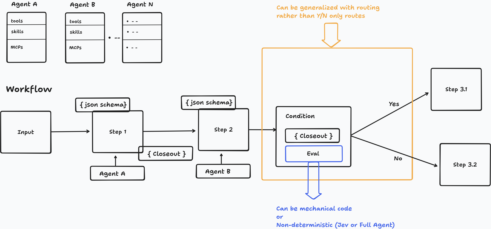
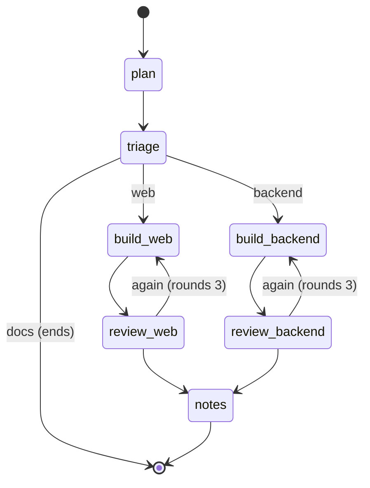

# Design, 2026-09-29: Routing — conditions between steps, gates and checks as properties, the inbox routed to a team

> **Amended 2026-11-04**, against main at `034badb10`, for intake `routing-the-design-amended-f-5zxi` and its 31 decisions, which
> the owner approved on 2026-11-04. What changed:
>
> - A closeout states facts. A **condition node** picks the route, and its eval is a swap point: a **table**, a **script** that
>   answers in a file the runtime keeps, or a read-only **judge**. A template ships no paid judge.
> - One kind of node and one kind of route: a route reaches a step or a **workflow**, and a route to a workflow files a card. Its
>   **workflow node** reads `sent`.
> - `nemia approve` confirms a route at the gate, and `nemia route` changes it. No dispatcher: §6 is now *Intake's ending routes*.
> - §4 keeps one `check:`. Named checks (C6) and results from outside (C7) are dropped.
> - §7 draws the step machine as C1 builds it in this run, and puts the workflow machine on `summary/graph.ts`.
> - §8 reads `mcp:` as landed. §9 is a new table. Every open question is answered or retired.
> - `wf` is `nemia` throughout, and every name is main's.
>
> The 2026-09-29 text stays in git: `git show 5ea1fe599:docs/design-2026-09-29-routing.md`. The title and the path stay, because C1
> and C3 cite them.

A design note. It changes no code. It rests on the owner's drawing and words of 2026-09-29, their discussion of 2026-10-11, the intake
of 2026-11-04, and the source as it is on main at `034badb10`. It names functions rather than line numbers. It builds on
`docs/design-2026-09-29-git-out.md` (contracts, decoding, scripts), on `docs/eval-2026-09-25-composable-workflows/REPORT.md` (teams,
results, sends) and on `docs/pivot-2026-09-18.md` §2 (Jev, and the dispatcher measured). `nemia` is the CLI; `wf` is its alias.



## What the owner asked

The drawing shows agents A, B … N, each with its tools, skills and MCP servers, unified behind A2A. It also shows a workflow: an
**input**, then **Step 1** (agent A, a JSON schema, a closeout), then **Step 2** (agent B, its schema), then a **Condition** holding a
closeout and an **Eval**, which routes *Yes* to Step 3.1 and *No* to Step 3.2. Two notes sit on it: the condition "can be generalized
with routing rather than Y/N only routes", and the eval "can be mechanical code or non-deterministic (Jev or full agent)".

The owner's words, 2026-09-29:

- The input "is basically our inbox right now but … it could also come from an integration, let's say my email."
- "A condition should be like a step as well." Its eval "could be a predicate provided by the author of the workflow … or it could be
  non-deterministic, where it is a script calling a Jev API or a full agent that is part of the team and decides, based on the closeout,
  where it should be routed."
- "I don't see a gate as a condition. I see a gate as a property … sometimes there is *input required* on a node, and that's how I see a
  gate." They meant to draw it as a square around a step.
- "I think check should work like GitHub Actions checks. There should be several commands or non-deterministic stuff that the user can
  run or provide. … When we go to GitHub, we probably won't have check anymore … I don't know if check should be a condition. Maybe you
  tell me."
- "There will need to be a supervisor or a long-running session that is routing input to the appropriate workflow. … it would be nice if I
  can just drop something in the inbox and the system just knows what the right team is."
- "I think it would be interesting to have it as a state machine as well", as the runtime's lifecycle is.

The owner's discussion, 2026-10-11, moved where a route is decided:

- **A closeout states facts** about its own work, never the step or workflow that comes next. Deciding is the condition node's, so a step
  like intake stays a reusable module.
- **A condition node decides the route.** Its eval is a swap point: a static evaluation, a script, or an agent reading the closeout. What
  a template ships needs no Claude and no paid judge. A factory may put a script that calls Jev in its place.
- **One kind of node and one kind of route.** A node has an input, an output and a status, whether its inside is one session or a graph
  of steps. There is no route that only reaches steps.

Two rules bind every answer below:

- **A tick carries nothing between passes.** Every route is a fact on disk that the pass reads again, never something it remembers.
- **No model is called in a tick or in `decide`.** The 2026-09-18 Jev evaluation concluded that a judgement fits only as a task filed
  from the pass, like a check, whose answer is journalled once and read back. Jev is "not deterministic, but consistent. An answer must be
  asked once and recorded." The same evaluation measured a dispatcher on the owner's 75 runs. The web question held (P 0.83, R 1.00). The
  plan question did not: at 0.8 / 0.2 it would have parked 46 of 75 cards.

And so: **no expression.** A route is a name from a closed list the folder declares, and its answer is a fact written once per try.

## In one paragraph

A **condition** is a node whose work is to answer one name from a closed list of **routes** it declares. Its **eval** says how: a
**table** that maps a fact field of a producer's closeout to a route, a **script** that answers in a file the runtime keeps, or a
read-only **judge** agent. A node after it says which route it takes (`when:`). A route reaches a step, or a **workflow node**, which
files a card that starts a new run of that workflow and then reads **`sent`**. The nodes on the routes not taken read **`skipped`**. A
join runs when at least one parent satisfied it and every other parent is skipped. An answer that does not decode is never a route: the
condition stops until a person names one (`nemia route`) or asks again (`nemia retry`). **Gates** stay a property of a step: at a gated
condition, `nemia approve` confirms the route with what it read, and `nemia route` changes it. **Intake's ending routes**: sdlc's intake
ends in a condition routing to `build` or `quick`, so the inbox needs no dispatcher. A step keeps **one `check:`**. **Two machines** print
themselves: a step's lifecycle, and each workflow's graph of nodes and routes.

## Today's four rules, as the code runs them

The run routes on four fixed rules. Each is written into the pure pass (`src/status/status.ts`, `src/tick/assess.ts`), not into the
folder.

| rule | the ways out | where the code decides |
|---|---|---|
| `check:` / `retries:` | exit 0: `verified`. A number other than 0: `failed (check)`, and `retries:` re-files the step (`retriesDue`). No number: the check did not finish, no try is spent, and a person runs `nemia retry --recheck` | A check is a task on the runtime's command harness (`checkArgv`, `src/check/check.ts`). Its verdict is the attempt's exit code (`attemptVerdict`), and `refusedCheck` (`src/record/record.ts`) tells a refusal from a check that did not finish. Its stdout and stderr are the runtime's, read through the engine's `output` (`checkStreams`, `src/views/views.verb.ts`). `retries:` is declared in `src/step/step.ts`; the tries it covers are counted and filed by `retriesDue` (`src/retry/retry.ts`) |
| `loop:` / `again` / `rounds:` | `again: false`: onward. `again: true` below the cap: a round (the target continued, then each step between, then the looping step). `again: true` at the cap: `exhausted`, and a person runs `nemia retry --round` (another round) or `nemia approve --message` (ends the loop as it stands, its findings open) | `askedAgain`, `capOf` (`DEFAULT_ROUNDS`), `roundIn` (`src/status/status.ts`), `roundsDue` (`src/round/round.ts`). `ownStatus` makes a non-boolean `again` `unsigned`. At load, `loopSpan` and `validateLoops` (`src/workflow/validate.ts`) apply: a loop is a chain, one loop per step, no remote target, no `resume:` inside, and no `replies` field on the target |
| `gate:` | `nemia approve`: onward. `nemia retry --message`: sent back to the step itself, or to its `after` if it was never filed (`sendBackTo`) | `hasGate`, `atGate`, `approvedFirst` (`src/status/status.ts`) and `waitsAtGate` (`src/record/record.ts`). Approvals are a person's files, `approve-<step>-<try>` in the run's asks folder (`approvalFile`, `src/record/record.store.ts`) |
| `blocked` | none: a stop, to a person | `ownStatus` reads the closeout's `outcome` first. `stopsFollowers` makes it final. `assess` names the run `failed` and adds `stoppedOn: 'blocked'` |

`readVerdict`, the `[wf check] exit N` trailer, `readCheckBrief` and the check's stream files are gone: c8af91849 moved checks onto the
runtime's command harness.

The check is three-way, not two-way: *did not finish* is a third outcome, and it is a person's. A step with no check signs off
`unverified`, not `verified`. Both words satisfy `after` (`satisfiesAfter`), and other words stop followers besides `blocked`:
`unsigned`, `awaiting approval`, `exhausted`, `over budget`, `budget exhausted`, `denied` (`stopsFollowers`). None of those is a route.
They are the machinery's stops, and they stay.

The package README says "**No key is control flow.** No conditions, no expressions, no templating", because "a judgement belongs to a
step with an agent in it". This design **keeps that rule and widens its one exception**, which `again` already is:

- A route is a name from a closed list the folder declares. It is not a value an expression computes.
- The answer is a fact: a closeout field, a file the runtime kept on an attempt, or a judge's closeout.
- The tick never evaluates anything. It reads which name was said, as it reads `again` today.

## 1. A condition node

### Its entry

A workflow's steps are `spec.steps` of its `workflow.yaml`, as in `packages/templates/sdlc/workflows/build/workflow.yaml`. A folder of
step files with frontmatter, as the tests' team `dev` (`packages/agent-orchestrator/test/fixtures/team/dev`), takes the same keys: its
frontmatter is YAML (`readFrontmatter`), so a map reads there too.

```yaml
spec:
  steps:
    - name: plan
      output:
        path: plan.schema.json        # declares surface: enum [web, backend, docs]
    - name: triage
      after: [plan]
      input: [plan]
      routes: [web, backend, docs]
      route:
        from: plan.surface
        table: { web: web, backend: backend, docs: docs }
      ends: [docs]
    - name: build-web
      after: [triage]
      when: web
    - name: build-backend
      after: [triage]
      when: backend
```

- **`routes:`** is the closed list of names, at least two, each a word (`[a-z][a-z0-9-]*`).
- **`route:`** says how the list is answered: one of the three eval kinds of §2. The table above is the default kind.
- **The condition reads a fact field the composing step declares.** `plan.surface` is a field of the producer's output, which states a
  fact ("the surface it changes"), never a route. A reusable step such as intake carries no word about what follows: the workflow that
  composes it adds the field on the step, since a step's `output:` merges after its agent's (the agent's fields first, then the step's,
  each with one owner).
- **The table is closed.** Load refuses a key of `table:` outside the field's enum, a value of the enum with no row, and a row whose route
  is not in `routes:`. The field's schema is frozen with its step, so the check runs at load.
- **`input:`** names the closeouts it reads, as `input:` works today: each producer is in `after` and declares `output:`.
- **No workspace of its own.** A condition cuts no worktree and commits nothing. It runs where its first parent worked, and a follower
  takes its workspace as if it followed that parent directly. Load refuses `workspace:`, `check:`, `retries:`, `resume:` and `budget:` on
  a condition, apart from `budget:` on a judge, the one kind with a session to spend on.
- **Its instruction** is what the node is for, as every step's is. For a judge, it is also what the agent is told.

A node after a condition names the route it takes:

- **`when: <route>`**, or `when: [web, docs]`, sits beside `after: [<condition>]`. A node with `when:` waits on exactly one condition. A
  node after a condition with no `when:` runs on every route, as a step after any other step does.
- `when:` was chosen over `on:`: GitHub Actions uses `on:` for a workflow's trigger, and the owner reads these files with GitHub in mind.
- **`ends: [<route>]`** on the condition ends the run on that route. A run that ends on an `ends:` route succeeds.

### A route to a workflow: the workflow node

A route that reaches a workflow is a node of its own, of kind `workflow`:

```yaml
    - name: to-build
      after: [next]
      when: build
      workflow: build
```

- **`workflow: <name>`** is the fifth new step key. The node has no agent, no workspace and no check. When it is due, it files a card for
  the named workflow (§6) and reads **`sent`**.
- `sent` satisfies `after`: the caller's run goes on, or ends, once the card is filed. It does not wait on the run the card starts.
- On a route not taken, the workflow node reads `skipped`, as any node does.

### A route not taken: `skipped`

A node reads `skipped` when it was never filed and either:

- its `when:` does not include the route its condition answered on the try the condition is on; or
- every node in its `after` is skipped.

It is worked out on every pass from the conditions' answers, by a pure function beside `stepStatus` (`src/status/status.ts`). It spreads
down the graph and carries nothing between passes.

**Once a follower is filed, the route is settled for the run.** A condition gets a new answer only while none of the nodes after it has
been filed, on any route. That is the rule `retryable` (`src/retry/retry.ts`) already keeps for a try of a satisfied step: it is offered
only while `noneFiled`. So `nemia route`, and `nemia retry` of a condition, are refused once a follower is filed, naming the follower and
the fix: cancel the run and start it again to take another route. A new answer can therefore un-skip only nodes that were never filed, and
no branch that ran is left beside one that a new route takes. A round never files a condition again, because load keeps conditions out
of a loop's span (below).

What the other rules make of it:

- **`skipped` neither `satisfiesAfter` nor `stopsFollowers`.** A node after a skipped one waits for its other parents.
- **A join runs** when every parent is satisfied or skipped and at least one is satisfied (`assess`'s ready loop). When every parent is
  skipped, it is skipped too.
- **A fan-in's workspace** merges only the parents that ran. When one parent ran, the join forks from it. `workspaceFor`
  (`src/workspace/worktree.store.ts`) gets the ran list rather than `after`.
- **The run succeeds** when every node is satisfied, `sent` or skipped and at least one ran. `assess`'s overall word changes by that one
  clause.
- **`nemia ls`, `nemia decide` and the board** say `skipped (triage: docs)`, naming the condition and the route it took. The board dims
  the node, and draws a `sent` leaf linked to the run its card started.

### What each new key and word costs

Each new step key (`routes`, `route`, `when`, `ends`, `workflow`) pays these sites:

- `STEP_KEYS` (`packages/agent-orchestrator/src/step/step.ts`);
- the api's `KINDS` (`apps/api/src/workflows/words.ts`) and `WorkflowStepSpec`/`specOf` (`apps/api/src/workflows/workflows.ts`);
- the web's `UNSET` (`apps/web/src/lib/builder.ts`) and `StepKeySchema` (`apps/web/src/lib/api/library.ts`);
- the template format: `STEP` in `src/template/layout.ts`, `PLACED` and `stepOf` in `src/template/draft.ts`, `STEP_WORDS` and
  `stepFile` in `src/applied/render.ts`;
- and a templated factory's rendered tree.

Each new step word (`skipped`, `sent`) pays the sites the orchestrator's `CLAUDE.md` lists (a new word is `working` on the board until
the web's `stepState` knows it), the Run object's `STEP_STATUSES` (`src/object/run.model.ts`), and a state of the step machine (§7),
whose states are typed over `StepStatus`, so a word with no state does not compile.

### What load refuses

Each refusal is a `WorkflowError` in the voice `validateLoops` already uses: the node, why it cannot run, and the fix.

- A `when:` naming a route the condition does not declare: name one of its routes, or add it to the condition's `routes:`.
- A `when:` on a node that waits on no condition, or on two: add the condition to `after:`, delete the line, or name the one whose route it
  takes.
- A route nobody takes: add a node for it, or name it in `ends:` to end the run there.
- A `workflow:` node with an agent, a workspace, a check or a gate: a workflow node files a card and does nothing else.
- A table that is not closed over the field's enum and `routes:` (above).
- **A route may never go back.** An edge back to an earlier step is a `loop:` and nothing else, and every loop is capped (`rounds:`, or
  `DEFAULT_ROUNDS`). So "a route back with no cap" cannot be written. `validateLoops` stays the one place a back edge is judged, and C10
  (§9) points a condition's `loop:` through it.
- **A loop does not cross a condition.** A round files its whole span again (`loopSpan`), and a condition in it would be asked again
  after its followers were filed, which the rule above refuses. So a loop's span holds no condition but the looping step itself, and no
  node with `when:` but its target. The looping step is excepted because it is never asked again after a follower is filed: when it
  answers the route its `loop:` takes (C10's `again`), a round is filed and none of its followers is; when it answers another route, its
  followers are filed and no round is due. A loop may run on one route: its target says `when:`, and the looping step follows it. On
  another route both are `skipped`, and a skipped step says no `again`. A loop across a join is already refused, because a loop's steps
  are a chain (`validateLoops`).

## 2. The eval kinds, one contract

Every kind answers the same thing:

```ts
type RouteAnswer = { route: string; why?: string; evidence?: unknown } | { unsure: string; evidence?: unknown };
```

- The answer is decoded strictly by an Effect Schema struct in a `*.store.ts`, since `boundary.test.ts` refuses Effect in a pure file.
- `route` must be one of the condition's `routes`. Unknown fields are ignored, as in the git-out contracts.
- `unsure` is an answer. As the pivot's dispatcher lesson says, "a split that flips between askings is a card the person should see".
- The request, for the kinds that are handed one, is `{ v: 1, routes, closeouts: { <producer>: <its declared output> } }`: the fields each
  producer's `output:` declares, as a step reading them through `input:` is given them today. A judge is also handed each target's
  description: a step's instruction, or a workflow's `metadata.description`.

| kind | written | where it runs | the fact read back | a restart |
|---|---|---|---|---|
| **table** | `route: { from: plan.surface, table: { … } }` | nowhere. The pure pass reads a field of a signed closeout and looks it up | the producer's closeout, immutable for its try | reads the same closeout |
| **script** | `route: { script: routes/surface.ts }` | the condition's own task (`stepTaskId`), on the runtime's command harness, as a check runs (`checkArgv`) | the answer file the runtime read at exit and kept on the attempt. The tick copies the route onto the step's record once per try (`StepRecord.route`), as it writes `landed` | adopts the task by its derived id, and reads the attempt or the record |
| **judge** | `route: judge` (with `agent:` or the role keys) | the condition's own session, read-only, in its first parent's workspace | its closeout. The run adds `route: enum(routes)` to its schema, as it adds `replies` to a loop's target | reads the same closeout |

**Why the table is the predicate.** An expression is a second program that the tick would evaluate, which is what the README refuses.
The producer's `output:` schema already constrains what an agent may say (`declaredOutput` holds the closeout to it), and `again` is a
field of this kind. An author who needs more than a named field — a count, a threshold, a comparison — writes a script. The script is code
the author owns, frozen and run as a task, never inside the pass.

**The script kind.** It is the author's code and may call a model, and a tick may call none, so it is filed as a task:

- **Frozen.** It is read from the run's frozen workflow files (`$WF_WORKFLOW_FILES`, the copy of the folder the run took when it began),
  as sdlc's `pull-request.ts` and `landing.ts` are. No command comes from a checkout.
- **The request is a file named in the environment** (`WF_REQUEST`), written by the tick before it files the task, beside the names a
  check is given (`CheckEnv`).
- **The answer is a file named in the environment**, which the script writes and the runtime reads once at exit and keeps on the attempt.
  This is Kubernetes' `terminationMessagePath`, which a Pod's container writes and the kubelet keeps on its status, and GitHub Actions'
  `$GITHUB_OUTPUT`, a file a step writes its outputs to. It is a generic field of a command task, as a Pod spec's is, so the runtime owns
  it and any command may use it. It has room for `why`, `evidence` and `unsure`, and stdout noise cannot spoof it. Its name, its size cap
  and what the runtime keeps when it is missing are designed with C4, beside its first reader.
- **The deadline is a task's** (`deadlineSeconds`). A route script that needs long is doing a step's work.

**Jev** is a factory's own script, never shipped: a script of the script kind that calls TypeSafe's API, which a factory puts in a
condition's place (below). The judge package is gone from the repository, so the script calls the SDK or the HTTP endpoint itself. Its
thresholds are the factory's, inside the script, measured on held-out cards before a route trusts them. TypeSafe's retention terms are
unread, so C8 leaves the product's §9 and is a card of the nemia factory, waiting on the owner's reading.

**The judge** is a step in all but its workspace:

- It has a session, a budget and a closeout, and is fed each target's description.
- It is read-only: load refuses a mode that writes, so on Claude it takes `permissionMode: dontAsk` with read tools only, and on Codex
  `sandbox: read-only`.
- A remote A2A agent (`harness: a2a:<name>`) can be one, since nothing continues its session.
- This is the "full agent that is part of the team" of the owner's words.

**A template ships a table or a judge**, never a paid service.

**The swap, per `<workflow>/<condition>`.** A factory swaps a condition's eval as it fills a step, with the workflow's own eval as the
default, kept across template upgrades:

- **A judge is hired**: an agent hired into the condition through today's `hires` key `<workflow>/<condition>` (`Factory.hires`,
  `src/factory/factory.model.ts`, `nemia factory hire`). No new field.
- **A factory's own script** (Jev, say) replaces the condition's entry in the factory's own overlay of the workflow, in its own tree.
- The Factory schema is untouched.

**What a restart meets.** Every kind is answered by a fact written once for the try:

- a closeout, which the runtime journals and a later try does not overwrite;
- or a task under a derived id that a restarted pass adopts rather than files again (`stepTaskId`, as `checkTaskId` does for a check),
  whose answer the runtime kept on its attempt.

The tick copies a script's route onto the record once, so it is read from there even if the task is later pruned. Only a new try asks
again, and only a person files one (`nemia retry`), before any follower is filed.

**An answer that does not decode.** It is never a route, never the first route and never a default:

- **A table or a judge.** A closeout whose field is missing or outside its enum is `unsigned`, exactly as a non-boolean `again` is today.
  A table's field outside the enum makes the *producer* `unsigned`, since its closeout did not keep its schema.
- **A script.** Each case has one word, and each is already a `StepStatus`:
  - exit 0 with an answer file missing or not decoding: `unsigned`, as a session that ends cleanly with no closeout;
  - a non-zero exit: `failed`. The script ran and said nothing the run can use;
  - no exit code (`attemptVerdict`'s `unfinished`: timed out, killed, stopped): `stopped`.

  Load refuses `retries:` on a condition, so the run files no try of its own for any of these. Only a person files the next one.
- **`unsure`, from any kind.** The condition reads `blocked`, with the words beside it, as an agent's `blocked` does.

A person then either:

- names the route, with `nemia route <run> <condition> <route>`. This writes `route-<step>-<try>` in the run's asks folder, one writer, as
  `approvalFile` does, and the pass reads it before the condition's own answer;
- or files a new try with `nemia retry <run> <condition>`.

`nemia decide` offers both, with the routes listed. Both are refused once a follower is filed (§1).

## 3. Gates: a property, *input required*

The owner's reading is the code's. `gate: true` is already a property, read by `hasGate`, and its JSDoc in `src/step/step.ts` says "Not
control flow: the run files nothing on a condition, it waits for a person's word". The runtime already has the word: a held session that
waits for a person reads `input-required`, A2A's own task state. A gate is the same wait at the step's level, after the step and its check.

- **`gate:` is unchanged**, and it may sit on a condition. A gated condition holds its answered route for a person.
- **`nemia approve` confirms the intent and its route together**: at intake's gate, the person approves what was read and where it goes,
  in one word.
- **`nemia route <run> <condition> <route>`** is one generic verb (class `answer`) that changes a route or answers an `unsure`, on a gated
  condition or not, until a follower is filed. `nemia retry --message` asks the condition again.
- **A route goes unconfirmed only where its workflow puts no gate.** There is no trust counter: the person confirms at the gate they
  already pass, and an author who wants a route confirmed puts a gate on it.
- **The board shows the wait as it does today**, and that is the design. On the Factory (`FactoryCanvas`), a run's card (`RunNode`) with
  a step waiting on a person carries a *waiting on you* badge (`waitsOnYou`) and answers the gate in its gate row (`CardGate`); a result
  for a person to decide carries a *to decide* badge (`toDecideOf`). On the run's page, the step itself (`StepNode`) is drawn as a
  *human gate* (`waitsAtGate`). A gated condition needs nothing new there: its wait is a gate's wait. Its gate row shows the proposed
  route beside what it read.
- **An idea for later, not a card:** a gated step could carry an outline of its own on the canvas, marking that it has a gate before it
  waits. The spec already says so (`gate` is on `WorkflowStepSpec`), so it would need no new endpoint.
- **"Send back" is the gate's, not a route.** `nemia retry --message` is a person's word that goes to one step (`sendBackTo`) as a new
  try. A route is the folder's graph, which an author declares and load checks. A person's word is outside that graph: it can go to any
  step, at any time, and no load could check it. The loop's `again` stays the agent's route, since the agent says it and the folder bounds
  it. On the workflow's machine (§7), send-back is not an edge. On a run's lit path, a try that a person sent back is drawn as a dashed
  person edge from the gate to the step it re-filed, read off its tries.

## 4. Checks: the owner's question answered

**A check is a property of a step. It is not a condition.**

- A check measures the step's own work, in the step's own workspace, after the step signs off. It decides whether the step is done
  (`verified`), not where the run goes next. `retries:` makes a refused check the step's own business: try again, in the same workspace.
- A condition decides where the run goes, and makes nothing. Turning a check into a condition would give it two jobs, and a step whose
  check refused would read `verified` with a route to itself. `retries:` already says that, better.

**One `check:` per step.** "Several commands, like GitHub Actions' checks" is already met: the CI's aggregate context is the check, and
it holds every job. A forge is a factory's way, never the packages': a workflow reaches it through its own scripts. So named checks (C6)
and results read from a forge through the place (C7) are dropped.

That is what sdlc does on GitHub today. A workflow step never pushes, but a check is the run's, not the step's:

- implement's check in sdlc's `build` pushes the round's commit and opens or updates its pull request (`pull-request.ts push`), then waits
  on GitHub's `ci` context for that commit (`pull-request.ts wait`), each read from the run's frozen workflow files;
- the ending, `land`, runs `landing.ts merge`, which merges the run's own green pull request, and its check is `landing.ts receipt`, which
  reads the merge that landed.

Both scripts are in `packages/templates/sdlc/workflows/build/`. The packages know none of it.

### A judge check

"Non-deterministic stuff the user can provide" is a check whose command is a script that asks a model:

- a script that calls Jev and exits 0 or 1 on the author's threshold;
- or one that runs a one-question `claude -p`.

It is filed, journalled and read like any check, with the same rule: *only a number is a verdict*. A judge that needs a session, a budget
and a closeout is not a check. It is a step (sdlc's `review`), and a condition after it routes on its closeout.

### `retries:`

`retries:` stays a count on the step. After the check refuses, the run files the step again, and the try's brief names the refusal and
its tails.

## 5. How today's four rules fold in

| today | becomes | a folder written today | `nemia decide` and the board |
|---|---|---|---|
| `check:` / `retries:` | unchanged: a property, one command | unchanged | unchanged words (`failed (check)`, `nemia retry --recheck`) |
| `loop:` / `again` / `rounds:` | a condition with a way back. The looping step's `again` is a table route (`again`, `on`), and `loop:` names where `again` goes | unchanged, and the code path stays until C10. The board draws the loop as a route edge labelled `again`, with its cap | unchanged (`exhausted`, `nemia retry --round`, `nemia approve --message`). The edge is lit on the run with the round count |
| `gate:` | unchanged: a property (*input required*). It may sit on a condition | unchanged | unchanged words. The board shows *waiting on you*, as today |
| `blocked` | unchanged: the agent's word to a person, a stop and never a route. A condition's `unsure` reads the same | unchanged | unchanged |

Frozen runs decode through `FrozenStepSchema` (`src/folder/folder.store.ts`) unchanged: every new key is an optional field, and a record
frozen before them has none.

**C10 folds the loop into a condition only if it deletes code.** `askedAgain`, `roundsDue`, `owedFields` and the round's continuation of
its target are richer than "an edge back". If routing a loop through a condition only adds a second path, the loop stays a key and the
board merely draws it as a route.

## 6. Intake's ending routes

The inbox is routed by the same condition, at the end of intake, not by a dispatcher one level up. The dispatcher of 2026-09-29, its
route task, its agreement counted per route, its threshold and its auto-queue retire.

- **A card whose next workflow nobody knows names `intake`**, as today: it is filed with `workflow: intake`, and intake's ending routes
  it. Nemia's `write-a-card` (`packages/agent-orchestrator/nemia/skills/write-a-card/SKILL.md`) says so in one line. No new field: the
  Factory and the Card are untouched. A factory's entry workflow can join the Factory's spec later, if a page wants it.
- **sdlc's intake ends in a condition routing to `build` or `quick`**, released with the template. The condition proposes the next
  workflow from the factory's attached list, never Iris, and the person confirms it with the intent at the gate they already pass.

**A route to a workflow files a card** (the workflow node of §1). It is the one way in for a person, Nemia and a route:

- The card goes through the Card door (`CardDoor`), queued, with `workflow:` the target and `from:` the caller's run. The tick starts it
  as any card, under the same caps and refusals.
- **The target is a bare name**, resolved through the factory when the route is taken. It is level-triggered, so a factory's upgrade
  reaches routes not yet taken. The new run pins its own revision, as every run does.
- **The new run is handed what the condition read**, with the files those closeouts name mounted read-only and named in its brief: no
  copies to drift.
- **The caller ends once the card is filed.** Its workflow node reads `sent`, or `skipped` on a route not taken.
- **Each run keeps its own** workspace, gate, budget and landing; nothing is carried across a route. The board sums the chain's spend as
  a read, and the runtime gains no budget across runs.

**Later:** call (a run that waits on the run it routed to), and a workflow's declared input and output, which only call needs: with send,
nobody reads a routed run's output back. The concept round is a later intent: a job session has no Artifact tool yet.

## 7. Two machines, drawn by their code

### A step's lifecycle in a run

`ownStatus`, `standing` and `assess` work out a step's word on every pass, from facts. That is right for a level-triggered pass, and it
stays: the machine decides nothing.

C1, built in this run, is the drawing that cannot drift from them:

- **A pure table of edges** in `packages/agent-orchestrator/src/step-machine/step-machine.ts`: `STEP_EDGES`, the states typed
  `satisfies Record<StepStatus, …>`, `stepMove` (a move between two words: it stays, is an edge, or is refused; `StepTransition`), and
  `stepMachineGraph()` and `stepDiagram()`, a no-argument function that prints Mermaid. Its initial state is `pending`, the word
  `StepStatus` has. It follows Nemia's own machine (`nemiaGraph`, `nemiaDiagram`, `src/nemia/nemia.ts`).
- **No XState.** `agent-runtime/test/xstate-boundary.test.ts` holds XState to the runtime.
- **Its drawing** sits between `diagram:step` markers in `packages/agent-orchestrator/README.md`, held by
  `tools/guards/test/diagrams.test.ts`. This document holds no marker: the test refuses one outside a package's docs.
- **Every status is a state.** A `StepStatus` with no state is a compile error, so `skipped` and `sent` each take a state when C3 lands
  them.
- **Every move the pass makes is an edge.** A replay (`src/step-machine/step-machine.test.ts`) moves a step's record by hand from fact to fact,
  reads `stepStatus` before and after each move, and refuses a pair the table does not have; every edge must be walked.
- **Its contract** (`packages/agent-orchestrator/contracts/step-machine.contract.ts`) states what a step's words mean: a step in
  flight (`running`, `checking`) is never unfiled, nothing is satisfied before it ran, and a checked step never reads as one without a
  check. A round (`roundFiled`) and a send-back (`sentBack`) do unfile a settled step, so `pending` is reached again from a settled word.
- **No `MACHINES.step`.** `/api/machines` and its page retire in run `resource-objects-build-the-i-9api`, so the machine is drawn in the
  docs only.

### A workflow's own machine

Each workflow is a machine: nodes as states, `after`, routes, loops and the gate's wait as transitions.

- **It sits on today's graph**, `packages/agent-orchestrator/src/summary/graph.ts`: `GraphEdge` (kind `after` or `loop`), `InputEdge`,
  `graphOf`, `inputGraphOf` and `runGraph`. The api's own `graphOf` is already gone, so C2 folds into C3.
- **C3 adds `{ from, to, kind: 'route', route }` edges and node kinds** (`step`, `condition`, `workflow`), which the Workflow object
  serves later. Gates are node properties, not edges.

A sketch:



Each loop runs on one route and is a chain: its target says `when:`, and its reviewer waits on the target alone, so the folder loads under
`validateLoops` and the rule in §1 that a loop does not cross a condition. `notes` joins the two routes. On `web`, `build_backend` and
`review_backend` are skipped, and `notes` runs after `review_web` alone, forking from its workspace. On `docs`, every node after triage is
skipped and the run ends. A route to a workflow ends in a workflow node, drawn as a leaf that reads `sent`.

- **Lit with a run's path.** `WorkflowCanvas` draws the folder, and `RunCanvas` draws a run, lit as the Debug panel lights a task's
  lifecycle (`litAt`, `takenRoutes` in the web's `lib/lifecyclePath.ts`). The path is read off the record: the steps filed, in the order
  of their tries, the route each condition took (`StepRecord.route`, or its closeout), and the rounds. Skipped nodes are dimmed. Routes not
  taken are drawn thin.
- **Its drift test** draws the tests' team `dev` (`packages/agent-orchestrator/test/fixtures/team/dev`), which C3 gives a condition,
  through a no-argument function of the orchestrator, into a `diagram:` marker in `packages/agent-orchestrator/docs/`. The folder is inside
  the package, so Turbo sees it, and a change to it needs no template release. A factory's workflows are drawn live, by the same function
  the board uses, so they have no picture to drift.

## 8. The agent column

What an agent carries today (`AGENT_KEYS`, `packages/agent-orchestrator/src/agents/agents.ts`):

- **Its own keys** (`AGENT_OWN_KEYS`): `role`, `description`, `skills`, `harnessPrompt`, `mcp` and `overridable`. No step takes them
  from it; a step's `skills:` and `mcp:` add to its agent's.
- **Role keys** a step takes as defaults: `harness`, `model`, `effort`, `context`, `permissionMode`, `sandbox`, `tools`,
  `disallowedTools`, `allowedTools`, `remote` and `output`. The fences sit on each worker's `disallowedTools`.
- **`harness: a2a:<name>`** makes the agent a remote A2A agent the store's `a2a-agents.json` declares. It takes none of the keys that tell
  a harness of ours how to run. The runtime also serves its own sessions over A2A (`agent-runtime/src/a2a/`). That is the "unified behind
  A2A" of the drawing.
- **`mcp:` has landed.** It names servers by name: those of the repository's `.mcp.json`, or ones the factory records, Nemia's builtin
  ones among them (`BUILTIN_SERVERS`, `packages/agent-orchestrator/servers/`). Claude Code's own `mcpServers` is still refused by name
  (`CLAUDE_CODE_REFUSED`), now saying to name the servers on an `mcp:` line.

What narrows today (`agent-runtime/src/harness/mcp.ts`): a task that names servers of the checkout's `.mcp.json` (`projectMcp`) is
given those entries and its own `mcp`, and nothing else of the file (`pickedProjectMcp`, `sessionMcp`); a task that names none is given
the whole file (`everyMcpServer`). The orchestrator splits an agent's `mcp:` between the two (`serversOf`, `src/filed/filed.ts`). A step
with no agent loads no server. A condition's judge needs no MCP server.

## 9. The cards

| card | status | after |
|---|---|---|
| C1 | built in this run: the step machine, its `diagram:step` marker, the replay and the contract. No behaviour changes, no `MACHINES.step` | — |
| C2 | folded into C3, on `summary/graph.ts` | — |
| C3 | the condition node: `routes:` / `route:` (the table) / `when:` / `ends:`, `skipped`, the join rule, load's refusals, `kind: 'route'` edges and node kinds | 9api |
| C3b | a route to a workflow: the `workflow:` node, `sent`, the card it files, the handed files mounted read-only | C3 |
| C4 | the script kind, with the runtime's answer file on a command task, `StepRecord.route`, `nemia route` | C3 |
| C5 | the judge: the run's `route` enum in its closeout schema, read-only refusals, a hire per `<workflow>/<condition>` | C3 |
| sdlc's intake condition, with a template release | intake ends routing to `build` or `quick` | C3b |
| C6, C7 | dropped (§4) | — |
| C8 | a nemia-factory card: Jev as the factory's own script, waiting on the owner's reading of TypeSafe's terms | — |
| C9 | replaced by §6, intake's ending routes | — |
| C10 | kept, only if it deletes code | C3 |

**9api** is run `resource-objects-build-the-i-9api`, which builds `packages/objects` and the Run object. C3 waits on it because both
change the same files: `packages/agent-orchestrator/src/summary/graph.ts`, the template's step-key sites (`src/template/layout.ts`,
`src/template/draft.ts`, `src/applied/render.ts`), the web's `apps/web/src/lib/status.ts`, and `apps/api/src/machines/machines.ts`. The
rest stacks on C3. It is one build card of this intent, `routing: condition nodes route steps and workflows`, filed after 9api and this
run land.

## 10. What a run in flight meets

- **Its frozen folder has none of the new keys.** `FrozenStepSchema` decodes it, no step reads `skipped` or `sent`, and every step joins
  as today.
- **Its checks keep their ids** (`checkTaskId`).
- **Loops keep today's rounds.** C10 changes nothing a record holds.
- **The daemon restarts** after each card merges, as after any change to `src`.

## Open questions

Each question of 2026-09-29, and where it went:

1. **The script's answer: the last stdout line, or a file?** Answered (Q4, R2-8): a file named in the environment, which the runtime reads
   at exit and keeps on the attempt (§2).
2. **`when:` or `after: triage:web`?** Kept as `when:` (§1).
3. **The Jev key.** Answered (Q9): Jev is a factory's own script, and C8 a card of the nemia factory.
4. **Does a gated condition confirm the route, or the closeout it read?** Answered (R2-7): `nemia approve` confirms the intent and its
   route together, and `nemia route` changes the route (§3).
5. **When may the dispatcher queue on its own?** Retired with the dispatcher (§6).
6. **Where the step machine's marker lives.** Answered by C1: the orchestrator's README (§7).
7. **Should a non-required check's verdict be routable?** Retired with named checks (§4).

Still open, for the build card:

- **The runtime's answer file**: its field's name, its size cap, and what the runtime keeps when the file is missing or too large (as
  Kubernetes' `terminationMessagePolicy` chooses). Designed and built with C4.
- **How the factory's overlay names a condition's script**: the shape of the entry it replaces, decided with C4 beside the template
  format's new keys.
