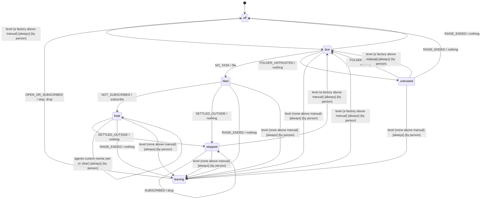

# Features to build

Since 2026-09-29 Nemia ships no workflows, agents or skills: the repository's `workflows/` and this package's own were removed, and
the tests run the machinery on `test/fixtures/team/`. The sections below that name those folders are records of what shipped then,
kept as they were written. So is a record's path to a file since removed with what it held; a record whose subject moved keeps the
old path with "(now …)" beside it, and a line that says how things are now names today's file.

The features agent-orchestrator is still missing, in the order I would take them. Each says what exists
today, what the feature has to settle, and what earlier work already taught about it. Bugs and open
questions live in [agent-runtime/docs/open-issues.md](../../agent-runtime/docs/open-issues.md).

State as of 2026-09-17: the check (package C of `docs/plan-hold-the-bar.md`, Nemia), declared
outputs (package J), a step's files directory with `workflows/ui/` (U1), a browser for every Claude
step (the repository's `.mcp.json`), a worktree's own `node_modules` with `.worktreeinclude`,
trying a step again with `retries:` and `wf retry` (§4 F), going round again with `loop:`,
`rounds:` and `wf round` (§4 R), a step's `tools:` and `effort:` (§4 I) and its `disallow:` (§4b), the decider screen
(§4 G), looking as a skill with `workflows/ui/` as implement ⇄ review (§4 U2), an answer for a step
that asks (`wf retry --message`) beside a step that plans (`workflows/dev-planned/`, §4 Q), a run
that waits on a run (`wf start --after`, the first half of §4 P), and three guards made to hold (a session
the harness blocked tried again, `shipped` with nothing past the base, an ask file that is not an ask), and a plan as a folder of cards whose waiting runs are handed their parents'
closeouts (`wf plan`, the rest of §4 P), and telling a running step something (`wf say`, with its route and the session page's
prompt box: the steering channel's upper half), and six small items — `radius` reading workspace globs as npm does, a run's steps
in the order they run, `wf start --input`, artifacts collected from the workspace, a stale ask honoured, and `wf start` on a card
file (§6 items 6–9, 24, 25) — and a step gone quiet without its closeout reading `unsigned` again after the engine began
settling it `failed` — and a step's `budget:`, with what a step and a run cost on `wf ls` and `wf decide` (plan §6 item 29, its
workflow half), forgetting a run that is over (`wf rm`), and freeing a finished run's worktrees (`wf prune`) — and an inbox of cards parked before they are started (`wf inbox`,
and its page on the board) — two small items from the plan's queue (§6 items 28 and 31), a cap on runs in flight (`WF_MAX_RUNS`) and
cards that start themselves (`wf inbox queue`) — and markdown rendered on the board, with a page for a card and for a step that
explains their keys — and a gate, a step's handoff that waits for a person (`gate: true`, `--gate`, `wf approve`), in the package — and
the engine's `priority` and `remoteControl` put to use: a run in flight filed above a newer run's first step, and `remote:` on a step (§2,
its package half) — and the workflow builder's package half: a step rendered back to markdown and a folder written from its steps
(`renderStep`, `writeWorkflow`, §4) — and the builder on the board, which writes a folder of yours from its blocks and edges (§4, its board
half) — and the web app's components on shadcn's React Aria base (§7) — and the end of a run as a step of its
workflow, with `workspace: main`, its gate, `to decide` and `ship.md` on the four `dev*` folders (§8, its package half) — and, since, a run
with no repository (`workspace: folder`, P2's first slice), started and read from the board (its second) — and a feed of what the
tick judged, followed with `wf watch` (its package half; the board's half is a card of its own) — and one `wf up` per store, with a heartbeat
in `daemon.json` that `wf ls` reads, and the Factory reads too — have shipped.

State as of 2026-09-28: everything above, and since, each in a *Shipped* section below — the board following the feed; the ending's
check run by the run, which lands the merge or aborts it; `denials: fail` (§10); a gate and a blocked sign-off held open on the step's
own task (§11, thin runtime stage 2 part 4b); a step on a remote A2A agent (thin runtime stage 6 part 2); and agents that carry their
own skills, cards 1a to 4 (§12). The runtime's thin-runtime stages are tracked in `docs/eval-thin-runtime.md`.

**What remains, in order.** Of the numbered items, two are open:

1. §1, a run that grows steps from a plan.
2. A step's tries and rounds as attempts of one task (*tries as attempts*; written "4c" before 2026-09-28, and not the runtime's stage
   4c, admission, which is done). Rounds and tries are `-try<n>` tasks today (§11).

Beside them, the git-out design's deferred freeze (`docs/design-2026-09-29-git-out.md`, *Freezing* and open question 6): a team's own
skill as a run's place, copied per run to `WF_ROOT/places/<skill>@<version>/`, a copy whose `skillVersion` drifted refusing the run's
passes, `nemia prune` removing a copy no record names, and `nemia refreeze`. Card C2 records `placeSkill` and runs the package's own place,
which ships as a release that never changes under a run; the card is filed once G has landed (H has, below), so the first copy carries
every verb and `say` key, and `placeSkill.version` becomes the copy's name then. Card E has landed: `nemia rm` and `nemia prune` read,
hand off and remove a run's worktrees and branches through its place (`inventory`, `handoff`, `remove`), and call no git of their own.

Then the *Engine-side work* at the end: waking the tick on a harness registry change rather than a timer, and the hkb migration; and
thin runtime stage 6 parts 3 (the gRPC binding) and 4 (streaming and subscribe). Each *Shipped* section names what it left, and those
leftovers are open too.

## Shipped: the check

A step's `check:` is executed by the run after the step signs off, as an engine task on the run's own
`check` harness; exit 0 is `verified` and files what follows, anything else is `failed (check)` and
files nothing. With it: the workflow is frozen onto the run at `wf start`; a step that ends without the
closeout it was asked for is `unsigned` and files nothing; failed and stopped steps are handed off
(engine open issue 2); `wf ls` and `wf decide` say `verified ✓`, `checking`, `failed ✗ check (exit N)`,
`unverified` and `unsigned`; `wf decide` no longer reads a `--no-worktree` run as shipped. The README's
*The check* section is the account.

What it leaves for wave 2 of the plan, in its order:

- **Retries** (§4 F). Shipped: *Shipped: trying again*, below.
- **The decider screen** (§4 G). Shipped: *Shipped: the decider screen*, below.
- **Rounds** (§4 R, which absorbed §4 H). Shipped: *Shipped: going round again*, below.

## Shipped: declared outputs and inputs

A step's product can travel to the next step as its closeout, declared, instead of as a file written
into the workspace. There are two keys, and neither is control flow. `output: <file>` on the producer
names a JSON Schema beside the step. It is read at `wf start` and frozen on the run with the step, and
its properties are merged into the closeout the step is filed with, still strict. `input: <step>` on
the consumer puts the producer's declared fields, and nothing else, in its brief under
`## From <step>`, as data. At load, the run refuses a missing file, a schema that is not strict or uses `$ref`, a
schema naming a base field, and an `input:` on a step that is not `after` the producer or that
declares no output. A producer whose closeout lacks a declared field is `unsigned`, and nothing that
waits on it is filed. `wf decide` prints the declared output after the summary.

The anchoring rule is kept by making both ends declared. A step's summary still goes only to the
person who decides, and nothing from any closeout reaches a step that did not ask for it.
`workflows/review.md` now declares `findings` (`review.schema.json`) and runs read-only.
`workflows/respond.md` read them with `input: review` until the loop replaced it, and `workflows/ui/respond.md`
did until the loop replaced it there too (§4 U2).
The README section *Declared output* is the full account.

What it leaves:

- **A size cap.** A declared output travels whole into the next brief. hkb capped a result at 4 KB,
  and no cap is stated here yet.
- **The board's Output tab** (apps, not this package) can render the declared output from the
  engine's record, the same way `wf decide` does. (Taken up by *a node's outcome drawn, not printed*, below.)
- **Files as inputs** (plan §4b). `wf start --input <file>` would copy into `runs/<id>/inputs/`, and
  every brief would name the directory. A closeout carries text, not a screenshot.

## Shipped: a step's files directory, and `workflows/ui/`

The run makes `runs/<id>/artifacts/<step>/` under `WF_ROOT` before it files a step, tells the step where
it is on its brief, beside the closeout contract, and gives the step's check the same directory as
`WF_ARTIFACTS`. A declared artifact by absolute path counts when it is a file in that directory; any other
absolute path is refused without being looked at. `wf decide` lists the directory's files with their
sizes. With it came `workflows/ui/`, checked by `npm run e2e`, which screenshots every page of the web app
in both themes into the step's directory for the steps after it to read — since §4 U2, implement ⇄ review
(*Shipped: looking is a skill*, below). The README section *A step's files* is the account.

What it leaves:

- **Reading outside the worktree, unattended, is measured in `dontAsk` only.** The screenshots live under
  `WF_ROOT`, outside the reviewer's worktree. A `claude -p` spawned as the engine spawns `workflows/ui/review.md`
  (`--permission-mode dontAsk --tools Read,Grep,Glob,Bash --mcp-config .mcp.json --strict-mcp-config`, in a
  worktree) read a PNG under `runs/<id>/artifacts/` without asking (Claude Code 2.1.270, 2026-09-13). Nobody
  has run a step in `auto` mode to see the same. If one stalls `needs-human`, the fix is a directory the step
  may read, carried on the task the way `mcp:` will be (§4 E4).
- **The board does not show a step's files.** That needs a small api endpoint over
  `runs/<id>/artifacts/` and a list in the step inspector (plan, *The `ui/` workflow*).
- **The api does not tell an unfiled step its directory.** `composeBrief` takes the directory as a fifth
  argument, and the api's "what it would be told now" does not pass it yet. It is one line in `toldOf`.
  A worktree the run cuts now resolves its own `agent-orchestrator`, so the app change and the package
  change can land on one branch. A worktree made by hand still links main's tree.
- **No clean-up and no size cap.** Screenshots accumulate per run under `WF_ROOT`, as check stderr files
  do. `wf rm`, when it comes, removes `runs/<id>/` whole.

## Shipped: a browser for every Claude step

The browser the plan gives the ui `implement` step, through the content route: the repository's
`.mcp.json` names one server, `playwright`, run as `node node_modules/@playwright/mcp/cli.js --headless
--browser chromium --isolated --output-dir ${WF_STEP_FILES:-/tmp/playwright-mcp}`, with `@playwright/mcp` pinned exactly in
the root devDependencies. The engine names that file on every Claude spawn, beside `--strict-mcp-config`
and `--no-chrome` (E4), so a step in any worktree of the repository has the `browser_*` tools and none of
the operator's servers. `.claude/settings.json` enables it for an interactive session in the checkout.
`node`, not `npx`, so nothing is downloaded at a spawn, and the relative path resolves through each
worktree's `node_modules` link. `--isolated` keeps each session's profile in memory, so no two steps share
cookies or storage. `--output-dir` keeps the snapshots and screenshots the tools write out of the
workspace, where the run would otherwise commit `.playwright-mcp/`: in a run, in the step's files directory, which the
orchestrator files each local step's session as `WF_STEP_FILES` and Claude Code expands in the entry; outside one, in
`/tmp/playwright-mcp`. `workflows/ui/implement.md` tells the
step it can drive the page it builds. `test/mcp-config.test.ts` holds the file to that shape, makes each
way out of it refuse, and starts the server as configured to list its tools. A live test (`AE_LIVE=1`)
files a `--bg` task in the checkout and reads back its MCP servers and tools. Run on 2026-09-13 in a
worktree (Claude Code 2.1.270, on a machine whose operator has a user-scope server), it passed:
`playwright` was the only server, and `mcp__playwright__browser_navigate` was among the tools.

What it leaves:

- **Every Claude step has it, the readers too,** and a tool list does not take it away (measured, under
  *Shipped: looking is a skill*). Per-step choice is the `mcp:` question under *Shipped: what a step may
  have*, below: the engine's `mcp` adds servers beside `.mcp.json`, and cannot take that file's servers away.
- **Codex steps do not have it.** Codex reads no `.mcp.json`. The engine hands a task's `mcp` to Codex as
  one `-c mcp_servers=…` override, so a Codex browser waits on the same `mcp:` key.
- **Two browser builds.** No `@playwright/mcp` release pins the e2e's playwright 1.62.1 (Chromium 1234),
  so 0.0.80 brings its own 1.63.0 alpha (Chromium 1243). Each is installed once per machine; CLAUDE.md
  gives both commands.

## Shipped: a worktree's own `node_modules`, and `.worktreeinclude`

A worktree the run cuts no longer links the main checkout's whole `node_modules`. Through that link a
branch's app imported main's workspace packages, and M1's check was refused four times over it (plan
§4b): a dependency the branch pinned was not in the shared tree, and main moving under the branch
failed tests the branch never touched. `depsPlan` (`src/workspace/workspace.ts`, pure) gives the worktree a directory
of its own. Workspace packages link to the worktree's copies and third-party packages to main's (hardlinked
since 2026-09-23, the next section), and `.bin` and every `@scope` belong to the worktree. When the worktree's `package-lock.json` asks for a
package main's `node_modules` does not have on disk (`lockfileParting`), `provisionDeps` runs `npm ci`
there instead, and the brief says so under *Where to look*. The gitignored
paths `.worktreeinclude` lists are copied from the main checkout at the cut, and `node_modules` is never
copied. A pass that dies mid-cut no longer wedges the run. `Advanced.notes` carries what the cut had to
say, and `wf up` and `wf tick` print it. The README section *What a worktree is given* is the account.

`.worktreeinclude` was added to the brief mid-run, by a cross-session message relayed from the person
who asked. It is recorded here because the run's record would not show it (plan §4b, *steering by
message*).

What it leaves:

- **`npm ci` runs inside the tick.** It is awaited, so `wf up` files nothing else for that minute, and a
  slow registry makes every run wait. If that hurts, the fix is an install filed as an engine task, the
  way the check is.
- **A workspace's nested `node_modules` parted, until 2026-10-02.** Once `apps/web/node_modules` held a
  package (`@rolldown/plugin-babel`, with the React Compiler), every cut ran `npm ci`: 139 times in
  `wf-up.log` by 2026-10-01. Each workspace's own `node_modules` is now planned and hardlinked as the
  root's is (`workspaceModules`, `depsPlan`), and a nested package parts only as a root one does.
- **The cut is the only time the run provisions.** A step that changes the lockfile mid-session installs
  for itself. `npm install` in a linked worktree replaced the links it touched with directories and
  wrote nothing of main's (measured with a local tarball, not a registry, before packages were hardlinked).
- **npm only.** The worktree's `package-lock.json` is compared with what is on disk in main's
  `node_modules`, so a change to another package manager's lockfile goes unseen and that tree is linked
  as npm's would be.
- **An optional package main did not install is taken for a platform build.** That is right for the
  84 such entries in this repository's lockfile. It is wrong for an optional package a branch adds that
  this machine would take: the worktree links, and the package is missing until a step installs it.
- **A package main has and the branch dropped is not looked for.** The worktree links, so the dropped
  package still resolves there and a test that needs it passes. Finding it would mean walking main's
  whole tree.
- **A version is compared, not contents.** A package main has at the lockfile's version is taken to be
  it, wherever it was fetched from.
- **A workspace bin has to be committed executable.** A linked `.bin` runs the worktree's file with the
  mode git gave it, whereas npm would chmod it at install. This repository's bins are `100755`.
- **`.worktreeinclude` takes paths, not patterns.** Claude Code's reads gitignore patterns, but a glob
  here is a path nothing has: it is skipped and named. A leading `/` is read as gitignore reads it, the
  root of the repository. Patterns would need `git ls-files --others --ignored` and a matcher.
- **Worktrees cut before this keep their link.** `provisionDeps` leaves a `node_modules` that is a link
  alone (`shared`), and nothing re-provisions a worktree after its cut.

## Shipped: a worktree's third-party packages hardlinked, so a fenced step can read them

Since stage 2 part 2 every Claude step is a `claude -p` job, and the planner and reviewer run in `dontAsk`, where a call
nothing allows is denied with no prompt. A worktree's `node_modules` linked each third-party package to main's, and Claude
Code allows a path through a symlink only when the link and its target both match: a read of `node_modules/hono/package.json`
was a read of `/home/…/hkb-v2/node_modules/hono/package.json`, outside the step's working directory, and denied. Main's
packages are now made again in the worktree, each directory the worktree's own and each file hardlinked to main's
(`{ kind: 'tree' }` in `depsPlan`, `hardlinkTree` in `worktree.store.ts`), so every path under `node_modules` is inside the
worktree, for every harness and every tool. Workspace packages keep their links to the worktree's copies; `.bin` keeps the
relative links npm wrote, which now resolve in the worktree; npm's dot files are still left out, and a lockfile main has not
installed still gets `npm ci`. A package is made under `.wf-making-<name>` and renamed into place whole, so a pass that died
halfway leaves nothing that reads as a package, and the next pass makes it again; one a step installed itself is never added to.
`provisionDeps` answers `{ tree: 'hardlinked', made }`.

**What it costs**, measured 2026-09-23 on this repository's tree (WSL2, ext4, Node 24.20; the store and the checkout on one
filesystem): main's `node_modules` is 729 MB in 3,134 directories, 37,154 files and 46 links. A walk hardlinking all of it took
0.79, 0.54 and 0.51 s over three runs, and `du` over main's tree and the copy together counts 13 MB for the copy — its
directories. `provisionDeps` itself, on the real tree, took 0.58 s. `npm ci` took about a minute and 729 MB.

**The live proof**, the same day, Claude Code 2.1.281: a `claude -p --permission-mode dontAsk --tools Read,Grep,Bash` job in a
directory provisioned by `provisionDeps`, asked to `Read` `node_modules/hono/package.json`, `Grep` it and `ls node_modules/hono`,
ended with `permission_denials: []`; the same job over the same tree linked as before was denied all three. $0.34 for both.

**The denials recorded on live runs before this**, read off the jobs' `permission_denials` on the plan and review steps of the
2026-09-23 runs (23 on 13 steps), by cause:

- *Under the worktree's `node_modules`, fixed by this (3):* `ls node_modules/@a2a-js/sdk/ …` and `Read …/plan/node_modules/@a2a-js/sdk/package.json`
  (part 5's plan), `Grep` in `…/plan/node_modules/@a2a-js/sdk/dist` (part 5's review).
- *Outside the worktree, denied rightly (9):* `Grep` in `~/.agent-engine` (three steps), `Grep` in main's `node_modules` by its absolute
  path, `find` and three `stat`s on main's `node_modules` and the worktrees directory (this card's plan), and `ls` of a run's artifacts
  directory and of the stores (two steps). A step reads a path outside its folder only when its brief names it; these were a step exploring.
- *A command no rule covers, denied and recorded as before (11):* `cd <dir> && …` compounds (six, on five steps — the list has
  `Bash(cd:*)`, but a compound is allowed only when each part is), a `for` loop (two steps), `grep … | xargs …`,
  `timeout 500 bash -c '…'`, and one `grep` over a path written with `\$`.

So three of twenty-three. The rest are the fence doing its job, or a role reaching for a command its rules do not cover, and they
stay on the `denied:` line, where `denials: fail` can stop a step on them. A bare `ls` inside the worktree needs no rule in `dontAsk`
(the live proof above).

What it leaves:

- **A hardlinked file is main's file.** A tool that rewrites one in place under the worktree's `node_modules` writes main's too.
  npm replaces a package's files rather than writing into them, and nothing else here writes under `node_modules`, but it is not
  isolation.
- **A kept worktree holds main's replaced files.** After main's next `npm install`, a worktree still holding the old files keeps their
  blocks until `wf prune`. A worktree's own size counts every hardlinked file, so `wf prune` walks it with `lstat` and counts a file
  only when every name it has is inside the worktrees removed (`freedBytes`): what removing it frees.
- **A store on another filesystem falls back to links.** A hardlink there fails `EXDEV` (or `EPERM`, `ENOTSUP` where the filesystem
  refuses one); main's packages are then linked as before, `provisionDeps` answers `{ tree: 'linked', why }`, and the run's notes say
  that a fenced step's reads under `node_modules` are denied. A second pass reads the links it left and says so again.
- **Worktrees cut before this keep their links.** `provisionDeps` adds only what a worktree lacks.
- **Node resolves a third-party package's real path in the worktree, not in main.** The tree's shape is the same; a tool that caches
  by real path across checkouts sees a copy per worktree.

## Shipped: the ending's check installs what the merge brings (2026-09-28)

An ending's check runs in the repository's own checkout, whose `node_modules` was installed from main's lockfile. Twice a branch that
added a dependency failed its ship there: `n54w` on 2026-09-26 (`@types/express`) and `typecheck-the-tests-of-the-o-obpx` on
2026-09-28 (TS7016 on `js-yaml`: the branch added `@types/js-yaml`). Both times the operator installed the package into main's
`node_modules` by hand and asked for the ship again. A round's check never met this, since `provisionDeps` gives each worktree its own
tree.

Now the tick, filing the ending's check, compares the staged lockfile with the checkout's own tree (`checkoutParts`,
`lockfileParting`). Where they differ, the check's brief carries `install` and its script runs `npm install --no-save --no-audit --no-fund`
before the command. The README bullet *The ending's check runs with the packages the merge brings* is the account.

- **In the orchestrator, not in the shipped `check:` lines.** A shell exit is always a number, so an install that failed there would
  be a refusal of the work. The comparison is TypeScript's already, over what is on disk. A line in five shipped `ship.md` copies is
  prose, and the run could not say on the check's record what it did.
- **Compared as installed.** A package nested in a workspace (`apps/web/node_modules/@rolldown/plugin-babel` in this repository) is
  read where the checkout has it, so a ship installs only what the merge changed.
- **A failed install ends by a signal.** The run reads a check's verdict off the process's exit code, not the log's trailer
  (`exitVerdicts`), so the script kills itself: no exit code, a check that did not finish.

What it leaves:

- **A dev server running from the checkout sees `node_modules` change.** `npm install` is the least disruptive install, not a
  disruption-free one: vite may re-optimize, the api under `node --watch` restart.
- **An aborted or refused merge leaves the branch's packages installed**, until the next `npm install` on main removes them.
- **The install needs the network for a new third-party package**, and counts against the check's 1200 s deadline. Offline, the ship
  is offered again each time, never refused.
- **A person running `npm install` in the checkout while the check installs races it.** Nothing guards against that.
- **A try after an install that failed is told the check "was stopped, or killed"** (`refusalSection`): imprecise, though the stdout
  tail it carries shows the install line.

## Shipped: trying again — `retries:` and `wf retry`

A step whose check did not pass can now be tried again without hand surgery. Before, the only remedy for
a check that refused for a reason that was not the code was editing the engine's journal and the run's
record with the daemon stopped. That happened four times on 2026-09-13 (plan §4b: a parallel-turbo flake, a
leaked `WF_STDERR`, a missing package, and three checks the harness killed for "low memory" with 16 GB free).

- `retries: n` re-files a step its check **refused** (settled `failed`, with an exit code), up to `n` times.
  The step's own last session is continued, and its brief carries the verdict as data: the command, the exit,
  both tails, and "do not weaken it".
- A check that **did not finish** (`stopped`, or `failed` without an exit code) spends no try. It waits on
  the person, and `wf decide` offers `wf retry <run> <step> --recheck`.
- `wf retry <run> <step> [--nudge | --fresh | --model <m> | --recheck]` writes `runs/<id>.asks/retry-<step>-<n>`
  exclusively. The next tick honours it once and moves it into `done/`.
- `steps[name].taskId` and `.check` stay the current try's, and the tries before go under `steps[name].tries`.
  The derived ids (`<run>-<step>-try<n>`, `…-try<n>-check`) let the next pass adopt a try a crashed pass filed.

`wf ls` puts the try beside a step's line (`note`) and never in its word, so the board's vocabulary is
unchanged. The README section *Trying again* is the account.

What it leaves:

- **The board does not see asks.** `apps/api` gives `assess` and `listing` each check's verdict, as the tick
  does, so a try `retries:` covers reads the same in both places: running, moving, and waiting on nobody. It
  reads no ask files, though. Until the tick files a try a person asked for, the board shows that run failed,
  not moving, and waiting on you. `note` is not in its payload either. Fixing that is one argument each in
  `judge`, plus a verb on the board if a person should be able to ask from there.
- **An ask carries no message.** A nudge tells the step what happened, not what the person wants done
  differently. That is plan §4b's *steering by message*: the same file shape, with text the tick composes into
  the brief. Built for a step waiting on a person, as `--message` (§4 Q, below); a step still running has no
  channel yet.
- **The refused check's litter is in the workspace when the next try starts.** The new try's hand-off commits
  whatever the suite left that git does not ignore, under the step's name. A clean-up would be destructive,
  so nothing does one.
- **A try shares its step's files directory.** The last try's screenshots stay beside the new try's until they
  are overwritten, and `wf decide` lists them all.
- **One reading of one verdict.** The tick, `wf ls` and `wf decide` tell a refusal by the exit code the engine
  recorded on the check's attempt (`attemptVerdict`), so no log is read per pass. A record from before the engine kept exit codes reads as "did not finish" to the
  tick, so it offers `--recheck` rather than spending a retry. A caller that passes no verdict gets the same
  reading. F's review found the api passing none, and reading a check stopped at its deadline as a refusal
  with a try due.
- **The engine's deadline is `failed`, not `stopped`.** A check stopped at its deadline settles `failed` with
  no exit code, so the missing exit code, not the phase, is what says it did not finish.
- **`bin/wf.ts` exited 1 on every error**, including the verbs' refusals, which set `exitCode` 2. Since 2026-09-28 it exits with a
  refusal's code and 1 on a crash (`exitCodeOf` in `src/cli/exit.ts`, `test/exit-code.boundary.test.ts` runs `wf` as a process).
- **No `retries:` on this repository's workflows.** A flaky suite would spend a whole session on a nudge.

## Shipped: going round again — `loop:`, `rounds:` and `wf round`

Plan §4 R, which absorbed §4 H. The shipped workflow is implement ⇄ review until the reviewer says the
change is done, at most three rounds, then a person: the README's last unchecked item. `respond` was not
a third kind of work — J had already made it `resume: implement` with `input: review` and the check — so
the loop replaced it, and its three honest answers moved into the contract the run appends.

- `loop: <step>` on the looping step names an ancestor by `after`, and `rounds: N` caps it, 3 by default.
  A looping step declares `again: boolean` in its `output:`. Refused at load: a loop naming no step it
  waits on, a looping step without a boolean `again`, `rounds:` without `loop:`, a step in the loop that
  forks, merges or resumes, a step in two loops, and a target that declares `replies`.
- The looping step verified (or unverified) with `again: true` and rounds left: the next tick files the
  target again — its last session continued, handed the looping step's declared output as data, without
  `again` or the summary — then the steps between, then the looping step, as new sessions. `again: false`
  continues to what comes after, or ends the run succeeded.
- From round 2 the target owes `replies` (`fixed`, or `won't fix` and why), and the next round's looping step
  is handed them as data. A target that gives none, or an empty list, is `unsigned`. They are in its closeout
  schema from round 1, where the answer is `[]` and goes nowhere (*one closeout schema for a loop's target*, below).
- At the cap with `again: true`: `rounds exhausted`, waiting on a person. `wf decide` says so, prints the
  last findings and offers `wf round <run> [<step>]`, which writes `runs/<id>.asks/round-<step>-<n>`,
  honoured once. Refused while a round runs or the run would go round itself, on a loop that ended, on a
  step of the loop that stopped, and on a cancelled run.
- A round is F's tries: `then: 'round'`, ids `<run>-<step>-try<n>`, adoption after a dead pass as for a
  try, and `round 2 of 3` in the row's `note`. `retries:` now counts within a round.

The README section *Going round again* is the account, and says how `loop:` and `retries:` differ.

What it leaves:

- **The board does not see rounds yet.** `apps/api`'s `judge` passes `assess` no round asks, and its
  `moving` does not count `round`: a run with a round due reads running and not moving until the tick
  files it, and a round a person asked for reads waiting on you until then. `apps/web`'s `stepState` does
  not know `rounds exhausted` and draws it as working. `note` is not in the api's payload, and the canvas
  draws no loop edge. Each is an argument or a word in the apps, from what `listing` already says.
- **A loop is a chain.** A step in the loop that forks or merges is refused, because its worktree is cut
  once and a round would not bring the target's new commits into it. Merging the target's branch into
  such a worktree each round would lift that, and a loop over two reviewers side by side needs it.
  `workflows/ui/` had two, and loops now because looking became a skill and its reviewers one (§4 U2).
- **`wf logs <run> <step>`** on a step of the loop waiting for its round says it has not run: it reads the
  current try, which is not filed yet. The earlier tries are under their own ids, for `ae logs`.
- **An ask carries no message**, as `wf retry`'s did not before `--message`: `wf round` says once more, not what to look at.
- **Nothing measures a reviewer that asks again for nits.** The cap and the person are the guard. The
  looping step is told that a finding worth a person's attention and not another round can go with
  `again: false`, and that is prose.

## Shipped: what a step may not have — `disallow:`

Plan §4b, "the reviewer's fence has two holes the brief covers". A step names the permission rules its session is
denied, `disallow: Bash(npm run build), SendMessage`. The engine carries them on the task as `disallowedTools`, beside
`tools`, and both Claude runners pass them as `--disallowedTools`. They reach `e.file` on the first filing, each try
and each round, as `tools:` does.

- `disallow:` is refused at load when it names no rule, when a comma is inside a rule's parentheses (the list is split
  on every comma), when an entry is not one rule (a list in brackets or quotes among them), and on codex, whose message
  names `permissionMode`. A quote inside the parentheses is legal, `Bash(git commit -m 'wip')`, so unlike `tools:` the
  comma check does not look in quotes: `tools:`'s check refused such a rule whenever another entry followed it. The engine's `file()` refuses a `disallowedTools` that is not a list of rules, and codex
  refuses one that denies anything rather than drop it.
- **Measured on `claude --bg`, the harness the reviewers run on** (`agent-runtime/test/live.test.ts`, `AE_LIVE=1`,
  Claude Code 2.1.270). Two sessions in `dontAsk` with `tools: Bash`, each in a checkout whose settings allow
  `npm run build` and `npm run e2e`: the control ran both, and the one filed with `disallowedTools` naming them ran
  neither, refused by the deny's own message. By hand on `claude -p`, the implement list took `SendMessage`,
  `CronCreate`, `CronDelete` and `RemoteTrigger` from the session's tools (30 → 26).
- The shipped Claude reviewers (`workflows/dev`, `dev-build` and `ui`, and the package's `workflows/ui`) are denied
  `Bash(npm run build)` and `Bash(npm run e2e)`: `.claude/settings.json` allows both for implement's check, and both
  write into the workspace. The fence keeps them from those two commands; from the build and the e2e by another name,
  only their brief does (below).
- Every shipped `implement` is denied `SendMessage`, `CronCreate`, `CronDelete` and `RemoteTrigger`, which an
  unattended session had (measured, plan §4b) and no step needs.
- `wf decide` prints a finding's `where` as a place (`file:line`, `page · theme`, a string as it is, another object as
  its keys and values), where it printed a ui review's nested `where` as JSON. `placeText` in closeout.ts.

What it leaves:

- **The build and the e2e have two other ways in, which no deny closes.** `.claude/settings.json` also allows
  `Bash(npx turbo run test:*)` and `Bash(node --test:*)`, which the reviewer briefs name for the suite. `npx turbo run
  test build` runs turbo's `build` task, `apps/web`'s `vite build`, which rewrites `src/routeTree.gen.ts`; and
  `node --test apps/web/test/e2e/run.ts` runs the e2e, whose `main()` is called at top level, into `.e2e/` without
  `WF_ARTIFACTS`. Neither matches `Bash(npm run build)` or `Bash(npm run e2e)`, so a `dontAsk` reviewer may run both
  (read from the settings, `turbo.json` and `run.ts`; neither was run, both write into the workspace). A pattern deny
  would not close them: `node --test` takes a glob, and on Node 24 `node --test 'apps/web/test/**/run.ts'` ran a stub
  `run.ts`, a command with no `e2e` in it. The allows are what is loose, and narrowing them is for whoever owns
  `.claude/settings.json`, outside this change; until then the dev and dev-build briefs name both forms. A step
  outside `dontAsk` would need the same care.
- **The board does not show it.** The api's step spec and the inspector name `tools` and not `disallow`. → apps.
- **`ae` briefs have no `disallowedTools` key.** The engine's task has the field, and its CLI does not read one.
- **The live test needs a checkout Claude Code trusts.** Its first form made the checkouts in `os.tmpdir()`, and there
  a `--bg` session was not given the directory's settings: the control was refused with dontAsk's own message, so
  the fenced session's refusal proved nothing. The checkouts are now made inside the package. Run from this run's
  implement worktree, they were given their settings, and review works in that worktree, so the fence measured is
  the one review has. From a directory Claude Code does not trust, the control is refused, and its message says so.
- **The four tools implement is denied are measured by hand only**, on `claude -p`.

## Shipped: what a step may have — `tools:` and `effort:`

Plan §4 I. A step names the only tools its session has, `tools: Read, Grep, Glob, Bash`, and how hard its
harness thinks, `effort: high`. Both reach `e.file` on every filing of the step: the first, each try
(`retries:`, `wf retry`) and each round. The engine gives them to Claude Code as `--tools` and `--effort`
(B), and `--tools` was measured not to take away the tool a closeout is made with.

- `tools:` is refused at load when it names no tool, when an entry has a space or a comma inside (a list
  without its commas, a rule such as `Bash(git diff:*)`, a list in brackets or quotes), and on codex, which has
  no tool list. The codex message names `permissionMode`, the sandbox, instead.
- `effort:` is refused by name with its harness's list, as a permission mode is.
- The parser's permission modes and efforts are copies of the engine's, and the modes had drifted: the engine
  took Claude Code's `manual` and codex's `bypassPermissions`, and the parser refused both at load.
  `test/vocabulary.test.ts` imports `CLAUDE_PERMISSION_MODES`, `CLAUDE_EFFORTS`, `CODEX_SANDBOXES` and
  `CODEX_EFFORTS` and fails on any difference. The engine is the source.
- `phaseOfView`, `closeoutAsked` and `exitVerdicts` are exported from the package root, so a consumer words a
  step as `wf ls` does off the views it already has, with no `logs` call. `wf ls` now says `unknown`, not
  `pending`, for a task the engine has no record of (plan §4b).
- `workflows/review.md` stays on codex in `permissionMode: read-only`, and its frontmatter gives the Claude
  form: `tools: Read, Grep, Glob, Bash`, which `workflows/ui/review.md` uses in `dontAsk` since §4 U2.

What it leaves:

- **`mcp:` on a step is shipped.** An agent's file names the servers of the checkout's `.mcp.json` its sessions
  load (`mcp:`), a step's own `mcp:` line adds to them as its `skills:` does, and the runtime leaves the rest of
  the file out (`checkoutMcp`): a session loads what its agent and its step name and no other. A server only one
  repository has is named by the step that needs it, and no agent of this repository's team names one
  (`test/team-portable.test.ts`). The line only adds; one that takes a server of the agent's away is not built.
- **`--tools` does not narrow a server's tools, measured.** `claude --help` (2.1.270) says the list is "from the
  built-in set", and a `claude -p` with `--tools Read,Grep,Glob,Bash` and `.mcp.json` listed every `browser_*`
  tool (2026-09-13, *Shipped: looking is a skill*). What keeps a server's tool from such a step is its permission
  mode and the settings, not its tool list. No `--bg` step has been filed with both yet.
- **The shipped reviewers still cannot be shown to run the suite.** They are on codex, and its `read-only`
  sandbox writes nothing, while the root `npm test` runs turbo, which writes a cache. Nobody has run it under
  that sandbox. A Claude reviewer with `tools: Read, Grep, Glob, Bash` has the tool for it, and the operator's own
  folders run review on Claude. But Bash can also write. And the `auto` classifier that refused `node --test`
  (plan §4b) is not a tool list, so whether it lets a tool-fenced reviewer's `npm test` through is unmeasured.
- **The engine's lists are exported by name**, done since: `agent-runtime` (`src/index.ts`) and its pure door
  `agent-runtime/vocabulary` (`src/vocabulary.ts`) both give them.
- **The api still carries its copies.** `apps/api/src/app.ts` has `phaseOf`, `askedOf` and `verdictOf`, and
  its test leaves a lost task out of the words it holds to `list`'s. Both go when the api swaps to these
  exports, in a follow-up.
- **Codex's tool-list fence in the engine is unused.** The engine runs a codex task `read-only` when its list has
  none of Bash, Write or Edit. No step reaches that now, and `permissionMode: read-only` says the same plainly.

## Shipped: looking is a skill — `workflows/ui/` as implement ⇄ review

Plan §4 U2. `workflows/ui/` forked implement into `look`, `review` and `respond`, which read as three kinds of
work when it was one loop. `look` was a step because the reviewer ran on codex, which reads no image and has no
browser, and `respond` because there was no loop. Neither holds: `workflows/ui/review.md` runs on Claude, every
Claude step has the checkout's `.mcp.json`, and §4 R gave the edge back.

- **The look skill**, `.claude/skills/look/SKILL.md` in this repository: read the e2e's PNGs; serve the app as
  the e2e does and photograph the pages with the `browser_*` tools, never `browser_run_code_unsafe`; judge the
  layout, both themes and what a person notices first, in `look.md`'s words. It writes nothing into the
  workspace.
- **`implement`** uses it on every page it changed before it signs off. Its check, `screenshots` and `pages`
  are unchanged.
- **`review`** is `input: implement`, `tools: Read, Grep, Glob, Bash`, `permissionMode: dontAsk`,
  `loop: implement`, `rounds: 3`: the old review's prose, then the old look's. Its schema is
  `workflows/review.schema.json` with a finding's place as `where: { file, line } | { page, theme }`, strict.
- **Both bodies name the skill's file**, `.claude/skills/look/SKILL.md`, for Read. A `tools:` line without `Skill`
  gives a session no Skill tool — measured with 2.1.270, whose session still lists the repository's skills — so
  `review`, told only "the look skill", could not load it (round 1's review found that). The test refuses a body
  that names a skill its step cannot reach: no Skill tool and not told the file, or told a file that is not there.
- **`look.md`, `look.schema.json` and `respond.md` are gone**, from this folder and the repository's copy.
  `test/ui-workflow.test.ts` loads the two steps and the loop; makes the closeout schema refuse a finding that
  names neither a file nor a page, half of one, or both, with `ajv` (now a dev dependency); and holds the
  repository's `workflows/ui/` to this folder, README aside, catching a copy that drifts.

What it leaves:

- **At this repository's settings the reviewer looks through the screenshots only.** Measured on 2026-09-13 with a
  `claude -p` spawned as the engine spawns `review` (Claude Code 2.1.270): a Read of a PNG under
  `runs/<id>/artifacts/` and `git status` were allowed; `browser_navigate`, `browser_take_screenshot` and `cp`
  were denied without a prompt, because `.claude/settings.json` allows none of them and `dontAsk` denies what
  it does not allow. So the skill's browser half is inert for `review` until a person adds the browser tools a
  reader may use to `allow` — by name, not `mcp__playwright` whole, which would allow `browser_file_upload` and
  `browser_evaluate` too. The skill says what to do meanwhile: judge from the pictures, and say so.
- **The browser photographs the light theme only.** The app and its canvas follow `prefers-color-scheme`, the
  browser's is light (measured), and no `browser_*` tool changes it; `browser_run_code_unsafe` could, and is
  denied. The dark theme is the e2e's `<page>-dark.png`. A browser that photographs the dark needs its server to
  start that way: a second server in `.mcp.json` given `--config` with `browser.contextOptions.colorScheme`, or a
  per-step `mcp:`.
- **The browser saves only under its output directory or the workspace.** Playwright MCP refuses any other
  path; in a run its output directory is the step's files directory (`WF_STEP_FILES`), so a picture a
  `dontAsk` step takes is kept with the run without a copy. A background session is filed no environment, and
  its pictures still go to `/tmp/playwright-mcp`.
- **`wf decide` prints a ui finding's place as JSON.** `itemLines` (`src/closeout/closeout.ts`) heads a finding with
  `file:line` only when `file` is at its top level, so a `where` finding prints
  `- where: {"file":"…","line":12}` and then `what:`, and a page finding `where: {"page":"/workflows","theme":"dark"}`.
  Reading `where.file`/`where.line` and `where.page`/`where.theme` there is a few lines and a case in
  `test/run.test.ts`, outside this change's files. The board reads no finding's place, so it needs nothing.
- **The pictures `review` reads were the check's, until 2026-09-25.** `implement`'s check ran `npm run e2e` into the directory its
  `screenshots` name, after it signed off and before `review` was filed, so each round's reviewer read the
  change as it stood under the same paths. A photograph `implement` takes with the browser is not among them. Since the
  e2e left the rounds' checks (*Shipped: the e2e runs once, on the merged tree*), the pictures are implement's own run
  alone, which its brief asks for after its last commit each round and nothing checks.

## Shipped: the decider screen

Plan §4 G. On a run waiting on you, `wf decide` prints three things between the verdicts and the closeouts:
what the result branch touched, the lesson line, and the whole diff of the check-affecting files. Beside
each step's check it prints what the step's session consumed. `src/branches/branches.ts` and `src/status/status.ts` are the pure part. `touchedBy` and
`sensitiveDiff` in `src/branches/branches.store.ts` ask git, and `consumption` in `src/views/views.verb.ts` the engine. `decide` returns `used` off the
views it already read, so the screen still reads each task once (each view is a harness observe, plan §4b). The README section *What the
screen puts in front of you* is the account.

- `radius` reads `git diff --numstat <base>...<branch>`: a rename in its brace or plain form, a binary file's
  `-` counts as no lines, and a quoted path as its name. It refuses a line it cannot read, and the screen says
  that branch was not read. Groups are the base's npm `workspaces`, else top-level directories, else `(root)`.
- The agent-facing, check-affecting and lesson lists are globs written once and printed by `wf decide --help`.
  A lesson is `CLAUDE.md` or `AGENTS.md` at any depth, or a file in the root's `docs/` or a workspace
  package's. It is not any `docs/`, so an app's `src/routes/docs/` does not count. A flag before the run is refused.
  `--sensitive <globs>` replaces the check-affecting list for the files printed in full. It is refused when
  mistyped, when it has no glob, and when given twice.
- `used` sums the current task's attempts, a count only when every attempt measured it. It leaves out an
  attempt that never started, and reads the one in flight off the view. `cost` prints a number only when a
  runner was told one.
- `main(argv, e)` takes an engine, so `test/decide.test.ts` prints the whole screen over a real repository and
  a board settled by hand.

What it leaves:

- **A lockfile diff is long.** `package-lock.json` is check-affecting, so a branch that adds a dependency prints
  its whole lockfile diff above the closeouts. `--sensitive` narrows one screen. A default that names the
  packages a lockfile changed would read better, and is not built.
- **Only the current try is counted.** A step tried again or gone round consumed its earlier tries as well,
  under their own task ids (`tries` on the step's record). The line says what the try beside it used, not
  what the step cost in all.
- **No runner `wf` files on reports cost.** The engine's SDK runner does (`total_cost_usd`). The claude-bg,
  claude-detached and codex runners read transcripts and streams, which hold none. (Since superseded: the engine measures
  each attempt's cost, and since thin runtime stage 2 part 2 a `claude` step is a job that prints its own.)
- **The board shows none of it.** `apps/api` returns no radius, lesson or usage. Each is a call to the
  functions above.
- **The lesson line counts any change**, a deletion included. `CLAUDE.md +0 −12` is printed as what it is, and
  a person reads whether that is a lesson.
- **Steps are still listed in file order** (plan §4b sends a topological order in `workflow/validate.ts` to G). The
  screen's steps read in `run.steps` order as before. Sorting at `wf start` is `workflow/validate.ts`'s, not this screen's.

## Shipped: a step that asks gets an answer, and a step that plans

Plan §4 Q. A step that needs a person already asked the right way: it signs off `outcome: blocked` with the
question in `needs`, which ends its session, puts the question on the record, and is drawn on the board.
Nothing carried the answer back. A person answered by cross-session message, which left no trace on the run
(§4b, *steering by message*), or with `wf retry --nudge`, which told the step what happened and not what they
said.

- `wf retry <run> <step> [--nudge | --fresh | --model <m>] --message "<answer>"` puts `message` on the ask
  file, beside the mode, and writes nothing else. Refused before anything is written (`messageRefusal`, from
  the CLI's parse and from `retryRefusal`): an empty or blank message, and `--message` with `--recheck`, which
  files no session to read it; in the CLI also a `--message` with no text, one followed by nothing but one of
  the verb's own flags (the answer left out; `--message=<answer>` gives such an answer), or one given twice.
  Any other next argument is the answer, `--flag stays` included. A message to a step
  that did not sign off blocked is allowed, and the usage text says what the flag is for.
- The tick honours the ask once, as before, and carries the message through `Retry` and `RetryBriefing` into
  the brief: `## Your answer` inside `## Try <n>`, the text as written in a fence longer than any run of
  backticks in it (`fenced`, which `## From <step>` data now uses too), after the paragraph that says where
  the step is and before `## What the check said`. The sentence saying whose word the try is names
  `--message`. A try without one is briefed exactly as before. The engine is untouched: the answer travels
  in the brief, and needed no field on the task.
- The tick holds a hand-written ask file to the verb's word: a message that is not text, is blank, or rides on
  a recheck is noted and not honoured. An ask file without `message`, as every one before this was, reads as
  it did.
- The record keeps no message. `wf ls` and `wf decide` read it off the ask files, waiting and in `done/`
  (`readAnswers`), and `answerOf` counts one only for the try it names, filed the way it asked. `wf ls` says
  `try 2 asked (--nudge, with your answer)`, then `try 2, nudged on your word, answered`. `wf decide` says the
  same on the step's line and prints `try 1 needs:` and `your answer:` under it; under a blocked step's
  `needs` it prints `to answer it:  wf retry <run> <step> --message "<answer>"` (`answerLines`). The offers
  under *once more* are unchanged.
- `workflows/dev-planned/` is `plan → implement ⇄ review`. `plan` is on review's fence (read-only tools and
  Bash in `dontAsk`, the build and the e2e denied by name), with `output: plan.schema.json`: `approach`,
  `files` with a line each, `steps`, `risks`. It signs off `done` with the plan when the brief reads one way,
  and `blocked` with the question in `needs` when it reads two materially different ways, or asks for
  approval. `implement` is dev's with `after: plan` and `input: plan`; `review` is dev's. `workflows/dev`
  stays the default.

What was measured:

- The suite, at shipped defaults: a refusal test for each refusal above, at the verb, the CLI and the tick; the
  brief with an answer compared whole against the brief without one; `readAsks` on an ask file written before
  `message`; the decide screen end to end, from the blocked sign-off to the answered try; and `dev-planned`
  loaded from the repository, its graph and plan's fence asserted, with a guard shown to refuse a plan given a
  tool that writes.
- The first run of the whole check from the root failed one api test. The offer for a blocked step had carried
  `--message "<answer>"` after its command, and `apps/api/src/decide/decision.test.ts` pins the offer's shape
  (`:  wf retry <run> <step>  (--fresh`), because the board cuts its command out of the line. The package's
  suite cannot see that test. The offer went back to what it was, and the command moved under the question.
- Round 2's review found `--message` refusing any answer that started with `--`, so the brief's own example
  question ("Rename --flag, or keep it?") could not be answered by naming the flag. The next argument is now
  the answer, and a test gives four such answers through the CLI and reads them off the ask file.
- Round 2's review also found the answer composed raw. A snippet that left a fence open made one code block of
  everything after it, up to the brief's next fence. Measured on a step that signed off blocked, that was both
  contracts, the check's and the closeout's, which on a nudge are the only instructions left; on a refused check,
  the check's own fence closed it, and what the check said was hidden. It is fenced now, and a test reads the
  brief's headings outside fences in both cases, with the answer fenced and raw.
- No session has run `dev-planned`. Whether `plan` asks at the right moments is its brief's prose until a run
  shows it.
- One observation against §4 Q's measurement: this step's own session, filed by `wf` on Claude Code, listed
  `AskUserQuestion` among its tools and `EnterPlanMode` among its deferred ones. Neither was called, since
  nobody sits beside a step to answer, so whether either works headless is still unmeasured. Nothing here
  depends on it: `blocked` ends the session rather than holding one open for nobody.

What it leaves:

- **The plan's paragraph is `approach`, not `summary`.** The brief asked for `summary`, and every closeout
  already has one, written for the person who decides; the parser refuses a declared field that reuses it.
- **The board's answer box.** `retry(e, id, step, { mode, model, message })` and the ask file are what it builds
  on: a box on a blocked step in the Decide section, posting to a route guarded as `POST /api/runs` is. The api
  reads no answers yet. Its `listing` and `tryNote` calls pass none, so the board's note never says `answered`,
  and its once-more command, the offer's bare command (`choicesOf`), is `wf retry <run> <step>` without `--message`.
- **The steering channel.** A message reached a step that was over and waiting, not one still running. *Shipped
  since, below: `wf say`*, over the engine's `say`, which is the way to reach a live session `wf` did not have. The
  record is the engine's journal of the task rather than an ask file, and `wf decide` prints it.
- **`wf round` carries no message.** A person's once more still says nothing about what to look at.
- **The question beside the answer is read from the engine.** `wf decide` views the task of the try before the
  answered one for its `needs`: one more view per answered step, and no question printed if the engine has lost
  that task.
- **A plan is not steps.** `plan`'s `steps` are prose for one `implement`; a run that files steps from a plan
  is still §1 below.

## Shipped: the steering channel — `wf say`

Plan §6 item 3, the upper half, over S3's `Engine.say`. A step steered mid-flight by cross-session message left
nothing on its run (§4b, *steering by message*), and the words were typed into a terminal against an engine task
id, away from the session page where the conversation is.

- `wf say <run> <step> "<words>"` calls `Engine.say` on the step's current try's task, which hands the words to
  the session through its harness and journals a `said` entry. The verb writes nothing of its own. Refused first
  in the package's words (`sayRefusal`: no such step, a cancelled run, a step not filed, a task settled, which
  points at `wf retry --message`), then in the engine's, verbatim.
- The words are read back off the engine's view: `wf ls` notes `said to 2×` beside the try the step is on
  (`saidCount`, `saidWord`), and `wf decide` prints each thing said to every try under the step, before its
  closeout, with its time and the words fenced (`saidLines`).
- Open issue 16's fix in this layer: a try or a round that continues a session carries what was said to the last
  try's task as `## Said to your session`, inside `## Try <n>` or `## Round <n>`, before `## Your answer`.
- `POST /api/runs/:id/steps/:step/say`, guarded as the retry route is, calls `say()`: 409 for a refusal, 502 for
  words the harness did not take, 202 with the entry. The step's detail carries `said`, and the session page draws
  each as a turn of its own, beside the conversation, under which a prompt box sends more.

What it leaves:

- **Taken is not read** (engine open issue 12). `said` means the harness took the words, and the record says
  nothing more; Claude Code can still set them aside.
- **A new session is handed none of it.** `--fresh`, and a nudge with no session left to continue, start without
  what was said to the last try, as they start without its conversation. A person who wants it said again says
  it with `--message`.
- **`wf ls` counts the current try; `wf decide` reads every try.** An earlier try's task is viewed once more for
  it, as its question is for an answered try.
- **`wf decide` prints nothing per step while the run runs.** Words said to a step of a run still running are in
  `wf ls`'s note and on the session page until the run waits on a person.
- **The box closes on the board's last read of the step.** Read every five seconds, so a session that ended since
  is refused by the api when words are sent, and the refusal is shown; nothing is said.
- **Only the session page draws what was said.** The inspector's Activity tab folds the transcript alone.
- **An arrival is known by its words.** The session page takes a system line whose text is what was said, or ends with
  it after Claude Code's line for a peer's message, written no more than 5 s before the entry, as the session's record of
  the words reaching it, and draws the words once (`heardIn`). A Claude Code that wrote them otherwise would draw them
  twice again, and lose nothing.
- **Codex and `claude-detached` steps have no channel**, and the engine refuses them in its words.

## Shipped: a run that waits on a run — `wf start --after`

Plan §4 P, its first half. All day a person had done the sequencing by hand: start B once A is on main.
Now the run holds that as a fact. The run boundary is the human gate, so a run's dependents start when
the run has **shipped**, meaning its own `wf decide` says `shipped`: not running, not cancelled, and its
result branch on the base branch as `isShipped` reads it. Its steps saying they are done does not count. The engine is untouched: waiting on a run is
a fact of the layer above it.

What was built:

- `wf start <brief> --workflows <dir> --repo <r> --after <runId> [--after <runId> ...]` freezes
  `after: string[]` on the record, the way the workflow is frozen. The field is written only when given, so
  a run without `--after` writes the record it always did. Every record from before reads as waiting on
  none.
- `runReady(run, shipped)` in `wait/wait.ts` is pure, read by `assess`. It rests on `waitingOn`, which
  returns the runs in `after` that have not shipped. `shipped` is never called for a run that is not
  `gated`: one with no `after`, a cancelled run, or a run with any step filed on any try (`hasStarted`: a
  step a round moved behind counts). That is how a started run's parents are never read again.
- `parentOf(e, id)` in `views.verb.ts` reads a parent on every pass that asks, once per pass (`parentsOf`). It
  counts the parent shipped exactly when `decision`, the function behind the parent's own `wf decide`, says
  `shipped`: not running, not cancelled, and every result branch on the base branch. Git is asked first;
  the engine's view of the parent's tasks is read only once its branches are on the base. A result branch
  git no longer has is `gone`, and not shipped. `wf start` reads only the record and git (`parentRecord`).
- `advance` files a run's roots only when `runReady` holds, and nothing else is gated. In the pass that
  files the roots of a run that waited, it reads the tip of the base branch into `baseRef`. Every worktree,
  check and diff of that run is then cut from a base that has its parents' work.
- A finished run's own tick records its result branches' tips on its record, as `tips` (`tipBranches` and
  `tipsSeen`, pure): only for a run that succeeded or failed, never one running or cancelled, and written only
  when a tip moved. A branch git no longer has keeps the tip last seen. When a branch is gone, `isShipped`
  asks git whether its recorded tip is on the base, so a parent merged and cleaned up still ships. That
  reading is the same for the parent's own `wf decide`, the board's decide and the gate.
- `wf start` reads `--after=<runId>`, `--repo=<r>` and `--workflows=<dir>` as well as the spaced forms, and
  refuses any other argument: a flag it does not take, a misspelt one, a value flag with no value or given
  twice, and a second brief. Before this, a misspelt `--after` was dropped, and the run waited on nothing.
- What each command shows for a waiting run:
  - `wf ls` shows `waiting on <run>` on each root, through `listing`'s new `waits` argument; a step that
    waits on a root still says `waiting`. A parent that will never ship without a person gets a reason in
    brackets: `(cancelled)`, `(no such run)` or `(<branch> gone)`. For those it also prints
    `→ waiting on you: … — yours to resolve: wf cancel <run>, or start the work again without --after <parent>`
    (`waitAdvice`).
  - `wf decide` says the same two lines and offers nothing else.
  - `wf tick` adds the wait to the run's line.
  - The same list is available to code as `Advanced.waiting`, `Listing.waiting` and `decide().waiting`.
- `wf start` refuses before anything is written, and the refusal names the fix (`afterRefusal`, pure):
  - an id given twice;
  - a run the store does not have;
  - a run on another repository;
  - a run started `--no-worktree`, which has no result branch to ship;
  - a run on another base branch, since the child would never start from a base that has its work;
  - a cancelled run, which `wf decide` never calls shipped, or one whose result branch is gone and whose tip
    git cannot find on the base.

  The CLI also refuses `--after` with no run after it.

What was measured:

- Pure tests in `test/run.test.ts`:
  - a legacy record and a run with `after: []` read as ready without a parent being read;
  - an unshipped parent is not ready, pass after pass, and one shipped parent of two is not enough;
  - a started run, including one a round left with no step filed, is ready without a parent being read;
  - a cancelled run reads no parent;
  - the words, including `waitAdvice`, compared whole;
  - `listing` on a fan-in's roots, on a cancelled run and on a started one;
  - each refusal of `afterRefusal`, by name;
  - which branches a pass records tips for (a finished run's result branches only), that an unchanged tip
    writes nothing, and that a tip is kept once its branch is gone.
- Store tests in `test/store.test.ts`, on a real git repository in a temp dir with `start` and `advance`
  run for real against a fake engine board:
  - A child of a parent whose step is still running files nothing, pass after pass, with and without a
    commit on the parent's branch. `wf ls` says `waiting on <parent>`, and `decide` returns the wait with no
    offers. Merged with `--no-ff` while the parent still runs, the parent's `wf decide` says running and the
    child files nothing. Once the parent signs off, its `wf decide` says shipped and the next pass files the
    roots: `baseRef` is the merge commit, and the child's worktree holds the parent's file.
  - A parent whose step signs off with no commit past its base: its `wf decide` says shipped, the child's
    next pass files its roots, and `wf start --after` it is accepted. Parent and child share one board, as
    they share one engine.
  - A parent merged, its tip recorded by its own pass, then its worktree removed and its branch deleted with
    `git branch -d`: its `wf decide` still says shipped, a child that started on the merge files `review`, one
    that had not files its roots, and `wf start --after` it is accepted.
  - The diamond's D, after B and C: B is merged and its branch deleted while C is still running. D says
    `waiting on C` alone, pass after pass. Once C signs off and is merged, the next pass files D's roots on a
    base with both parents' files.
  - A parent dropped with `git branch -D` after its tip was recorded, and one merged and deleted before any
    pass saw it finish: both read `(<branch> gone)`, the child files nothing, and `wf start --after` either one
    is refused.
  - Through the CLI, `wf start` refuses `--after=` with no run, `--afer`, `-a`, `--repo` twice and a second
    brief, with nothing written, and writes `--after=<runId>` as `--after <runId>`.
  - A cancelled parent: nothing is filed, and still nothing once its branch is merged. Through `main`,
    `wf ls` and `wf decide` print exactly the lines above. Then `cancel` on the child leaves it waiting on
    nothing.
  - Every `wf start` refusal, through `start` and through the CLI, leaves the store's file count unchanged.
    `--after` twice with different runs is written in order, and a run without it has no `after` key.
- `npm test && npm run typecheck` from the root exited 0. agent-orchestrator ran 313 tests, 11 of them new: 312
  passed, and one was skipped, the live browser test that needs `AE_LIVE=1`. agent-runtime ran 239 (235 passed,
  4 live tests skipped), api 89 and web 116, all passing.
- The CLI itself, in a throwaway `WF_ROOT` over a throwaway repository, with the parent's branch recorded
  and committed to by hand. It covers `wf start --after=<runId>` with `--workflows=` and `--repo=`, `wf ls`,
  `wf decide`, six refusals (a duplicate, an unknown run, `--after` with no id, `--afer`, `--after=`, an
  unquoted brief) that leave no record, the merge, and a cancelled parent. The parent's step was never filed,
  so after the merge its own `wf decide` says
  `still running: implement` and the child still says `waiting on` it. Kept as `wf-start-after.txt` in the
  step's artifacts. No tick ran there: a real engine would have filed real sessions, so the gate's filing is
  measured on the fake board only.
- Found while building: a result branch is cut at its run's base, which is on the base branch, so `isShipped`
  answers yes for a branch nobody has committed to. Read that way, a child of a one-step run would start the
  moment the parent's step was filed. Round 1 guarded it with a rule of its own, work past the base, and
  review found that rule stricter than `wf decide`. A parent that finished with nothing to commit read
  `shipped` on its own `wf decide`, while its child waited for ever under a plain `waiting on <parent>` with no
  reason and no way out, and `wf start --after` it was accepted. The gate now asks `decision` itself, so the
  two cannot disagree, and a store test signs a parent off with no commit.
- Found while building: whether a deleted branch was merged cannot be read.
  - `git merge-base --is-ancestor` on a branch that no longer exists exits 128.
  - `git branch -d` refuses a branch a worktree uses.
  - This repository's merges carry their own messages ("Merge Q1: …"), so neither the merge commit nor main's
    reflog names the branch.

  Rounds 1 and 2 stopped there: a branch deleted before a child's roots were filed read not shipped. Round 3's
  review found that strands the diamond's D, whose last parent can take hours in review while the first is
  cleaned up, and the request's own test said a parent merged and then deleted still files. So each finished
  run's tick records its tips. That is a fact about the parent, written by the parent's own tick, and the gate
  still asks git about it on every pass.
- No real session has run as a child. A real merge has never released a real step.

What it leaves:

- **The Factory's graph of cards** — done by P2 (apps, 2026-09-14): `RunSummary` and `RunDetail` carry `after`
  and `waiting` (`waitsOf`, `waitWord`, `waitAdvice`, read once per request off the same views), `moving` is false
  for a run waiting on a run that never ships, the Factory draws the edges and keeps a group joined by `after`
  layered, and the start form takes *after*, with `afterRefusal`'s sentence as its refusal. The api reads whether
  a waited-on run never ships off `Wait`'s contract because `neverShips` is not exported: export it, and that
  becomes an import.
- **A tip is recorded only by a tick.** A run whose branch is merged and deleted before any `wf tick` or `wf up`
  pass saw it finish has no tip, and its children read `(<branch> gone)` until a person starts them again
  without that `--after`. The same happens to a result branch rewritten after its tip was recorded and then
  deleted. With `wf up` running, a run is seen within a pass of finishing.
- **A parent that finished failed with nothing committed has shipped.** Fixed in `decision`, below (*Shipped: three
  guards made to hold*): a branch with nothing past its base ships only a run whose steps all succeeded, so such a
  parent is decided, and its child waits.
- **A parent's tasks are viewed twice a pass** while a child waits on it and its branches are on the base: once for
  its own pass, and once for the gate.
- **A parent is read once, on the way in.** A parent that ships a second change after its child started is
  not waited on again, by design. Later work is a new run with its own `--after`.

## Shipped: three guards made to hold

Plan §6 item 10 and two findings of §4b. Each was a guard that was inert or wrong.

### A session the harness blocked can be tried again

On 2026-09-13 and again on 2026-09-14, a `--bg` session stopped on "Could not refresh your login because another
Claude Code process is refreshing it". The engine read it `needs-human`, and the step had no closeout. `stepStatus`
called it `running`, `retryable` offered nothing, and `wf retry` refused it as still running. The only remedy was a
hand `ae stop` and then `wf retry`, and the board could only print those two commands.

What was built:

- `retryable` takes the harness's word: `harnessBlocked`, the engine's `needs-human`, read off the views the pass
  already has. A step that reads `running`, whose session is blocked and which signed nothing, may be asked
  `--nudge` or `--fresh`, with a model or an answer if you like. `--recheck` stays refused, in words of its own,
  since nothing of the step was checked. A session still working, and one that signed off and runs on, are refused
  as before. `stepStatus` and the vocabulary are unchanged: the step still reads the engine's `needs-human`.
- `wf retry` writes the ask as it writes any other. The tick reads the try as due, with `stopFirst`. It calls
  `e.stop` on the step's task, unless the engine already holds a stop request for it, and files nothing. On a later
  pass the engine has settled the task `stopped`, the same ask is due as a stopped step's, and the try is filed. A
  nudge continues the session, since the settled task keeps the session's id. Nothing is carried between the passes:
  the stop request is on the engine's record, and the ask is in its file.
- What each command says:
  - `wf ls` puts `try 2 asked (--nudge) — stopping its blocked session, then the tick files it` beside the step's
    `needs-human`.
  - The pass that asks for the stop says so in its notes, once.
  - `wf retry` prints that the next tick stops the session and files the try once it has stopped.
  - `wf decide` names the step once in `still running`.
- **A caller opts in.** `retry()` takes the harness's word only when its caller passes `{ stopBlocked: true }`. The
  CLI does, and since B8 (apps, 2026-09-14) so does the board's `POST …/retry`, whose `held` test now expects the 202
  and `stopFirst: true`; a caller that leaves the option out is refused as before, and a test holds that.

### `decision` no longer says `shipped` for a branch with nothing past its base

A result branch is cut at the run's base, so git calls a branch nobody committed to "on the base branch". A terminal
step that ended failed, blocked or unsigned with nothing committed left its branch there, and `decision` called the
run shipped. `wf decide` hid the failure, and a run waiting on it with `--after` started.

- `isShipped` now says which yes it is (`Shipped`). It returns `false` when the branch is not on the base branch,
  `true` when commits past the run's base are on it, and `'unchanged'` when there are none. The last is asked with
  `git merge-base --is-ancestor <branch> <baseRef>`, and a base git cannot read counts as `'unchanged'`, so such a
  run goes to a person. A deleted branch is asked by its recorded tip, as before.
- `decision` calls a run shipped on `true` whatever its steps said: a person merged real work. On `'unchanged'` it
  calls it shipped only when the run's outcome is `succeeded`. It stays pure, and asks each branch once, stopping at
  the first that is not on the base.
- The api's call, `(branch) => isShipped(run, branch)`, compiles unchanged and gets the fix: the board's decide, a
  parent's own `wf decide` and a child's gate read the same.

### An ask file that is not an ask is refused by name

A file at `runs/<id>.asks/retry-<step>-<n>` that does not read as an ask, such as `{}`, is honoured by no pass, and
`wf ls` shows nothing asked. Yet `retry()` refused to write over it with "try n of step is already asked for. Wait
for it", and the wait would have been for ever. Now `retry()` names the file, says why it is not an ask, and says to
delete it and ask again. `wf round` had the same shape with `round-<step>-<n>` and got the same fix.

What was measured:

- Pure tests in `test/run.test.ts`:
  - A step whose task runs, harness-blocked and unsigned, is accepted for `--nudge`, `--fresh`, `--model` and
    `--message`, and refused for `--recheck` with the exact sentence.
  - Refused as before: a session still working, one that signed off and runs on, and a caller that gives no word
    of the harness.
  - `assess` has the try due with `stopFirst`, and without the harness's word nothing is due. `decision` names the
    step once. `listing` says the words above for `needs-human` and nothing for `running (working)`.
  - Once the task is `stopped`, the same ask is due without `stopFirst`.
  - `decision` on a branch with nothing past its base reads failed for a step failed or stopped, and blocked for one
    that signed off blocked or ended unsigned. It reads failed for a check that refused, and shipped once every step
    succeeded. Merged work is shipped though a step failed.
  - A fan-out with one branch merged and one unchanged is decided when a step failed, and shipped when none did.
    Git is asked once per branch, and not past the first branch off the base.
- Store tests in `test/store.test.ts`, at shipped defaults on the fake board, with `start`, `advance`, `retry` and
  `main` run for real:
  - A step whose view says `needs-human`, with no closeout: `retry()` without the option refuses it as still running,
    and writes nothing. `wf retry` through `main` writes the ask and prints that the tick stops the session first, and
    `wf ls` carries the note.
  - The first pass stops the task once, files nothing, leaves the record byte for byte, and keeps the ask.
  - Two more passes, one on a board read afresh as after a restart, stop nothing more and file nothing.
  - Settled `stopped`, the next pass files try 2 with `resumeFrom` the session, a brief that starts `## Try 2` and
    says `wf retry --nudge`, and the ask consumed. A fourth pass files nothing.
  - Through `main`, `wf retry` refuses a session still working (nudge and fresh), `--recheck` on a harness-blocked
    step, and one that signed off and runs on. Each is exit 2, with no ask and no stop.
  - A one-step parent whose step failed with nothing committed: git says its branch is on the base, and its
    `wf decide` says `failed`. `parentOf` says not shipped, and its child files nothing for three passes.
  - A parent whose step failed after committing, merged by a person with `--no-ff`: its `wf decide` says
    `shipped`, and its child files its roots. The existing test of a parent that signed off with nothing to commit
    still passes: shipped, and its child starts.
  - `{}` at `retry-implement-2`: `wf ls` shows nothing and a pass honours nothing. `retry()` refuses with the file's
    path, why and `rm`, and leaves the file as it was. Once the file is deleted, the ask is written and honoured. `[]`
    at `round-review-2` on a loop out of rounds is refused by `round()` the same way.
- `apps/api`'s decision and asks tests pass against these changes, and `apps/api` typechecks unchanged.
- `npm test && npm run typecheck` from the root exited 0. agent-orchestrator ran 323 tests, 6 of them new: 322 passed,
  and one was skipped, the live browser test that needs `AE_LIVE=1`. agent-runtime ran 239 (235 passed, 4 live tests
  skipped), api 98 and web 126, all passing. The log is `root-check.txt` in the step's artifacts.
- No real session has been blocked and then tried again: the refresh race cannot be reproduced on demand. So the
  stop and the filing are measured on the fake board only, with a view that carries `stopRequested` once a stop is
  asked. Nobody has measured what `claude-bg` reports between `claude stop` and the engine's settle. If its word is
  not `needs-human` for a pass, the ask is not due on that pass, `wf ls` shows no note, and the pass after it files
  the try.

What it leaves:

- ~~**The board refuses what `wf retry` takes.**~~ Done by B8 (apps, 2026-09-14): the POST passes the option, the
  banner offers Continue, and `judge` hands `assess` and `decision` the package's `harnessBlocked(views)`.
- **`wf decide` offers no `wf retry` for such a step.** A run it keeps running reads `still running`. In a fan-out
  whose sibling failed, `retryLines` is not given the harness's word, so `wf ls` is where the step says it can be tried.
- **`waitingOnYou` does not name a harness-blocked step.** The board says "blocked by the harness" from its own field.
- **The try's brief says its session "was stopped before it signed off".** On the pass that files it, the tick cannot
  tell that the harness had blocked the session, since nothing is carried.
- **Only a person's ask stops a blocked session.** The tick does not recognise the login message and resume the
  session by itself, which was §4b's first idea, and nobody has filed a Claude Code report on the refresh race.
- **A child of a failed parent with nothing committed waits with no reason given.** It says `waiting on <parent>`
  and "nothing to decide yet", though the parent's own `wf decide` has something to decide: `waitAdvice` does not
  read a parent's outcome.

## Shipped: a plan as a folder of cards — `wf plan` — and a waiting run handed its parents' closeouts

Plan §4 P, its second half. A person who describes a plan in prose (A, then B and C, then D) writes it as files and
starts it whole. The tick does the waiting, and every card is still a decision at its own `wf decide`. A run that
waited is told what its parents concluded, without a person pasting it. Nothing in the engine, and nothing in apps/.

What was built:

- **A card is a markdown file.** `parsePlan(files)` in the new `src/plan/plan.ts` is pure. Handed the folder's entries, it
  reads each `<card>.md` as a card named for its file, with exactly two frontmatter keys, `workflow:` and `after:`
  (card names, comma-separated), and its body as the brief. `README.md` is skipped. It refuses by name, with the fix:
  - a key a card does not have, set twice or to nothing, and a line that is not `key: value`;
  - no `workflow:`, and an empty body;
  - an `after:` naming no card, or one card twice;
  - a file that is not `.md`, a folder inside the plan, and a folder with no card.

  The frontmatter is split as a step's is (`splitFrontmatter`, now shared), so a byte-order mark, `\r\n` and a block
  that never closes read the same for both.
- **`planOrder(cards)`**, pure, puts parents first, and goes by name among the cards that may go next. It refuses an
  `after:` naming a card the plan does not have or the card itself, and a cycle, named round:
  `a.md, d.md, b.md wait on each other — a after d, d after b, b after a`.
- **`workflowFolder(given, from, repo)`** in `folder.store.ts` finds a workflow by a path from where it is written, or,
  when nothing is there and the value is a bare name, under `<repo>/workflows/`. `wf start --workflows` used to take
  only a path. It now takes a name too (`--workflows dev`), and a card's `workflow:` is read the same way, from the
  plan folder. A name found nowhere is refused, naming both places and the workflows the repository has.
- **`wf plan <folder> --repo <r>`** calls `startPlan` in `plan.verb.ts`:
  - It reads the folder (`readPlan`).
  - Before the first `start()`, it finds every card's workflow and asks of it what `start` refuses (`stepsToStart`,
    split out of `start`). A refusal comes back behind the card: `b.md: \`workflow: deb\` — no workflow folder at …`.
    A `.worktreeinclude` that `start` would refuse is refused once, up front.
  - It starts each card in order, `after` the run ids of its parents' runs. That is the record `wf start --after`
    writes, so the tick, `wf ls`, `wf decide` and the board need nothing new, and nothing else is written.
  - It prints one line per card (`planLines`): the card, its run, its workflow as the card names it, and what it waits
    on, by card and by run. Then `wf start`'s `run 'wf tick'` line.
  - A `start()` that refuses part-way stops the plan (`PlanStarted.stopped`). The runs it started stand.
    `planStopped` names them, the card and the refusal, and prints `wf start <card> --workflows <folder> --repo <r>
    --after <id>` for each card left, parents first, with `<c's run id>` for a parent not started yet.
- `wf plan` takes `--repo`. It refuses `--after`, `--workflows` and `--no-worktree` by name, since the folder says
  each, and anything else as `wf start` refuses it: `startHow`'s loop became `readFlags`, which both verbs read their
  flags with. `wf start`'s refusals read as they did, and their tests pass unchanged. `wf plan --help` shows a card.
- **`## From run <id>`.** On the pass that files a gated run's roots, the pass that reads `baseRef`, `advance`
  gathers `parentCloseouts`: for each parent, its record, the first line of its brief, and each terminal step's
  closeout off the engine's view of its current try, read as `wf decide` reads one (`closeoutOf`). `composeBrief`
  takes them as its last argument and stays pure.
  - Each root's brief gains a section per parent, right after *What was asked for*: the first line, then for each
    terminal step its `summary` and the fields its `output:` declares, as `## From <step>` prints them. Each is fenced
    (`fenced`).
  - A parent whose record or workflow cannot be read, a step never filed, a task holding no closeout (a failed step
    whose work a person merged) and a closeout that does not parse each say so and why, and the roots are filed all
    the same.
  - Steps after a root, tries, rounds, and runs without `after` are composed as before.
- **Whether a summary may travel**, which the list of what to build had left open: it does, and `fromRunSection` says why. Between steps
  the summary is the author's account of work nobody has judged, and it would anchor whoever judges it. A shipped
  parent's summary was read by a person beside its diff before they merged the work, so one run later it is the record
  of what is already in the workspace.

What was measured:

- Pure tests in `src/plan/plan.test.ts` (7):
  - the diamond, parsed from its files in any order, with the README skipped, and a Windows file read as the same card;
  - `planOrder` parents first, and by name among the cards that may go next;
  - each refusal above by name, including a cycle of three with a card waiting on it and a root beside it, named
    without either, and `planOrder` refusing a cycle on its own;
  - `planLines` compared whole, and `planStopped` compared whole, with runs started and with none.
- `test/boundary.test.ts` holds `plan.ts` to reading no disk, spawning nothing and not importing `runner.ts`.
- `test/workflow.test.ts` (2): `workflowFolder` by name, by a relative path from the right folder, by an absolute path,
  and a folder where it is written found before the repository's of that name. Refused, each message compared whole: a
  name the repository does not have, a path that is not there, a path that is never read as a name, a file, and a
  repository with no `workflows/`.
- `test/run.test.ts` (1): `composeBrief` handed three parents — one whose summary holds a fence and whose step declares
  a field, one whose step has no closeout, and one whose record cannot be read — compared as text. With none, and with
  `[]`, the brief is exactly what it was; with them, nothing before or after the sections changes.
- Store tests in `test/store.test.ts` (7), on a real git repository, with `start`, `advance`, `startPlan` and `main`
  run for real against the fake board:
  - `wf plan` on the diamond through `main`: four runs and no other file in the store, printed parents first, each
    `after` the right ids in the card's order, the briefs the cards' bodies, and workflows found by name and by a path
    from the plan folder. `wf ls` says D is `waiting on <B's run>, <C's run>`, and a pass files A's step and none of the
    others'.
  - A folder whose second card's workflow does not load: refused with the workflow's own refusal behind `b.md`, and no
    run written, not even A's. The same for a workflow that is not there, a cycle, a folder inside the plan, a folder
    with only a README, and no folder.
  - `--after`, `--after=`, `--workflows`, `--no-worktree`, `--repos`, `--repo` twice, `--repo` and `--repo=` with no
    value, and a second folder: each refused by name, with no run written.
  - `wf start --workflows <name>` starts `<repo>/workflows/<name>`, and a misspelt name is refused whole.
  - A `start()` that throws on the third card: A and B stand with their edges, and `stopped` names C, its error, and D.
  - A child of two parents, merged, one of them with a terminal step that declares `output:`. The child's root brief
    has `## From run <parent>` right after the child's brief: the parent's first line, its summary, and `findings` as
    JSON. The second parent's section has its summary and no declared block. The first parent's own root brief, a run
    without `after`, has no such section, and neither has the child's `review`, filed after its root.
  - Two parents a person merged after their steps failed, one with no closeout and one whose closeout does not parse:
    the child's roots are filed, and each section says why nothing can be given.
- Each of the three code commits was typechecked and tested on its own tree: 332, 337 and then 340 tests in
  agent-orchestrator, 17 of them new, all passing but the live browser test, which is skipped without `AE_LIVE=1`.
- The CLI itself, in a throwaway `WF_ROOT` over a throwaway repository with a `workflows/dev`. `wf plan` refused
  `--after`, a cycle of three and a misspelt `workflow:`, with no run written. It then started the diamond and printed
  its four lines, and `wf ls` read D as waiting on B and C. Kept as `wf-plan.txt` in the step's artifacts. No tick ran
  there, so no real session was filed, and no real child has been handed a real parent's closeout.
- `npm test && npm run typecheck` from the root exited 0. agent-orchestrator ran 340 tests, 17 of them new: 339 passed,
  and one was skipped, the live browser test. agent-runtime ran 239 (235 passed, 4 live tests skipped), api 98 and web
  126, all passing. The log is `root-check.txt` in the step's artifacts.

What it leaves:

- **The Factory's graph is P2's** (apps): the api does not carry `after` yet (the `--after` section above says what it
  needs), and a plan is drawn only once it does. **A plan's own page on the board** is later: today a plan is its runs,
  and nothing groups them.
- ~~**A card started by hand carries its frontmatter.**~~ Done by the six small items (§6 item 25, below): `wf start` on a card
  file starts its body, and `planStopped` quotes the paths it prints.
- **A card cannot wait on a run outside its folder.** `after:` names cards; to wait on a run already started, start that
  card by hand with `--after`, as the refusal of `wf plan --after` says.
- **The parents' closeouts reach only each root's first try.** A try `wf retry --fresh` files later, or a new session a
  round files, is not given `## From run <id>`: the parents are read once, on the pass that files the roots.
- **Only a parent's terminal steps are read.** What an earlier step of the parent declared, a plan its implementer
  consumed say, is not handed on.
- **Starting a plan twice starts every card twice.** Nothing records that a folder was started.

## Shipped: six small items

Plan §6 items 6, 7, 8, 9, 24 and 25, one commit each, with the §4b findings they came from. Nothing in the engine, and
nothing in apps/.

### `radius` reads the base's `workspaces` as npm does

G's round-2 review found that the decider screen took the base's `workspaces` globs as written. `./packages/*` became a
regexp that no path git prints could match, so every package's changes fell into one `packages` group, and nothing under
`./packages/*/docs/` counted as a lesson. This repository writes `packages/*`, so it never showed here.

What was built:

- `workspaceGlob` drops a leading `./` and a trailing `/`, and everything in `branches/branches.ts` that reads a workspace goes through
  it: `groupOf` (now `packageOf`, then a top-level directory), `lessonGlobs` and the new `isLesson`.
- A glob with `**` is not refused, since the repository's `package.json` is not ours. `deepWorkspaces` names such globs as
  written, `radius` carries them, and `radiusLines` adds a `workspaces` line under the branch that names each one. Each file
  still counts once. Its group is the outermost directory a glob names. It counts as a lesson only in that package's own
  `docs/`, since `packages/**/docs/` would also take a `docs/` in a package's source, or one directly under `packages/`.
- `wf decide --help` says both, under the lists.

What was measured:

- Two pure tests in `test/radius.test.ts`:
  - `./packages/*` groups `packages/x/src/a.ts` under `packages/x` and counts `packages/x/docs/notes.md` as a lesson, but not
    a `docs/` in a package's source. `./packages/*`, `./packages/*/`, `.//packages/*` and `packages/*/` each group exactly as
    `packages/*` does. No `workspaces` line is printed.
  - `['packages/**', 'apps/*']`: five files in three groups, the group counts summing to five. The one lesson is the
    package's own `docs/`. The screen's last line names `packages/**`, once per branch.
- Each guard was broken on purpose and the tests rerun: leaving `./` in place fails the first test, and turning a `**`
  glob into a `docs/` glob fails the second.
- agent-orchestrator: 351 tests, 350 passed, and one was skipped, the live browser test that needs `AE_LIVE=1`. Typecheck clean.

What it leaves:

- **The board does not draw the `workspaces` line.** The api hands on the package's radius, `deepWorkspaces` included, but
  the decide panel on the run page draws only the groups and the chips.
- **A package nested inside another counts in the outer one**, with or without `**`, as before: `packages/*` plus
  `packages/x/plugins/*` puts `packages/x/plugins/p/src/a.ts` under `packages/x`. A lesson in the inner package's `docs/`
  still counts, through `lessonGlobs`; with `**` it does not.

### A run lists its steps in the order they run

`run.steps` was keyed in the folder's file order, which is alphabetical. So `wf start` printed `3 step(s): implement → plan →
review` for `plan → implement ⇄ review`, and `wf ls`, `wf decide` and the board's step list read that workflow backwards.

What was built:

- `orderSteps(steps)` in `workflow/validate.ts`, pure. Each step comes after every step its `after` names, and otherwise keeps the
  order it was given. `loadWorkflows` hands it a folder's files sorted by name, so a folder's siblings come by name, as §6 asked.
  A workflow frozen in an order that already runs forward is kept as frozen: the board lists a run's steps in its record's
  order, and apps/api holds that to `list`'s. `resume:` is already in `after`, and `loop:`, the edge back, orders nothing. It
  ends on any input, since a record read back is not validated again: an `after` naming a step that is not there orders
  nothing, and steps waiting on each other go last, as given.
- `loadWorkflows` returns steps in that order. So `start` freezes `workflow` and keys `run.steps` in it, and the api's
  Workflows page gets it too.
- `stepsOf` orders what it reads back, so a record keyed alphabetically lists in run order, whether its workflow was frozen
  alphabetically or never frozen.
- `namesInOrder(run, steps)` in `record/record.ts`, pure: the record's steps in that order, then any the workflow no longer has. `wf
  decide` prints each step's section in it, and reads the branches steps worked on in it when no terminal step has one yet.

What was measured:

- `test/workflow.test.ts` (2):
  - `orderSteps`: `plan → implement ⇄ review` given alphabetically; a fan-out's siblings by name as a folder lists them; two
    roots and a follower whose name sorts first; an order that already runs forward kept as given, `r-20`'s shape among them;
    a fan-out given out of order, which comes out root first, siblings as given, join last; `resume:`; an `after` naming a step
    that is not there; a cycle last, as given; and its input left as it was.
  - A folder `plan → implement ⇄ review` loads as plan, implement, review.
- `test/planned-workflow.test.ts`: the repository's `workflows/dev-planned` is now held to plan, implement, review. Before, it
  was sorted, then compared.
- `test/run.test.ts` (1): `namesInOrder` on a record keyed alphabetically, with a step the workflow no longer has.
- `test/store.test.ts` (2), on a real repository with `start`, `advance` and `main` run for real:
  - `wf start` prints `3 step(s): plan → implement → review`, and freezes the workflow and keys the record in that order.
    `wf ls` prints the rows in it.
  - Two records rewritten in the folder's order, one frozen that way and one with no workflow: `stepsOf`, `list` and
    `wf ls` read plan, implement, review.
  - `wf decide` on a run waiting on you, its review unsigned, prints the plan, implement and review sections in that order,
    before and after its record is rewritten in the folder's order.
- Each guard was broken on purpose and the tests rerun. With `loadWorkflows` and `stepsOf` unordered, 4 tests fail. With
  `stepsOf` alone unordered, 2 fail: the old records. With `wf decide` reading the record's keys, 1 fails. With ties broken by
  name again, 1 fails: the order kept as given.
- The first version broke ties by name, and the root suite failed one apps/api test, *the api's words, and who it says is
  waited on, are `list`'s*. Its fixture `r-20` froze seven roots and then `ship`, out of name order. The api lists them as
  frozen, and `list` had sorted them. Ties now go by the order given, and apps/ is unchanged.
- agent-orchestrator: 356 tests, 355 passed, and one was skipped, the live browser test. Typecheck clean.
- `npm test && npm run typecheck` from the root exited 0. agent-runtime ran 267 (262 passed, 5 live tests skipped), agent-orchestrator 356 (355 passed, 1 skipped), api 114 and web 158, all passing.

What it leaves:

- **The board reads an old record in its keys' order.** The api takes a run's steps from `run.workflow`, else the folder, else
  the record's keys, and does not order them. A run started before this lists alphabetically on its page, though `wf ls` lists
  it in order. Every run started since is keyed in order, so it lists in order everywhere.
- **`wf cancel` names what it asked to stop in the record's order.** `inFlight` has no workflow to order by, and `wf show`
  prints the record as it was written.

### `wf start --input`: files a person gives the run

§4b's *inputs for a step*: a brief is text, and nothing told a step where a file for it was. For one run, reference
screenshots were copied by hand, and their paths sent to the running session.

What was built:

- `wf start --input <file>`, once per file, also as `--input=<file>`. `start()` takes `inputs`, paths from where `wf start`
  is typed. Before anything is written, it looks at each and asks the pure `inputRefusal` in `start/inputs.ts`, which refuses by name,
  with the fix:
  - a file that is not there;
  - a directory, or anything else that is not a regular file;
  - two inputs with the same name, which would share `inputs/`;
  - one file given twice.

  `readFlags` already refuses `--input` with no value, as it does every value flag.
- The files are copied into `runs/<id>/inputs/` (`inputsDir`), the run's own directory beside `artifacts/`. The copy happens
  before the record is written, so a record never names a file that is not there. The names are frozen on the record as
  `inputs`, in the order given. A run given none has no key and no directory.
- `composeBrief` takes the directory as its last argument. Every brief that carries *What was asked for* gains one line under
  the request (`inputsLine`), and the tick passes it on every filing: a step, a try, a round. A brief that continues a session
  carries neither the request nor the line, since that session was handed both. A run given none composes byte for byte as
  before.
- The directory is filed read-only on each step of a repository run on a harness fenced by a permission mode (`inputsMounts`,
  in `filedFolders`), and its line names it as mounted, so the brief names no file the fence refuses; Codex and a remote agent
  are filed none.
- `wf start` prints where the inputs went, and `wf decide` names them under the run's line on every screen (`inputsNote`).
- `wf plan` refuses `--input` by name: a card's inputs are later.

What was measured:

- `test/run.test.ts` (3):
  - `inputRefusal`'s refusals, compared whole, and a missing file named before a clash of names; files that are there, each
    of its own name, pass.
  - `composeBrief` with no `inputs`, with `[]`, and with inputs but no directory: exactly the plain brief. With both, the
    plain brief with the one line under the request. A step after another, a fan-in and a fresh try carry the line once; a
    `resume:` step and a nudge do not.
  - `inputsNote`, with names and without.
- `test/store.test.ts` (2), on a real repository through `main`:
  - `--input` and `--input=`, one name holding a space: both copied byte for byte, the names on the record in order, and
    `git status` in the workspace empty. The `implement` and `review` briefs carry the line under the request, and
    `wf decide` prints it under the run's line. A run with none has no `inputs` key, no run directory and no line.
  - Refused by `start()` with nothing written to the store: a missing file named after a good one, a directory, two
    `notes.md` from two folders, and one file given twice as `b/../a/notes.md`. Through `main`: `--input` with no value,
    `--input=`, `--input` followed by a flag, a directory, `--inputs`, and `wf plan --input`.
- Each guard was broken on purpose and the tests rerun: `inputRefusal` refusing nothing fails 2 tests, `composeBrief` ignoring
  inputs fails 2, `--input` taken only once fails 1, and `wf plan` without its own refusal of `--input` fails 1.
- agent-orchestrator: 361 tests, 360 passed, 1 skipped. Typecheck clean.
- `npm test && npm run typecheck` from the root exited 0. agent-runtime ran 267 (262 passed, 5 live tests skipped), agent-orchestrator 361 (360 passed, 1 skipped), api 114 and web 158, all passing.

What it leaves:

- **The board neither starts a run with files nor shows them.** Its start form takes none, and for a step not yet filed the
  api previews `composeBrief(step, run, workflows)`, with no directory, so the preview has no line. The api would pass
  `inputsDir(run)`.
- **The files are copied once, whole, and kept.** A file changed after `wf start` is not seen, nothing limits a file's size,
  and nothing removes `runs/<id>/`, as nothing removes a run's artifacts.
- **A card has no inputs** (`wf plan`), as §6 left it.

### Artifacts collected from the workspace

§4b's *the artifacts directory and Codex*, from U1's review. Every brief names `runs/<id>/artifacts/<step>/`, and a Codex step
in `workspace-write` cannot write there: it writes only its worktree and tmp, and the engine passes no `--add-dir`. The fix is
the one hkb's `exports` had. The step names a path in its workspace, and the run collects it.

What was built:

- `artifactPlace` tells four places apart, reading only the path:
  - `workspace`: a path from the workspace root;
  - `escapes`: one that climbs out of it, such as `../notes.md`;
  - `files`: an absolute path in the step's directory;
  - `outside`: any other absolute path.
- `collectArtifacts` in `artifacts/artifacts.store.ts` runs on every pass that hands a step off: before its check is filed, and before a step after it
  works in its workspace. It copies each `workspace` file into the step's directory at the same path, and the pass's note names
  what it copied. It is level-triggered, so a pass that dies halfway loses nothing: the next copies only what changed, by size
  and by time within a millisecond. Nothing is copied for:
  - a path that climbs out of the workspace, which is never read;
  - a link that leads out of the workspace, which is not followed;
  - a directory, or a file that is not there.

  Nor is a copy ever written through a link a step made in its files directory, whether on the way to it or in its place.
- `missingArtifacts` now says why, as `MissingArtifact`. A file named from the workspace is read from the directory first. Where
  it is not there, the workspace names a link that leads out of it and a directory, and names `not collected` for a file whose
  copy something the step made in its files directory refused (`copyBlocked`), even when the file is on the branch. Any other
  file is the branch's to answer, as before collection, so a run from before it reads as it did. `artifactLines` gives each reason its own line on `wf decide`'s screen: not in the
  workspace, a directory, not collected, not in the directory, outside the workspace, outside the directory.
- `artifactsContract`, on every brief, says both ways. Put a file in the directory and name it by absolute path, or leave it in
  the workspace and name it by its path from the root. (Amended since, in *Shipped: the supervisor*: a `workspace: main` step is told
  the first way alone, because the run hands nothing off in a person's checkout.)

What was measured:

- `test/run.test.ts`:
  - `artifactPlace` on workspace paths, `docs/../RESPONSE.md` and `..notes.md` among them, and on five spellings of climbing out;
  - `artifactLines` with every reason, compared whole;
  - the contract's two ways and its refusals.
- `test/store.test.ts` (4 new), on a real repository with `start`, `advance` and `main`:
  - A step names `RESPONSE.md`, `./.e2e/shot.png` (which git ignores) and an absolute path in its directory. A pass hands off,
    collects both workspace files, and dies filing the check. `RESPONSE.md` is then amended, and the next pass copies only it,
    files the check, and `missingArtifacts` is empty. Once the check is filed, a change in the workspace is not collected.
  - A path that climbs out to a real file, a link in the workspace to that file, a directory, and a file never written. Nothing is
    collected. With `fs` spied, neither the tick nor `wf decide` passes the outside file's path to any call. `wf decide` prints
    the three lines under the step.
  - A link in the files directory on the way to a copy, and another in a copy's place. What they lead to is left as it was, and
    `wf decide` names both files not collected, though both are on the branch.
  - A run from before collection, its step past hand-off with its check on the record, its worktree still there, `docs/RESPONSE.md`
    committed on the branch and nothing in its files directory: `missingArtifacts` names only a file git ignores, which is on no
    branch, as `not collected`, and a pass collects nothing.
  - The earlier tests of absolute paths inside and outside the directory now expect a reason, `missing` or `outside`, and are
    otherwise unchanged.
- Each guard was broken on purpose and the tests rerun:
  - collecting nothing fails 1 test;
  - reading a climbing path as the workspace fails 3;
  - following a link out of the workspace fails 2;
  - copying on every pass fails 1;
  - passing a link on the way to a copy fails 1;
  - writing through a link in a copy's place fails 1.
- The collection test at first failed intermittently. A copy's time, set through a `Date`, read back a fraction of a millisecond
  off its source's, so an unchanged file was copied again, and its pass's note named it. The comparison is now within a
  millisecond, and the store tests passed five runs in a row.
- The first version counted a file as present whenever it was on the branch, and the link test showed that hid a file the run
  had refused to copy. The second asked the branch only when the workspace had nothing at the path, and round 2's review found
  what that broke: no code removes a worktree, so every run from before collection would print `not collected`, for good, for
  each file its steps named from the workspace root. Those steps are past hand-off, and nothing collects for them. The branch
  now answers unless the copy was refused. The reviewer proposed asking the branch only once hand-off is past. I left that
  condition out: a step whose engine task is gone never hands off, and would still read `not collected` for good.
- Round 2's guards, each broken on purpose: round 1's rule back fails the new legacy test; passing over a refused copy that is on
  the branch fails the link test; a link on the way to a copy, or in its place, written through each fail the link test; copying
  on every pass fails the collection test.
- After round 2, `npm test && npm run typecheck` from the root exited 0: agent-runtime 267 (262 passed, 5 live tests skipped),
  agent-orchestrator 369 (368 passed, 1 skipped), api 114 and web 158, all passing. The log is `root-check-round2.txt` in the step's artifacts.
- agent-orchestrator: 364 tests, 363 passed, 1 skipped. Typecheck clean.
- `npm test && npm run typecheck` from the root exited 0. agent-runtime ran 267 (262 passed, 5 live tests skipped), agent-orchestrator 364 (363 passed, 1 skipped), api 114 and web 158, all passing.

What it leaves:

- **The board serves only a file directly in the directory, named by an absolute path.** The api's artifacts route requires
  `artifactPlace(...) === 'files'`, so a collected file named from the workspace shows as a bare path on the Output tab. The api
  would look for it at `path.join(dir, file)`.
- **A directory is not collected.** A step names each file in it, and a directory named whole is named on the screen.
- **A copy that fails for another reason is not named when the file is on the branch.** `collectArtifacts` swallows the error
  (a full disk, a permission), and the branch then answers. The file is there to read, on the branch.
- **A file rewritten at the same size within a millisecond of its copy is not copied again.** Collection runs once the step has
  finished, so only something else writing the workspace could do that.

### A stale ask on a harness-blocked step is honoured

From W4's review. `wf retry` on a step whose session the harness had blocked writes the ask, and the tick stopped that session
only while the engine said `needs-human`. A session can work again before a tick stops it, told something by a peer with no
`wf up` running. The ask was then neither due nor spent, and `wf ls` said nothing of it. When the step later failed or stopped,
it filed try 2 at once, ahead of `retries:`.

What was built:

- `retriesDue` reads the engine's record of the task, not what the harness said when the ask was written. An unspent `--nudge`
  or `--fresh` ask for a step whose task has not settled (`pending` or `running`) is due with `stopFirst`, whether or not the
  harness still says blocked, and `runsOn` marks a session the harness no longer calls blocked. The tick then does what W4
  built: it asks the engine to stop the session once, since a task with `stopRequested` is not asked again, and files the try
  once the task has settled.
- `wf ls` notes it: `try 2 asked (--nudge) — stopping its session, then the tick files it`. While the harness still says blocked,
  the words stay `stopping its blocked session`, which apps/api and apps/web pin. The pass's note says the session runs on.
- `listing` now reads `unknown`, a task the engine has no record of, as that and not as running: the tick stops nothing of such a
  task, and `wf ls` does not say it would.
- `wf retry` is unchanged, and `retryable` still refuses a working step at the verb. A `--recheck` ask on a working step is not
  honoured, since no session could have been asked for one.

What was measured:

- `test/run.test.ts` (1 new):
  - Due, with `stopFirst` and `runsOn`: an ask for a step whose task runs, whether the harness's word is left out or given as
    no, for `--nudge` and for `--fresh --model`; and likewise a task still `pending`, and one signed off and running on.
  - Still blocked by its harness, the ask is due exactly as before, without `runsOn`, and `decision` names the step once.
    `listing` gives each wording, beside `running (working)` and beside `needs-human`.
  - Not due: an ask on a task the engine has no record of, a `--recheck` ask, and an ask for a try past the next.
  - Settled `stopped`, the ask is due as any stopped step's.
  - `retryRefusal` still refuses a working step, with the harness's word and without it. With no asks, nothing is due of a
    working step, and a refused check `retries:` covers is due as before.
- W4's test had held the old behaviour in two assertions: "without the harness's word, nothing is due", and nothing said beside
  `running (working)`. Both now expect the ask due and noted.
- `test/store.test.ts` (1 new), with `main` and `advance` run for real. `wf retry` on a `needs-human` step, then the task reads
  `running`, and `wf ls` says `stopping its session`. The first pass stops the task once, files nothing, leaves the record byte
  for byte, and keeps the ask. Two more passes, one on a board read afresh, stop nothing more. Once settled `stopped`, the next
  pass files try 2, continuing the session, and consumes the ask; a later pass files nothing more.
- Each rule was broken on purpose and the tests rerun:
  - the old rule, due only while the harness says blocked, fails 3 tests;
  - the note always saying `blocked` fails 3;
  - `wf ls` reading an unknown task as running fails 1.
- agent-orchestrator: 366 tests, 365 passed, 1 skipped. Typecheck clean.
- `npm test && npm run typecheck` from the root exited 0. agent-runtime ran 267 (262 passed, 5 live tests skipped), agent-orchestrator 366 (365 passed, 1 skipped), api 114 and web 158, all passing.

What it leaves:

- **A session that works again and settles with no tick in between still leaves its ask.** The ask is not due while the step
  is verified, and it files try 2 the moment the step waits on a person. Nothing in `wf ls` says an ask is waiting on a verified
  step.
- **The web's own words say `stopping its blocked session` for both.** The api's `note` is `listing`'s and tells them apart, but
  the web words a try asked from `stopFirst` alone.

### `wf start` on a card file

From P3's review, and recorded as left in the plan section above. A plan that stops part-way prints `wf start <plan>/<card>.md
--workflows … --after …` for each card left, and `wf start` took the file's whole text as the brief. The run's id, and every
step's brief, then carried the card's `workflow:` line.

What was built:

- `cardToStart(file, text, after)` in `plan.ts`, pure. A file is a card when every line of its frontmatter, comments aside, is
  `workflow:` or `after:`. It is held to what `wf plan` holds a card to, through checks `parseCard` now shares (`bodyOf`,
  `afterOf`): a key set twice or to nothing, an empty body, an `after:` naming no card or one twice. A card whose `after:` names
  cards is refused when `wf start` was given no `--after`, and the refusal gives an `--after <card's run id>` per card, from
  `wf ls`.
- Any other file gives null, and its whole text stays the brief: no frontmatter; one with any other key, or a line of prose; an
  empty block; and a `---` that never closes, which `splitFrontmatter` refuses for a step or a card but a brief may start with.
- `wf start` uses a card's body as the brief, so the run's id comes from the body. `--workflows` comes from the flag or else from
  the card's `workflow:`, found from the card's folder as `wf plan` finds it. The `--after` ids given are checked as any
  `--after` is.
- `planStopped` quotes each path it prints for the shell, with a quote inside closed, escaped and opened again.

What was measured:

- `src/plan/plan.test.ts`:
  - `cardToStart` reads three cards: one with both keys and a body of two paragraphs, one saved on Windows with a comment, and
    one with only `after:`.
  - It gives null for six briefs that are not cards.
  - It refuses by name an `after:` with no `--after`, naming one card, two and three, and each thing `wf plan` refuses of a card.
  - `planStopped` compared whole with quoted paths, and with a space and a quote in them.
- `test/store.test.ts` (1 new), through `main` on a real repository with a `workflows/dev`:
  - A card naming `workflow: dev` starts its body, its id from the body, on `<repo>/workflows/dev`. One naming a path from its
    plan folder starts on that folder, and `--workflows` wins over a card.
  - A card with `after: a, b` and no `--after` is refused by name and writes no run; with both `--after`s, it starts.
  - A brief whose frontmatter has `title:` beside `workflow:` is taken whole, and so is one that opens with a `---` it never
    closes.
- Each guard was broken on purpose and the tests rerun:
  - starting a card with `after:` and no `--after` fails 2 tests;
  - reading any frontmatter as a card's fails 2;
  - refusing a `---` that never closes fails 2;
  - `wf start` taking a card's whole text fails 1;
  - ignoring the card's `workflow:` fails 1;
  - printing the paths bare fails 1.
- agent-orchestrator: 368 tests, 367 passed, 1 skipped. Typecheck clean.

What it leaves:

- **Which runs `--after` names is not checked against the card.** `wf start` refuses a card with `after:` and no `--after`, but
  given ids, it checks each as any `--after` is, not whether they are the runs of the cards the card names.
- **A card's `workflow:` is read from the folder the card is in.** A card copied out of its plan folder reads a relative
  `workflow:` from where it is now.
- **The board's start form takes no card.** `wf plan` and `wf start` are how a card is started.

## Shipped: quiet without a closeout is `unsigned` again

From agent-runtime's open issues, *Quiet without a closeout* (bug 1, fixed by E7). The engine used to settle a session that went
quiet `succeeded`, closeout or not, and `stepStatus` read one that gave none as `unsigned`. Since E7, a task with a closeout schema
whose session goes quiet without its closeout ends that attempt `failed` with reason `unsigned`, is nudged if it has attempts left,
and settles `failed`. `stepStatus` returned a failed task's phase before it looked at the closeout, so the same step read `failed`,
and three things moved with the word. The run's outcome was `failed` instead of `blocked`. `wf ls` dropped the step from "waiting
on you". And a nudged try was told its session "ended `failed` before it signed off", not that it gave no closeout, which is the
one thing it has to fix.

What was built:

- `closeoutAsked` in views.verb.ts now answers `CloseoutAsked`: `false` for a task never asked for a closeout, `true` for one asked,
  and `unsigned` for one asked whose last attempt ended with that reason. It is still the one reading of the engine's view, so the
  tick, `wf ls`, `wf decide` and apps/api, which hands `closeoutAsked(views)` to `listing`, `assess` and `decision`, all get the
  third answer with no change of their own. The type is exported beside the package's other types.
- `stepStatus` reads a task settled `failed` with no closeout whose answer is `unsigned` as `unsigned`, before it returns the
  engine's phase. It stays pure. Only `failed`: a task a person stopped while it was being nudged reads `stopped`, one not settled
  reads `running`, and a closeout that says `blocked` still reads `blocked` first.
- Every `askedCloseout` parameter in `tick/assess.ts`, `brief/`, `cancel/`, `decide/`, `forget/`, `list/`, `retry/`, `round/`,
  `status/status.ts` and `gate/gate.ts` takes the wider type. A caller with only a yes or a no still passes one.
- The comment on `stepStatus` says what the engine does now. `StepStatus`'s doc and the README's table say an `unsigned` step
  *ended* without its closeout, where they said it *succeeded* without one: both ways still reach the word.

What was measured:

- `test/run.test.ts` (1 new), pure. A failed task whose answer is `unsigned` reads `unsigned`, and one only asked reads `failed`.
  With the `unsigned` answer, a stopped task reads `stopped`, a running one `running`, and a closeout saying `blocked` reads
  `blocked`. `decision` calls the first run `blocked`, its step under `unsigned`, and the second `failed`, under `failed`.
  `listing` puts only the first step in `waitingOnYou`. The nudge's brief says "ended without the closeout the run asked for" for
  the first, and "ended `failed` before it signed off" for the second.
- `test/store.test.ts` (1 new): `start`, `advance`, `list`, `decide` and `retry` for real, over the fake engine view. The fake's
  `settle` now takes an attempt's reason, and an attempt given one ended `failed`. Implement's task settles `failed` with no
  closeout, its attempt ended `unsigned` in one run and `harness` in the other, and `phaseOfView` says `failed` for both while
  `closeoutAsked` says `unsigned` and `true`. In the first run, review is blocked, `wf ls` says `unsigned` with implement waiting
  on you, `wf decide` is `blocked` with implement unsigned, and `wf retry --nudge` files try 2 told it gave no closeout. In the
  second, the same pass blocks review, `wf ls` says `failed` with nobody waited on, `wf decide` is `failed`, and try 2 is told its
  session ended `failed`.
- Each rule was broken on purpose and the tests rerun:
  - `stepStatus` ignoring the `unsigned` answer fails 2 tests;
  - `closeoutAsked` never giving it fails 1;
  - a stopped task read as `unsigned` too fails 1.
- `npm test && npm run typecheck` from the root exited 0: agent-runtime 284 (278 passed, 6 skipped), agent-orchestrator 371 (370
  passed, 1 skipped), api 114 and web 158, all passing. Typecheck clean in all four.

What it leaves:

- **A step's line does not say which way it went unsigned.** `wf ls` and `wf decide` say `unsigned` for a session settled
  `succeeded` with nothing said and for one that went quiet and settled `failed`. The engine's note on the task says which
  (`1 attempt(s), none succeeded: the last ended without the closing statement it was asked for`; the note read *went quiet* until 2026-09-19), and nothing here prints it.
- **At defaults the engine's nudge is not spent on a step.** agent-orchestrator files one attempt unless a step declares
  `maxAttempts`, so a quiet session's task settles `failed` at once, and a person's `wf retry --nudge` is the nudge.
  (Taken up by P0.5 below: the run nudges it once a round itself.)

## Shipped: cost measured and a budget set — `budget:`, and dollars where a person decides

Plan §6 item 29, the workflow half; E8 was the engine's. The old hkb had a budget per worker and a cost per piece of work, and
`wf decide` said `cost not measured` on every step. E8 made the engine read what a session cost from its harness (`usage.costUsd`,
`apiMs`, `toolMs`) and take `budgetUsd` on a task. This carries a budget from the folder to the task, and shows the cost where a person
decides. Read from this workspace, where E8 had merged (`1944644`): agent-runtime's README (*What a session may spend*, *What an attempt
consumed*), `src/domain.ts` (now `src/core/domain.ts`), and its open issues 17 and 18.

What was built:

- **`budget:` on a step**, in dollars (`5`, `2.50`). Refused at load for 0, a negative, a word, an amount with its unit and an empty
  value, each naming the fix. Refused on codex in the engine's words, which `test/vocabulary.test.ts` holds the copy to. Frozen on the
  run.
- **Two words in the status vocabulary.** `over budget` (`stepStatus`, still pure) means the step's ended tries have together cost
  the cap in force or more, so nothing is left, and another session of it is the way on: a try, from a status a try is taken from (a
  check that refused, not one that did not finish), or a round its loop asks for. `budget exhausted` means its harness ended its session at the cap, the engine's reason `budget`. Both stop what follows
  and wait on a person. `decision` lists them under `overBudget` and `budgetExhausted`, and calls the run `blocked`.
- **The run's own word spends nothing past the cap.** `retries:` files no try of such a step. A looping step whose round would file a
  step of its loop over its budget reads `over budget` itself, so no round goes and nothing after the loop is filed.
- **A person raises it**, with `wf retry <run> <step> --budget <amount>` or `wf round <run> [<step>] --budget <amount>`. `retryable`
  carries `raise` for the two statuses, and for a step whose check did not finish past its budget, whose free recheck is offered first. `retryRefusal` and `roundAsk` refuse, by name, a try or a round of them without
  `--budget` or with one not above what was spent, and `--budget` anywhere else. The amount rides on the ask file, which the tick
  also refuses to honour when it is not dollars or rides on a recheck. The tick keeps it on the try the ask replaced
  (`EarlierTry.budget`), and `budgetOf` reads the cap in force off the record, so it holds after a restart.
- **On `claude-detached` what is left of the cap goes to the engine as `budgetUsd`**: the cap less what the step's tries have cost, on
  the first filing, every try and every round (`budgetUsdFor`), so the harness holds the tries together to it. On `claude` it never
  does, since the engine refuses it there.
- **A try's brief says how its last try ended on its own work** (`ownStatus`: unsigned, failed, its check). Beside that it says the
  budget was reached and raised, and never in its place.
- **Cost on the screens.** `wf ls` puts each step's tries' cost beside its word (`$3.01`, or `≥$3.01` where an ended attempt has
  none) and the run's total on its line. On `wf decide`, `used` gains `api 8m06s · tools 2s`. `cost` prints the dollars, the tries
  together where there were several, and the cap in force. The run's total follows the steps, and each try's cost is on the
  timeline. `Consumed` and `sumUsage` carry `apiMs` and `toolMs`. `taskSpend`, `stepSpend`, `runSpend` and `spendReader` read the
  cost off the engine's views. `taskPhases` now views each earlier try's session task too. A settled `claude` task's view reads its
  journal and asks no registry; a detached one's reads the worker's run files.

What was decided, and why:

- **One rule on both Claude harnesses: the tries together, against the cap.** On `claude-detached` the harness also ends each session
  at the cap. That per-session cap alone would let `retries: 3` spend nearly four caps, which is not what `budget:` on a step says.
- **A step that did the work keeps its word.** A verified step over its budget still lets what waits on it run. Nothing more is
  filed for it, so there is nothing to hold, and holding its followers would fail a run over work that passed.
- **A round is held by any step of the loop over its budget**, not only the one `loop:` names, since the round files each of them again.
- **A recheck needs no `--budget`.** It runs the check, which costs nothing.
- **Held at the cap, not only past it.** With nothing left, any session spends past the cap; and a `claude-detached` step with nothing
  left would be handed a `budgetUsd` of 0, which the engine refuses at `file()`.
- **A check that did not finish holds nothing.** It is no verdict on the work (CLAUDE.md), and its way on is the check again, for
  nothing. So the step reads `failed (check)` past its budget, as without one. A new session of it still needs `--budget`, since that
  would spend past the cap.

Round 2's review found three of these missing, and each was fixed: an unfinished check held as `over budget`, which hid
`CHECK DID NOT FINISH` and offered a raise where a free recheck was the way on; each `claude-detached` filing handed the whole cap, so
`retries: 2` could spend nearly three; and a try's brief told the budget sentence in place of why its last try ended.

Round 3's review found the person's screen still hid it. A step past its budget whose session failed, was stopped or ended unsigned
was filed under `overBudget` alone: `wf decide` printed neither `FAILED:` with its logs nor `UNSIGNED:`, and the run's outcome read
`blocked`. `decision` now names each step by how it ended on its own work, with `overBudget` beside that, so a refused check past its
budget reads `failed` too. The offer says `over budget (failed)`. The OVER BUDGET line (`overBudgetLine`) gives each step its own
reason: it had given one reason for every step, and so said a looping step held on implement's budget had spent its own. And `wf ls`
puts such a looping step's own cost beside its word, which shows only implement's.

What was measured:

- `test/workflow.test.ts` (2 new) and `test/vocabulary.test.ts` (1 new): the amounts taken, each refusal's words, and the codex
  refusal held to the engine's.
- `test/run.test.ts` (12 new), all pure:
  - `taskSpend` over ended, running and unstartable attempts;
  - a claude step over its budget reads it with the amounts, files no `retries:` try, and is offered `--budget`; at the cap it is
    held too; under it, or without a measured cost, it reads as before;
  - a step whose check did not finish past its budget, stopped or at its deadline, reads `failed (check)`: `wf decide` says its check
    did not finish, offers `--recheck` first, and a session is refused without `--budget`;
  - a try's brief past a budget keeps why its last try ended, for each status, with the budget sentence beside it;
  - an ask needs a `--budget` above what was spent, the record keeps it, and a try past the new cap is held again;
  - each `wf retry` refusal, by name;
  - `budget exhausted` and its refusals, including a session cut off before its cost was written;
  - `budgetUsdFor`: what is left, to the millionth, never 0;
  - a loop held on implement's budget, `wf round --budget`, and the cap the round keeps; the same at the cap;
  - a step signed off blocked, before and after its session settles;
  - `wf ls`' cost words, `costLine` and `runCostLines`, and a try's cost on the timeline.
- `test/store.test.ts` (5 new), over the fake engine, whose attempts now carry a usage once settled and not before:
  - the frozen key;
  - a claude step whose check refused past its budget is not re-filed, is refused `wf retry` without `--budget` or under what it
    spent, is filed with a larger one, and is held again past the new cap;
  - a `claude-detached` step's `budgetUsd` on its filings, `budget exhausted`, and a try whose larger cap is carried less what was spent;
  - a `claude-detached` step's tries sharing its cap: `retries:` files try 2 with what is left, and at the cap files none;
  - a nudge of an unsigned step past its budget told that it gave no closeout, beside the budget;
  - a loop held on implement's budget, and `wf round --budget`;
  - the CLI's `--budget` refusals.
- `test/radius.test.ts` (1 new) and `test/decide.test.ts` (2 new): `used` with the api and tool time, the `wf decide` screen of a step
  that failed or ended unsigned past its budget (`FAILED:` or `UNSIGNED:` beside the OVER BUDGET line), and both screens with a
  measured cost and with none.
- Each guard was broken on purpose and the tests rerun:
  - `over budget` never read: 6 failing;
  - an ask without `--budget` honoured: 2;
  - `--budget` not above what was spent taken: 4;
  - a round asked without it honoured: 1;
  - `budget exhausted` read as `failed`: 2;
  - `budgetUsd` handed to every harness: 3, and to none: 2;
  - `budget:` on codex taken: 1;
  - `budget: 0` taken: 2;
  - the raised cap not kept on the record: 2;
  - round 2's guards: a check that did not finish held as over budget, 1; the whole cap handed each filing, 3; held only past the cap,
    2; the budget offer before the recheck, 1; the brief's budget sentence dropped, 3; the brief handed the masked status, 2;
    `wf decide`'s offers read with no verdict, 1;
  - round 3's guards: `decision` naming a step past its budget by its masked status, 4 failing; the offer without why it stopped, 4;
    the cost dropped beside every over-budget word, 1; the OVER BUDGET line losing a looping step's reason, 1; `wf decide` printing
    no OVER BUDGET line, 1.
- From the root, `npm test && npm run typecheck` exited 0: agent-runtime 307 (299 passed, 8 skipped), agent-orchestrator 406 (405 passed,
  1 skipped), api 129 and web 164. Typecheck was clean in all four.

What it leaves:

- **The board.** `apps/api` passes `listing`, `assess` and `decision` no `spendOf`. So it reads a step over its budget by the status
  underneath, and shows a `retries:` try as due that the tick holds. The board shows no cost and no `over budget`, and `apps/web`'s
  `stepState` knows neither word. `choicesOf` offers `wf retry <run> <step> --budget <amount>` for an over-budget step, but
  the retry route's body carries no `budget`, so the board's Continue on such a step is refused. Each fix is `spendReader(views)`
  handed where `closeoutAsked(views)` already goes, plus a field. That is the next apps run. The api's tests pin `usedLines`' words
  (`$0.004`, and a used line with no times), so the format keeps three figures under a cent and says nothing of time nobody measured.
- **A `claude` step is capped between tries, not during one.** Until Claude Code writes what a running `--bg` session has spent
  (agent-runtime's open issue 17), a step can overrun its budget by one try, and one long try is not bounded at all.
- **A cost lands after its session ends** — for a `claude` session, once the engine has let it go. A `wf retry` of a step whose last
  try ended moments earlier can be filed before that cost is on the view, without the `--budget` it would have needed. That try is
  the overrun.
- **The cap is per step.** Nothing sets a budget for a run or a workflow: the run's total is shown, and held to nothing.
- **`maxAttempts:` on a `claude-detached` step hands each attempt what is left.** The engine starts an attempt that failed under its cap
  again within one filing, with the same `budgetUsd`, and counts no spend of its own. So `maxAttempts: 3` can spend nearly three times
  what was left. The run's own default is one attempt. (Gone on 2026-09-23: the runtime makes one attempt per start, and a step
  that says `maxAttempts:` is refused.)
- **Only what was measured counts.** An attempt killed before its harness wrote a cost, or run on a model it could not price, adds
  nothing to what a step has spent. `wf ls` marks such a step's cost `≥`, and a step that such an attempt took past its cap is not
  held.

## Shipped: an inbox — cards parked before they are started

An idea about the project had nowhere to be parked. The unit for one already existed: a card, a workflow and a brief. But a card lived only
in a plan folder, started whole by `wf plan`, or was started by hand and left where it was. The old hkb parked such a note with
`hkb new --triage` and listed them with `hkb ls --phase triage`, and its ADR-015 records that triage became a phase in the machinery
because a person needed an inbox. Here an unstarted card is a file in a folder, and a run is what it was. Read first: CLAUDE.md, the
README's plan and inputs sections, `plan.ts`, and `start`, `readPlan` and `startPlan` (`start.verb.ts`, `plan.store.ts`, `plan.verb.ts`).

What was built:

- **The folder.** `$WF_ROOT/inbox/`, beside `runs/`, holds one `<name>.md` per card (`inboxDir`). A card is a plan's card with two
  differences. `workflow:` is optional. `repo:` is a key of its own, also optional: the absolute path of the repository the idea is about.
  `parseInboxCard` in the new `src/inbox/inbox.ts` is pure and closes the keys through `frontmatterKeys`, which a plan's card now uses too. It
  refuses `after:` by name, saying where a wait is given instead (`wf start --after`). It refuses a `repo:` that is not absolute, or that
  names no directory, asking a predicate so the module reads no disk. `test/boundary.test.ts` holds `inbox.ts` to that.
- **A plan's card refuses `repo:`** by name, since a plan's repository is `wf plan --repo`. `cardToStart` reads `repo:` as a card's line,
  so an inbox card carried out of the inbox is refused by `wf start`. It is no longer taken as a brief with its frontmatter in it.
- **`wf inbox`** lists the cards through `readInbox`, which hands the folder's entries and every run record to `inboxListing`, pure. Each
  card gets its name, first line, and workflow and repo when set. A card whose name a record's `from` carries gets `started as <runId>`,
  composed on read. An entry that does not read as a card is listed with its refusal, as the board lists a workflow folder that does not
  load. `inboxLines` words the list.
- **`wf inbox add "<idea>"` or `<file>`** files a card through `addToInbox`, which writes what `ideaCard` returns. The card is named by
  `runId` of its first line, suffix included, and written `wx`, so a taken name is drawn again. `--workflow` and `--repo` write the keys
  over a file's own. A file whose frontmatter is an inbox card's gives its keys; any other text is the body whole. A repo, and a workflow
  given as a path, are written absolute (`workflowAt`): the flag's from where it is typed, a file's own `workflow:` from the file's folder. The card written is parsed back before it is written, so nothing lands in the inbox that
  `wf inbox` would list as refused.
- **`wf inbox rm <name>`** drops a card through `dropFromInbox`. A name with no card exits 0 and names the cards there are (`noCardLine`).
  The request lists this among the refusals, but also says a name with no card is normal. The more specific sentence was kept, as
  `wf cancel` says "already finished" and exits 0.
- **Starting a card.** `startFromInbox` in `inbox.verb.ts` is the one function the CLI calls and the board will call. It takes the card's name,
  a brief to replace the body, the workflow (the given one, else the card's `workflow:`, else refused naming the repository's workflows),
  the repository (the given one, else `repo:`, else the caller's), and `after`, `isolate` and `inputs`. It calls `start()`, which now
  takes `from` and writes `from: { inbox: <name> }` on the record. Then it removes the card. `wf start` on any path under the inbox goes
  through it — `<inbox>/<name>.md`, or `<inbox>/<name>` as `wf inbox` lists it — recognised by `inboxNameAt` (links resolved, then
  `inboxNameOf`, pure), with `--brief "<brief>"` as text or a file. `wf decide` prints
  `from inbox card <name>` under the run's line (`fromNote`). A card's `workflow:` is found from the inbox folder, as a plan card's is
  from its plan folder.
- **One refusal the request did not name:** a card that a record already names. That card's removal failed after its run was written.
  Started again, it would run the idea twice, so the start is refused, naming the run and `wf inbox rm`.
- **From review, round 2**, three findings, each fixed:
  - `wf start <inbox>/<name>`, the name copied from `wf inbox`, was not a card's path: only `<name>.md` was. No file of that name exists,
    so the path's text became the brief of a run that was written, and the card stayed. Every path under the inbox now goes to the
    start, and one that names no card — a name not there, a file that is not a card, one in a folder inside the inbox — is refused by name.
  - `wf inbox add <file>` copied a relative `workflow:` as written, and the start read it from the inbox. `../workflows/dev` in
    `<repo>/plans/idea.md` then named the store's `workflows/dev`, used silently if it existed. It is now written absolute against the
    file's folder, as the flag's is against where it is typed.
  - `after:`'s refusal for a file `wf inbox add` is given built `wf start <inbox>/./ideas/d.md`, a command naming no card. It now says
    to delete the line, file the idea, and give `--after` when starting the card.

What was measured:

- `src/inbox/inbox.test.ts` (11 tests, pure):
  - the card with each key and neither, saved on Windows, and a comment-only frontmatter over a body that opens with a rule;
  - every refusal of a card: an unknown key, `after:`, a key set to nothing or twice, a relative `repo:`, one naming no directory, an
    empty body, and a frontmatter that never closes;
  - the listing, with records naming a card twice, a card that does not read, a stray file, a folder, a hidden file and a README;
  - the lines, and `noCardLine` with and without `.md`;
  - the name refusals: `../runs/r-1`, `..`, `.`, a slash, a backslash, a NUL, a hidden name and an empty one;
  - `ideaCard`: keys from a file, flags over them, text taken whole, and a refusal for an empty idea, a key on two lines or given empty,
    and a relative or missing repo;
  - `inboxNameOf` for every path under the inbox (with `.md`, without, a file that is not a card, a folder inside it) and for seven outside
    it or the inbox itself; `workflowAt`, and `ideaCard` writing a file's relative `workflow:` absolute against its folder — a name, an
    absolute path and the flag's left as given; the no-workflow and already-started refusals, and `fromNote`.
- `src/inbox/inbox.store.test.ts` (10 tests, a temporary `WF_ROOT`, through `main`):
  - `wf inbox` on no folder;
  - `add` of text, of text with flags, of a file with the flag over its key, by the function with a workflow path, and of text with
    `--workflow` given as a relative path, written absolute;
  - `add` of `<repo>/plans/idea.md` with `workflow: ../workflows/dev`, while the store has a `workflows/dev` of its own: the card names
    the repository's, and the run starts on it;
  - `wf start <inbox>/<name>` without `.md` starts the card and leaves the other; a name with no card, `<inbox>/notes.txt` and
    `<inbox>/drafts/idea.md` are refused by name, and no run is written;
  - `wf inbox` listing started, refused, stray, hidden and README entries;
  - `rm`, including a name with no card and one given with `.md`;
  - the CLI's refusals for add and rm. A `../runs/…` name is refused, and the record it would reach is still there;
  - a start from a card with `workflow:` and `repo:`: the brief, repo, workflow and `from` on the record, the card gone, and `wf decide`'s
    line. A typed run has no `from`, and a plan's card started by `wf start` stays;
  - flags over the card, the caller's `.` found by `process.chdir`, the board's call with an absolute folder, `--brief` as a file, and
    `--after`;
  - every start refusal, each writing no run and leaving the card: no card, three bad names, no workflow (with workflows and without),
    `workflow: nope`, `--workflows nope`, a hand-edited `after:`, a `repo:` gone, an empty `--brief` (CLI and function), `--brief`
    twice and on a typed brief, and an `--after` `start()` refuses;
  - a removal made to fail with a read-only inbox. The run is written, the start says the card is still there, `wf inbox` lists
    `started as`, a second start is refused through the CLI and the function, and `wf inbox rm` clears it. The test skips as root, which
    removes the file anyway; here it ran.
- `src/plan/plan.test.ts` refuses `repo:` on a plan's card, and on a card `wf start` is given. `test/store.test.ts` has one refusal's wording
  updated: `wf start`'s unknown-flag message now names `--brief`.
- Each guard was broken on purpose and the four test files rerun. 29 breaks, each failing at least one test:
  - `repo:` not read as a card's line: 1; `repo:` taken on a plan's card: 2;
  - on an inbox card, `after:` taken: 5; any key taken: 6; a relative `repo:`: 3; a `repo:` naming no directory: 4; an empty body: 2;
  - in `add`: an empty idea taken: 2; a key on two lines: 1; a file's keys over the flags: 2; the card not parsed back: 2;
  - a slash or `..` in a name: 3; a hidden name: 2; `rm` not checking the name: 1; a start not checking it: 1;
  - an inbox path taken as a brief: 5; no workflow falling back to `./workflows`: 1; a card already started started again: 1;
  - the card removed before the record: 2; never removed: 2; `from` not on the record: 3; the card's `repo:` ignored: 4; its
    `workflow:` over the flag: 1; an empty brief taken: 1; the brief ignored: 1; `--brief` on any start: 1;
  - `wf decide` naming no card: 1; `started as` not composed: 4; a stray entry hidden: 3.
  - round 2's: only `<inbox>/<name>.md` a card's path, as before: 2; a path outside the inbox taken as a card's: 9; a file's
    `workflow:` path not written absolute: 2; the CLI giving no folder for a file: 1; the flag's path left relative: 1; a bare name
    resolved as a path: 2; the filing `after:` refusal naming the given path: 2.
- The verbs were run by hand in a scratch `WF_ROOT` on this repository: add twice, list, a start refused for no workflow, a start with
  `--brief`, the list after, `rm` of a name with no card, and `wf decide`'s head. The README shows that output.
- From the root, `npm test && npm run typecheck` exited 0: agent-runtime 307 (299 passed, 8 skipped), agent-orchestrator 427 (426 passed,
  1 skipped), api 137 and web 174. Typecheck was clean in all four.

What it leaves:

- **Two starts of one card at once both start.** Each reads no record naming the card before the other writes one. The CLI and the board
  together could do it. A claim file taken `wx` before `start()` would close it, but a claim left by a crash would then need clearing.
- **A card's `workflow:` is not checked when it is filed.** A name is found in a repository, and that may not be known until the start.
  `wf inbox add --workflow nope` files, and the start refuses by name.
- **Every record is read for `from`.** Both `readInbox` and `startFromInbox` read them all, as `wf ls` does. A record that does not parse
  breaks all three.
- **A card filed by hand under a name a record carries** lists as `started as` and is refused a start. `wf inbox add` names carry a
  random suffix, so this takes a hand-named file.
- **`wf ls` does not say a run came from the inbox.** Only `wf decide` does.
- **`bin/wf.ts` exited 1 on every refusal**, whatever `exitCode` it carried. This was here before the inbox, and was not changed then; it
  exits with the refusal's code since 2026-09-28 (`test/exit-code.boundary.test.ts`).
- **The board had no inbox.** The next run, `the-inbox-on-the-board-a-pag-ryny`, gave the api its routes and the board its page: *The board
  half*, below.

The exports that run should call, from `agent-orchestrator` (`src/runner.ts`) unless noted:

- `readInbox(): InboxListing[]` lists the inbox, `started as` included.
- `addToInbox({ text, from?, dir?, workflow?, repo? }): { card: InboxCard; file: string }` files a card. `repo` must be absolute, and
  `workflow` a name or an absolute path: `workflowAt(given, dir)` makes one. `from` is what a refusal calls the idea; `dir` is the folder
  a relative `workflow:` inside `text` is read from, and without it such a path is written as it is.
- `dropFromInbox(name): InboxDropped` drops one. It returns `{ removed: true, file }`, or `{ removed: false, cards }` for a name with no
  card: a 404, worded by `noCardLine(name, cards)`.
- `startFromInbox(opts: InboxStart): InboxStarted` starts one. Pass the workflow folder the api's own `folderOf` found as `workflow`,
  absolute; the board's repository as `callerRepo`; and `brief` and `after` from the body. `removed: false` carries `why`.
- `inboxNameRefusal(name)` refuses a name in the route before anything is read.
- `inboxDir()`, `workflowAt`, `fromNote(run)` for the run page, `INBOX_KEYS`, `parseInboxCard`, and the types `InboxCard`, `InboxListing`, `InboxStart`,
  `InboxStarted` and `InboxDropped`.
- From `agent-orchestrator/run`: `Run.from`, `{ inbox: string }` or absent.
- Refusals in the card's or the start's words throw with `exitCode` 2. `start()`'s own refusals, for `--after` and `--input`, do too. A git
  failure has none.

### The board half

An idea is had where the project is looked at, so the inbox got a page of the board's own. Whether its cards belong on the Factory canvas is
left for later. Read first: the apps/web lines of CLAUDE.md, the exports above, and `POST /api/runs`, `folderOf` and `guard.ts` in apps/api.

What was built:

- **`GET /api/inbox`** (`apps/api/src/inbox/inbox.ts`) lists `readInbox()` as it is, read from disk on each request. Each entry also carries `body`,
  parsed again from its file with `parseInboxCard`, since the listing has only the first line and a start's brief is prefilled with the whole
  body. It carries `filedAt` too, the file's mtime, since a card has no time of its own and the page orders cards newest first.
- **`POST /api/inbox`** takes `{ "body", "workflow"?, "from"?, "repo"? }` and files through `addToInbox`. The request named `body`, `workflow`
  and `repo`. `from` was added beside `workflow`, as a start takes it, for a name both the repository and yours have. `workflow` must be a
  name, found among the api's folders with `folderOf` (404, 409): a card filed from the board never names a path that was sent. It is written
  by name when it is the repository's and the card is about the api's repository. Otherwise it is written as the absolute folder `folderOf`
  found: a name on a card is looked for under the card's repository at start, where yours is not, so `wf start <card>` from a terminal would
  refuse it. An absolute `repo` is written as `wf inbox add --repo` writes it (`path.resolve`): no trailing slash, `.` or `..`. Written as
  sent, `/code/app/` would be recorded on the card's run, and the board, which matches runs to a repository by string, would list that run
  with none of the others. A relative `repo` is passed on as sent, for the package to refuse. The package's refusals are 422s, word for
  word. The body's shape is the api's own, 400.
- **`DELETE /api/inbox/:name`** drops through `dropFromInbox`. `inboxNameRefusal` is a 400 before anything is read, and a card that is not
  there is a 404 worded by `noCardLine`.
- **Both writes pass the guard** (`refusedBeforeReading`), with guard words of their own. `guard.ts` now counts six writes. A drop sends no
  body, but its content type is held to `application/json` all the same, as every guarded write's is.
- **`POST /api/runs` takes `card`** beside `workflow`, `brief` and `after`, and starts through `startFromInbox`. The workflow is the folder
  `folderOf` found, the caller's repository is the api's, and the card's `repo:` is over it. With a card, `brief` may be left out, for the body.
  A blank one is the package's to refuse. `card` is shaped first (400, `inboxNameRefusal` for a name), before any folder is read. The
  package's refusals (`exitCode` 2) get a status by what is on disk once refused: 404 when the card's file is not there, 409 when a record
  names the card, 422 for the rest (a card that does not read, a blank brief, `afterRefusal`). The answer is
  `{ id, card, removed, why? }`: a card whose removal failed started all the same.
- **The page** (`apps/web/src/routes/inbox.tsx`, Inbox first in the sidebar):
  - a box that files a card: the idea, a workflow among those that read (none by default), and the repository, the api's own
    (`GET /api/repository`) until a person changes it;
  - the cards, newest first (`newestCardsFirst`), each with its first line, name, workflow, repository and filing time, and Start and Remove;
  - a card a record names links to its run and offers Remove only;
  - an entry that does not read shows its refusal, and offers Remove when it is a `.md`;
  - an empty inbox says to file an idea in the box, or with `wf inbox add`.
- **Start** opens the start form: the workflow preset by `presetOf`, the brief prefilled from the body, and `StartRun` with its `AfterPicker`.
  `presetOf` finds the card's workflow as `workflowFolder` does: a name is the repository's workflow, never yours, and an absolute path is
  that folder. A name on a card whose `repo:` is another repository presets nothing (`namedElsewhere`). The start would look for it in that
  repository, so the api's workflow of the same name is another workflow. The page says whose workflow the card names. From review, round 3:
  it preset the api's `dev`, and Start ran it on the card's repository. A start the api took opens the run's page. A start whose card could not be removed stays on the page: the start form goes,
  and the card says it was started as the run, with the api's `why`. The page keeps that `why` itself (`kept`), since the inbox read again
  after the start names the run and not why. From review, round 2: the form showed `why` at first, but the re-read unmounted it at once. `StartRun` and `AfterPicker`
  moved from the Workflows page into `components/StartRun.tsx`, and that page behaves as before. For a card, the picker lists the runs of
  the card's `repo:`.

What was measured:

- `apps/api/src/inbox/inbox.test.ts`, 15 tests: the listing (none, bodies, filing times, a refused entry with no body, `started as`, a card
  dropped between requests); filing by name, yours by folder, one both have by `from`, one about another repository by folder; every shape
  refusal; the package's refusals compared with `addToInbox`'s own message; a drop, and a drop's 404 and 400s (a hidden name, and `/` and `\`
  sent encoded, which the route decodes); the guard on both writes (three content types and none, three sites, three hosts), then the board's
  own headers taken; a card started with an edited brief, a workflow over the card's, and `after`, with `from` on the record and the card gone;
  a start with no brief, from the body; a card not there (404, the package's sentence compared with `startFromInbox`'s own), with `.md` too;
  started already (409), a blank brief, a card that does not read and an `after` that does not exist (422); `card` and `brief` of the wrong
  type; the guard on a card start, the card kept. From review, round 2: a `repo` with a trailing slash, two slashes, `/./` and a `..` is
  written as the api's repository, and a card filed with one records the run's `repo` without it; and a start with the inbox read-only (skipped
  as root) answers 201 with `removed: false` and the package's `why`, writes the record, lists the card as started, and refuses a second start.
- Each api guard was broken on purpose and the file rerun. 22 breaks, each failing 1 or 2 tests: either write unguarded; the drop's name not
  refused in the route; a drop of no card answered 200; a workflow path taken; `from` without a workflow taken; a non-string idea or repo
  taken; yours written by name; the repository's by folder; another repository's by name; the package's filing refusal as 500; the body not
  read; the card's name not refused in the route; a non-string card or brief taken; a missing card as 422; a started card as 422; every card
  refusal 422; and the card start dropping `after`, `brief` or the workflow found. From round 2, two more, each failing 1: the `repo` written
  as sent, and a relative one resolved against the api's directory.
- `apps/web/test/inbox.test.ts`, 7 tests: the order, including ties and an unknown time; the preset for a name, a path, and a path with a
  trailing slash; no preset for none, an unknown name, one that does not read, a name only yours has, relative paths, and `.` and `..`;
  `fileCard`, `dropCard` and `startRun` with `card`: what is sent, and the api's refusal verbatim. From round 3: no preset for a name on a card
  about another repository, one whose path starts with the api's included, and a preset for the api's own written with a trailing slash, and for
  an absolute path whatever the card's repository. Three breaks, each failing 1 or 2: the card's repository ignored, a trailing slash read as
  another repository, and a path treated as a name. Eight breaks: seven failed a test. The one
  that did not was the relative-path check in `presetOf`, which was dead code, since no such path is a workflow's name. It was removed.
- `npm run e2e`, the `inbox` page, in both themes:
  - the seed writes two cards into the store's `inbox/` (`seedInbox`), one with `workflow:` and `repo:` and one with neither, dated apart;
  - the page lists both newest first, each by its first line alone, and only the first names a workflow;
  - a card filed from the box, with a workflow and the prefilled repository, is written as `wf inbox add` writes it, listed first, then
    removed with its Remove, both through the proxy;
  - the start form shows the preset workflow, the prefilled brief and the six runs to wait on;
  - in pages of their own: a card started with an edited brief, which opens the run's page, writes `from`, `brief`, `workflowDir` and `repo`,
    and removes the card, all taken back; a card a record names, linked, with no Start; an empty inbox; and a start refused because the card was
    dropped behind the page's back, whose 404 and its console line are all its watch sees, with the sentence beside the form verbatim and no
    record written; and, from round 2, a start with the inbox read-only, which stays on the inbox and whose card says it was started as the
    run, with the api's `why` word for word, after the inbox is read again, with no Start and no form. That case was run against the page as
    it was before the fix, and failed on the missing `why`; and, from round 3, a card written by hand about another repository that names
    `dev`, whose start form presets nothing, names that repository, and has no Start until one is picked;
  - the pictures (`inbox`, `inbox-start`, `inbox-started-as`, `inbox-kept`, `inbox-elsewhere`, `inbox-empty`, `inbox-refused`, each in both
    themes) were read. They showed the
    box's workflow option cut short, and a rule drawn twice in a card's start form. Both were fixed and photographed again. Then, in a browser
    on a scratch store: a filing refused for a relative repository, and a card filed with `wf inbox add` and started with another workflow,
    which opened its run and left the inbox.
- From the root, `npx turbo run test --force && npm run typecheck && npm run build && npm run e2e` exited 0: agent-runtime 307 (299 passed,
  8 skipped), agent-orchestrator 427 (426 passed, 1 skipped), api 150 and web 180. After round 2, the same: api 152, the rest unchanged.

What it leaves:

- **Only the run's page says a run came from a card.** `RunDetail` carries the record's `from` and `fromNote`'s sentence, which the page
  shows under the brief, as `wf decide` prints it under the run's line (three small items, 2026-09-16). The Runs list and the Factory's card
  do not, as `wf ls` does not.
- **The board lists the api's repository's workflows alone.** A card about another repository that names its workflow by name presets
  nothing. The page names that repository and offers `wf start`, which finds the workflow there. A workflow picked from the list runs its
  folder on the card's `repo:`.
- **A card whose workflow is not listed** (a relative path, a folder elsewhere, one that does not read) presets nothing, and the page says so.
  The board starts only a workflow it lists, as a start from the Workflows page does.
- **Why a card's removal failed is shown once.** Only the start's answer carries it. The next visit says the card was started, and not why.
- **A refused Start or Remove is kept by the page, and by nothing else.** The page reads the inbox again after any answer to a start or a
  drop (three small items, 2026-09-16; the board half's last review found a 404 or 409 left the card listed with its refusal until a reload).
  A card gone behind the page's back leaves the list, and the api's sentence stays in its place, dashed, until Dismiss; one a run started
  behind its back stays listed as started, with the sentence at its foot and no form. A reload, or the next visit, shows neither. The e2e
  makes each refusal: a start of a card dropped (404), a drop of one (404), and a start of one a record names (409).
- **A card written by hand with `repo: /code/app/`** is not normalised: `parseInboxCard` takes the path as written, and its run records it so.
  The board's filings and `wf inbox add` write it resolved. The package could resolve `repo:` when it parses a card.
- **The filing time is the file's mtime.** A card edited by hand moves up the list. The package has no filing time to give.
- **The listing does not carry the body.** The api reads every card twice a request: once in `readInbox`, once for its body. A card that is
  gone, or no longer reads, between the two is listed as `readInbox` saw it, with no body.
- **Two starts of one card at once both start**, as the package half left it. The board's Start is disabled while its request is pending,
  which covers one page, not two.
- **Remove asks nothing first.** A card dropped is gone, as with `wf inbox rm`.
- **The page is not polled.** A card filed or dropped in a terminal shows on the next visit.
- **The Capabilities page reads ask rules, and no rule written with a glob tool name.** `permissions.ask` is listed beside the deny rules, and what it covers — a read-only command, an allow, a server's tool — is marked asking, and denied on a dontAsk step — the read-only command struck, a server's tool shown amber as asking (two findings, 2026-09-16); `*` or `mcp__*` in a deny or an ask rule is read as nothing.
- **The read-only commands are 2026-09-15's measurement, under that day's settings, and are not measured again.** A guard refuses the list without a day, a version or a source, and no test holds it to today's `.claude/settings.json` (two findings, 2026-09-16).

## Shipped: forgetting a run — `wf rm`

Item 1 of this list, built a second time. The first build (`add-a-wf-rm-runid-verb-to-th-sd0s`) was deleted unmerged on 2026-09-12:
it predated the structured closeout and conflicted with master in three files. One bug it found was kept as `0e7b02a`, and its review's
seven lessons were carried into this one. The store only grew. Every run left its record, `runs/<id>/`, its asks, sometimes a
cancellation, a worktree per step with a `node_modules` of its own (one on this machine is 1.1 GB), and a branch per step. Removing any of
it by hand left git's worktree list stale and a record pointing at nothing.

What was built:

- **`wf rm <runId> [<runId> ...]`**, each run judged on its own, one line each (`forgetLine`). A run refused, or held by a worktree git
  would not remove, makes the verb exit 2 once every run has had its line. The CLI refuses `--force-unmerged` without `--delete-branches`,
  a flag it does not take, and flags with no run, before any run is read.
- **The pure part, in forget/forget.ts.** `forgetRefusal` names every reason at once, each with what to do. It refuses a task in flight (a step or its
  check, pending or running), anything a pass would file (a step ready, a check, try or round due, roots waiting on runs), an ask no pass
  has spent, and a run another run waits on and has not started on (`gated`), naming the runs it would strand. The last two apply to a run
  nobody called off: a cancelled run whose tasks have settled is forgettable. `runWorktrees` takes only what git lists inside
  `worktrees/<id>/`, with the step a hand-off commits under: the last step on the record that works in the directory, or its directory's
  name. `branchFates` takes only `wf/<id>/…` branches. `checkLogsOf` takes `<id>-<step>[-try<n>]-check.stderr` for the record's steps,
  or, with no record, any under the id that could be no other stored run's, whose id is longer or shorter. `idRefusal` takes only what
  `runId` mints: lowercase letters, digits and dashes.
- **`forget` in forget.verb.ts**, in an order a `wf rm` that dies can finish when run again. It reads the run as `cancel` does, adopting a check,
  try or round a pass filed and never wrote down, and a step too (`unrecordedSteps`), on a cancelled run as well. Then the worktrees: each
  handed off (`handOff`, now answering with the commit it made, or git's words when it could not make one) and removed with
  `git worktree remove`, never `--force`, then `git worktree prune`. What holds the run, with nothing else removed: a worktree locked or on
  no branch (`heldWorktree`, pure: detached, unless clean with its HEAD on a branch), a hand-off git refused, a removal git refused, and a
  directory in the run's own that git does not know. Then the branches as asked, the record, and
  every file under the id, the record first so a run is never read without its cancellation. The engine's tasks are not touched.
  Paths are compared as git names a worktree, with every link followed (`resolved`). Git lists a worktree by its real path, so a store
  under a link, such as macOS's `/var` in `/private/var`, would otherwise read each worktree as a stray and hold the run for ever.
- **A pass that finishes after the removal does not recreate the record.** `advance` writes back through `rewriteRun`, which opens the
  record `r+`: that never creates a file, and a record unlinked after it is opened takes the write with it. `consumeAsks` makes `done/`
  without `recursive`, so it never makes the asks directory again. `listRuns` skips a record removed between listing the directory and
  reading it, which used to throw out of `tick` for every run on the machine. `writeRun` is `start`'s alone.
- **Nor does a pass file into a run called off or forgotten while it worked.** `advance` reads the record and the cancellation again before it
  cuts a worktree, after the cut, and before each try, round and check it files (`mayFile`), and once either says so it files nothing more
  on that pass. A cancelled run's pass stops a step a pass filed and died before writing down, as it stops what the record names. It hands
  a step off and collects its files only while the record is there, read at each.

What was decided, and why:

- **An ask no pass will file still refuses**, with the `rm <file>` that takes it back. Forgetting it silently would drop a person's word,
  and `wf cancel` does not help: `cancelPlan` reads a run with nothing due as finished and marks nothing.
- **A held run keeps everything but what git removed.** Its record is what `wf rm` finds it by. Removing `.cancelled` while the record
  stays would make a cancelled run read as live, and the tick file its next step.
- **A record with no run is swept of its files, never of worktrees.** A `wf rm` that died after removing the record is finished that way;
  nothing says whose worktrees are in a directory with no record, so it is named and left.
- **The hand-off commits leftovers as the tick does**, including a check's untracked litter. Keeping a failed step's work outweighs a
  commit a person can see on the line and on the branch.
- **A hand-off git refuses is reported, not bypassed.** Committing with `--no-verify` and signing off would keep the work, but a hook may be
  what keeps a secret off a branch, and the tick's hand-off honours it too. The work stays in the worktree, staged, and the line says so.
- **A detached worktree that loses nothing is removed.** Clean, with its HEAD's commit on some branch, it holds only a rebase's or a bisect's
  state, and its commits are where they were.
- **Merged means git's `merge-base --is-ancestor` against the run's base branch**, and `git branch -D` only after that answer. `git branch -d`
  judges against whatever is checked out.

Round 2's review found three ways to lose work or strand a session, and each was fixed. A pass that read a run before `wf cancel`, still
cutting its step's worktree, filed the step after `wf rm` had removed the worktree and the record: `wf cancel` then `wf rm` is what the
refusal tells a person to type, and on a cancelled run nothing judged a ready step. A hand-off git refused was swallowed, and the line passed
on git's `--force` for the dirty tree. And a worktree on no branch was handed off and removed, its commits with it.

Round 3's review found an id that could name another run's files, and a pass that made a forgotten run's files directory again; both
were fixed. `idRefusal` took dots, so `wf rm r-xyz.json`, as `ls runs/` gives it, found no record at `runs/r-xyz.json.json` and swept
`runs/r-xyz.json` as that id's own directory: a live run's record, with nothing asked, exit 0. `.cancelled` and `.asks` did the same to a
cancellation and a person's asks. Its sibling without a dot: with no record, `wf rm r-xyz-implement` took `r-xyz`'s check logs. And a pass
that read a `--no-worktree` run before `wf rm` handed its step off and collected its files after: the repository was still there, so
`runs/<id>/` came back with no record, and a person's edits were committed under the step's name.

**The lesson a record that never froze its workflow taught.** Five runs from 2026-09-13 predate the run freezing its workflow, so every
pass reads their folder from disk (`stepsOf` falls back to `loadWorkflows(run.workflowDir)`). Measured 2026-09-16: with that folder renamed
away, `wf ls`, `wf decide` and `wf tick` all died with `no workflow folder`, the tick for every run on the machine. So such a folder cannot
be deleted until those runs are forgotten: `wf rm` them first, then delete it. `wf rm` still forgets one whose folder is already gone. No
pass can file anything of it, so nothing ready needs judging: `forgetRefusal` takes `steps` undefined and judges its tasks in flight, its
asks and the runs that wait on it. The line ends `its workflow was never frozen, and no workflow folder at <dir>`.

What was measured:

- `test/run.test.ts` (12 new), pure: a run that is over is forgotten (finished, failed, cancelled and settled, tasks the engine no longer
  knows); refused in flight, cancelled or not; refused on a step ready, a check, try or round due and roots waiting on runs, each
  forgotten once cancelled; an ask due, one no pass files, one spent, and asks on a cancelled run; a run waiting on it, and children that
  started, were cancelled or wait on another; every reason at once; a record whose folder does not read; `parseWorktrees` and
  `runWorktrees` against the repository, a longer id's directory and the run's own, with `HEAD` and `detached`; `heldWorktree`;
  `branchFates`; `checkLogsOf`, sparing a stored run whose id the given one starts with; `idRefusal`, an id with a file's suffix told the id;
  `forgetLine`'s words, for a detached worktree and a hand-off refused too.
- `test/store.test.ts` (14 new), over real git and the fake engine: a failed step's run forgotten through the CLI, its file left after the
  last pass committed on its branch and nothing git ignores, a link in `node_modules` not followed, the record and every file under its id
  removed, another run's check log left, the board untouched, and a second `wf rm` saying `no such run`, exit 0. Four refusals in one `wf rm`
  beside a run forgotten, exit 2, then each forgotten once cancelled. A check filed and never written down holding a cancelled run until it
  settles. A locked worktree and a stray directory holding a run, then finished. `--delete-branches` and `--force-unmerged`, a
  `--no-worktree` run's base branch untouched, and the CLI's refusals, `..` among them. A pass held on the engine across a `wf rm`, writing
  nothing back; asks removed as a pass reaches them; a record gone between listing and reading. An unfrozen record whose folder is gone,
  and a run with no record whose files are left. Round 2's: a pass held inside `npm ci` by an `npm` first on PATH that waits, while
  `wf cancel` and `wf rm` run, filing nothing and making nothing of the run again; the same with `wf cancel` alone, the worktree then
  forgotten; a step filed and never written down on a cancelled run, refused, stopped by the next pass, then forgotten; a pre-commit hook
  refusing the hand-off, in its words (on stderr, on stdout, and silent), the work staged in place, then forgotten once a person committed
  it; a detached worktree with a commit held, the same with uncommitted work at a commit on a branch, forgotten once on a branch that keeps
  the commit, and a clean detached one at a branch's commit removed. Round 3's: `wf rm <id>.json`, `.cancelled` and `.asks` on a live run,
  and ids with uppercase, an underscore or a dot, refused with exit 2 and the record, cancellation and ask left; `wf rm <id>-implement`
  leaving the live run's check log; a pass held across `wf rm` of a `--no-worktree` run, making no `runs/<id>/` and committing no edit.
- `test/forget-linked.test.ts` (1 new, a file of its own since `WF_ROOT` is read as the package loads): a store under a link, whose
  worktree git lists by its real path, forgotten with its work handed off.
- Each guard was broken on purpose and the tests rerun: the tick writing a whole record, 1 failing; `done/` made `recursive`, 1; `listRuns`
  throwing on a vanished record, 1; nothing in flight read, 3; nothing due read, 3; a waiting run not held, 1; unspent asks not held, 2; a
  cancelled run's asks held, 2; stranded runs not read, 3; a started child counted, 1; any listed worktree taken, 1; any `wf/<id>…` branch
  taken, 1; an unmerged branch deleted without `--force-unmerged`, 2; check logs by prefix, 1; no hand-off before removal, 1; strays not
  looked for, 1; `--force-unmerged` alone taken, 1; no adoption, 1; any id taken, 3 (and the test root deleted with it); paths
  compared as written, 1 (the run held, its worktree read as a stray). Round 2's: no re-read after the cut, 1; the re-read ignoring the
  cancellation, 1; no unrecorded step adopted by `wf rm`, 1, or stopped by a cancelled run's pass, 1; a detached worktree removed like any,
  2, or when clean whatever its commit, 2; a hand-off git refused passed over, 1; a silent refusal given no words, 1. A fallback to a hook's
  stdout failed nothing when broken — git hands a hook's stdout on as its stderr — and was taken out. Round 3's: dots taken in an id, 2;
  check logs sparing only longer ids, 2; a hand-off and collection with no record, 1.
- On a copy of this machine's `node_modules` (684 MB, 27,488 files) in a throwaway `WF_ROOT`: `wf rm` refused the running run in 2 ms, and
  once its step failed, forgot it in 550 ms, committing the file left in the worktree and leaving git's list with the repository alone.
- From the root, `npm test && npm run typecheck` exited 0: agent-runtime 307 (299 passed, 8 skipped), agent-orchestrator 433 (432 passed,
  1 skipped), api 137 and web 174. Typecheck was clean in all four.

What it leaves:

- **A person's word in the moment `wf rm` works.** The judgement comes before the worktrees go. A `wf retry` or `wf round` typed on a run
  judged over, in the half-second its worktrees take to remove, can have a pass file a try into a worktree that is going, and the pass's
  write can land before `wf rm` removes the record. Closing it needs a mark of its own that `wf retry`, `wf round` and the tick read, such as
  `runs/<id>.forgetting`. The cancel-then-`wf rm` case is narrow, not closed: after its last re-read (`mayFile()`) a pass still awaits the engine's views and makes
  the artifacts directory before `e.file`, a few milliseconds in which a scripted `wf cancel x && wf rm x` could land (the last review).
- **`npm ci` still running when `wf rm` removes its worktree.** The pass files nothing after it, but an install writing by absolute path may
  put a `node_modules` back under `worktrees/<id>/`. Not measured with a real `npm`. A `wf rm` of the id then names the directory, and leaves
  it for a person.
- **`wf cancel` does not look for a step filed and never written down.** It says nothing was in flight; the next pass stops it.
- **The engine's board keeps a forgotten run's tasks.** `ae ls` lists them for ever, and the engine has no verb to drop a task.
- **A hand-off can make a merged branch read unmerged.** What a check left untracked is committed under the step's name as its worktree
  goes. `--delete-branches` then keeps the branch and says so, and the line names the commit.
- **`wf ls`, `wf decide` and the tick still die on an unfrozen record whose folder is gone.** Only `wf rm` reads past it.
- **The board.** `apps/api` has no route to forget a run. A run forgotten from the terminal leaves the Factory's list, since it reads
  `listRuns`.
- **A directory of worktrees with no record** is named, not removed: nothing says which repository holds them.

## Shipped: `wf watch` — a feed of what the tick judged

The engine has a feed (`engine/feed.jsonl`) of what happened to its tasks, with a byte cursor, and `ae watch` follows it. What this
package decides on top — a step at its gate, one signed off blocked, a loop out of rounds, a run waiting on another or for a slot, a run
done — was a pass's judgement and nothing more: learned by asking again (`wf ls` every few seconds, the board's 5 s poll). Now the tick
writes it down as it changes. The README's *Following it: `wf watch` and `ae watch`* is the account.

What was built:

- **`$WF_ROOT/feed.jsonl`**, a line `{at, run, step?, word, note?}` per change: the run's status (`assess`'s, as `wf tick` prints it,
  `(pruned)` beside it, and what waits on you as its note) and each step's word and note as `wf ls` says them (`feedWords` in feed/feed.ts,
  off the `listing` the pass builds from the reads its judgement already made — the engine is asked nothing more). A run whose record
  is gone gets one `removed`. The tick is the one writer: last in the pass, after the queue, in one append, and a failure to write is the
  pass's `feedError`, which `wf tick` and `wf up` print and nothing else reads.
- **Compared against the feed, not memory** (`src/feed/feed.ts`): a process folds the feed as far as it has read it (`foldFeed`), reads on
  from its byte each pass, and writes what differs (`feedChanges`). A fresh process folds from 0, so a restarted daemon writes nothing
  for what did not change; a feed replaced or truncated under it (another inode, a cursor no longer at a line) is folded again from 0.
- **Words that move only when the judgement does.** The engine's live words fold into `running` (`feedPhase`); a slot wait drops its
  count; no cost is said; and a note's change alone, on a run at rest (`atRest`), is not a change. Without these the feed would be
  written on every pass a session went idle, every pass a dollar was spent, and for every finished run once a note is worded anew.
- **The engine's cursor, refused by name where it cannot be read from**: a read stops at the last newline, never past a partial line;
  a cursor inside a line or past the end is refused with exit 2 and what to type (`nemia watch --once 0`). A line a writer died in is ended by the
  next append and parsed by nobody.
- **`wf feed [cursor]`** prints the lines and `cursor: <n>`; **`wf watch [cursor]`** follows from 0 by default, pushed by `fs.watch` on
  the store and backed by a 1 s timer, one read at a time, as the engine's `watch` is. `wf --help` names both, and says which feed is whose.
  (`wf feed` has since retired into `nemia watch --once`: *Shipped: one watcher, with selectors*, below.)

Where it departs from the card, and why:

- **The fold is kept in memory and checked against the feed each pass, not in a file of its own.** A second file would be a second thing
  to keep in step with the first, and one more writer's file; the feed read from 0 is the fold, so a restart costs one read of it.
- **The words are read before the pass files anything**, so a step filed on a pass reaches the feed a pass later, as `pending`: a step
  filed this pass has no engine view yet, and would read `unknown`.
- **No git standing is read** (`standings` is `[]`): `wf ls`'s `→ to decide` for a finished run with no ending step, and an ending
  whose work is already on the base, are not in the feed. Reading them costs git calls per finished run on every pass; the feed says the
  run `succeeded`, and `wf decide` says the rest.
- **A step's check verdict is the tick's** (`exitVerdicts`, off the engine's attempt), where `wf ls` reads the check's log: the same
  number, read without a log.
- **The run's word at a gate is `assess`'s `awaiting approval`**, as `wf tick` and the api's run status say it, with `waiting on you:
  approve plan` as its note; `blocked` where a step waits on an answer, and `failed` only where a step broke.
- **Two writers were possible** — `wf tick` typed beside `wf up` — and each reads the other's lines before it writes, so a line is said
  twice only when both passes land between the same two reads. At least once, never lost. Since *one `wf up` per store*, below, a hand
  tick is refused while a daemon ticks the store, and a second `wf up` with it.
- **`wf watch` with no cursor starts from 0**, where the plan said the end: `ae watch`, which the card asks it to follow as, starts
  from 0, and a read that ends prints as its last line the cursor that starts at the end. A note is printed after `·`, as `wf ls` prints a step's.
- **`wf rm` writes nothing to the feed itself**; the next pass sees the record gone and writes `removed`. `wf prune` the same: the run's
  word gains `(pruned)` on the next pass.

Tested in `src/feed/feed.test.ts`: a transition written once over four passes; nothing written across a restart (a fresh fold); a live word
moving writes nothing; a cancel and a removal each one line; a cursor inside a line refused by the read, `wf feed` and `wf watch` (before it
says it is watching); a partial line neither read nor passed, and read once it ends; a torn line ended; `wf watch` delivering lines by count
under a bound, and nothing after `stop()`; `wf --help`; and no engine read added. Each was checked to fail with its rule deleted (the
comparison, the fold from the feed, the last-newline stop, the mid-line refusal, the torn-tail newline, the `removed`, `feedPhase`); a `stop()`
that leaves its timer holds `node --test` open, so run that mutant under `timeout`.

### Shipped: the api streams the feed

The api's half of what was sketched here. What was built, in `apps/api/src/factory/feed.ts` beside the transcript stream (`steps.ts`):

- **`GET /api/feed/stream`**, server-sent events over `watchFeed` from the package root: pushed by its `fs.watch` and backed by its 1 s
  timer, so the api keeps no poll of its own. One event a line: its name what the line is about (`feedEventOf`) — `step` for a line with
  a `step`, `removed` for a run's line that says `REMOVED`, `run` for any other — its data the line as written, and its id **the cursor
  just after that line**, not the last read's. For that the package's `watchFeedFile` hands `onLine` a second argument, counted in bytes
  on the buffer (a note with a dash in it is three bytes of one character). So a reconnect resumes after the last event it was sent.
- **The transcript stream's conventions**: `Last-Event-ID`, over `?after=`, over none; an empty value is none, and none is 0, the whole
  feed — where `wf watch` and `ae watch` start. The cursor is checked before the stream opens: anything not a whole number is refused in
  the api's words, and a number the feed has no line boundary at in `feedCursorRefusal`'s, inside a 400 that quotes what was sent.
- **`unreadable` / `readable`**, as the transcript stream says them. A watch refused mid-stream (exit 2: the feed truncated or replaced
  under the cursor) sends `unreadable {error, retrying: false}` once and ends the stream, rather than fail every second as `wf watch`
  still does; a reader opens it again with no cursor. Any other failed read is said once with `retrying: true`, and cleared with
  `readable` by the first read that works, whether it finds a line or not — the watch's `onRead`, called before the lines a read found
  are handed on. Tested with the feed made unreadable (mode 000) for more than a beat, then readable again with nothing new written.
- **Stopped when the reader goes**: the route awaits the stream's abort and then `stop()`s the watch, so a board tab closed leaves no
  fs watcher and no timer. Tested by counting the process's `FSEventWrap` handles, through `app.request` and through a real socket
  served by `@hono/node-server`, as `main.ts` serves it.
- **The engine's feed is not in it.** A step's filing (`pending`), its start (`running`) and its settling (`succeeded`, `failed`,
  `needs-human`, …) already reach the workflow feed as the step's word, a pass late at most. The engine's is keyed by task, so relaying
  it by run would be joining, not relaying; its `watch` hands out no cursor per entry, so one stream of both would need a two-part cursor.
  Neither feed carries a session's live words, its cost, a harness's `waitingFor` or a git standing, so the board keeps a slow poll
  either way.

Tested in `apps/api/src/factory/feed.test.ts`: a gate, a run's word and a `removed` written by `recordFeed` arriving as `step`, `run` and
`removed` with the feed's end as each id; a reconnect by `Last-Event-ID` over `?after`; a cursor inside a line, past the end, and not a
number refused by address and by header, each a 400; a truncated feed ending the stream; three streams holding three watchers and none
once their readers go, and a closed socket giving its watcher back. And in the package's `src/feed/feed.test.ts`: each line's cursor is one
the feed takes, from which a read gives exactly the lines after it, with a non-ASCII note and a torn line before a good one.

### Still to build: the board follows the feed (a card of its own)

*Built since; noted 2026-09-28, the list below kept as it was asked.* The board holds one stream of the feed (`useFeed` in
`apps/web/src/lib/useFeed.ts`), and each event invalidates exactly what it can change (`keysOf` in `apps/web/src/lib/feed.ts`). While the stream is open, the runs, a
run's record and the ceilings are polled once a minute (`FALLBACK_MS`, `pace(5_000)`), and every 5 s while it is down. The header says
whether the board follows the feed (`data-feed`). An e2e page that edits the store by hand says so on the feed (`fed()` in the e2e's
`board.ts`). CLAUDE.md keeps what it taught.

- **One EventSource on `/api/feed/stream`** for the app, opened with no cursor (the whole feed replays, so batch what it does into one
  invalidation per animation frame), and closed on the `error` that ends a response, not on the last event (CLAUDE.md).
- **Per event**: `step` and `run` invalidate `['runs']` and the named run's record with `exact: true` — never `['runs', <id>]` by prefix,
  which refetches a decision under the wrong state (CLAUDE.md) — and `run` the ceilings and the inbox too, since a run's word moving can
  free a slot or start a queued card. `removed` invalidates `['runs']` and removes the named run's record, `exact: true`. `unreadable`
  with `retrying: false` closes the stream and opens it again with no cursor, then refetches; with `retrying: true` it is said on the
  page until `readable` clears it.
- **`runsQuery`'s 5 s poll becomes a backstop** of 30–60 s, not nothing: a session's live words (`running (idle)`), cost, a harness's
  `waitingFor` and a finished run's git standing (`to decide`) are in no feed.
- **An e2e page of its own** that writes a run's change into the seed's store and sees the Factory move without waiting out a poll; it
  shifts no count (CLAUDE.md), since it writes no run.
- **If a first connection's replay measures large** (about 150 bytes a line, and the feed only grows), list-then-watch: `/api/runs` hands
  back the feed's cursor read before its listing, and the board opens the stream from it.

## Shipped: one `wf up` per store, and a heartbeat that says it is ticking

On 2026-09-16 four daemons ticked `~/.agent-workflows` at once; on 2026-09-22 stopping the daemon by its `npm exec wf up` wrapper left the
node child ticking, reparented to init, while a check on the wrapper's name counted none. And `tick.json` is written only when the caps
change, so nothing said whether a daemon was ticking at all: a run `waiting` and a store nothing ticks read the same.

- **`$WF_ROOT/daemon.json`**, written by `wf up` alone: `{ pid, startedAt, startedMono?, cwd, every, passedAt, passedMono?, beatAt?, beatMono?, procStart?, stoppedAt? }` — its node pid,
  its start, where and how often it ticks, its last completed pass (`null` before the first), its beat — written on a timer of its interval,
  while a pass awaits too — its process's start from `/proc/<pid>/stat`, so a pid reused after a `kill -9` reads `gone` rather than
  holding the store and being named as a pid to kill (round 3's finding; where it cannot be compared a live pid holds, said unconfirmed,
  with `ps` to check it first) — and `stoppedAt` once it stopped on a signal or a failure. `wf up [ms]` refuses, exit 2, an interval that is not
  a whole number from 1 to 2147483647, before the store is taken: `-5` and `1e400` (JSON's `null`) would not read back, and a daemon whose
  file does not read holds nothing. Judged purely by `daemonStanding` (`src/daemon/daemon.ts`): `none`, `unreadable`, `stopped`, `gone`, `stalled` or `ticking`.
- **A second `wf up`, and a `wf tick` by hand, are refused by name, exit 2, while the store is `ticking`** — a live pid whose start, last
  pass or beat is within `staleAfterMs(every)` = max(10 × its interval, 15 minutes). Not the last pass alone: a pass files every ready step
  of every run, each perhaps behind a ten-minute `npm ci`, so it has no bound, and a daemon read as stalled mid-pass would be taken over while
  it still files (round 2's finding). The beat is silenced only by a blocked event loop or a stopped process; a pass that awaits for ever
  keeps beating and holds the store until killed, and `wf ls` says `a pass under way since — alive 3s ago`. The refusal names the pid and says `kill <pid>`, the node process, not the wrapper. No force for `wf tick`.
- **Anything else is taken over** — claimed with a link on an empty store, renamed over the rest — and a daemon that finds another pid in
  the file at the start of a pass stops. `wf ls` ends on a line saying whether a daemon ticks and when its last pass was.

Tested in `src/daemon/daemon.test.ts` (each standing, both sides of the threshold at 4000 ms and at 600 000 ms, alive-but-stale and
dead-but-fresh, a long pass heard from by its beat, the intervals refused, the words) and `src/daemon/daemon.store.test.ts` (the file written pass by pass and let go; both refusals at shipped
defaults, the file untouched and no pass run; a stale, gone, stopped and unreadable holder taken over; a daemon taken over mid-run
stopping without writing over its successor; a hand tick writing nothing; SIGTERM writing `stoppedAt`, exit 143; a pass in flight beating
and read as ticking throughout; the beat writing nothing but its own file; `wf up -5` refused with the store untouched; a live pid under
another start taken over, with no `kill` of it printed anywhere; a pid that cannot be compared refused, said unconfirmed). Each guard was
deleted in turn and failed a test; the link claim's retry on `EEXIST` is not covered, as nothing races two starts.

### Shipped: the board reads `daemon.json`

The api and the board could not tell `waiting` from nothing ticking: on 2026-09-22 cards read `waiting` for minutes because the daemon was
stopped, and it was read as the machine being slow. What was built, in `apps/`:

- **`GET /api/daemon`** (`apps/api/src/factory/daemon.ts`) judges it as `wf ls` does: `daemonStanding()` from the package's root, one file read,
  one `kill(pid, 0)` and one `/proc/<pid>/stat` read per request, never per run, and never a write. It answers the kind, `ticking`, the
  pid, `cwd`, `every`, `startedAt` (since when), `passedAt` (the last pass), `lastHeardAt` (the latest of start, pass and beat), `stoppedAt`,
  `staleAfterMs`, the process table's `identity`, and `line`, which is `daemonLine`'s. A file that is there and cannot be read is a 500
  with the reason, as `/api/ceilings` answers one. The api must run on the daemon's host: liveness is a signal 0.
- **The Factory says it once, over the floor beside the cap and the quota** (`DaemonLine`, words in `apps/web/src/lib/daemon.ts`), and
  only when nothing ticks: *Nothing ticks this store, so no run moves:* no wf up has held it / its file does not read / pid N stopped, is
  gone, or is alive but silent — with how long ago — *Start one with `npx wf up` in* the last daemon's `cwd`, or *the repository*; for a
  stalled holder or an unreadable file, that the new one takes the store over. `wf ls`'s own line is its `title`. *Recently* is the
  package's `staleAfterMs` — 15 minutes at the shipped interval, measured from the beat — so the board and the takeover rule agree; a
  stopped or killed daemon reads at once.
- **Polled, not streamed**: the feed carries no pass of the daemon (a pass writes a line only where a word changed), so `daemonQuery`
  reads on `pace(5_000)`, the cap's fallback — every minute while the feed is followed — and `polled()` counts it.

Tested in `apps/api/src/factory/daemon.test.ts` (each kind through the route, a long pass read as ticking by its beat, a 500 for a directory in
the file's place, and after every read the file's bytes and mtime unchanged and no file made where there was none),
`apps/web/test/daemon.test.ts` (the words of each kind, nothing for ticking) and the e2e's `daemon` page (the seeded store's `none` line, a
stalled file's line and the floor fitted clear of it, no line for a fresh one, the file taken back).

## Shipped: one daemon, the api's, and admission in the runtime (Nemia platform slice 3)

The board and the store's daemon were two processes a person started apart, and a board left open beside a stopped `wf up` showed runs
that never moved. Admission was the orchestrator's, read off the views after the runtime's pass. What was built:

- **Admission is the runtime's** (`agent-runtime/src/core/admission.ts`): the engine admits queued tasks per pool under its ceiling, the
  highest priority first, then the earlier filing, then the lower id. The orchestrator hands it `WF_MAX_CONCURRENT` and files each step's
  momentum as its task's `priority`; run slots (`WF_MAX_RUNS`) stay its own.
- **The api's process is the store's daemon** unless started with `--no-tick`: it takes the lease before it binds a port, writes `by:
  "api"` and the `url` it serves at once it listens, and ticks through `up` (`src/daemon/up.verb.ts`), as `wf up` does with `by: "wf
  up"`. Each refuses the other by name, exit 2, with `kill <pid>`. `--no-tick` takes nothing and serves on 8788, which `npm run dev`
  uses and the vite dev server proxies to; `vite preview` proxies to 8787, the daemon's, and `HKB_API_URL` overrides both.
- **The board names the holder**: `/api/daemon` answers `by`, `url` and how to start one (`start`), and the Factory's line says *the api*
  or *the wf up*, and *npm start in apps/api*, with `wf up` where no board is served.

Tested in `agent-runtime/test/admission.test.ts`, `test/pool.test.ts`, `src/daemon/daemon.test.ts` and `src/daemon/daemon.store.test.ts`
(both refusals at shipped defaults, both ways round; an api taken over mid-run stopping), `apps/api/test/main.test.ts` (a spawned api:
its lease through `/api/daemon`, a second api and a `wf up` refused, SIGTERM writing `stoppedAt` and the next api taking over,
`--no-tick` taking nothing), `apps/web/test/daemon.test.ts` and the e2e's `daemon` page (each holder stalled, and fresh). Starting the
daemon on demand from the board stays card 4e; stopping the daemon itself, beyond `wf pause`, is a verb on this lease, still to come.

## Shipped: the daemon as a login service (Nemia platform slice 8)

After a restart nothing brought the daemon back until a person started it by hand, with its environment typed again. What was built,
in `src/service/`:

- **`nemia service install [--env KEY=VALUE ...] [--name <name>] [--take-over <pid>]`** writes a systemd user unit on Linux
  (`~/.config/systemd/user/<name>.service`) or a launchd agent on macOS (`~/Library/LaunchAgents/<name>.plist`), whole, through a hidden
  file renamed over it, and enables it at login. It runs the same daemon a person starts by hand: the checkout's api, found by the root
  `package.json`'s `"nemia": { "daemon": "apps/api/src/main.ts" }`, under the node that ran the install, in the api's folder, with
  `WF_ROOT`, the installer's `PATH` and each `--env` written once. It restarts on failure but not after a refusal (exit 2), counts a stop
  by a signal as clean, and is stopped by SIGTERM, which writes `stoppedAt` as before. `KillMode=process` (launchd's
  `AbandonProcessGroup`) signals the daemon alone, so a restart leaves the runtime's detached sessions and checks running.
- **Refused before anything is written**: WSL without systemd (`Invalid`, naming `/etc/wsl.conf`, `[boot]`, `systemd=true` and
  `wsl --shutdown`); a store that is not the default without `--name`, or with `--name nemia`; an `--env` with no `=`, a bad key,
  `WF_ROOT` or `PATH`, a key given twice, or a control character in its value.
- **Beside a daemon started by hand** it starts nothing and names that pid with its `--take-over <pid>` line. With it, after the pid is
  confirmed as the lease's (`identity` `same`), it pauses the store, waits out each landing check with no deadline (^C cancels and lifts
  its pause), sends SIGTERM, waits up to 60 s for the lease to say `stopped` or `gone`, starts the service, waits up to 60 s for it to
  tick, and resumes only the pause it put. A start that never ticks leaves the store paused and says `nemia resume`.
- **`nemia service uninstall`** stops, disables and removes it; **`nemia service status`** names the unit's state, the checkout it runs,
  who holds the lease, and lingering (`loginctl show-user -p Linger`, read only). All three are the CLI's alone; Nemia's fence asks
  before install and uninstall (`prompts`) and lets status run (`read`).

Tested in `src/service/service.test.ts` (the unit and the plist against golden text, `KillMode=process`, escaping read back, every
refusal, WSL, the status lines, the landings waited for) and `src/service/service.verb.test.ts` (over a fake machine: install free,
refused, beside a hand daemon and as its holder; a take-over's order with a landing, a person's pause standing, an interruption, a
service that never ticks, a daemon that does not stop; uninstall, status and the fence). No test starts a service. Starting the
daemon on demand when none holds the lease is shipped below (*the daemon started on demand*). The service pointed at an installed release
is slice 9's, below.

## Shipped: releases — `nemia upgrade` and `nemia version` (Nemia platform slice 9)

A landing changed main, and the daemon ran the checkout, so the running system moved under it with every `git pull`, and nothing said
which code served the board. What was built, in `src/release/`:

- **`nemia upgrade <tag> [--repo <path>] [--name <name>]`** exports the tag through the git place's `export` (an empty `git init` holds
  the tree, since the suite reads git), runs `npm ci`, `npm run build` and `npm run release:check` in it on a trial store under the build
  folder (`WF_ROOT` and `AE_ROOT` there, `HKB_REPO` removed), seals the export's repository away (`seal`), writes `release.json` last and
  renames the tree into `$WF_ROOT/releases/<tag>`, then switches `releases/current`, a relative link, by a rename. The repository is
  `--repo`, else the running install's source, else the checkout.
- **Restarted where the service runs the pointer**: the service holds the lease on a unit whose entry is under `releases/current`, and
  the take-over restarts it paused (`restartPlan`, `takeOver`). A daemon started by hand is named and left running, with the line that
  moves it; a service on the checkout gets the `service install` line that rewrites it; with no daemon, only the pointer moves.
- **Refused, changing nothing**: a tag that climbs out of `releases/`, hides, holds a space or is `current` (`Invalid`); a tag the
  repository lacks (`Missing`); a built tag that now names another commit (`Conflict`); no `release:check` script, or a command that
  fails (`Invalid`, naming its log, which is kept). A tag built at the same commit is switched to without a rebuild, so a rollback is
  an older tag. Class `prompts`, the CLI's alone.
- **`nemia version [--json]`** says this `nemia`'s release (an install's tag and commit, or the checkout), the store's pointer and the
  daemon's (`release` on its lease). Class `read`, the CLI's alone. `/api/version` adds the api's `release`, and the board's footer says
  `v1.0.0 · <tag>` or `v1.0.0 · checkout`, the folder in its title.
- **A checkout on an installed store is refused** (`trialRefusal`, exit 2), in the CLI's `main` and the api's, but for `version` and a
  help, unless `NEMIA_ON_INSTALLED=1`: develop on a trial store (`WF_ROOT=<a scratch folder>`). An install's service and daemon entry are
  named under `releases/current` (`pointedEntry`), so a restart after a switch runs the new release; an install's api reads its
  `source` as the repository unless `HKB_REPO` names one.

Measured on this repository: the export takes about 1 s and 20 MB, `npm ci` 7 s and 848 MB, the build 7 s, the typecheck 9 s and the
suite about 2 min; a release is about 850 MB. With no `.git` the suite fails 21 tests, hence the empty `git init`. Tested in
`src/release/release.test.ts`, `release.store.test.ts`, `upgrade.verb.test.ts` (over scratch repositories with a fixture package and a
fake machine), `test/cli-trial.boundary.test.ts`, `src/daemon/daemon.store.test.ts` (the lease's `release`), `apps/api/test/main.test.ts` and
`apps/web/test/footer.test.ts`. Still to come: a git-free export, a walk of the tag's tree for the six helpers that read `.git`, so a
release holds no repository at all.

## Shipped: the daemon started on demand (card 4e, from the command line)

A person typed `nemia start` on a store nothing ticked, and the run waited, said only by a line of `nemia ls`. What was built, in
`src/demand/demand.ts` (pure) and `src/demand/demand.verb.ts`:

- **The ten commands whose work waits on the next pass declare `ticks`** in the command table — `start`, `plan`, `inbox queue`, `retry`,
  `approve`, `round`, `accept`, `merge`, `resume`, `cancel` — and `runBreaks` refuses `ticks` on one that writes nothing. The CLI's `main`
  runs `ensureDaemon` after a command's parse and check, before its work; the api calls the handlers directly and starts nothing.
- **Where no live daemon holds the lease** (`daemonStanding`: none, unreadable, stalled, gone or stopped), it starts the store's login
  service where one is installed (the unit or agent whose `WF_ROOT` is the store), else spawns, in a session of its own, the daemon that
  service would run (`ServiceHost.daemon()`, an install's `releases/current` or the checkout's api), printing into `$WF_ROOT/daemon.log`,
  with the service's environment: `WF_ROOT`, its `PATH` and the login's own keys, nothing else of the shell. It waits for the lease up to
  60 s, read every 200 ms, and ends early if the child exits. A daemon that holds the lease is left alone, and nothing is said.
- **One line says what it did**: the pid, what it runs, where it logs, `kill <pid>` and `nemia service install --take-over <pid>`, and
  that `PORT`, `WF_MAX_CONCURRENT`, `WF_MAX_RUNS` or `OTEL_EXPORTER_OTLP_ENDPOINT` come from `nemia service install --env`, since the shell's are
  not passed on; or the service's journal and its stop; or, where nothing came up, why, and that the command went on. Nothing is thrown.
- **`NEMIA_DAEMON_START=off` starts nothing and says so**: set in Nemia's settings (`nemiaSettings`), so a `nemia` she types never starts
  a second kind of daemon beside the one that keeps her, and in every test process (`test/ambient.ts`, the api's `test/harness.ts`).
- **A SIGTERM in the daemon's first moments lets go of the store**: `runMain` takes its signals before it forks the program, whose fiber
  runs at once as far as it can; before, a signal there was node's default and left the lease `gone`.

Tested in `src/demand/demand.test.ts` (each lease's plan, the switch, the service before a spawn, the environment, the lines),
`src/demand/demand.verb.test.ts` (a daemon spawned for real on a scratch store and found by its lease; none beside a live lease, a second
start failing the test; the store's systemd unit and launchd agent started, another store's left alone; a child that ends, one that
cannot spawn, another daemon taking the store, the switch), `test/demand-cli.test.ts` (each of the ten through `main` over a host that
starts nothing, no read asking, and no `daemon.log` or lease in the store), `test/ambient.test.ts`, `src/command/command.test.ts`,
`src/nemia/nemia.test.ts` and `src/daemon/run-main.boundary.test.ts`. Starting the daemon from the board is still to come.

## Shipped: the daemon's log and traces (Nemia platform slice 5, part 1 of 3)

Nemia's loop (slice 5) wakes on what the engine and the workflow layer say. They are to say it once, through Effect, and every reader —
the log, OpenTelemetry, `nemia watch`, the feed's stream, a subscription — reads that one emission. This part builds the log and the
traces:

- **Effect 4.0.1**, the stable release, in every package (`agent-runtime/test/effect-version.test.ts`).
- **One telemetry layer, provided by the process** (`telemetryLayer`, `src/telemetry/telemetry.store.ts`): the line logger `nemia up`
  printed through, and, only when `OTEL_EXPORTER_OTLP_ENDPOINT` is set, Effect's own OTLP tracer and logger, under `OTEL_SERVICE_NAME`
  (`nemia` by default). `nemia up` and the api's process provide it around `up`.
- **The daemon says each pass through `Effect.log`** (`logPass`), in place of the `onPass` callback: the same lines, a summary when due and
  a line on a change, each annotated with its `run` and `step`. The api's daemon prints them too.
- **The runtime's spans nest under the pass**: `tick` > `pass` > `advancePass` > a filing > the runtime's `file` > `append`, the
  orchestrator annotating the run and the step (`advancePass`, `forStep`), the runtime its task, kind and attempt (`appendFields`), and
  its journal said at Debug.

Tested in `src/telemetry/telemetry.test.ts` (no export without an endpoint, read off the context; a scratch collector posted the `tick`),
`src/daemon/up.test.ts`, `test/up-lines.boundary.test.ts` (`nemia up` spawned, its line on stdout), `test/telemetry-nesting.test.ts`,
`agent-runtime/src/core/engine/journal-said.test.ts` and `apps/api/test/main.test.ts` (the api's daemon exporting its `tick`).

## Shipped: one emission — `emitFeed` and `FeedHub` (Nemia platform slice 5, part 2 of 3)

The workflow layer writes each line of the feed once, and its live readers in the process read that write:

- **`emitFeed`** (`src/feed/feed.verb.ts`), in place of `recordFeed` on the tick: in one call it appends the lines to `feed.jsonl` (the
  record), logs each at Info annotated with its `run`, its `step` where it names one and its `word`, and publishes each with the bytes it
  was written at, `{ from, to, line }` (`publishedOf`), to `FeedHub`. Lines another writer's bytes landed among are published with none.
- **`FeedHub`**, a `PubSub.sliding` built once by the process's layer (`feedHubLayer`): the api's runtime and `nemia up`'s. A publish never
  waits on a reader, and one that takes nothing costs at most the hub's capacity. A process with no hub writes and logs, and publishes
  nothing.
- **`followFeed(cursor)`**, a stream: it subscribes first, reads the file from the cursor to its end, then wakes on each item of the hub
  and on a 1 s beat. An item at or before its cursor is dropped; one that starts at it is handed on without a read; one past it — the hub
  slid, or another process wrote — reads the file from the cursor. A beat stats the file and reads only when its size is not the cursor,
  so a line another process wrote (a `nemia tick` beside an api run with `--no-tick`) comes on the next beat. A cursor the feed cannot be
  read from fails the stream, before it opens or under it; any other failed read is said once and tried again on every wake.
- **Counted**: the readers in `FEED_FOLLOWERS` (a gauge, held in the stream's scope), the beats and the reads in `FEED_FOLLOW_BEATS` and
  `FEED_FOLLOW_READS`.
- **`GET /api/feed/stream` reads through `followFeed`** on the app's runtime, whose hub the api's daemon publishes to.

Not as planned: `nemia watch` keeps `watchFeedFile`. It runs in a process of its own, with no hub to read, so the file is all it has.

Tested in `src/feed/feed.verb.test.ts` (a reader that takes nothing never holds up the writer; a lagging one gets every line once and in
order, with one read for what the hub dropped; a line another process wrote, read before the next item and on the beat; the beat reading
nothing while the file stands; a cursor refused before the reader is counted; a cut under an open reader; the log's annotations),
`src/feed/feed.test.ts` (the bytes published, and none among another writer's) and `apps/api/src/factory/feed.test.ts` (the stream's
events, a line written by a process with no hub, a failed read said once and cleared, and the readers counted out once their client
goes).

## Shipped: subscriptions (Nemia platform slice 5, part 3 of 3)

A long-lived task can be given a subscription to the feed, and the daemon says the feed to it: a line that needs its judgement at once,
the rest folded into a digest.

- **`nemia subscribe <name> <task> [--wake <word>]… [--digest-every <minutes>]`** and **`nemia unsubscribe <name>`**, in the command
  table (`src/subscription/subscription.verb.ts`), and on the api as `POST` and `DELETE /api/subscriptions/:name`. The task is read off
  the engine first: one never filed is refused (`Missing`), one not long-lived (`restartPolicy: Always`) is refused (`Invalid`), since its
  session ends with its turn, and one settled (`Conflict`). The subscription's news starts at the feed's end (`from`). Nemia's own is put
  by her keeper (slice 5b, below); another subscriber is filed by hand with `ae`: `AE_ROOT=$WF_ROOT/engine ae file`, with
  `restartPolicy: Always` and `background: true`.
- **Two files a subscription** under `$WF_ROOT/subscriptions/` (`subscription.store.ts`): `<name>.json`, the person's, written once by
  `nemia subscribe`; and `<name>.state.json`, `{ of, cursor, digest, since }`, the deliverer's, its one writer, written whole after each
  line and removed once the person's file is gone. `of` stamps it with the subscription's `task` and `from` (`resumedAt`): a name put
  again starts from its own `from`, whatever file the last one's deliverer left. `nemia unsubscribe` removes the person's file; a file
  that does not read is left out and said, never a stop.
- **A line sorted** (`sortLine`, `src/subscription/subscription.ts`): a wake where its word holds a wake word, or a part of its note
  (between ` · `) starts with one, case aside; else routine. The default wake words (`DEFAULT_WAKE`) are the feed's words for a wait on a person — `awaiting approval`,
  `rounds exhausted`, `needs-human`, `blocked` (a run blocked carries the note `waiting on you: …`), `failed`, `waiting on you:` and
  `needs:` — pinned against `feedWords` by a test.
- **The deliverer** (`deliver`, `src/subscription/deliver.verb.ts`), forked by `up` beside the tick: a fiber a subscription in a
  `FiberMap`, the subscriptions read again every 5 s (one gone stopped and its state dropped, one changed stopped before it is started
  again, one new started). Each follows the feed from its cursor (`followFeed`). A wake line is said through the runtime's `say` at
  once, the digest riding it; a routine line is folded into the digest, said alone once `digestEvery` minutes (60 by default) have
  passed since its first line with no wake. The cursor moves only once `say` resolved: a `say` that fails is said again for ever on a
  backoff from 1 s doubling to 5 minutes, each failure a warning and counted (`subscription.say.failures`), the feed not read on
  meanwhile. A restart reads the deliverer's file, so it neither repeats nor drops a line. A feed cut under the cursor is read again
  from its start.

The guarantee is at least once, to the harness's inbox: a line is said again only if the daemon stops between `say` and the write of the
cursor, and whether the session reads what it was handed is the runtime's (`agent-runtime/docs/open-issues.md`, #12, #14, #15, #16).

Tested in `src/subscription/subscription.test.ts` (the sort, pinned against `feedWords`; the words; a digest due),
`subscription.store.test.ts`, `subscription.verb.test.ts` (each refusal), `deliver.verb.test.ts` (a wake said once with its digest; a
digest due with no wake, and none before; a restart; the cursor held while `say` fails; an unsubscribe; a name subscribed again; a cut
feed) and `apps/api/test/subscriptions.test.ts` (201, 400, 404, 409, 422, 403, and a `DELETE` 200 then 404).

## Shipped: Nemia at Semi-auto (Nemia platform slice 5b)

The store's own agent on a long-lived session, woken by her subscription to the feed, bringing each gate to the person — the intents
`nemia-the-system-agent-a-lon-kwf1` and `amend-the-nemia-intent-one-n-y2vp`, at the level the owner named Semi-auto: she reads freely,
and every write she proposes is asked of the person at a prompt, over Remote Control.

- **`nemia level [manual|semi-auto]`** (`src/nemia/level.verb.ts`, also `GET` and `PUT /api/level`) writes the person's switch,
  `$WF_ROOT/nemia/level.json` (`{ level, since, task }`), its one writer. Bare, it says her level, her task's phase, how to reach her
  session (`claude attach <8 characters>`, measured, or the web link the session shows) and any allow rule a person gave her at a prompt,
  read from her folder's local settings. `auto` is refused as to come (slice 6), as is a word that is no level (`Invalid`). `semi-auto`
  is accepted while her folder is not trusted by the harness: her session waits in `untrusted`, and `nemia level` and `GET /api/level`
  answer the command that trusts it once, by hand (`trust`), which the board shows beside the switch and in its empty state; the keeper
  reads the trust each beat and files her once it is given. Her own folder's trust is still given by hand: no pass writes the
  harness's config, and the keeper only reads it (`trustedFolder`, the runtime's). A factory's places are another matter: each is
  given its trust when a person adds it (`nemia factory add`, `apply`, `trust`), through the runtime's `trustFolder`.
- **The keeper** (`keep`, `src/nemia/keep.verb.ts`), forked by `up` beside the deliverer, beats every 5 s and acts on what her
  machine owes (`nemiaDue`, `src/nemia/nemia.ts`): at `semi-auto`, her task filed once under `nemia-<since>`, then her subscription put;
  at `manual`, her task stopped and her subscription dropped. A task stopped or ended from outside is never filed again — the keeper
  never fights the person — and `nemia level semi-auto` then gives a fresh one. Her task is long-lived (`restartPolicy: 'Always'`,
  `background: true`, Remote Control on), in `$WF_ROOT/nemia/`, at `permissionMode: auto`, with every factory's folders mounted
  read-only and her memory writable; her instruction is written at filing, the shipped one followed by the person's custom one (a
  change while she is kept is told, *Her custom instruction told*, below). At 5b
  her settings asked the person each write, through an askTools: list in her instruction and an Edit asked on each folder of the store
  but hers; card A replaced both (*at Semi-auto, only what waits on the person prompts*, below): her fence is derived from the command
  classes (`nemiaFence`), the store outside her folder is denied her edits (`storeDenies`), and `readNemia` refuses an askTools: line.
  Her settings put the daemon's own `nemia` first on her `PATH` (`ownBin`).
- **Her subscription is `nemia`**, with the default wake words and `denied:`, and a digest once a day; `nemia subscribe nemia` and `nemia
  unsubscribe nemia` are refused, pointing to `nemia level` (`Conflict`).
- **`nemia memory [<fact>]`** (`src/nemia/memory.verb.ts`, also `GET /api/nemia/memory[/:fact]`) lists the facts she keeps in
  `$WF_ROOT/nemia/memory/`, or prints one; read-only, so she stays its one writer.
- **What she is ships in `packages/agent-orchestrator/nemia/`**: `nemia.md` (her instruction, her allow list of read verbs and her deny
  list: push, a forced branch delete, a merge, a kill by name, a pull request or release by `gh`, `browser_run_code_unsafe`), and her
  skills: at 5b `recap`, bring-a-gate, `grant-access` and `commission-a-workflow`; card B's (below) are today's. A factory's instruction (`NEMIA.md`) is what she reads
  before acting there, and no step is told it; this repository's is `NEMIA.md` at its root. What every agent hired into a factory is
  told is the factory's rules, written with `nemia factory rules`.

Her machine, drawn by its code:

<!-- diagram:nemia:begin — generated, from the repository's root: node -e "import('./packages/agent-orchestrator/src/nemia/nemia.ts').then((m) => console.log(m.nemiaDiagram()))" -->

<!-- diagram:nemia:end -->

- **A step denied a call says so in a signal of its own**: a one-shot line of the feed, `reason: ToolDenied`, `source: runtime`
  (`denialLines`, `src/feed/feed.ts`), written once for each denial its task's attempts journalled, as the runtime journals it
  (`denied`), and never a part of the step's own note. It carries the call in the runtime's words (`denialText`) and the try its task was
  filed for (`taskTryOf`), the two the tick counts by, off the feed's own lines: a restarted daemon writes a denial neither again nor
  never, and a recheck of the step says none of them again. `denied:` is one of her wake words, and her `grant-access` skill proposes the
  narrowest allow that would have let the call through, or says the deny stands. The denials `nemia stats` counts are its own read of the
  same views, each ended attempt's calls one by one (`deniedCallsOf` in `src/stats/discipline.ts`, read by `src/stats/stats.verb.ts`).
- **Her quota and her spend**: her task is allowed `curl -s <url>/api/quota` unasked, the address read off `daemon.json` at filing
  (`quotaUrl` in `keep.verb.ts`), and told it in her first message; none where the daemon serves no board. `nemia level` says what her ended sessions
  cost (`spend`), counted as a step's are (`taskSpend`).
- **The board shows her** on a frame Settings page (`/settings`, the rail's last place): her level as a Semi-auto switch (`PUT
  /api/level`, a refusal in the api's words), her session's state judged from the orchestrator's facts alone (`sessionOf`,
  `apps/web/src/lib/nemia.ts`: off, leaving, not filed, starting, up, stopped from outside with a way to a fresh one), how to reach it
  as the api answers it (its first line a command to copy), her spend and allows, and her memory read-only, with words saying a fact is
  pruned by asking her. Her web link is read off her task's view (`TaskView.bridge`, through `bridgeOf`): `reach` answers it after
  the attach line, or why it is not up, and `nemia level` and `GET /api/level` answer it as `bridge` too, which the page draws as a
  link.

`commission-a-workflow` is the spec's `commission-argus`, named for what it does in any factory, since no team name ships; `nemia factory
instruction` is not on her allow list, since its write flags share its prefix.

Tested in `src/nemia/nemia.test.ts` (what the keeper owes; a task stopped from outside never filed again; the levels; the diagram;
`denied:` waking her alone), `src/nemia/keep.verb.test.ts` (the untrusted wait, the filing and its fields, the quota allow, her spend,
a stop from outside, manual, memory), `src/feed/feed.test.ts` (the one-shot: one line for a denial over ten passes, a restart and a recheck that say it neither again nor
never, and the step's own note left alone),
`src/stats/discipline.test.ts` (the calls so far beside the ended ones the stats count),
`src/subscription/subscription.verb.test.ts` (the name `nemia` refused), `test/agent-fences.test.ts` (her deny list, and a mode but
`default` refused) and `test/nemia-shipped.test.ts` (no team name ships; each skill named ships).

## Shipped: her custom instruction told (phase 7, card 2)

`nemia agents custom nemia` and the board's Settings (her rules, *Custom instructions*) write the person's words for her, and a change
reaches her open long-lived session within one keeper beat, through the runtime's `say` alone: no verb of hers, no restart, no new filing.

- **Owed, level-triggered**: while she is `kept`, each beat reads the person's words for her as they read now and compares them with
  those her session was last filed or told with, the keeper's record (`customChanged`, `$WF_ROOT/nemia/told.json`, denied her as
  `prompt.md` is); where they differ, `nemiaDue` owes `tell`. Her shipped instruction is never compared: a change to it alone tells her
  nothing. A session filed before the keeper kept the record is judged by the words her filed instruction ends with, and is never told a
  removal of words it is unknown she had. Nothing is carried between beats, so a restart owes what the files say. In any other state no
  tell is owed, and the words are not read, so words that do not read never hold a stop.
- **Told, then recorded** (`tellHer`, `src/nemia/keep.verb.ts`): the words as read once (`toldCustom`: the new words whole, or that she
  has none), said to her task, and only once the runtime took them her filed instruction written with them, so an attempt started again
  reads them too, and the words recorded as told. A refused `say` writes nothing, and the tell is owed again on the next beat.
- **Said in its words**: `nemia agents custom nemia` prints that her open session is told at the keeper's next beat, where a hired
  agent's says a run already started keeps its words; the board's panel says a save or a clear is told to her open session.
- **Her instruction** (`nemia/nemia.md`) says that the keeper's tell replaces the words she was started with.

Tested in `src/nemia/nemia.test.ts` (a tell owed in `kept` alone; its words; the edge drawn), `src/nemia/keep.verb.test.ts` (told once
to her open task, never by a filing or a stop, and a clear; a refused `say`; words that do not read; her shipped instruction changed alone; a session kept before the record), `test/nemia-told.test.ts` (on
the runtime: the words in her live session's inbox, one attempt, never stopped), `test/agents-cli.test.ts` (her print) and
`apps/web/test/components.test.ts` (her panel's words).

## Shipped: at Semi-auto, only what waits on the person prompts

Card A of the third Nemia amendment: every command of the table is classed once by who answers for it when an agent calls it, and her
fence is derived from the class, with no hand list in `nemia/nemia.md`.

- **The class** (`nemia` on each entry, `src/admission/class.ts`): `read`, `hers`, `prompts` (a write that cannot be undone or changes
  the person's settings or a factory), `answers` (to what waits: a gate, a step's question, a loop out of rounds, a cap) and `out`
  (`tick`, `up`); a command that reads bare names the words or flags that set. `classBreaks` refuses a command with none, a read classed
  as a write and a write as a read, a flag in neither list, and a name a longer one's rule would override (`test/commands.test.ts`).
- **Her fence** (`nemiaFence`, `src/admission/fence.ts`): a read, her own write and an answer allowed; a prompt asked; a setter asked
  set; `out` denied, with `wf` and `ae` denied by her definition and the store outside her folder denied (`storeDenies`), never asked.
  A prompt the person allowed by its own rule in her folder's local settings is asked no more from her next filing (`widened`), and
  `nemia level` lists it: an ask outranks an allow wherever each is written, so the keeper takes the ask out.
- **Her admission** (`nemia admit`, `src/admission/`), the runtime's hook on her `Bash` calls: an approval, a round, an accept, any
  `--budget` and a retry of a step that waits on the person (`waitsOnPerson`, `src/retry/waits.ts`) are asked, whatever she types around
  them; a retry that waits on no one runs. A hook's ask prompts over every allow, so a "don't ask again" never widens what waits.

## Shipped: a level per factory, and a raise for a stretch (Nemia platform slice 6a)

A factory at Manual is left alone; one at Semi-auto is hers to work. The level is the person's, per factory, and naming no agent.

- **A level per factory** (`src/level/`): each factory's default, `manual` or `semi-auto`, in its own file `factories/<name>/level.json`
  (`level.store.ts`), written by `nemia level <level> --factory <name>` alone and removed with the factory. A factory with none follows
  the store's level, `nemia/level.json`, read as before and never migrated, which is also the default factory's (runs started in none);
  `nemia level <level>` sets it, and `--factory default` is refused, naming that command.
- **A raise for a stretch**: `nemia level semi-auto --factory <name> --for <duration>` (`90m`, `2h`, `1d`, up to `7d`) raises it until a
  moment written in the file, and `--end` ends it early. Level-triggered: a raise past its end reads as its default, with no write
  (`raiseAt`, `levelOf`, `src/level/level.ts`). Refused: a raise to the default or below it (`Invalid`), an end with no raise in force
  (`Conflict`), no such factory (`Missing`), and `--for`/`--end` given without a factory, together, or with the wrong level (`Invalid`).
- **A factory at Manual is left alone**, by two generic primitives: a subscription's floor, `scope: {atLeast}` (`nemia subscribe
  --at-least <level>`), whose deliverer passes a line of a run whose factory is below it, read as each line comes (`carries`,
  `deliver.verb.ts`); and admission's floor, `nemia admit --at-least <level>`, which denies a call naming a run (`runId`) or a factory
  (`factory`) below it, saying the raise is the person's, and asks a call whose run does not read or whose words do not parse
  (`Scope`, `src/admission/admission.ts`). Nemia's keeper puts both at `semi-auto` (`NEMIA_FLOOR`).
- **Her session follows the levels**: kept while any factory, the default included, is above `manual`, and stopped at the keeper's next
  beat once none is (`Keeping`, `nemiaDue`); a subscription of hers without her floor is put again with it. The verb that puts a factory
  above `manual` names a fresh task where none is open, whatever her folder's trust: the keeper files it once the folder is trusted.
- **`nemia level`** says each factory's level, its default and whose it is, and a raise with its end; `GET /api/level` answers them as
  `factories`, and `PUT /api/level` takes `factory`, `for` and `end`. The board's Settings page shows them, one row per factory, and sets
  a default, raises a factory for a stretch and ends a raise.

Turning her on again files her afresh, with the new admission and subscription: a session filed before this slice keeps the old ones.

Tested in `src/level/level.test.ts` (a raise until its end, never at it; the stretches; what a write asks), `src/level/level.store.test.ts`,
`src/nemia/keep.verb.test.ts` (a raise keeps her, its end passing stops her with no write; an end; the refusals),
`src/admission/admission.test.ts` and `src/admission/admit.verb.test.ts` (denied below the floor, asked unread, no change above it),
`src/subscription/deliver.verb.test.ts` (a floored subscription told nothing of a factory below it) and `src/admission/fence.test.ts`.

## Shipped: her skills — her verbs generated, what waits, a factory, a card

Card B of the third Nemia amendment: what ships with her (`nemia/`) teaches her card A's model. What waits on the person she brings in
chat with a recommendation, then runs the verb they choose with their words as `--message`, so its prompt is their decision, asked once;
what prompts, prompts; the rest is hers, on her judgement, and said.

- **Her verbs, generated**: the `verbs` skill (`nemia/skills/verbs/SKILL.md`) is written from the command table and each command's
  class by `verbsSkill` (`src/nemia/verbs.verb.ts`): every verb the CLI serves her, under *Reads*, *Yours*, *Prompts the person* or
  *Answers what waits*, with its usage and help as `nemia --help` prints them; a command that reads bare is a read, with the words that
  make it prompt; `out` and api-only entries are left out. The CLI's own verb (`decide`) is said once, in `CLI_VERBS`
  (`src/command/command.ts`), which `nemia --help` renders too. `test/verbs-skill.test.ts` refuses the file once it drifts from the
  table, naming the command that regenerates it:
  `node -e "import('./packages/agent-orchestrator/src/nemia/verbs.verb.ts').then((m) => process.stdout.write(m.verbsSkill()))" > packages/agent-orchestrator/nemia/skills/verbs/SKILL.md`.
- **Her skills**: `bring-what-waits` replaced bring-a-gate, with a section for each of what card A's admission counts as waiting on the
  person (`WAITS_ON_PERSON`) — a step at its gate, a step's question, a loop out of rounds and a step at its cap — each naming its read
  and its answering verbs; `commission-a-workflow` brings a proposal as a card to start, fold or drop;
  `create-a-factory` makes a whole factory short of a run, writing its workflows, agents and skills into yours (platform slice 7a);
  `write-a-card` writes a card with the person's words, today's facts, done-when, proof, a first measure, a size from measured
  costs and where it goes. Her instruction's *Where you stand* says what waits, what prompts and what is hers.
- **Held**: `test/nemia-shipped.test.ts` refuses "gate" in what ships but for a step's gate, and reads each of her skills as Claude Code
  would; `test/skills-rendered.test.ts` parses each frontmatter as YAML.
- **Served on the CLI by platform slice 7a**: the writers of workflows, agents and skills and an agent's try, below.

## Shipped: the library's writers at the command line (Nemia platform slice 7a)

`nemia agents write`, `agents remove`, `agents try`, `skills write`, `workflows write` and `workflows remove`, each one entry of the
command table served on both sides: the same handler, refusals and help as its route on the api. Approved with the design: yours only;
a write or a removal is checked against the version it was read at, and one without it is refused naming the version it is at now, so
the caller runs it again with `--version`; a workflow's own schemas left to a follow-up card.

- **The entries**: `AGENTS_WRITE`, `AGENTS_REMOVE` and `AGENTS_TRY` (`src/agents/library.verb.ts`), `SKILLS_WRITE`
  (`src/skills/skills.verb.ts`), `WORKFLOWS_WRITE` and `WORKFLOWS_REMOVE` (`src/folder/workflows.verb.ts`), their flags from
  `src/yours/yours.ts`: `--version` on both sides, a path the command line alone takes (`--file`, `--folder`) and the form the api
  alone hands (`draft`, `schema`, `change`, `readme`). Each handler resolves yours from its store and refuses any other place
  (`yoursOrRefused`, `src/yours/yours.ts`).
- **The runners** (`src/cli/writers.ts`): an agent's file read into its draft with the result schema its `output:` names beside it, a
  SKILL.md into the skill's form, a draft folder's steps and README as a start reads them; then handed to the handler without the path.
  `agents remove`, `agents try` and `workflows remove` need none.
- **The try** (`tryAgent`, `src/try/try.verb.ts`) refuses, in order, the place, an empty brief, an agent not there or that does not
  read, one a try cannot run, a skill only the repository has, and a try of it still moving; then writes its folder and starts a run with
  no repository, capped at `TRY_BUDGET`. It ticks: typed with no daemon, it starts one.
- **Her skills**: the verbs skill lists the six by class (a write or a removal prompts the person, a try is hers), and
  `create-a-factory` writes a factory's workflows, agents and skills itself, tries an agent with `nemia agents try`, and drafts only a
  workflow's own `*.schema.json` and a skill's extra files for the person to place.
- **Held**: `test/writers-cli.test.ts` (each write read back and each refusal, through `main`, and the keys the command line hands a
  handler against its spec), `apps/api/src/commands/writers.test.ts` (the keys each route hands, against the same spec),
  `test/verbs-skill.test.ts`, `test/demand-cli.test.ts` (the try starts a daemon) and `src/folder/workflows.verb.test.ts`.

## Shipped: recruit-or-create and her first meeting (phase 7, card 4)

Behaviour taught to Nemia in what ships with her (`nemia/`), with no code in `src` and no verb of hers: every command it uses was already
served (`agents sources`, `agents copy`, `agents card`, the library's writers, `agents custom nemia`, `level`, `memory`).

- **`recruit-or-create`** (`nemia/skills/recruit-or-create/SKILL.md`): searches only where the store points (`nemia agents`, `nemia
  agents sources`, and `--path` for a folder the person named), reads each candidate's card against the step's file, proposes at most
  three with one recommended, and brings the copy and the hire in one message, each its own prompt; when none fits, drafts an agent with
  the person, writes it with `nemia agents write yours`, tries it and hires it. `create-a-factory` hands its hires to it.
- **`first-meeting`** (`nemia/skills/first-meeting/SKILL.md`): when the person writes and her memory holds no `met` fact, a few lines on
  who she is, her level and how to reach her (read from `nemia level`), then `met`, then one offer: a factory to make, or a tour and a
  recap. At a first meeting she makes or changes no factory without a yes, scans no disk, starts no work, raises no level, and asks no
  batch of settings. Level-triggered: read from her memory as it stands, so a person whose memory has no `met` is met once.
- **Her settings learned as they matter** (`nemia.md`, *What you learn of the person*): `language` from how they write, `time-zone` the
  first time she would say a clock time (UTC until then, said so), `cost-line` the first time she sizes work (`write-a-card`, part 6);
  each kept in memory at once, then proposed for her custom instruction, the whole read and written back through `nemia agents custom
  nemia --file -`.

Tested in `test/nemia-shipped.test.ts`: the new skills' and her instruction's sections (`SECTIONS`), the facts' names said alike in each
file (`FACTS`), and none of the owner's settings in what ships (`OWNER`, joined to `OURS`), each with a fixture it refuses. Her wording is
judged at the landing from a dogfood transcript of three first meetings on a scratch store.

## Shipped: freeing the space — `wf prune`

`wf rm` frees a run's space only by forgetting it, and a finished run is still read: its closeouts, its cost, what it decided. A
worktree is most of what a run leaves on disk and the one thing of it nobody reads again. Approved at the plan's gate as revised:
worktrees only, `--unmerged` opt-in, no `--artifacts` (a run's files go only with `wf rm`), and a pruned run said on `wf decide`, `wf ls`
and the run's page.

What was built:

- **`wf prune [<runId> ...] [--unmerged] [--yes]`.** It lists each run with what removing each worktree frees (`freedBytes`, a walk with `lstat`
  that follows no link and counts nothing for a file hardlinked from outside the worktree) and the total, then removes only on `--yes` or a `y` at a terminal. With no run named it reads the whole store; the runs not over are
  one line, and a run with nothing to prune is not said. Many runs are judged 4 at once and removed 4 a turn, one `remove` a repository
  (`judgingMany`, `freeingMany`), once under `--yes` and again after a `y`. The tick never prunes; since the retention rule, the daemon frees a finished
  run's worktrees itself, on a sweep beside its passes (`freeOnce`, README, *Freeing the space*).
- **The pure part, in `prune/prune.ts`.** `pruneRefusal` names each reason with its fix: a folder run; a run not over (`wf cancel` first); a finished
  run not merged, unless `--unmerged`; a hand-off owed (`handOffDue`); a worktree locked, detached on a commit no branch holds, or holding
  changes no commit has. It also refuses whatever `forgetRefusal` refuses, with `wf prune` in its fixes. `prunedRefusal` is the one wording of why
  `wf retry`, `wf round`, `wf approve` and `wf accept` refuse a pruned run.
- **`prune` in prune.verb.ts** reads the run as `forget` does, finds the worktrees with `runWorktrees`, and removes them with
  `git worktree remove`, never `--force`, then `git worktree prune`. It commits nothing, since a dirty worktree is refused.
- **The mark, `runs/<id>.pruned`**, is a person's fact beside the record, composed on read as `.cancelled` is (`readRun`), stripped by
  `rewriteRun`, and removed by `wf rm`. `mayFile` reads it before each filing, and `advance` skips the hand-off of a pruned run. `assess` drops
  the asks of a pruned run, so a retry written by hand is neither due in `wf ls` nor `asked` on the board, and `listing` waits on nobody.
- **The board.** The api carries `pruned` on a run's detail and offers no command in its Decide section; the run page has a `pruned`
  row with when, what was removed and freed, and what was kept.

Where it departs from the plan:

- **A run other runs wait on is not held.** They read its record and branches, which stay; `forgetRefusal` is asked with no other runs.
- **The mark is written before the removal**, so a pass that reads the run mid-prune files nothing into a worktree about to go. A prune
  that removed nothing takes a new mark back.
- **A running run gets one reason, `not over`**, rather than every reason `forgetRefusal` would name for it.

Left for later:

- ~~**`--artifacts`**~~: shipped, below (*a finished run's files — `wf prune --artifacts`*).
- ~~**The board has no prune button**, and the Runs list and the Factory say nothing of a pruned run~~: shipped, below (*pruning a
  finished run from the board*).
- **A cancelled run whose branch is not merged prunes without `--unmerged`**: nothing of it could be tried again anyway, but its branch is
  still the one place its work is.

## Shipped: a finished run's files — `wf prune --artifacts`

Measured on the owner's store on 2026-09-28, read-only (`du -sk`): `runs/` holds 3.57 GB, and 3.56 GB of it is the runs' files
directories, `runs/<id>/artifacts/` — 189 runs, 2.7 MB at the median, 130 MB at most, 18,022 PNGs, most of them the e2e's screenshots.
Everything else under `runs/` is small: the rendered prompts under `agents/` 1.1 MB in all, the check logs 1.5 MB, the asks 1.2 MB, the
inputs nothing. So `--artifacts` removes the files directory and nothing else.

What was built:

- **`wf prune --artifacts`** removes `runs/<id>/artifacts/` beside the worktrees, a link among the files as a link, and says what each
  held and what the whole freed. It keeps prune's rules: a run not over, one held, a folder run, and a finished run not merged without
  `--unmerged` are refused (an in-place run, which never reads shipped, in words of its own); the mark is written first, and a prune that
  removed nothing puts back the mark the run had. A run whose worktrees are gone, or that cut none, may still have its files pruned. A
  `--unmerged` an earlier plain prune was given does not carry over to the files: a run still waiting on its decision loses them only to
  a prune given `--unmerged` for them (review, round 2). So every prune a refusal or a kept line offers repeats the flags it was given
  (`pruneAgain`): `wf prune <id> --unmerged --artifacts`, never the plain `--unmerged` that has nothing left to prune (round 3).
- **What stays, and why.** The record, the asks and the engine's journals are what `wf decide` and the board read. The inputs are a
  person's own files. The rendered prompts say what each step was told, and cost a megabyte. The check logs say why a check refused. A
  folder run's `work/` is its work, and a folder run is refused.
- **The mark** carries `artifacts: {at, bytes}` beside the worktrees; the worktrees' time moves only when a worktree goes. `prunedWords`,
  `prunedRefusal` and `wf decide` say the files went; a file a closeout named in the directory reads `!! not kept: … — its files were
  removed at …`, not missing.
- **The api** answers the artifacts route 410 for a pruned run's file, saying when and by what, where it answered 404 as if the file had
  never been made; a closeout's file there is `{path, pruned}`, and the detail's `pruned.artifacts` is `{at, bytes}` or null. **The board**
  draws such a file greyed with the words, and the run's `pruned` row names what the files freed.

Left for later:

- **The whole directory or none**: nothing keeps one screenshot and prunes the rest.

## Shipped: pruning a finished run from the board

What was built:

- **`POST /api/runs/:id/prune`**, behind the api's write guard, calls the package's `prune` with `yes`, `artifacts` and `unmerged` as
  the body says, and answers 200 with `wf prune`'s lines, 409 with its refusal in its words alone (a run not over, one already pruned, one
  nobody merged without `unmerged`; the page says *Not pruned* above them), 404 for a run not in the store. Each refusal is proven in `apps/api/src/runs/prune.test.ts`, the store
  unchanged after it; the e2e makes none, since its watch counts every 4xx.
- **What is on disk**: a run's detail carries `onDisk: {worktrees, files}`, so the page offers only what a prune would find and no button
  that could only be answered *nothing to prune*.
- **The run's page** has a Prune button in its header for a finished git run with something on disk. Its popover offers what to give
  back: its worktrees; its worktrees and its files; and, for a run nobody merged, the same though nobody merged it (`--unmerged`), which
  says in red that its branch becomes the only copy of its work and that no branch is ever deleted. For such a run the first two are shown
  unavailable, with why. The prune is asked twice, the second time in words that name what goes, the warning again (`pruneOffer`,
  `pruneQuestion` in `apps/web/src/lib/prune.ts`).
- **Who decided it is the package's word.** The popover reads the run's decision before it offers anything, and `GET /api/runs/:runId/decision`
  carries `awaiting` — `decision`'s own `awaiting`, the reading `pruneRefusal` refuses without `--unmerged` — with its result branches and
  whether it worked on its base branch itself. `apps/api/src/runs/prune.test.ts` holds the field to `wf prune`'s answer for a run merged, one
  nobody merged, one running, a failed run merged by hand and one that worked on main itself.
- **The marks**: a `pruned` word on the run's row on Runs and a `pruned` badge on its Factory card, each with `wf ls`'s words as its title.
- **The e2e's `prune` page** prunes the seeded unmerged run through its page, checks the store and the kept branch, reads both marks, and
  takes it all back.

Where it departs from the plan:

- **The offer reads the decision, not the list's `toDecide`.** The first round read `toDecide` and the status, and was wrong both ways:
  `toDecide` is never said of a run that worked on its base branch itself, so a succeeded `--no-worktree` run was offered two choices
  the package refuses and not the one it takes; and a failed run whose branch a person merged by hand is shipped to the package, but was
  told its branch was the only copy. The decision costs a few `git` calls, so it is read when the popover opens — under the Decide
  section's key, which a finished run's page has read already.

Left for later:

- **A cancelled run whose branch is not merged** is offered no warning, as the package asks no `--unmerged` of it (above).
## Shipped: a landed ending keeps no pictures of the merged tree

Measured read-only on the owner's store on 2026-09-28: `runs/` was 3.81 GB, almost all of it the e2e's PNGs (18,176 files, 3.73 GB) under
`runs/*/artifacts`, 3.26 GB of it in `implement/` (182 runs) and 0.54 GB in `ship/` (115). The request read the two sets as copies. They
are not: nothing copies them. `collectArtifacts` copies only what a closeout names, and a ship's closeout names no picture. They are two
photographs of two trees: implement's, which the implementer takes of its branch with `WF_ARTIFACTS=<artifacts/implement> npm run e2e`
before it signs off (its skill `look-at-a-page`), and ship's, which the ship's check takes of the merge staged in the checkout (the
shipped check line runs the e2e only where no `WF_BASE_REF` is set, and the tick gives that check `WF_ARTIFACTS=<artifacts/ship>`). In
the latest web run, agents card 3c, 202 of its 252 pictures differ byte for byte between the two.

Who reads each: implement's are the ui reviewer's (`screenshots`, `input: implement`), the board's (a file a closeout names, `artifactOf`)
and `wf decide`'s list. Ship's are taken after the ship's gate, so no person reads them before; when the check fails, its headline names
`<page>-<theme>-failed.png` and the pages before it show how far it got. When it passes, the run commits, and nothing shows them but
`wf decide`'s list of names and sizes.

What was built: on the pass that writes a landing's `{ commit }` — the commit made on the check's exit 0, or found on HEAD after a restart
— `landEnding` removes every regular `.png` directly in the ending's directory that its closeout does not name, never through a link, and
writes `e2e-pictures.txt` in their place: why, where the check's output and stderr are, and each name with its size (`dropLandedPictures`
in artifacts/artifacts.store.ts). The note is written before anything is removed and left as it is after, so a pass that dies halfway leaves the whole list
and the next removes the rest. An abort, an untouched landing, a refused check and one that did not finish keep every picture.

Why not a hardlink of byte-identical files: once a landed ship keeps no pictures there is no pair across steps left on a pass, and within
a step the files are still written to — `collectArtifacts` copies onto a file that has a link, which would write through it into the
other name. The pairs within one set (`builder` and `builder-saved`, and a few more, about 2.7 MB a set) are left.

The saving, measured on a fixture of the store's shape (`ship.test.ts`: 252 pictures of 194 KB): 48.9 MB freed a landed web run, less a
note of a few KB. On the owner's store as it is, the 21 runs whose ship landed a commit hold 453 MB of such pictures: that much would
have been freed, 12% of `runs/`. Forward only: runs landed before this keep them, and nothing reclaims them yet.

Left for later:

- **The pictures already on the store** (453 MB of landed ships, and the ships of runs from before the run landed its merges): a reclaim,
  by `wf prune` or a one-off, is a decision of its own, since `wf prune` promises to keep a run's files.
- **Implement's own e2e is the larger cost**: about 44 MB on nearly every run, web or not, since the implementer runs it before it signs
  off. What a finished run needs of those after its reviewer has read them is the next question.

## Shipped: holding a run that has started — `wf hold`, the orchestrator's half

`--after` is given at `wf start`. Two runs found to collide once both had started had no such word: a person could only cancel one and
start it again. `wf hold <run> --until <run> [--until <run> ...]` puts the wait on a run in flight, and `wf hold <run> --off` lifts it.
The owner approved it at the plan's gate, split into three cards: this one is the orchestrator's; the api and the board follow.

What was built:

- **The mark, `runs/<id>.hold`**, `{ at, until, why?, by }`, is a person's fact composed on read as `hold` (`readRun`), stripped by `rewriteRun`,
  and removed by `wf rm`. `writeHold` writes it exclusively (`wx`). `removeHold` removes it only if it is still the hold put at `at`, so a
  lift by the tick never removes a hold a person put again in the meantime.
- **`assess` pauses a held run**: status `running`, nothing ready, checked, tried or rounded, and the asks dropped as for a pruned run.
  `blocked` is kept. `mayFile` reads the file before each filing, so a pass that read the run before the hold was put files nothing.
- **The tick lifts the hold** on the pass that reads every run named as shipped (`parentOf`, as `--after` reads it), and goes on in the
  same pass. The lift is noted on the run's line.
- **Every offer checks the hold.** `retryLines`, `answerLines` and `roundLines` offer nothing, and `overBudgetLine`, `gateLines`, `gateNote`,
  `exhaustedNote` and `heldNote` say the question is asked once the hold lifts (`heldLater`). `listing` waits on nobody and carries
  `holding`, and the feed says `held until <run> ships`. `heldRefusal` is the one wording of why `wf approve`, `wf retry`, `wf round` and
  `wf accept` refuse a held run.
- **`holdRefusal`** refuses, before anything is written: nothing named; a run cancelled, pruned, shipped, succeeded, already held, or a
  folder run; of each run named, what `afterRefusal` refuses, and a run already shipped; and a circle through `--after` or other holds.
- **`wf ls` and `wf decide`** say `held until <run> ships` in place of *waiting on you*, and how to go on before then. `forgetRefusal`
  refuses `wf rm` of a run another is held until, and names the `wf hold … --off` that lets it go.

Where it departs from the plan:

- **A held run is refused a second hold** rather than the two merged. A hold is put once, whole, so what a run waits on is always
  what one person said at one time; changing it is `--off` and a new hold.
- **A lift sticks**, as a start after `--after` does: a run named that ships and is reverted does not hold the run again.

Left for later:

- **The board** (the third card): it shows the hold on the run's card and page, with a way to lift it, off the api's `holding`. (Since
  shipped, below, without the way to lift it: the api has no route that lifts a hold, and the board names `wf hold <run> --off`.)
- **`wf cancel` and `wf say` on a held run** are allowed. Cancelling ends the hold's meaning, and `wf say` files no work.

## Shipped: holding a run — the api's half

The second of the three cards. The api says a held run is held, not waiting on you, in `wf ls`'s and `wf decide`'s words:

- **The list and the detail** carry `heldUntil`, the runs the hold names, and `holding`: each run as `holdsOf` reads it, `word`
  (`holdWord`), `advice` (`holdAdvice`), and `onYou`, true when only a person can lift the hold: it names no run, or a run that is
  missing, cancelled or whose branch is gone. A run nobody holds, or one called off, carries `[]` and `null`. The runs a hold names are
  read with `seenBy`, as `--after` reads its runs, so no harness is asked anything more.
- **Nothing waits on you**: `waitingOnYou`, `onYou` and `toDecide` are empty, as `listing` says, and no step is offered an approval or a
  raise (`costOf` reads the hold beside the cancel and the prune).
- **The decision is `{ holding }`**, and `{ waiting, holding }` for a run started `--after` and held as well. It offers no command, since
  `decide` offers nothing on a held run, so `choicesOf` has nothing to offer, and `heldLater`'s words carry no `wf` verb.
- **The verbs the board sends** answer 409 in the package's own words (`heldRefusal`), since the api calls the package's verbs.

Where it departs from the plan: **`moving` is true for a held run while its hold may lift on its own**, when the run would move
unheld. That is the rule `--after` keeps: the tick files the work in the same pass that lifts the hold. For a hold only a person can lift,
only work in flight counts. `apps/api/test/hold.test.ts` holds each of these against `list()` and `decide()`, over a store with real git.

## Shipped: holding a run — the board's half

The third of the three cards. The board says a held run is held, in the api's words, and draws the hold as it draws `--after`:

- **The chip reads `held`**, in violet. `stepState` takes whether the run is held as a third argument, with no default, so the compiler
  named every caller. On a held run a step not filed and a step at a human gate read `held` and keep their words (`awaiting approval`).
  A step at work, `needs-human`, checking or settled keeps its state. The phase is not touched, so the four exact comparisons of
  `needs-human` still match.
- **The Factory's card** says the hold's `word` where its gate would be, with `advice` on hover, and has a `held` badge. It is amber
  once only a person can lift the hold, and then counts as waiting on you (`waitsOnYou`). It draws no Approve: `gateOfSummary` and
  `offersOf` are null and empty on a held run, since the package refuses those verbs. **The run's page** has a Held section beside
  Waiting on runs. **The Runs list** says the word on the run's row.
- **An edge `hold:<run>-><held>`** comes from each run in `heldUntil` that is on the floor, drawn as an `--after` edge is. It stays dashed
  while the hold stands, and is left out where an `--after` edge already joins the two runs. `floorRuns` brings a finished run that a held
  run is held until onto the floor, so the edge has a card to leave from.
- **The e2e's `hold` page** holds GATED until HELD, as `wf hold` would write it, reads the card, the edge and the run's page, and then
  takes the hold back.

Where it departs from the plan:

- **A held run only a person can lift is not in flight; it waits on you**, as a run whose `--after` runs never ship does. `assess`
  calls every held run `running`, so `inFlight` leaves out `holding.onYou` by name, and `waitsOnYou` reads it. The plan left this unsaid.
- **The e2e holds GATED until HELD, not until the diamond's running run.** `holdRefusal` refuses a hold across repositories, and those
  two runs are on different ones.

Left for later: **lifting a hold from the board**, which needs a route on the api. Built since: see *Shipped: a hold lifted from the board*.

## Shipped: a hold lifted from the board

- **`DELETE /api/runs/:id/hold`** (`apps/api/src/runs/runs.ts`) lifts a run's hold with the package's own `unhold`, the code `wf hold <run>
  --off` runs, behind the same guard as every other write (a name that is not this machine and another site's page are refused 403, a
  body not sent as JSON 415). It refuses what `wf hold --off` refuses, in its words: a run nobody holds, a pruned one among them, is 409;
  a run not in the store, or one removed with its hold file left behind, is 404. A hold written by hand on a pruned run is lifted, since
  the board says it; the run stays pruned. Each refusal is proven in `apps/api/test/hold.test.ts`, the files unchanged after it.
- **Lift, asked twice, wherever the board says a run is held.** The Factory's card has `Lift…` in its footer beside the `held` chip,
  which opens a popover whose second press lifts; the run's page has `Lift…` in its Held section, which asks in place. Once lifted, the
  board reads the run's record and the list again (each `exact`), so the hold, its edge and the button go, and the gate the hold kept
  back is offered again. The lift writes no feed line: the tick is the feed's one writer, and says the run moved once it files.
- **The e2e's `lift` page** holds GATED until HELD, lifts it from the card and then from the run's page, checks the hold file is gone
  each time and that the card still fits its cell with the button, and takes back whatever hold it left.

Where it departs from the plan: the card's `Lift…` is in its footer, not in the row where the gate would be, so a held card is no
taller than its cell (`CELL_HEIGHT`).

## Shipped: two small items from the plan's queue

- **Plan §6 item 28: `unsigned` is the last attempt's word.** `closeoutAsked` already read the last attempt's `reason`, and no test held it
  to that. Now two do, with a task of `maxAttempts: 2` whose attempt 1 went quiet (`unsigned`) and attempt 2 was `lost`: it reads `failed`,
  and one lost then quiet reads `unsigned`. The pure one hands `closeoutAsked` a fake view and reads `stepStatus`, `decision` and `listing`
  off it (`test/run.test.ts`); the store one files the step with `maxAttempts: 2` on the fake board and reads `wf ls`, `wf decide` and the
  try's brief (`test/store.test.ts`). Reading any attempt's reason instead fails both.
- **Plan §6 item 31: a round asked past a budget holds nothing on the pass before it is filed.** After `wf round --budget`, `wf ls` and
  `wf decide` still said the run waited on you for one tick (W7's last review): `assess` marked only the looping step running, so the target
  held on the round read `over budget`, and the run read failed. Now `roundSpans` names every step of each due round's loop, and `assess`,
  `listing` and `decision` read each by its own status, never held. Tested pure, with a round asked with a raise, beside a step that failed
  too, and with no round asked, one without `--budget` and one not above what was spent, which still read held; and on the store, through
  `wf ls` and `wf decide` between the ask and the tick. Breaking the fix in `assess`, `listing` or `decision`, or taking only the looping
  step, fails a test each.

## Shipped: the queue — a cap on runs in flight, and cards that start themselves

Item 3 of this list, registered 2026-09-16 by the operator: a Factory canvas filled for a week, cards queued, picked whenever a slot frees.
The workflow layer built its engine with `WF_MAX_CONCURRENT`, named in no document: a cap on sessions per harness, not on runs. Every run
started was filed on the next pass, however many were at work, and the inbox parked cards and started none. Now a cap holds runs in flight,
and a card marked to start on its own is started by the tick when a run slot is free.

What was built, the cap:

- **`WF_MAX_RUNS`**, read beside `WF_MAX_CONCURRENT` (`ceilings` in daemon.store.ts), unset or 0 for no cap, today's behaviour. Anything but a
  whole count is refused by name, exit 2 (`runCapOf`, now `maxRuns` in `config/config.store.ts`), by `wf up`, `wf tick` and `wf ls`: read
  as no cap, a typo would lift the cap.
- **A pure admission gate beside `runReady`.** `slotNeed` says what a run asks of the cap: in flight — a step's or a check's task filed and
  not settled, or a started run nobody called off that the pass files something of — and whether it wants a slot: nothing filed, not called
  off, its `--after` runs shipped, a root ready. `runAdmitted` files a run's roots only while fewer runs than the cap are in flight, and never
  holds a run that has started. `admissionOrder` is oldest by `createdAt`, then id. `heldRuns` judges a whole store as a pass would.
- **`tick` in two halves.** Every started run is advanced first, and counted in flight once its pass is done (`Advanced.inFlight`: in flight
  when read, or it filed something). Then each run with nothing filed, oldest first, is advanced with the slot as counted so far (`advance(e,
  run, slot)`), and counted once it filed. Results come back in the store's order. Nothing is carried between passes.
- **The words.** `wf ls` says `waiting for a run slot (2 of 2 in flight)` on a held run's roots (`listing`'s `slot`, `slotWord`), judged over
  the store by `runSlots` with the cap the last pass ran with (`$WF_ROOT/tick.json`, `lastCeilings`); `wf tick` on the run's line; `wf decide`
  in place of `still running`. `wf up` prints both ceilings in words when it starts (`ceilingLines`).
- **The wait on the timeline.** The first pass that holds a run writes `slotHeldAt` on its record, and says so once in its notes. `timeline`
  then counts `createdAt` → first filing as the run's `slot` (`SlotWait`) and in its total's `queued`, on a `run slot` row of `wf decide`'s
  timeline: `still waiting` while nothing is filed, `not known` where the feed has no filing.

What was built, the cards:

- **`queued:`**, a third key in `INBOX_KEYS`: the ISO time the card was queued, which orders the queue. `parseInboxCard` refuses by name a
  value that is not such a time, and a `queued:` on a card with no `workflow:`, since nothing would say what starts it. `wf inbox add` refuses
  a `queued:` carried in by a file: a card is queued once it is in the inbox.
- **`wf inbox queue <name> [--workflow <w>] [--off]`** (`queueInInbox`) writes the key, `--workflow` writing `workflow:` too, and `--off`
  takes it back, the file written whole through a hidden file renamed over it (`queuedText`). Refused by name, exit 2 (`queueRefusal`): a name
  with no card, a card with no workflow and no `--workflow` — which writes both — one already queued, one a run was started from, one that
  names no factory, or `default` (`queueFactoryRefusal`, which `--off` never asks), and `--off` beside `--workflow`. `wf inbox rm` takes a card back too.
- **The tick starts the next card** once every run has been advanced, while a run slot is free — always, with no cap (`slotFree`): the
  oldest by `queued:`, then name (`queueOrder`), a card a record names as started left out, through `startFromInbox` with the card's
  `workflow:` and its `repo:` or else the daemon's repository (`tick(e, { repo })`; `wf up` and `wf tick` hand it `.`). One card a pass, so
  the next pass counts its run before another starts. `tick` now answers with a `Pass`: the runs, and what it did with the queue
  (`QueueStarted`), which `wf up` and `wf tick` log (`queueLine`): `started <card> as <runId>`.
- **A start that did not happen is written down** (`startQueued`, `QueueTry`): `$WF_ROOT/queue/<name>.json`, the tick's own file, holds when,
  the card's text, the repository it was tried on, why, and whether the package refused it (exit 2). `nextQueued` passes over a card refused
  as it stands — its text, and the repository it would be tried on — so the card behind it has its turn; an edit, `--off` then a new queue,
  or a daemon in another repository for a card that names none makes it a card to try again, and the pass removes the try that no longer
  reads. A failure that is not a refusal is tried again on the next pass, where the card keeps its place, and `wf up` says it once
  (`again`). `wf inbox` shows `queued 2 of 3`, and `not started at <time>: <why>` or `failed at <time>: <why>` beside the card (`inboxListing`,
  `inboxLines`).

What was decided, and why:

- **In flight includes a started run between two steps.** The spec's words were a task not settled, or a check running. But a run whose step
  just settled has nothing filed for the length of one pass, and judged then, a held run took its slot and the pass filed both. So a started
  run with something due counts, and `tick` advances started runs before it judges any other, which makes `wf ls` between passes and the pass
  itself agree.
- **A cancelled run counts until the engine has stopped what it had in flight.** The engine settles a stop on its tick, which `tick` asks for
  first, so a slot frees on the pass after `wf cancel` for a task that had not started, and a pass or two later for a live session.
- **Waiting on runs is from the hold, not from `createdAt`.** The time a run waited on its `--after` runs is not a wait for a slot, so on such
  a run the slot wait runs from `slotHeldAt`.
- **The record, and nothing else, says the cap held a run.** One field, written once by the tick, the record's one writer. A run the cap never
  held has no `slot` on its timeline at all, rather than `not known` on every run from before the cap.
- **No new field on a shape the board compares whole.** `TimelineTotal` keeps its keys (the slot wait goes into its `queued`), and `Listing`'s
  `slot` is there only on a held run, since `apps/api`'s tests compare those objects whole. So is an `InboxListing`'s `queued` and `tried`.
- **A refused card is written down and passed over, not tried every pass.** The brief's *one try per pass, no hot loop* read literally is a
  refused card tried again on every pass: it logged a refusal every four seconds and, one card a pass, held every card behind it for good.
  Nothing in memory could say it was tried, so the tick writes it down, in a file of its own outside the inbox, which is a person's; the card
  itself is left as it is. Keyed on the card's text and the repository it was tried on, so no verb has to clear it. This is a reading, and
  round 2's review asked a person to confirm it: a queue that stops at a refused card instead is one line in `nextQueued`.
- **Only the package's refusal lasts.** A start can also fail for reasons that say nothing of the card — git on the repository, a file
  that cannot be read — and those pass; so such a card is tried again on the next pass and keeps its place, and is said once.
- **The queue is in the order a person queued, and a refused card loses nothing but its turn.** Order by name would start `a-…` before a card
  queued an hour earlier. A card queued again is at the back.
- **`queued:` with no `workflow:` is refused by the parser, not only by the verb.** A card hand-edited into the queue with nothing to say
  what runs it would otherwise be tried, refused, and written down on every card like it.

What was measured:

- `test/run.test.ts` (7 new), pure: `WF_MAX_RUNS` refused as a word, a negative, a fraction and a unit, and unset, empty and 0 read as no cap;
  `slotNeed` for a task pending, running, between two steps, finished, waiting on a person, a check running, cancelled and still stopping or
  stopped, nothing filed, called off first, and waiting on a run before and after it ships; `runAdmitted` refusing at 2 of 2 and 3 of 2, and
  admitting below it, at cap 0, with no slot and for a started run; `heldRuns` oldest first with ties by id, a run in flight counted, a run
  waiting on runs neither counted nor held, and none with no cap; `listing` on a held run's roots and followers, and not on one started,
  called off, or waiting on a run; `ceilingLines`; the timeline's slot wait — measured, from the hold on a run that waited on runs, `not
  known` with no feed, `still waiting` with nothing filed, and none on a run never held.
- `test/queue-store.test.ts` (6, a file of its own since `tick` reads every run under `WF_ROOT`), over a fake engine that settles a stop on
  its tick: at a cap of 2, a third run not filed, and `wf tick`, `wf ls`, `wf ls <run>` and `wf decide` saying so, the hold written once; at a
  cap of 1, a run finishing and a run cancelled each freeing a slot on the next pass, taken by the run held longest, whose `wf decide`
  timeline shows the `run slot` wait; a run waiting on `--after` not counted, and the one after it held at 2 of 2; no cap and cap 0 filing
  all three at once; the oldest by `createdAt` admitted first against the id order; `wf up`'s two ceilings, and `WF_MAX_RUNS=two` refused by
  `wf up`, `wf tick` and `wf ls`.
- `src/inbox/inbox.test.ts` (4 new), pure: a queued card read, and `queued:` refused as a word, a date, a local time, an offset, an impossible date
  and a number, on a card with no `workflow:`, twice, and in a file given to `wf inbox add`; `queuedText` writing and taking off the key, a
  body that opens with a rule, and a text that would not read; `queueRefusal` on a started card, a queued one, and one with no workflow;
  `inboxListing`'s places by time then name, a started card out of the order, a refusal only while the text is the same, `nextQueued` passing
  over it, and `inboxLines`; `queueLine`'s three words. Two tests changed their expected words, for the new key and the new hint line.
- `test/queue-store.test.ts` (7 more): a card queued by the verb, started on the next pass with no cap on its workflow and repo, the card
  removed, `wf tick` and `wf up` logging `started <card> as <runId>`, and its roots filed on the pass after; a card with no repo started on the
  daemon's; at a cap of 1 a queued card waiting on a run in flight, started on the pass that sees it finish, and a second card held while its
  run waits for the slot; the oldest by `queued:` started first against the name order, one a pass, and a card not queued never; every
  refusal of `wf inbox queue` by name, `--workflow` writing both, `--off` and `wf inbox rm` taking a card back; a card queued and started by
  hand not started twice, nor, with its removal failed, by any pass after; a refused start named on `wf tick` and in `wf inbox`, the card as it
  was, not tried on the next pass while the card behind it starts, and tried and started once its workflow is back and it is queued again.
- Each guard broken and the suites rerun: no gate, 5 failing; started runs not counted, and the rest admitted in the store's order, 4;
  admission by id, 2; a run with nothing filed counted in flight for what is due, 4; a run waiting on runs wanting a slot, 1; the hold written
  on every pass, 1. For the cards: a refused card not passed over, 2; a card started with no slot asked, 1; the queue by name, 3; a started
  card kept in line, 2; `queued:` with no `workflow:` parsed, 2; a refusal matched whatever the text, 2; a queued card queued again, 2; any
  `queued:` value taken, 1.

Round 2's review found three things, each fixed:

- **`wf ls` and `wf decide` read the cap from their own shell.** The README's own example sets `WF_MAX_RUNS` on `wf up` alone, and from
  another shell a run the daemon held read plain `waiting`, and `wf decide` said still running; a shell with another value printed a wrong
  count. Each pass now writes the ceilings it ran with to `$WF_ROOT/tick.json` when they change (`recordCeilings`), the tick its one writer,
  and `runSlots` reads the cap there, falling back to the shell's own only before any pass has written it. Tested in
  `test/queue-store.test.ts` through `wf ls` and `wf decide`, run with no `WF_MAX_RUNS`, with `5`, `1` and `two`; with the file removed, the
  shell's own; and a pass with no cap writing `0`, which a shell setting `1` reads. Reading the shell again, and a pass not writing, fail it.
- **A queued card whose `repo:` folder was deleted left the queue with nothing said.** `parseInboxCard` refuses a `repo:` that names no
  directory, so the listing had no `queued` for it, and no pass tried it: `wf up` said nothing, though the brief names the repository gone as
  a refusal said there. `inboxListing` now reads such a card's `queued:` without the directory check, so it keeps its place beside why it
  does not read; the tick tries it, `startFromInbox` refuses it by name, and the refusal is written down as any. `--off` takes it back without
  the check. Tested pure in `src/inbox/inbox.test.ts` — a card with another fault is in no queue — and in `test/queue-store.test.ts`, deleting a
  queued card's repository: named on `wf tick` and in `wf inbox`, the card behind it started on the next pass, and taken back. Leaving it out
  of the queue fails two; `--off` with the check, one.
- **Every failure of a start stuck as a refusal**, and a refusal stuck wherever the daemon ran. The catch wrote down any error — git failing
  once while `start()` read the repository — and a card with no `repo:` refused because `wf up` ran in the wrong repository stayed refused
  from the right one. Now only an error with exit code 2 is a refusal (`QueueTry.refused`), and it is keyed on the repository it was tried on
  as well as the card's text; any other failure is tried again on the next pass, in its place, said once. Tested pure — a card refused on
  one repository tried on another, a failed card not passed over, both on `wf inbox` — and in `test/queue-store.test.ts`: a queued card on a
  directory with no git failing with git's words, tried on every pass while the card behind it waits, said once over two passes of `wf up`,
  and started once git is there; and a card with no `repo:` refused on a repository with no such workflow, passed over there, and started in
  one that has it. Every error lasting fails one; a try not keyed on the repository, two; failures passed over, three; a failure said, or
  written, on every pass, one each.

What it leaves:

- **The board.** `apps/api` passes no slot to `listing`, so the Factory and the run page say `waiting` on a held run; its inbox page has no
  queue button and shows no place; and the Factory draws no ghost for a queued card. Left for the board. The board half, below, built the
  queue button, the place and the ghosts, and the cap over the floor; a held run still reads `waiting` there.
- **A refused card stays refused when the world changes and the card does not.** Put the workflow back, and the tick still passes over it
  until a person edits it or queues it again: the refusal is keyed on the card's text and the repository it was tried on, and nothing else
  about the world is written down.
- **A failure that persists holds the queue behind it.** A card whose start keeps failing without a refusal — a `repo:` that is a directory
  with no git — is tried on every pass and keeps its place, so the cards behind it wait until a person fixes the repository, or takes the
  card back. It is said once on `wf up`, and in `wf inbox`. *Four leftovers from the reviews*, below, made each `wf up` say it once of its
  own, rather than once in the store.
- **A card with no `repo:` starts on wherever `wf up` runs.** `wf inbox` cannot know that directory, so a refusal that turns on it is seen
  only once the tick has tried.
- **`wf inbox queue --off` in the moment the tick starts the card** can write the card back after the start removed it. The record names it,
  so `wf inbox` lists it `started as` its run, and nothing starts it again: the guard that exists.
- **`wf ls` and `wf decide` read every run twice** when a cap is set and some run has nothing filed: once to judge the cap, once to list. Each
  view of a task in flight observes its harness.
- **`WF_MAX_CONCURRENT` is still read with `Number() || 2`**: a value that is not a number is 2, silently. Not asked; left as it was.
- **The cap counts runs, not sessions.** A run fanning out to three steps is one run in flight and three sessions against
  `WF_MAX_CONCURRENT`.
- **The ceiling that matters over a week is still the merge.** A child waits on its parent's merge, and every later run is cut from a main
  missing unmerged results: the operator merges daily, or a workflow's last step merges on a green trial merge. Not decided here.

### The board half

The queue was the package's, and the board showed none of it: a card's place, a start the tick refused, the cap. Read first: the apps/web lines
of CLAUDE.md, the section above, `InboxListing`, `queueInInbox`, `runSlots` and `lastCeilings`, and `apps/api/src/inbox/inbox.ts` and `guard.ts`.

What was built:

- **`GET /api/inbox` already carried `queued` and `tried`.** Each entry is the package's `InboxListing` spread, with `body` and `filedAt` beside
  it, so a queued card's time and place and the tick's last try of its start reached the board untouched. A test now says so.
- **`POST /api/inbox/:name/queue`** and **`DELETE /api/inbox/:name/queue`** (`apps/api/src/inbox/inbox.ts`) are `wf inbox queue <name>` and its
  `--off`, through `queueInInbox`. They are the seventh and eighth guarded writes. The name is refused first, in the package's words (400,
  `inboxNameRefusal`), and so is a body that is not empty or `{}` (400). A `workflow` sent is refused by name, not ignored: the board queues a
  card on the workflow it names, and `--workflow` stays the command line's. The package's refusals keep its sentence, with a status for what is
  on disk once refused (`queueRefusalStatus`): 404 for no card, 422 for a card that does not read or names no workflow, and 409 for one queued
  already or named by a record. The answer is `{ name, file, was, queued, place, of }`: `was` is `queued`, `taken back`, or `not queued` for
  a DELETE of a card not in the queue, which writes nothing. The card's file keeps its mtime across the write: the package renames a new file
  over the card, and the mtime is the `filedAt` the Inbox page orders the cards by, so a card queued or taken back from the board would have
  jumped to the top of the list with the queue's time as its own. From review, round 2.
- **`GET /api/ceilings`** (`apps/api/src/factory/ceilings.ts`, `Ceilings`) is `{ last, cap, inFlight, held }`. `last` is `lastCeilings()`, or null
  before any pass has written them. `cap` is what `runSlots` judges by: the last pass's cap, or before any pass, the api's own `WF_MAX_RUNS`,
  whose non-count is a 500 in `runCapOf`'s sentence (now `maxRuns`'s). `inFlight` lists the runs counted against the cap, oldest first.
  `held` lists the runs
  it holds, each with its count and `slotWord`'s words. With no cap nothing is read, as `runSlots` reads nothing. With a cap there is one
  observation (`everyView`), and each run is judged as `runSlots` judges it, with the package's `slotNeed` and `heldRuns`.
- **The Inbox page** (`routes/inbox.tsx`): a queued card says `queued · 2nd` and since when, and offers Unqueue. A card that names a workflow,
  reads, is not queued and was not started offers Queue (`queueable`). The tick's last try of its start is shown in `wf inbox`'s words
  (`triedLine`). Refused, it is amber and says the card stays queued until it is edited or queued again. Failed otherwise, it says the tick
  tries it again. A refused Queue or Unqueue is kept on the card, or in its place once the card is gone, as a start's or a drop's is
  (`Not queued`, `Not taken off the queue`). The Cards heading counts the queue.
- **The Factory** (`components/QueueLane.tsx`, `FactoryCanvas.tsx`): queued cards wait at the floor's left edge as dashed ghosts, in the
  order the tick starts them (`queueOf`). Each shows its place (`1st`), how long it has been queued, its first line, its workflow and its
  repository (`wf up's repository` for a card that names none). A refused try is marked in amber, a failed one muted, with why in two lines
  and in full on hover. A ghost opens the card's page. The header says the run slots taken of the cap, `3 of 4 run slots taken · 3
  queued`, or `no cap` (`capLine`), and the hover says what the cap counts and which runs it holds. The Factory reads the inbox and the cap
  every 5 s, as it reads the runs, and its loader prefetches the inbox, so the floor is fitted beside the lane; the floor is fitted again
  when the lane comes or goes. The lane is off while a step's inspector is open, since the two together left the floor too narrow to read;
  the header still counts the queue. On a narrow screen the lane is a row above the floor that scrolls. An empty floor beside a queue says
  `wf up` starts it.

What was decided, and why:

- **The ghosts are a lane beside the floor, not React Flow nodes.** Nothing waits on a queued card and it waits on nothing, so as a node it
  would be a card with no edges, laid out by `placeRuns`, saved in the browser's arrangement, fitted, drawn on the minimap, and counted by the
  e2e as a node. In a lane it touches none of that. The cards' ids, the diamond's edges and the switch are what they were, and the queue stays
  in view however the floor is panned. The cost is width: on a wide screen the lane takes 16rem from the floor.
- **The header's two counts are two things, and say so.** `4 in flight` is the floor's (`inFlight` in lib/factory.ts: a run that moves, or
  `assess` has running). The cap's is `slotNeed`'s: the diamond's bottom waits on a run, so it is on the floor, and takes no run slot, since it
  has filed nothing. The brief worded the cap's count `2 of 4 runs in flight`. Beside the floor's `4 in flight` with a cap of 4, round 2's review
  found `3 of 4 runs in flight` read as a full floor with a slot free. It is now worded in the package's own word for what the cap holds,
  `3 of 4 run slots taken`, as `wf ls` says `waiting for a run slot` and the lane `started in this order as run slots free`. The floor's
  count, which the e2e holds, is as it was.
- **`--off` is `DELETE` on the queue.** The mark is a thing the card has, taken away, as a drop is `DELETE` on the card. A body flag would
  have made a POST that sometimes writes and sometimes takes away.
- **A route of its own for the cap, not a field on `GET /api/runs`.** The list is an array, compared whole by the api's tests. Its own
  route costs one more observation per 5 s poll with a cap set, and none with no cap.
- **The api judges the cap itself, off one observation, rather than calling `runSlots`.** `runSlots` answers the held runs alone, and views
  each task (an observation each). The count in flight, which the header says, is exported by nothing. The api's loop is `runSlots`' own,
  over the package's pure parts, and its test holds `held` to `runSlots`' answer on the same store.

What was measured:

- `apps/api/src/inbox/queue.test.ts`, 10 tests: the listing's `queued` and `tried` compared whole with `readInbox()`'s; a queue with its place, a
  second behind it, `{}` taken as no body, DELETE taking one back and the card behind moving up, and a DELETE of a card not queued writing
  nothing. A card filed an hour before another, queued and taken back, keeps its `filedAt` each time, and a refusal sets none. A queued card
  whose repository is gone is taken back. Refused, each compared with `queueInInbox`'s own sentence and nothing written:
  no workflow and a card that does not read (422, for POST and for DELETE), not there and a name with `.md` (404), queued already and started
  (409). A name refused (a hidden one, and a slash or a backslash sent encoded, 400 for both verbs). A body with `workflow`, `{"off":true}`,
  `[]`, a string and not JSON (400). The guard on both writes: three content types and none (415), three sites and three hosts (403), then the
  board's own headers taken. `GET /api/ceilings`: `no cap` with nothing read and no observation. At caps of 1, 2 and 3: one run in flight, two
  held, then one, then none, `held` equal to `runSlots`' each time, one observation, a run waiting on a run in flight and a run called off
  neither counted nor held, and in flight ordered by `createdAt` against the id order. Refused: a pass that ran with no cap is `no cap` beside
  `WF_MAX_RUNS=1` in the api's environment, and a pass's cap of 3 wins over it. The api's own is read only before any pass has written its
  cap, `WF_MAX_RUNS=two` is a 500 in `runCapOf`'s words (now `maxRuns`'s), and it is not read once a pass has.
- Each api guard broken on purpose and the file run again, 11 breaks, each failing 1 to 4 tests: the queue unguarded; the name not refused in
  the route; the body not read; every refusal 422; a conflict 422; DELETE queueing; the api's environment over the pass; reading with no cap;
  a run wanting a slot counted in flight; a parent never shipped read as shipped; views read per task. From round 2, the mtime not set back
  fails 1.
- `apps/web/test/inbox.test.ts`, 7 new tests: `ordinal` through 113th; `queuedWord`; `queueOf` in place order, a started card out; `queueable`
  offered, and refused for no workflow, queued, started, and a card that does not read; `triedLine` refused with and without a repo, a why
  said once, and failed; `capLine` with and without a queue, `no cap`, and a count with no cap; `queueCard`'s POST and DELETE, the api's
  refusal verbatim, a status line, and an answer with nothing in it. Eight breaks, each failing 1 test.
- `npm run e2e`, in both themes:
  - the seed writes three queued cards into the store's `inbox/` as `wf inbox queue` writes them (`seedQueue`). The second names a workflow
    nobody has, and its refused try is written as the tick writes one. `tick.json` gets a cap of 4;
  - the `factory` page draws three ghosts in queue order, each with its place, first line, workflow and repository, linked to
    `/inbox/<name>`. The refused one says why in the package's words, and the others mark no try. No ghost is a node, every ghost is left of
    the floor, and the header reads `3 of 4 run slots taken · 3 queued`. Every earlier expectation of the page held: node ids, the four edges,
    the switch, the layout. The lane is off while a step's inspector is open, the header still counting the queue, and back once it closes;
  - the `inbox` page lists six cards newest first. Each queued card shows its place and when it was queued, and offers Unqueue and not Queue.
    The refused card says why and that it stays queued. `planned` and `rich` offer Queue, `bare` does not, and the heading counts
    `· 3 queued`. The card filed from the box is queued from its button, 4th, written with `queued:` last, then taken off the queue with
    Unqueue, written as it was filed, and removed as before. From round 2: `planned`, listed third, is queued from its button and
    photographed (`inbox-queued`), then taken off the queue, and each time the list's order, the card's filing time as shown, and its
    file's mtime are what they were before, and the card is written back as it was;
  - in a page of its own, a Queue refused because the card was queued behind the page's back, from another tab through the api: a 409 with
    the package's sentence verbatim, the card read again as `queued · 4th` offering Unqueue, listed where it was, and the sentence kept on it
    (`inbox-queue-refused`). Until round 2 the e2e queued it by writing the file by hand, which moved its mtime and the card to the top. That 409 and its console
    line are all its watch sees. The card is written back, dated as it was;
  - the pictures (`factory`, `factory-diamond`, `inbox`, `inbox-queued`, `inbox-queue-refused`, each in both themes) were read, with the
    `look` skill. They showed the diamond's last card cut at the floor's right edge, because the lane arrived after the floor was fitted;
    and, with an inspector open beside the lane, the floor's hint drawn over its buttons. Both were fixed and photographed again. Then, in a
    browser on a scratch store with three cards queued and no runs, at 390 and 1280 pixels wide: the lane as a row above the floor, and an
    empty floor's copy said nothing of the queue, which was fixed.
- From the root, `npx turbo run test --force && npm run typecheck && npm run build` exited 0: agent-runtime 313 (305 passed, 8 skipped),
  agent-orchestrator 490 (489 passed, 1 skipped), api 175 and web 210. `npm run e2e` ran four times on this branch. Three passed in both themes.
  One failed on the `say` page in the light theme, which this work does not touch: the watch saw `GET …/steps/draft/transcript/stream?after=…
  — net::ERR_ABORTED`, a request of the session stream's aborted. It passed on the run straight after.
- In round 2, the same failure again, two runs in five, so not left as a flake. The cause was on main: the api writes a stream's `settled`
  and ends its response, and `follow` (`apps/web/src/lib/following.ts`) closed the EventSource the moment that event arrived. When the end of the
  response had not arrived yet, the browser aborted a request answered in full, and the watch counted it. `follow` now closes such a stream
  once the api has ended it (the `error` the EventSource fires before it would reconnect), or after `END_GRACE_MS`, 2 s; the page stops
  following at once as before. `apps/web/test/following.test.ts` holds it: not closed on `settled` or on a read that will not work again, closed
  when the response ends, and after the grace with none, the grace cleared by either and by the page stopping. Closing at once again fails it.

What it leaves:

- **A held run still reads `waiting` on its card and its page.** `apps/api` passes no slot to `listing`. `GET /api/ceilings` carries `held`
  with `slotWord`'s words, and only the header's hover names those runs. Putting it on a card means judging every run before each is worded,
  on the list and on the detail.
- **The package exports no count in flight.** `runSlots` answers the held runs alone, so the api repeats its loop over `slotNeed` and
  `heldRuns`, and a test holds the two together. A package function that answered each run's `slotNeed`, or the count, would make it an
  import. It is also what lets the api judge the cap off one observation where `runSlots` makes one per task.
- **With a cap set, the Factory observes the harness twice every 5 s**: once for the runs, once for the cap.
- **The Inbox page is not polled.** A card the daemon starts stays listed as queued until the page is read again. The Factory's lane is
  polled.
- **The board queues a card only on the workflow it names.** A card with no workflow is filed again with one, or queued at the command line
  with `wf inbox queue <name> --workflow <w>`.
- **A card's page says nothing of its place or its tries.** It shows `queued:` as the key's value alone.
- **A ghost cuts a refused try's why to two lines.** It is whole on hover and on the Inbox page.
- **`wf inbox queue` at the command line still moves a card to the top of the Inbox page.** `queueInInbox` writes the card through a file
  renamed over it, which gives it a new mtime, and the page orders cards by mtime. The api sets the mtime back after its own write; the package
  could keep it in `queueInInbox` itself, which would cover both, and the api's `utimesSync` could then go. *Four leftovers from the reviews*,
  below, kept it in `queueInInbox`; the api's `utimesSync` now sets the same time a second time, and was left where it is.
## Shipped: markdown on the board, and a card's page with its keys explained

The board showed every piece of prose as preformatted text: a run's brief, a step's body, a closeout's summary and needs, each reply, a
question on the Decide section. Agents, folders and cards write all of it in markdown. A card was its first line on the Inbox page and a
step its spec on a node, and nothing on the board said what a key does. Only the conversation rendered markdown, through streamdown 2.6.0,
which rendered raw HTML through a sanitizer and drew code blocks unhighlighted without `@streamdown/code`. Read first: CLAUDE.md's apps/web
lines, `components/Markdown.tsx`, and `KeyTable` and `AsWritten` in `components/FilePage.tsx`.

**The study, and the renderer chosen.** The plan step compared the candidates on `WebSearch` and `WebFetch`, signed off `blocked` with its
recommendation, and the operator approved it: **react-markdown 10.1.0 with remark-gfm 4.0.1.** It is the only candidate that is safe as it
ships *and* hands the board React elements, so a fenced block goes to the shiki `CodeBlock` already there as a component, with no HTML
string set anywhere.

| | react-markdown + remark-gfm | marked | markdown-it | micromark and mdast by hand | streamdown (what was there) |
|:--|:--|:--|:--|:--|:--|
| Output | React elements | an HTML string | an HTML string | hast, to React through `hast-util-to-jsx-runtime` | React elements |
| Raw HTML, as shipped | turned into text | rendered: "Marked does not sanitize the output HTML", DOMPurify recommended | escaped (`html: false`) | as the glue decides | rendered, through `rehype-sanitize` and `rehype-harden` |
| Links, as shipped | `defaultUrlTransform` empties any protocol but http(s), irc(s), mailto, xmpp | as written | `validateLink` refuses `javascript:`, `vbscript:`, `file:`, most `data:` | as the glue decides | a link modal |
| Code through `CodeBlock` | `components.pre` | a string, or a renderer that returns one | `highlight` is synchronous and returns a string | a component, glue owned here | its own block, plain without a plugin |
| GFM | all five with remark-gfm | built in, footnotes by extension | tables and strikethrough; autolinks with `linkify`, off as shipped; task lists and footnotes are plugins | micromark-extension-gfm | remark-gfm |
| Size, gzipped (bundlephobia) | 34,090 + 9,811 B | 13,250 B, + 10,739 for DOMPurify | 40,507 B | 14,568 + 7,136 + 14,971 + 5,340 + 9,977 B | 147,624 B |
| Last release | 10.1.0, 2025-03-07 | 18.0.13, 2026-09-12 | 15.0.2 | micromark 4.0.2, 2025-02-27 | 2.6.0, 2026-08-24 |
| Licence | MIT | MIT | MIT | MIT | Apache-2.0 |

What it cost against the others: about 44 kB gzipped where marked with DOMPurify is about 24 kB; two dependencies added for the one removed;
and a last release eighteen months old, where marked and streamdown released this month. Why not the others: marked renders raw HTML and
needs a sanitizer over a string; markdown-it is safe as it ships but gives a string, and its synchronous `highlight` cannot wait for shiki's
lazy grammars; micromark and mdast by hand is react-markdown's own pipeline with its glue owned here; keeping streamdown meant overriding
four of its defaults (raw HTML, the link modal, plain code, a streaming mode the board never uses) on 147.6 kB. The GFM claims are the
projects' own: nothing here ran the GFM spec against a renderer. Sources, fetched 2026-09-16 by the plan step unless marked: github.com/remarkjs/react-markdown,
raw.githubusercontent.com/remarkjs/react-markdown/main/lib/index.js (its `safeProtocol` and the raw-to-text transform, read again in
`node_modules/react-markdown/lib/index.js` by implement), its `changelog.md`, registry.npmjs.org/react-markdown/latest,
api.github.com/repos/remarkjs/react-markdown and its `releases/latest`; github.com/remarkjs/remark-gfm; github.com/micromark/micromark
and its `releases/latest`; cdn.jsdelivr.net/npm/markdown-it@15.0.2/dist/markdown-it.d.mts (the `html`, `highlight` and `validateLink`
lines fetched again by implement), cdn.jsdelivr.net/npm/markdown-it@15/README.md, registry.npmjs.org/markdown-it/latest;
marked.js.org (its sanitizing sentence fetched again by implement), marked.js.org/using_advanced,
api.github.com/repos/markedjs/marked/releases/latest; streamdown.ai/docs/security, /docs/configuration, /docs/code-blocks,
/docs/plugins/code, raw.githubusercontent.com/vercel/streamdown/main/packages/streamdown/package.json and its releases;
bundlephobia.com/api/size for each package (dompurify 3.4.15).

What was built:

- **One `Markdown` component** (`components/Markdown.tsx`) on react-markdown with remark-gfm. Raw HTML stays text and a link's address
  passes react-markdown's own check, both as it ships; nothing adds `rehype-raw` or a `urlTransform`. A link opens in a new tab with
  `rel="noreferrer noopener"`; one whose address was emptied is its words, and a footnote link stays in the tab. A fenced block is the
  shiki `CodeBlock`, its fence mapped to the six grammars it loads by `languageOf` (`lib/markdown.ts`, pure), anything else shown as text.
  Two rules the request did not name: an image is a link to it, never fetched, since an agent's text can name any address; and headings
  go two levels down (`#` is an h3), so a text never stands level with the page's h1 and h2, which the e2e's section locators read. Each
  text's footnotes get a prefix of their own, the label's id included (`labelFootnotes`), so two closeouts on one page link each to its
  own. Tailwind classes per element for both themes, sizes in `em`, so a text takes the size of the box it is in. Memoized on the text.
- **Where it renders:** a run's brief, each step's body and its closeout's summary and needs on the run page; the Output tab's summary,
  needs, and each reply's finding and why; a question on the Decide section's answer and raise rows, under `asks:`, in a box that scrolls
  where it was clamped to four lines; the conversation's said turns, thoughts and closeout; a workflow's description on the Workflows
  page; a card's body and a step's body on their pages; and each key's meaning. A reply reads finding, then `→ answer · why` beneath it,
  where it was `finding → answer (why)` on one line: the finding and why may be more than a line.
- **What stays plain:** the run page's banner and the Factory's cards and nodes, one-line clamps by the operator's decision on the plan;
  `wf decide`'s screen; a person's own words (`Told`, `your answer`); declared output values; refusals.
- **Streamdown is gone.** `ai-elements/response.tsx` is deleted, `reasoning.tsx` renders `Markdown`, and `styles.css` loses its `@source`.
- **A card's page, `/inbox/<name>`**, from the card's title on the Inbox page: the body rendered, then a row per key an inbox card may
  set — its value or `not set`, and one line of what it means — and **Source**, a toggle to the file as written, frontmatter included. A file in
  the inbox that is not a card has a page too, its refusal and its text; a folder, whose name `sub/` the api refuses, has none (`hasPage`).
  **A step's page, `/workflows/<repo|yours>/<workflow>/<step>`**, the
  address the operator gave in approving the plan, from its block on the Workflows canvas and from a line of step links under each graph:
  the same, for every key a step may set, its value as the loader reads it, which the page says (`after` names the step `resume:` names; a
  loop that sets no `rounds` runs 3). Neither page writes. The menu lights the Inbox and Workflows on them.
- **The package's lines of meaning**, the one thing added to the package: `STEP_KEY_MEANINGS` beside `STEP_KEYS` in `step/step.ts`, a
  count's line being `COUNTS`' own (so `COUNTS` moved up beside the keys), and `INBOX_KEY_MEANINGS` beside `INBOX_KEYS` in `inbox.ts`,
  re-exported from runner.ts. A key without a line does not typecheck.
- **The api**, a route per page, each finding what it reads among what the package lists and never by a path joined from the request.
  `GET /api/inbox/:name`: the card as the inbox lists it, `source`, and `keys` (null for an entry that does not read); a name that is not a
  card's is 400 in `inboxNameRefusal`'s words, a card not there 404 in `noCardLine`'s, naming the `.md` files as `wf inbox rm` does; a card is found before a
  stray file of its name. `GET /api/workflows/:from/:name/:step`, the page's own address: the step's body, `source`, and `keys`
  (`keyRows`); a `from` other than `repo` or `yours` is 400, a workflow `folderOf` does not find its 404, a folder the loader refuses 422
  in its words, and a step it did not load 404, naming the steps.
- **From review, round 2**, three findings, each fixed:
  - The step's page was first built under `steps/`, as a run's step is, against the operator's answer, which named
    `/workflows/<repo|yours>/<workflow>/<step>`. It moved there, its api route with it.
  - A folder in the inbox linked to a page that refused its name, `sub/`. Only an entry whose name the api takes is linked now.
  - A card's page refused for a name not there named every entry, a stray file and a folder among them. It names the cards, as the
    package does.

What was measured:

- From the root, `npx turbo run test --force`: agent-runtime 313 (305 passed, 8 skipped), agent-orchestrator 458 (457 passed, 1 skipped), api 161
  and web 201, from 313, 455, 156 and 189. `npm run typecheck` clean in all four.
- New tests. agent-orchestrator: each table's keys in order with one line each, the count lines as `countOf` refuses in, and the check
  refusing a key missing, out of order, extra, empty or on two lines. web: `languageOf`, `fencedCode` and `labelFootnotes`; `Markdown`
  rendered to markup for GFM, links, fences, and two texts' footnotes on one page; raw HTML inline and as a block (`<b>`, ``,
  `<script>`, `
`, `<a>`) shown as text, `javascript:`, `vbscript:` and `data:` links refused, and an image never an ``;
  the menu lighting a card's and a step's page, and not `/inboxes`; `hasPage` refusing a folder, a backslash, a hidden name and
  none. api: both routes' answers, a card with keys, with none and one that
  does not read; a step setting seven keys, one setting counts and one setting none; and every refusal above, `..%2F` in a name and a
  step, `README` and `review.md` as a step; a 404 in an inbox holding a
  stray file and a folder, held to DELETE's sentence for the same name; `notes.md` beside a stray `notes`.
- Each guard broken on purpose and the tests rerun: `rehype-raw` added, the raw HTML test failing; `urlTransform` passing every address,
  the link test; no image rule and no `target`, two; no footnote label prefix, one; the api's name refusal skipped, a missing card answered
  200, any `from` taken, a step found by a path joined from the request, a loader refusal answered 500, the 404 naming every entry, no card found before a stray file, and `hasPage` taking a slash, one
  each; a meaning deleted and one
  on two lines, the package's tests. In the e2e, `urlTransform` passing every address failed the card page: "no link on the page runs
  script — expected 0, found 1"; every inbox entry linked failed the inbox page: "has no page … expected 0, found 1".
- `npm run e2e`: a third seeded card in markdown (a heading, a list, a table, a bash block, a line of raw HTML, a link and a `javascript:`
  one) and review.md with a heading and a list. The card page and the step page, in both themes: each renders; the raw HTML is text with
  no `b`, `img` or `script` made of it; no link runs script; the link opens in a new tab; a row per key in the api's order with the api's
  value and meaning; Source equal to the file on disk, and back; the inbox and the checkout's `workflows/dev` unchanged. The Workflows page:
  the step links, and a link and a block each opening the step's page. The Inbox page with a stray file and a folder in it: the folder
  unlinked, and the file's link opening its refusal and Source. The PNGs were read. From them, markdown tables were narrowed to
  their content, the key table's value column narrowed, inline code kept whole across a line break, and card titles underlined.
- `vite build`: the lazy Conversation chunk went from 529.8 kB (160.8 kB gzipped) to 41.7 kB (12.8 kB), and a shared `Markdown` chunk of
  160.1 kB (48.2 kB) is loaded by the run page, the Workflows page, both new pages and the conversation. The run page's own chunk is
  35.4 kB (10.0 kB), as before.

What it leaves:

- **Text never meant as markdown now renders.** A brief or closeout typed before this with `**/*.ts`, `__init__`, a line opening with `#`,
  or an indented line (a code block) reads differently. The run page has no Source toggle for a brief; the record keeps the text.
- **The run page loads the markdown chunk on first visit**, 48 kB gzipped it did not load before. Lazy-loading `Markdown` would flash
  plain text on every run page; not done, not measured on a slow link.
- **The banner and the Factory still clamp a question to its lines**, as plain text: a question that is a list reads flat there.
- **Streaming is reasoned, not measured.** A said turn is one event's whole text, and the component is memoized on it; nobody has timed a
  long conversation.
- **react-markdown's last release is 2025-03-07.** A React or Vite change could wait on it; its pipeline packages built here through
  streamdown before, which lowers that and does not remove it.
- **A step's page shows the loader's values**, which can read as disagreeing with Source. The page says why.
- **Keyboard.** A block on the Workflows canvas is not focusable (`nodesFocusable` is off); the step links under the graph are the way by
  keyboard.
- **Neither page starts, drops or edits anything.** Starting a card is the Inbox page's; editing a step is §4's builder.

## Shipped: a gate — a step's handoff that waits for a person

§6 below, in full. `dev-planned`'s plan paused by prose: a brief that said to wait made it sign off `blocked`, a person answered with
`wf retry --message`, which cost a try, and a plan that signed off `done` started implement at once. The shape §6 chose held: the
handoff is the gate, not a step of its own. The package first; the board's half — Approve on the run page, the card's need,
`POST …/approve` — shipped in the apps run after it, under *The board half* below. Read first: the README's *A gate*, `hasGate` and `atGate` in `status/status.ts`,
`approvalRefusal` in `gate/gate.ts`, `approvedSection` in `brief/brief-sections.ts`, `approve` in `gate/gate.verb.ts`, `readApprovals` in `record/record.store.ts`.

What was built, four commits:

- **`gate: true` on a step**, in `STEP_KEYS` after `retries` with its line in `STEP_KEY_MEANINGS`; `gate: false` and any other word
  refused with the fix. **`wf start --gate <step>`**, once per step, and **`gate: <step>` on an inbox card**, in `INBOX_KEYS` (last) with
  its line, one step — a list and a step's `true` refused — carried by the listing, `wf inbox`'s line, `wf inbox queue` and
  `wf inbox add <file>`. Both freeze into `gates` on the record (`start({ gates })`, `startFromInbox({ gates })` with the card's first);
  the step's own `gate: true` is frozen with the workflow, and `hasGate` reads both. A step the workflow does not have, and a `--gate`
  given twice, are refused at start with nothing written (`gateRefusal`), in the card's words for a card's gate. `wf plan --gate` is
  refused by name. `workflows/dev-planned*` are unchanged, as §6 says.
- **Held by the tick.** In `standing`, after `held`: a gated step whose own work reads verified or unverified, with no approval of the
  try it is on (`approvalOf`), reads `awaiting approval` (`atGate`). It is in `stopsFollowers`, so what follows is `blocked` on every
  pass and `assess` reads the run `failed`, as a step signed off blocked does; `decision` gives it `awaitingApproval`, outcome `blocked`,
  and never `shipped` while one holds — not on work a person merged either — so `runReady` treats such a parent as not shipped. A
  looping step that asks for another round is not held. `listing` says the word, a note with `wf approve` and the send-back, and
  `onYouWords` makes `wf ls` say `waiting on you: approve plan`. Nothing is in flight while it waits (`slotNeed`).
- **An approval is a person's file**, `runs/<id>.asks/approve-<step>-<try>`, JSON `{ step, try, at, message? }`. §6 wrote
  `approve-<step>`; the number is the try it approves, as a retry ask's is, which is what lets a send-back spend it. `readRun` composes
  the live ones onto `run.approvals`, as it composes `cancelledAt`, and `rewriteRun` strips them, so the record keeps none and
  everything handed a run — `assess`, `listing`, `decision`, `composeBrief`, and the api, which reads runs through `listRuns` — sees
  them with no new parameter. An approval is never consumed while it opens the gate; one a later try spent (`spentApprovals`) moves
  into `done/` with the spent asks. A file named as one that does not read as one opens nothing, and the pass notes it.
- **`wf approve <run> <step> [--message "<words>"]`** (`approve` in gate.verb.ts): writes the file whole and exclusively (`writeAsk`) and
  nothing else. Refused by name, exit 2, nothing written (`approvalRefusal`, pure): a run not there, a step the run does not have, a
  cancelled run, a step not gated, one not signed off yet — waiting, running, checking, blocked, unsigned, its check refused, failed,
  stopped, out of rounds, or asking for a round — the try already approved, empty words (`approvalWordsRefusal`, which the CLI asks
  before a run is read), and one §6 did not list: a send-back already asked for, which would spend the approval at once. A stray file at
  the name is named, with `rm`.
- **Sending back** is `wf retry --message`: `retryable` gives `nudge` and `fresh` to a step at its gate, or approved with steps after
  it and none of them filed (`sendsBack`) — not to an approved step nothing waits on, whose run is over (found in review, round 2), and `retryRefusal` refuses one without words, and `--recheck`. The try's brief says its handoff waited at its
  gate and was sent back (`triedFrom`, `retrySection`). `retryLines` offers a gated step nothing: `gateLines` does. `cancelPlan` calls
  a run at its gate off rather than finished; `forgetRefusal` holds it, naming the `wf approve`; `roundAsk` on a loop at its gate says
  to approve or send back, with `--budget` or without it (review, round 2). From review, round 3: the tick files no wordless ask at a
  gate (`heard` in `retriesDue`) — one taken while the harness blocked the session that then signed off would have sent the step back
  with nothing to change, before anyone read it — and `wf approve` and `wf retry` name such an ask and say to delete it; `wf approve` on
  a step already approved and handed on says so, rather than offer a send-back that is refused.
- **What the next steps are told**: `## Approved` (`approvedSection`), in every brief composed for a step after an approved gate,
  directly or through another (`upstreamOf`, now exported) — which step, which try, when, and the words, fenced — beside `## From run
  <id>` under what was asked for, and in a resumed step's brief. **`wf decide`** prints `AWAITING APPROVAL` among the verdicts and, under
  a gated step's name, `gate  approved 23:10Z — "<words>"` or `gate  awaiting approval:` with both commands (`gateLines`, on `decide`'s
  `gates`). `wf ls`'s vocabulary in the help, the keys line, `wf decide --help` and the README (*A gate*, the table, the closeout's part)
  say it.
- **One line outside the package**: `apps/api/src/inbox/inbox.test.ts` pinned three key rows, and the api lays out one per `INBOX_KEYS` entry;
  it gains the `gate` row. Nothing in `apps/*/src`.

What was measured:

- From the root, `npx turbo run test --force`: agent-orchestrator 520 (519 passed, 1 skipped) after round 3, from 490; api 166 and web 203, unchanged;
  agent-runtime 313 (305 passed, 8 skipped), unchanged. `npm run typecheck` clean in all four.
- New tests. `workflow.test.ts`: `gate: true` read, and `false`, other words, no value and twice refused. `inbox.test.ts`: a card's
  `gate:` through the listing, its line, `queuedText` and `ideaCard`; a list, `true`, no value and twice refused. `run.test.ts`: the
  hold over three passes, whatever the closeout; no approval but the try's own opens it; check first; the round not held; `wf ls`'s
  word, note and `approve plan`; `decision` blocked and not shipped, merged or not, and `runReady` on such a parent; no slot held;
  `gateRefusal`; every `approvalRefusal`; the send-back allowed with words and refused without or with `--recheck`, and refused once
  what follows is filed; `triedFrom` and the brief; `spentApprovals`; `cancelPlan`, `forgetRefusal` and `roundAsk` at a gate; `## Approved`
  to the next step and the one after, not before the gate or its approval, fenced, two gates, a resumed step; `gateLines`.
  `gate.test.ts`, new, on disk with a settled board: `--gate` and the card's gate frozen, and refused with nothing written; the hold
  across passes with `wf ls`'s line, another try's approval, another step's and a stray file opening nothing, and the approval never in
  the record; check then hold; a merged parent at its gate not shipped for `--after` until approved; `wf approve`'s file and every
  refusal, CLI flags included; approve, then send back before the tick — the approval spent into `done/`, the gate holding again for
  three passes, the approval copied back by hand opening nothing, and a new `wf approve` of try 2 filing implement; `wf cancel` and
  `wf rm` at a gate; `wf decide`'s lines and `## Approved` reaching implement and review.
- Each guard broken on purpose and the two gate test files rerun, each failing at least one test: no gate at all (9), an approval of any
  try (3), a merged gated run shipped (2), approvals written into the record (1), a round held (1), a gate before the check (2), no
  start refusal (2); in `approvalRefusal` no gate check, no already-approved, no pending send-back, no status check, no cancelled check
  (2 each); a send-back with no words (1); cancel at a gate called finished (2); `wf rm` at a gate (2); spent approvals not consumed (1);
  an approved step not sendable back (2); the round refusal (1); no `## Approved`, only direct dependents given it, the words unfenced (2
  each).
- The screens were printed and read at a gate: `wf ls`, `wf decide`, `wf approve`, and implement's brief. The `## Approved` paragraph was
  reflowed from them.

What it leaves:

- **The board.** Shipped after this, in *The board half* below. The api's words did say `awaiting approval` for a gated step, waiting on
  you, as reasoned here; the board read that word as `working`, with a spinner, until it was taught it.
- **Approving costs a pass, not a try.** Nothing is filed until the tick after `wf approve`; the approval is read on every pass after,
  so a long-lived gated run reads one more small file per pass.
- **A gate on every round.** A gated step inside a loop — `--gate implement` on `implement ⇄ review` — is on a new try each round, so it
  waits for an approval each round. That follows from an approval naming its try; nobody has run a loop so.
- **An approval of a future try** written by hand opens that try's gate when it comes; the verb writes only the try the step is on.
- **The time on `wf decide`'s gate line** is `HH:MMZ`, with no day, as §6 wrote it.
- **Plan cards** (`wf plan`) take no `gate:`; a card's run is gated by its workflow's own `gate: true`, or by starting that card by hand
  with `--gate`.

What the board's run should call:

- **`approve(e, runId, step, message?)`** from `agent-orchestrator` (runner.ts): resolves `{ run, approval: { step, try, at, message? },
  file }`, or rejects with `exitCode: 2` and the refusal's words — `no such run: <id>. …`, and every `approvalRefusal` sentence: a step
  the run does not have, a cancelled run, `<step> has no gate: …`, `<step> has not signed off yet: …` (and its siblings, one per status),
  `try <n> of <step> is already approved, at …`, `try <n+1> of <step> is already asked for …`, `--message is empty, …`. A rejection
  without `exitCode` is not a refusal. Ask `approvalRefusal(steps, run, step, message, phaseOf, closeoutOf, askedCloseout, verdictOf,
  asks, spendOf)` from `agent-orchestrator/run` to grey the button out, with the same words.
- **Send back** is `retry(e, runId, step, { mode: 'nudge', message })`, as the answer box already calls it; without a message it is
  refused for a step at its gate.
- **A record carries** `gates?: string[]` (start-time gates; a step's own `gate: true` is on `run.workflow`), and, as read by `readRun`
  and `listRuns`, `approvals?: Approval[]` — `{ step, try, at, message? }`, composed from `runs/<id>.asks/approve-<step>-<try>`, never
  in the JSON. `hasGate(step, run)`, `gatesOf(steps, run)` and `approvalOf(run, step)` say what gates a step and whether its current try
  is approved.
- **What to show**: `stepStatus` and `listing`'s word `awaiting approval`; `listing(...).waitingOnYou` names the step, and `onYouWords`
  says it `approve <step>`; `decision(...)`'s `awaitingApproval` on an `awaiting` run, whose outcome is `blocked`; `gateLines(steps, run,
  phaseOf, closeoutOf, askedCloseout, verdictOf, spendOf)` for the line under the step. The closeout to render beside Approve is the
  gated step's own, as `closeoutOf` reads it.

### The board half

A person approves or sends back from the run page, as `wf approve` and `wf retry --message` do. Apps only: nothing in `packages/` changed
but this file and the README's last *A gate* bullet. Read first: the apps/web lines of CLAUDE.md, the calls listed above, and
`POST …/retry` in apps/api.

What was built:

- **`POST /api/runs/:id/steps/:step/approve`** takes `{ "message"?: "<words>" }` and calls the package's `approve()`. It passes the guard
  (`approveGuard`), and `guard.ts` now counts seven writes. A run or a step the page does not have is a 404 (`taskOfStep`), as for a retry.
  A body that is not an object, and a `message` that is not text, are 400s in the api's words. Empty words are a 422 in
  `approvalWordsRefusal`'s words, before the run is read. Every other refusal is the package's sentence as a 409: a step not gated, one not
  signed off yet, one already approved, one already sent back, a cancelled run. The answer is `{ try, at, message, file }`, 202: the next
  tick files what waits on the step.
- **Sending back** needed no new route: it is `POST …/retry` with `{ mode, message }`, and the package refuses one with no words.
- **A run's detail** carries `gates` (`gatesOf`), and each step a `gate`, null for a step with none: `{ awaiting, approval }`. `awaiting` is
  `wf ls`'s word `awaiting approval`. `approval` is `approvalOf`'s `{ try, at, message }` for the try the step is on.
- **The list and the detail** carry the need: `approve` on each step (`StepNeeds`), `approve plan` in `onYouWords`' words, for a step at
  its gate that waits on you. It is null once the step is approved or sent back, and on a run called off. Each run also carries `onYou`:
  `waitingOnYou` as `wf ls` names it after `→ waiting on you:`.
- **The decision's commands** offer `approve` and `send back` for a step waiting at its gate, parsed from `gateLines`. Without them a gated
  run with no result branch yet said `None yet: the run is still moving` while it waited on you. The e2e's first screenshot showed it.
- **The run page.** The held step's section shows its closeout rendered as markdown. Beside it, on a wide screen, is the gate
  (`components/Gate.tsx`): Approve, with an optional box for the words, and Send back, the answer box. Send back takes an objection, which
  it needs, and continues the session or starts a new one. Each refusal shows beside its button, word for word (`Not approved.` for an
  approval), and the words stay in the box. Once approved, the section says `Approved`, the try, when, and the words as written, as text.
  The step's facts gain a `gate` row. The banner says `Waiting on you: approve plan — …, waiting at its gate, … — wf decide <run>` in its
  one line, and `approve plan` links to the step's section (`#step-plan`). The approval is not listed again under that line.
- **The word.** `awaiting approval` is a state of its own on the board (`awaiting-approval`): amber, and a human gate on the canvas, whose
  node says `waiting on you · approve plan`. Before, it fell through to `working`, and the node drew a spinner on a step nobody runs.
- **The Factory and Runs.** The card lists the need `approve plan` (`Need` kind `approve`, amber). The Runs row says
  `waiting on you: approve plan`, off `onYou`. Both counts of runs waiting on you include it, since `waitingOnYou` already named the step.
- **An api started before this change.** From review, round 2: its detail has no `onYou`, and its steps no `approve` or `gate`. The run
  page drew Approve on every step (`undefined !== null`), aimed at a route that api does not have, and the banner and the Runs row threw.
  `withGraph` now refuses such a detail with its restart words. The gate is offered only when `approve` has words (`gateOffered`). The list
  is read tolerantly instead (`onYouOf`: the step names, as the board said them before), because the Factory polls it and a refusal
  there would take the whole floor down.

What was measured:

- From the root, `npx turbo run test --force`: api 173, from 166; web 212, from 203; agent-orchestrator 520 (519 passed, 1 skipped) and
  agent-runtime 326 (317 passed, 9 skipped), unchanged by this run. `npm run typecheck` and `npm run build` clean.
- `apps/api/src/asks/gate.test.ts`, new, 7 tests, at shipped defaults over a seeded store:
  - the detail's `gates` and every step's `gate`, including a gated step not signed off;
  - `approve` and `onYou` on both endpoints, compared with `onYouWords` over `list`, and none on a run called off;
  - the decision's two commands;
  - the guard refusing three sites, three hosts and three content types;
  - bodies refused (400), a run and a step not there (404), and empty or blank words (422), each compared with `approve()`'s own sentence;
  - a step not gated, a gated step not signed off, and a cancelled run (409), with nothing written each time;
  - an approval with words, as `wf approve` writes it, read back under the step, with a second approval refused;
  - an approval with no words;
  - a send-back with no words refused in `retry()`'s words, one with words taken, and the approval then refused as already asked for.
  Four guards broken on purpose: no guard, no 422, no type check on `message`, and a need on every step. Each failed at least one test.
- Web unit tests: `awaiting approval` → `awaiting-approval`, amber, a gate, and not on a run called off. The `approve` need and its lines,
  and nothing offered in the Decide section. A detail without the gate refused by `withGraph`; `gateOffered` refusing no words, a
  missing field and a run called off; `onYouOf` falling back to the step names. Each of these four guards was broken on purpose, and a test
  failed each time. The node at a gate, and the banner's line with its link and no list under it: the first run of
  that test found the need listed twice. The Gate's two forms, buttons and modes, and the approval with and without words.
- `npm run e2e`: the seed gains `GATED`, a run started `--gate plan` with plan signed off, and the Factory's and Runs' counts move by one.
  The Factory's card says `approve plan`, and the Runs row says `waiting on you: approve plan`. The new `gate` page reads:
  - the banner's one line and its link, the node, the closeout rendered beside the gate, the facts, and the two commands;
  - then, in a page of its own, a refusal made on purpose. The page's read of the run is held, and the record's `gates` taken away. The
    approval is refused, `plan has no gate: …`, beside Approve, verbatim, with the words kept and nothing written. That page's watch sees
    that one 409 and nothing else;
  - then an approval with words: the file as `wf approve` writes it, the approval read under the step, and the gate and banner gone;
  - taken back, then a send-back: the ask as `wf retry --message` writes it, and the note `try 2 asked (--nudge, with your answer)`;
  - taken back again, and the page ends as it began.
  Both themes passed. The screenshots were read: `gate-awaiting`, `gate-refused`, `gate-approved`, `gate-sent-back`, the Factory and Runs.

What it leaves:

- **Approve on the Factory's card.** The card says `approve plan` and links to the run. Approving takes the run page, where the closeout is.
- **Send back after approving.** The package takes a send-back of a step approved with nothing after it filed yet (`sendsBack`). The page
  offers none once approved: that window lasts until the next tick.
- **A gated step not yet signed off** says `holds once it has signed off` in its facts, and nothing on the canvas.
- **A phone.** The gate is a form on a page served on this machine, and Remote Control (§2) is what reaches it from elsewhere.
- **A run held at a mid-run gate reads `awaiting approval` on the wire** (`status`, with `moving: false`), and `blocked` where a step
  waits on an answer: waiting on a person, neither running nor failed; the Factory keeps it on its floor off `waitsOnYou` (`floorRuns`).

## Shipped: the workflow builder — steps and their edges drawn on the board, written back as the folder

§4 below, in full. The Workflows page drew each folder read-only, and nothing in the packages wrote a step back to markdown. Now a folder of
yours is built on the board: blocks and the edges between them, a form per step, saved back as the folder's files. The package half came
first (`renderStep`, `writeWorkflow`), then the api and the board in the apps run after it.

### The package half

- **`renderStep(step)`**, pure, in workflow/step-file.ts. It writes the frontmatter with only the keys the step sets, in `STEP_KEYS` order, each
  as the parser reads it: a list as `a, b`, a count or a budget as its number, `output:` as the file it names. The body follows.
  `undefined` and `null` are unset, and so is an empty `after`, `input` or `disallow` list, since no line says the same thing. An empty
  `tools` list is written, and the parser refuses it: no tools reads as every tool to one person and as none to another. `rounds:` is
  written wherever the step has it, the default included, and `after:` lists the step `resume:` names, as the parser read it. A file's
  comments are not on the step, so a render has none. It judges nothing the parser judges. It refuses only what a file cannot hold: a
  key no step has, in the parser's own sentence, since the key would otherwise be dropped; a line break in a value, which would turn
  what follows into a line of its own (a `check` of `npm test`, a line break and `harness: codex` would change the harness); and a
  comma inside a name in `after:` or `input:`. A test loads every shipped folder — the repository's `dev`, `dev-build`,
  `dev-planned`, `dev-planned-build` and `ui`, the package's `workflows/` and `workflows/ui`, and the examples. It renders each step,
  parses it again and gets the same step back, and a second render gives the same text. Another test does this for a step that sets
  every key.
- **`writeWorkflow(dir, steps, readme?, { anywhere? })`** in write.store.ts. The whole folder is judged before a byte is written:
  - where the folder is;
  - each name as a file's name (`stepNameRefusal`: no slash, no leading dot, no comma, no spaces around it, no `.md`, not the
    README's, a file name of at most 255 bytes);
  - no name used twice, and at least one step;
  - each step rendered;
  - the rendered folder parsed in memory by `parseFolder`. `loadWorkflows` now reads a folder with the same function, and the
    `output:` schemas are read from the folder as they are.

  So every parser refusal comes out first, in its words and naming the step, and the folder is left as it was. Tests make it refuse a
  key a step does not have, an `after:` naming no step, a cycle, a loop that is not a back edge, an `output:` whose schema is not there
  or is outside the folder, and a name that is not a file name. Each asserts every file of the folder is unchanged. Then each
  `<name>.md` is written, except a file that already reads as its step, which is left as it is. Saving a workflow on the board keeps
  the comments of every step it did not change, and the shipped folders are full of them. The `.md` of a step no longer in the set is
  removed. A `*.schema.json` is never written. The README is written only when `readme` is given, under the name the folder's README
  already has. The result is the steps as the folder now reads (`steps`) and its files by name (`written`, `kept`, `removed`).
- **Where it writes.** A workflow directly inside the store's `workflows/` or a repository's (`<repo>/workflows/<name>`, with a `.git`
  next to that `workflows/`). Those are the two places the api lists workflows from. A write removes files, so any other folder is
  refused, with the fix named, unless the call passes `{ anywhere: true }`. `workflows/` itself and a folder below a workflow are
  refused too. The package's own `workflows/` is in neither place.
- **One change to the parser.** An `output:` naming a file outside its folder, whether absolute or climbing out with `..`, is refused
  at load, before the file is read. The folder is what a run freezes and what the builder writes back. Through the api, a file read
  from outside would also put its first bytes into the refusal, in the JSON parse error. No shipped folder names one.
- **Left to `wf start`, as for a folder written by hand:** what start refuses beyond the parser, which is a step named for another
  step's check or try, and `remote: true` on a harness other than `claude`. A write changes no run, since each run froze its folder at
  `wf start`.
- **What the board's run should call.** From `agent-orchestrator`: `writeWorkflow(dir, steps, readme?, { anywhere? })` and its result
  type, `WorkflowWritten`. From `agent-orchestrator/workflow`: `type StepDraft` (a `Workflow` whose `output` may be only `{ file }`),
  `renderStep` (a step's file, to preview), `stepNameRefusal` (a name refused while it is typed), `parseFolder` (a folder checked
  before Save, with the api's own `read`), and `WorkflowError`, whose `message` is the sentence for a 422. One trap: the api's
  `WorkflowStepSpec` has no `remote`, `budget`, `gate` or body today. A draft built from the listing alone would drop
  `budget: 20` from `dev`'s review, and the write would take that as a change. So the listing needs those keys first, or the draft
  should start from the step as `loadWorkflows` read it. `null` and `[]` pass as they are.

### The board half

A person builds a workflow of theirs on the Workflows page, and Save writes the folder through `writeWorkflow`. Apps only: nothing in
`packages/` changed but this file. Read first: the apps/web lines of CLAUDE.md, the package half above, `STEP_KEYS`, `STEP_KEY_MEANINGS`
and `COUNTS` in step/step.ts, `listWorkflows` and `folderOf` in `apps/api/src/workflows/workflows.ts`, and `WorkflowCanvas.tsx`.

**The decision made in the request: the builder writes yours only**, the store's `workflows/`. A write to the repository's is refused with a
sentence that says to copy the folder into the repository by hand, and the api writes nothing into a checkout. `writeWorkflow` would take a
repository's folder (`<repo>/workflows/<name>`); the api never passes it one.

What was built:

- **The listing carries what a save needs.** Each step is `{ name, spec, body }`, and `spec` gains `remote`, `budget` and `gate`, the
  trap the package half named: without `budget`, a put of `dev`'s review would drop `budget: 20`. Each workflow gains `schemas`, the `.json`
  files beside its steps, which an `output:` may name. A test puts a copy of the repository's `dev` back exactly as listed and asserts both
  files are kept byte for byte, comments and budget included.
- **`PUT /api/workflows/yours/:name`** takes `{ version, steps, schemas?, readme? }`: the steps in the listing's shape, a key unset as null
  or left out, and any schema pasted for an `output:` as `{ file, text }`. It passes the guard first. The folder is found among yours by `folderOf`, never joined from the path, so a name not there is a 404 that says
  how to make one. A body not in that shape is a 400 naming the step and the key: `after` not a list, `deadlineSeconds: "5m"` not a number,
  `remote: "yes"` not a boolean. Whether a value is one a step may have is the package's to say. A key no step has is passed through, so
  `renderStep` refuses it in the parser's words. Every `WorkflowError` is a 422 `{ error, steps }`: the sentence as thrown, and the steps it
  names (`stepsNamed`), both for a cycle, the name itself for a name refused or given twice, and the step a refusal opens on otherwise, the
  longest name first. The answer is `{ workflow, written, kept, removed }`, with `workflow` read back from disk by the listing's own
  `listed`, not echoed from the request.
- **`POST /api/workflows/yours`** takes `{ name, step, readme? }` and makes the folder with its first step through `writeWorkflow`. A
  name that is not one folder's name is a 400 (`workflowNameRefusal`: a slash, a leading dot, which the listing hides, spaces around it, a
  control character, over 255 bytes). A folder or a file of that name in yours is a 409. A step the package refuses is a 422 naming it, and
  no folder is made. A name the repository has too may be made: the board starts either with `from`.
- **A pasted schema travels in the same PUT** (`schemas`), since `writeWorkflow` never writes one. The request sketched it as a second
  PUT, and the first round built it so, written before the folder: review found that it was judged only against the steps on disk, so a
  schema for a new `output:` was written whatever it held, and stayed when the folder was then refused under "nothing written". Now each
  schema's file must be a `.json` directly in the folder, not hidden, given once (400, `schemaNameRefusal`), and then the schemas and the
  steps are judged together before a byte of either is written (`judgedWith`): each text a JSON object (422, naming the steps whose
  `output:` names it), then every step rendered and the folder parsed in memory with the schemas read as given and every other file as on
  disk, so any parser refusal comes out in its words — a schema not strict for a new output, a loop's schema without `again`, a cycle beside
  a good schema. A step name `writeWorkflow` refuses is left to it, first, as it refuses one before anything else. Then the schemas are
  written and the folder after them; should `writeWorkflow` refuse all the same, or the disk fail, each schema is put back as it was. The
  answer's `written` and `kept` name the schemas too.
- **A save carries the version it was read at.** The listing gives each folder a `version`, a digest of its `.md` and `.json` files
  (`versionOf`): a step, the README or a schema edited, added or removed changes it, a hidden one included — the package reads `.draft.md`
  as a step, and a save without it removes it, which review found in round 3 when the version still skipped hidden files; a note beside
  the steps, hidden or not, or a folder inside, does not. A PUT without one is a 400. One that no longer matches is a 409, nothing written, that says the folder changed since it
  was read at that version, gives the version it is at, and says to read it again. Review found it: with the builder open, a step file added
  by hand was deleted by the next Save, and one edited was written over from the stale draft — the lost update of two writers doing
  read-modify-write.
- **A write to the repository's** is a 403, whether asked by the path (`/api/workflows/repo/…`) or by a body's `from: "repo"`, on both
  writes: `… refuses to write the repository's workflows (<repo>/workflows): the builder writes only yours, in <store>/workflows,
  and the api writes nothing into a checkout. Build the workflow in yours — cp -r <repo>/workflows/<name> <store>/workflows/ starts from
  this one — then copy the folder into <repo>/workflows by hand, where git shows it as a change to commit.` Any other source is a 400.
- **`GET /api/workflows/keys`**, what a step's form is drawn from. It lists every key in `STEP_KEYS` order with its `STEP_KEY_MEANINGS`
  line and a kind (`steps`, `step`, `choice`, `harness-word`, `text`, `list`, `count`, `dollars`, `flag`, `schema`). It gives the words a key
  may take: `HARNESSES`, `EFFORTS` and `PERMISSION_MODES` by harness, `remote`'s true and false, `gate`'s true. And it gives the default
  harness. `COUNTS` and the default harness are not exported, so the api keeps copies, and a test holds each to the parser. The parser
  refuses exactly the `count` keys as "not a count". It takes each flag word, and refuses `gate: false`. With no harness named, it takes
  every mode of the default harness and none only codex takes. `KINDS` is a `Record<StepKey, …>`, so a key added to the package does not
  typecheck until the api says how it is set.
- **`guard.ts`** counts nine writes.
- **The board.** A card of yours has **Build**, which puts the builder where the graph, the step links and the start were
  (`WorkflowBuilder`):
  - **Blocks.** The spec node in a building mode, with handles a person drags: out on the right, in on the left, and underneath a violet
    loop dot to drag from, apart from the dot a loop comes into, so the one is never under the other. A drag from A's right dot to B writes
    `after: A` on B. A drag from B's violet dot to A writes `loop: A` on B, with `rounds: 3` where it had none.
  - **Edges.** Each edge has a button at its middle that takes its key away: `after`, and `resume` where it named the same step, since
    `after` lists it; or `loop` with its rounds.
  - **Layout.** Steps are laid out by `after` as a folder's graph is. Steps that wait on each other have no such order, so they go in a row,
    and an edge drawn backwards dips beneath the row, as a loop's does. The canvas refits whenever a step moves: a drawn edge moves its
    target a column right, and the second drag of the e2e's cycle panned the pane until it did.
  - **Adding a step.** A block is added with a name and what its agent is told. A name there is none of, or one taken, is refused on the
    board, since the draft is keyed by name; every other name is the package's to refuse on save. Removing a step takes every key that
    names it.
  - **The form.** A block clicked opens its form (`StepForm`): the body, then a field per key the api's form has, each with its line of
    meaning. `after` and `input` are checkboxes of the other steps, `resume` and `loop` a select of them, the harness words a select, lists
    and counts typed. `output` is a select of the folder's schemas, or *Paste a schema…*, with the file it is written to. A word the
    harness does not take, or a schema file not in the folder, is kept and said, never hidden.
  - **Unsaved changes** are marked on the card (`Unsaved changes`, and `Saved` once saved, with what was written, kept and removed) and
    on each block that changed.
  - **Save** puts the folder in one PUT, with the schemas pasted in the draft and the version the draft was read from. A refusal is shown
    above the canvas, verbatim, with the steps it names. Each of those blocks is drawn in red, and the first one's form opens with the
    sentence above its fields. A 409 offers **Read the folder again**, which starts the draft from what the folder holds now and lets go of
    what was drawn. Discard changes, and Discard and close, go back to the folder as last read.
  - **New workflow**, beside the page's introduction, takes a name, a first step and its body, and opens the new card in its builder.
  - **The repository's cards** have no Build, and say why in one line. A folder of yours that does not read has none either, and says so.

What was measured:

- From the root, `npx turbo run test --force` before the change: api 173, web 212, agent-orchestrator 543 (1 skipped), agent-runtime 326
  (9 skipped). After it: api 186, web 223; after round 2, api 190 and web 225; the packages unchanged. `npm run typecheck` and `npm run build` clean.
- `apps/api/src/workflows/builder.test.ts`, new, 13 tests, over a scratch store and repository:
  - the key form held to the parser;
  - a copy of `dev` put back as listed, with everything kept;
  - a folder drawn, then cut back: a step added, an edge, a key, the README, a step gone. Each file is asserted as written, and the answer
    is compared with `listWorkflows`;
  - twelve package refusals — a cycle, an `after` naming no step, a key no step has, a loop with no output, a schema not there or outside
    the folder, a name that is not a file's, a name twice, no tools, a line break in a check, an empty body, no steps. Each is a 422
    compared with `writeWorkflow`'s own sentence, with its steps named and the folder unchanged;
  - the 403 for the repository's on each write, by path and by body, and the 400 for another source;
  - the guard's three refusals on all three writes;
  - sixteen shapes refused (400), and the 404 for a folder yours does not have, `..%2F` included;
  - `POST`'s 201, and its 400s, 409s and 422s, with nothing made;
  - a schema written and then named, and its refusals: a name, not JSON, not an object, a loop's `again` taken away, no folder;
  - `stepsNamed`.
  Eight guards broken on purpose, one at a time: the repository's 403, the guard on the put, the body's type check, the schema's
  judgement, the steps a refusal names, a new folder's name, the 409, and a schema's file name. Each failed at least one test.
- **Round 2, from review.** Three findings, each fixed. The pasted schema and the stale save above. And `builder.ts`'s two
  control-character classes were raw NUL and DEL bytes, which a heredoc had turned from escapes into characters: ripgrep took the file for
  binary, and a search of `apps/api/src` did not find it. They are escapes now, and each app has `test/source.test.ts`, which refuses a raw
  control character anywhere in its `src` and `test` and names where. `apps/api/src/workflows/builder.test.ts` is now 15 tests: the schema
  route's two gave way to a schema saved with the folder (new and replaced, kept when the same), six schema refusals with the folder
  unchanged, hand edits each refused with a 409 and kept (seven since round 3: a hidden step and a hidden schema added among them), and a disk failure that puts both schemas back. Nine guards broken on purpose,
  one at a time — the version check, the version required, the schemas' judgement, their JSON object check, putting them back, leaving a
  refused name to the package, a schema's file name, one given twice, and the source scan (a NUL planted in `src`) — each failed a test.
  The first run of those left one unnoticed: schemas written beside a refused name were put back, so no file told; the case gained a cycle,
  which the package refuses after the name, and it failed.
- Web: `test/builder.test.ts`, new, 10 tests of the draft (edges drawn and taken away, steps added and removed, keys, a pasted schema,
  what is unsaved, placement with a cycle, typed lists and numbers, the listing's order). Its first run found the draft sharing its lists
  with the listing, so a change could reach the page's cache: `draftOf` copies them now. And one markup test of the building node's
  handles, and of the spec node having no connectable handle off the builder.
- `npm run e2e`, a new `builder` page, in both themes:
  - the repository's card has no Build and says why;
  - then, in a page of its own, a step added to `mine`, a schema pasted for its output, a cycle drawn and saved. The 422's sentence is shown
    verbatim above the canvas and in build's form, both blocks are marked, nothing is written — no schema either — and that page's watch
    sees that one 422 and nothing else. The same page
    takes an edge away by its button, draws a loop from the violet dot (the form reads `loop: plan`, rounds 3), and takes it away;
  - then, in another page of its own, `mine` open in its builder, plan's body changed, and plan.md given a check by hand before Save. The
    409's sentence is shown verbatim, plan.md keeps the hand edit, and Read the folder again shows the check on plan's block and the body as
    on disk, with nothing unsaved. That page's watch sees that one 409;
  - then `New workflow`: `built` made (201) and opened in its builder, `implement` added and marked unsaved, an edge dragged from plan,
    effort and check set in the form and shown on the block, a schema pasted for its output, and Save (200), which says it wrote
    implement.md and implement.schema.json. The folder is read back through `GET /api/workflows` and
    the step page, and on disk as `---\nafter: plan\neffort: high\ncheck: npm test\noutput: implement.schema.json\n---\n…`, the schema beside it, with plan.md
    left as written. The folder
    is removed before the page ends.
  The screenshots were read: `builder-refused`, `builder-changed` and `builder-saved` in both themes, and the page's own. Before the backward edge was drawn
  beneath the row, the refused picture showed it crossing both blocks, with its button on the forward edge's.

What it leaves:

- **Renaming a step.** A step is removed and added again; its keys go with it.
- **The README** is written by the api (`readme`), and the board has no field for it.
- **What `wf start` refuses beyond the parser** — a step named for another's check, `remote: true` off `claude` — is refused at a start,
  not at a save, as for a folder written by hand.
- **The two edge cases review found in `writeWorkflow`** (a rename on a case-insensitive filesystem, a symlinked step file) are the
  package's, and unchanged. *Four leftovers from the reviews*, below, took both up.
- **A folder the builder cannot open**: one of yours that does not read. Its files are fixed by hand.
- **The version is checked, not held.** Between the api reading the folder's version and `writeWorkflow` writing, a hand edit can still
  land, in the milliseconds a save takes. Nothing locks a folder, as nothing locks one against an editor.
- **Read the folder again lets go of the draft.** Nothing merges what was drawn into what the folder holds now; the refusal says to copy
  what is needed first.

## Shipped: the web app's components on React Aria

§7 below. `apps/web` composed shadcn's Radix primitives: `radix-ui` 1.6.7, `asChild` triggers, Radix's collapsible, sheet, tooltip and
switch. Now it is on shadcn's React Aria base. Apps only: nothing in `packages/` changed but this file. The plan step's study was approved
as it stood, one run, with the folds drawn only while open.

**What the CLI says.** shadcn 4.21.0, the version the app pins and the one `npx shadcn@latest` resolved. `init --help` offers three bases,
`base`, `radix` and `aria`; the app's preset on aria is the style `aria-nova`, and with it in `components.json`, `info` reports
`base: aria`. All sixteen installed components exist for it. Against `radix-nova`, `add <component> --diff` showed every installed file
as the registry's but for a `"use client"` line, so there were no local edits to carry over. Against `aria-nova`, `add --dry-run` listed
twelve files to overwrite (badge, bubble, button, collapsible, input, marker, separator, sheet, sidebar, switch, tabs, tooltip) and five as
identical (card, message, message-scroller, skeleton, `hooks/use-mobile.ts`), and the twelve were re-added. It listed `cn` and
`@shadcn/react` as its dependencies and nothing of React Aria, so `react-aria-components` 1.21.1 was added by hand, pinned. `radix-ui` and
`@radix-ui/react-use-controllable-state` are gone, and nothing under `apps/web` names Radix.

What changed in the app's own code:

- **Buttons are pressed.** `onPress` and `isDisabled`: the Factory's Reset layout, Collapse all and Fit view, Send under the prompt box,
  the code block's copy button.
- **A link to a route is `routeLink`** (`components/routeLink.tsx`): TanStack's `createLink` over the aria component, with TanStack's own
  click handler left off. `NavLink` over `SidebarMenuButton` in `__root.tsx`, and `RouterLinkButton` over `LinkButton` for the Factory's Go
  to Runs. `createLink` gives the link its typed `to`, its `href`, preloading on intent and `aria-current`, and the root mounts React Aria's
  `RouterProvider` on `router.navigate`, which navigates. Enter on a link is two clicks. On keydown the browser clicks the link, and React
  Aria does not prevent it: with no provider the browser followed it and loaded the whole page again. On keyup React Aria calls the link's
  `onClick` with a click it makes itself, and TanStack's handler took that as a second navigation to the same place. Measured in a build
  that counted the router's `onBeforeLoad`: with `createLink` alone over the provider, Enter loaded the route twice and a click once; with
  the handler left off, each loads it once, at 1280 and at 390 pixels, and hovering a place still fetches its data. Something to run on a
  press goes through `onPress`, as `picked` does, which closes the phone's sheet.
- **Show finished is the switch with a `<label htmlFor>` beside it.** React Aria's switch is itself a `<label>`, sized as the track, round
  an input hidden to the eye: the words cannot go inside it, and a label round it would nest two labels.
- **The folds are React Aria's `Disclosure`**: a tool call (`tool.tsx`), a thought (`reasoning.tsx`) and a run of calls (`ToolRun`).
  `defaultExpanded`, `isExpanded` and `onExpandedChange` stand for Radix's names; `data-expanded` on the fold and `aria-expanded` on its
  trigger stand for `data-state`. A `DisclosurePanel` keeps its children mounted, and hides itself `until-found`, which is
  `content-visibility: hidden`, so the panel is still laid out: a margin on it grew a closed fold from 20 to 28 pixels, measured. So each
  fold draws its content only while open, as Radix's did, with its spacing on what it draws. `Reasoning`'s `useControllableState` is a few
  lines of local state.
- **Two local edits to a registry file, both in `sidebar.tsx`.** The mobile sidebar's sheet hides its close button with
  `showCloseButton={false}`: the registry's `[&>button]:hidden` misses the button inside the dialog, and at 390 pixels it sat over the Nemia
  row. And `SidebarMenu` and `SidebarMenuItem` are a `ul` of `li`s again. aria-nova draws them as `div`s, where radix-nova drew a list and
  aria-nova's own `SidebarMenuSub` still does, so a screen reader no longer heard a list of five places. React Aria plays no part in it.

**Tests.** `components.test.ts` reads `data-expanded` where it read `data-state`, and a new test refuses a closed fold or call that draws
what it holds; with the folds drawn always, it fails. The e2e presses Show finished on its track and checks it reads off, then on: a click
aimed at the hidden input is intercepted by the switch's label, and Playwright waits for ever. On the runs page it presses Enter on the Inbox
and then on Runs in the menu, and refuses a page loaded again or a history that is not one entry longer; with the `RouterProvider` taken out,
it fails there. Nothing else in the e2e changed. Every role and name it finds by kept theirs, and React Aria passes through the
`data-sidebar`, `data-active`, `data-turn` and `data-tool` it reads. Nothing in it counts the router's loads, so the double load above is
held by `routeLink`'s comment and the measurement, not by a test.

**Looked at by hand**, since the e2e runs at 1280 × 800. Enter on a place in the menu keeps focus on it, and Ctrl+click opens the place in a
new tab and leaves the page where it is. The menu reads as a list of five. Collapsed with Ctrl+B, the sidebar shows a place's name in a
tooltip on hover, and expanded, none. At 390 pixels the trigger opens the sheet, a pick closes it, by click or by Enter, and Escape gives
focus back to the trigger. On a store with no runs, the Factory's Go to Runs navigates in the page by click and by Enter. Show finished
toggles with Tab and Space, and from its words. A fold opens and closes with Enter and keeps focus. Scroll to end shows once the conversation is scrolled up, and takes it back down.

What the base does not offer, named rather than worked around:

- **AI Elements has no React Aria variant.** `tool.tsx`, `reasoning.tsx` and `code-block.tsx` are its Radix versions adapted by hand, each
  saying so in its header. An update from registry.ai-sdk.dev comes back on Radix.
- **No `asChild` and no `Slot`.** Badge, Bubble and Marker take a `render` function, Button has a `LinkButton`, and a router link is
  `routeLink`.
- **No `TooltipProvider`**: each `TooltipTrigger` carries its own delay, 0 in the registry's, and nothing is shared between tooltips.
- **A `DisclosurePanel` does not unmount what it holds.** The board's folds do it by hand, and lose the closing animation Radix's had.
- **The switch cannot hold its own label**, as said above.
- **`add` installs no React Aria** in a project switched to `aria-nova`.
- **The shadcn skill knows two bases, radix and base.** Its `base-vs-radix.md` and SKILL.md's `base` field name no aria, and from the
  repository's root the skill does not load at all: its `info` refuses a monorepo root. On aria, the reference is what
  `npx shadcn@latest add <component> --view <file>` prints from `apps/web`.

## Shipped: the end of a run is a step of its workflow — `workspace: main`, the ending's gate, and `to decide`

§8 below, the package half. A run that finished went quiet: its branch sat there, `wf decide` printed two git commands, and nothing on
the board counted a result nobody had decided. The shape §8 chose held, with one thing it did not say in so many words, which building it
settled: **where an ending step's gate holds**. Read first: the README's *The end of a run is a step*, `approvedFirst` and `waitsAtGate` in
`status/status.ts`, `toDecide` in `ending/ending.ts`, `resultSteps` in `branches/branches.ts`, and `workflows/dev/ship.md`.

What was built, four commits:

- **`workspace: main` on a step**, in `STEP_KEYS` after `input` with its line in `STEP_KEY_MEANINGS`: the step runs in the repository's
  own checkout rather than a worktree of the run's, which is the one thing a worktree cannot do — the base branch is checked out there.
  `workspacePlan` gains `{ kind: 'main' }`, and `workspaceFor` cuts nothing, merges nothing in and provisions no `node_modules`: it is the
  repository as a person left it. `handOffDue` skips such a step, so the run commits nothing in that checkout, and `composeBrief` tells it
  where the work is — the result branch, the base branch, and the `git log` and `git diff` between them — instead of telling it to read its
  workspace. Refused with the fix: `workspace: worktree`, any other word, a `check:` beside it (the run would execute it there, on whatever
  the checkout holds), and, at load, a step anything waits on or one that ends a workflow beside another.
- **A run's result is the work the ending acts on** (`resultSteps`): the terminal steps, and for a terminal `workspace: main` step, the
  steps it waits on. Read as the result, its `main` would answer *has it shipped* with yes for ever. `tipBranches`, `decision`,
  `resultBranches` and `parentOf` read it.
- **The ending's gate holds before the step is filed.** A gate holds what its approval decides. Where steps follow, that is the handoff, and
  the step runs first — §6's gate, unchanged. An ending step in the checkout produces nothing to read: it acts, where nothing can be taken
  back. So `approvedFirst` (gated and `workspace: main`) plus `waitsAtGate` (unfiled, unapproved, every step it waits on satisfied) reads
  `awaiting approval` from `standing`, which is the one place the words are decided — so `assess`, `decision`, `listing`, `cancelPlan`,
  `forgetRefusal`, `gateLines` and `approvalRefusal` all saw it at once, with no second judgement to keep in step. `wf approve` files it;
  its own approval is on its brief under `## Approved` (`approvedSection`), since the words are the terms it acts on; and a send-back goes
  to the work, not to the ending, which has nothing of its own to object to (`sendBackTo`, `retryable`, `gateNote`, `gateLines`).
  `approvalRefusal` refuses approving one whose work is unfinished, and one whose work a send-back is asked for.
- **`to decide`**, the fifth reason a run waits on a person, in `assess` and `listing` (`toDecide`, `ToDecide`, `toDecideWords`): the run is
  at its result and a last step's gate has nobody's approval — `{ kind: 'approve', step, says }`, `says` being the first line of the step's
  prose for an ending that has not run and null for a gated step that has, whose closeout is what to read — or, where no step of the
  workflow merges (`merges`), every step finished and a result branch is ahead of the base and not gone, `{ kind: 'result', branches }`. A
  gate a run was started with, `--gate <the last step>`, is the second kind: approving accepts what that step did, and what becomes of the
  branch is still a person's, so the git commands are printed for it. Level-triggered: `branchStandings` asks git on the pass that asks and stores nothing, as `shipped` is asked
  and not stored, so a branch a person merged by hand stops being one to decide with nobody telling the run. `wf ls` says
  `→ to decide: <the ending's first line> — wf approve <run> <step>`, above `→ waiting on you` and never the same step twice.
- **`wf decide` reports facts**: `branch    wf/<id>/implement is ahead of main by 3 commits` (or `is on main`, or `is gone`), then
  `to decide  ship has not run: this workflow's ending, and your approval is what runs it:` with the step's first paragraph as it is
  written, the `wf approve` and the send-back. `git merge --no-ff` and `git branch -D` are printed only for a folder with no ending step:
  a folder that says what shipping is does not also tell a person to type it. `wf start` says `ends at: ship — nothing of it runs until
  wf approve <run> ship, which is what files it`.
- **`ship.md` on `dev`, `dev-build`, `dev-planned` and `dev-planned-build`**: `after: review`, `workspace: main`, `gate: true`, implement's
  denies, no check of its own. Its prose is the loop the operator ran by hand on 2026-09-16 and 17 — look at the checkout, `git merge
  --no-ff --no-commit`, that folder's check whole, `git commit --no-edit`, `git merge --abort` on any failure — with what happened in its
  closeout. dev-planned's is dev's file for file; dev-planned-build's is dev-build's. CLAUDE.md's Git rule gained its one exception.
- **`--after` is unchanged**, as §8 said: a child starts when git says the parent's result branch is on the base, which `ship.md` makes
  true when it merges; a run at any gate is not shipped, merged or not.
- **What the gate holds on is the work, and work said again un-holds it.** A looping step that asked for another round signed off, so the
  record alone reads it as handed on: an ending read off that word offered its merge in the pass that sent the work round again, and an
  approval taken then named a try nothing spends, so the next round would have merged unread (`notHandedOn`, which `waitsAtGate` and
  `approvalRefusal` share). The same for a person's send-back between the ask and the pass that files it, which `assess` and `listing`
  take as waiting (`unheld`). Found by the review, round 3.
- **Two runs' ending steps never work in one checkout at once** (`heldCheckouts`, `checkoutHold`). `workspaceFor` hands `run.repo` to any
  approved `workspace: main` step, so two approved `ship` steps filed in one pass both read `git status --porcelain` clean, both trial
  merge, and the loser's `git merge --abort` throws away the winner's staged merge while its check runs; ship.md's prose was the only thing
  in the way. Now, while a `workspace: main` task of any run on the same repository is in flight, nothing of another is filed — not a first
  session, and not a try of one that ended blocked, which works in that same directory: it reads as waiting,
  `wf ls` says `waiting on the checkout (<run>'s ship has it)` on its line and `wf decide` names the step in it (`checkoutWord`,
  `checkoutLine`). The word is `waiting on the checkout (…)`, not `waiting for …`: the board takes `waiting`, `waiting on …` and `pending`
  for a step with nothing filed and anything else for a session at work (`stepState`, `apps/web/src/lib/status.ts`), so `waiting for …`
  would have drawn a step with no session as one that is running. `slotWord` (`waiting for a run slot (…)`) read as working there for the
  same reason, until the board learned it as a wait of its own (`waiting-for-slot`). Oldest approval first, then by id. Level-triggered: the claims are read from the store and the engine on the pass that
  asks — including what that pass has already filed — so the order a pass takes the runs in decides nothing, and a restart changes nothing.
  `assess`, `listing` and `decision` take the hold as they take a run slot. A step holds the checkout while the engine holds its task in
  flight, as `inFlight` counts one: a task the engine has lost holds nothing, since a run nobody can stop must not hold every other run's
  ending for ever — but a run somebody called off holds it until the engine has settled its session, which is still merging in that
  directory between `wf cancel` asking and the engine stopping it. Found by the review, round 4.
- **An ending step's brief carries one way of handing a file over, not two** (`artifactsContract`). Its workspace is the person's checkout:
  `handOffDue` skips such a step, so nothing it leaves there is collected or committed, and a file left lying makes the next run's ship read
  `git status --porcelain` as dirty and sign off blocked. It is told the artifacts directory and nothing else — no *leave it in this
  workspace* bullet, no `WF_ARTIFACTS` (it runs no check of the run's), and that what it leaves in the checkout reaches nobody, reads
  `not collected` where it is named from the workspace root, and is to be left as it was found. Found by the review, round 4.
- **A send-back at an ending's gate with no words names the step at the gate** (`retryRefusal`). `wf retry <run> review` said `review is
  awaiting approval` — review is not, ship is — and offered `wf approve <run> review`, which `wf approve` refuses, since review has no gate
  of its own. It now says which step is at its gate, that the send-back from it goes to the work, and names the two commands that are
  honoured: `wf approve <run> ship` and `wf retry <run> review --message "<objection>"`. The test that pinned it used an alternation,
  `/^review is awaiting approval|--message/`, which passed whatever the sentence said; the sentence is pinned now, and refused again at the
  store on `err.message`. Found by the review, round 4.
- **`gateLines` takes the same `unheld` adjustment `assess` and `listing` take.** Between `wf retry <run> <the work> --message` and the pass
  that files it, `wf decide`'s `gates` offered `wf approve <run> ship` — the very approval `approvalRefusal` was refusing in that moment,
  while `wf ls` showed ship waiting. `gateLines` now reads an un-held ending as the waiting step it is, taking the asks as `listing` does.
  `decision` took the adjustment too at first and does not now: a try or a round due makes `assess` call the run `running`, and `decision`
  returns on that before its `statusOf` is read, so nothing could reach it and no test could fail without it (round 5's review). Found by
  the review, round 4.
- **`wf retry <run> ship` at the ending's gate says what there is to say** (`retryRefusal`). The step `wf ls` names as awaiting approval
  answered `ship is awaiting approval, and there is nothing to try again` — the end of the road, in the one place a person who typed the
  step's own name would look. It now says nothing of it has run, so there is no try of it to replace, and names the two things there are:
  `wf approve <run> ship`, and the send-back `sendBackTo` computes. Found by the review, round 4.
- **`wf round <run> review` at an ending's gate no longer says "What waits on it has been filed"** (`roundAsk`): nothing has been — the
  ending is held before it is filed, and a person's word is what files it. It says the run is at that gate and names the approval and the
  send-back (`sendBackTo`), as the gate's other refusals do; a loop whose follower is a step like any other says what it always said. Found
  by the review, round 4.
- **`--no-worktree` is refused on a folder whose last step merges** (`stepsToStart`), before a run is written: such a run works on the base
  branch itself, so there is no result branch for the ending to merge — it would be told the work is on the branch it is standing on, merge
  a branch into itself, and pay for the folder's whole check to find nothing to commit. Found by the review, round 3.

What was measured:

- From the root, `npx turbo run test --force`, counted as this file counts them — tests, then passed and skipped: agent-orchestrator 575
  (574 passed, 1 skipped), from 548; api 200, web 243 and agent-runtime 326 (317 passed, 9 skipped) unchanged — the two api tests that
  changed are the rows below, and no api test was added. `npm run typecheck` clean in all four.
- New tests. `workflow.test.ts`: `workspace: main` read; `worktree`, another word, no value and the line twice refused; a `check:` beside
  it refused, either order; a step anything waits on, and one beside another ending, refused at load; the key rendered back in
  `STEP_KEYS` order. `run.test.ts`: `workspacePlan`, `resultSteps` and `tipBranches` on an ending; the brief that names the branches; the
  gate held unfiled pass after pass with `toDecide`, and gone once approved; the gate not held while the work runs or after it broke, with
  `approvalRefusal`'s words; approving refused while a send-back is asked; the send-back offered on the work and refused without words;
  `wf ls`'s row, note and `approve ship`; a run at its gate never shipped, merged or not; `toDecide`'s git kind on, ahead and gone, on a
  failed run, a cancelled one and a running one; `branchWord`; `## Approved` to the ending itself; `gateLines`; `wf rm` and `wf cancel`.
  `decide.test.ts`: the branch's standing on the screen, a branch merged by hand and one deleted after the merge; the ending's screen and
  `wf ls`'s line, with no git command. `ship.test.ts`, new, in a temporary repository with the shipped `dev/ship.md` as its ending: `wf
  start`'s line; the run stopped at the gate with nothing filed and the checkout untouched, pass after pass; an approved ending filed in
  the repository's checkout, told the branches and the words, and its merge shipping the run; a sent-back one filing the work again and
  merging nothing, with the approval refused meanwhile; and the abort its prose names leaving the checkout clean after a check that
  refuses.
- The fence tests hold the new step: `ui-workflow.test.ts` holds every `dev*` folder's `ship` to its keys and its recipe, with each
  folder's own check in it, and the two copies to their originals; `planned-workflow.test.ts` reads dev-planned as `plan → implement ⇄
  review → ship`.
- From the review's second round: `workflow.test.ts` refuses `resume:` beside `workspace: main`, either order, with each key on its own
  still read; `ship.test.ts` files a child `--after` a run whose ending merged and holds its brief to what the work said, never to the
  ending's account of its own merge; `decide.test.ts` reads the whole screen of a run parked at a gate that worked on the base branch
  itself, which used to return before the decision was printed; `run.test.ts` holds `wf rm`'s words at both kinds of gate.
- From its fourth, six findings, one commit each: `ship.test.ts` holds two runs of one repository, each at its ending's gate and each
  approved — the second's approval written older, since a fixture that already has the order proves nothing — to one ending in the checkout,
  whatever order the pass takes them in, with the other reading `waiting on the checkout (<run>'s ship has it)` on `wf ls`, named on `wf
  decide`'s screen, and filed on the first pass after that step settles; and refuses, on `err.message`, a send-back with no words, a try of
  the ending itself, and `wf round` at the ending's gate, each naming the gate and the commands that are honoured. `run.test.ts` pins those
  three sentences where it had an alternation that passed whatever they said, holds the brief of both kinds of step to its own artifacts
  contract, and reads `wf ls`, `wf decide`, `gateLines` and `wf approve` in the window between a send-back and the pass that files it,
  finding them agreed. Measured from the root three times with `npx turbo run test --force`: agent-orchestrator 588 (587 passed, 1 skipped),
  from 575; api 202, web 248 and agent-runtime 340 (331 passed, 9 skipped) untouched. `npm run typecheck` clean in all four.
- From its second round, four findings: a try of an ending step is held by the checkout as its first filing is — `ship.test.ts` sends back a
  ship that ended blocked while another run's is merging, and holds it for two passes, with nothing merged, `wf ls` saying it beside the try
  and `wf decide` saying it on the screen of a run that is not running; a cancelled run holds the checkout until the engine has settled its
  session, which `ship.test.ts` reads between `wf cancel` and the stop; `run.test.ts` holds `heldCheckouts` to the oldest word, the id on a
  tie, a step already in it keeping it, and one repository at a time, and holds the word to the `waiting on …` prefix the board reads.
- From its third round, one finding: a claim on the checkout is a promise the pass would file the step. `ship.test.ts` holds a merge-only
  folder — one `workspace: main` step, which is its own root — to claiming nothing while it waits on a run that has not shipped and while
  the cap on runs in flight holds it, with the oldest word of all; and to being held all the same, once its parent has shipped, by a step
  that is in the checkout, and filed on the pass after that one settles. Each half fails without its gate, and the second fails on the
  `hasStarted` shortcut that would have opened the reverse hole.
- From its third: `run.test.ts` holds the ending to a loop going round — the round filed, the ending waiting, nothing to decide, and the
  gate held again once the loop hands on — and to a send-back between the ask and its filing; and holds a gate on a last step that merges
  nothing to its own words and to the branch still being a person's once approved. `decide.test.ts` refuses `--no-worktree` on a folder
  whose last step merges, with nothing written, and reads both screens: the ending that has not run, in its prose, and the gated step that
  has, by its name with its closeout above.

What the board does with it, an item a commit — §8's apps half, the run after this one:

- **`to decide` on the list and on a run's detail** (`RunSummary.toDecide`, `RunDetail.toDecide`), as the package decides it and words it:
  `{ kind, step, says, branches }` with `said`, the whole of what `wf ls` prints after `→ to decide:`, and `command`, the command at the
  end of it — `wf approve <run> <step>`, or `wf decide <run>` for the branches. The two cannot drift: `said` ends with `command`, and the
  api's test says so. The branch standings `assess` and `listing` want for the second kind read git, so the api reads the status first and
  asks git only where the answer can decide anything (`standingsOf`): not for a run called off, one still going, one that worked on its
  base branch, or a folder whose ending merges — a gate says a run is one to decide with no `git` call at all, which is what the list the
  Factory polls every five seconds is. Level-triggered as the package is: a branch merged by hand stops being one to decide on the next
  read, and the test merges one by hand — with one thing remembered, the branches already on the base (`onTheBase`), since a merged branch
  does not come off its base and that is the answer that says there is nothing to decide: remembering it can only forget a decision, never
  invent one, and the answer that holds a person up is asked every poll. It is what the store's long tail costs: of the author's 69 runs
  with a result branch on 2026-09-17, 66 were already on main — the first read of the list 691 ms of `git`, every later one three branches.
  Beside it, `GET /api/runs/:runId/decision` carries `standings` — where each result branch stands and
  git's own diff stat of it (`branchWord`, `diffStat`) — reads the result with `resultSteps` rather than `terminalSteps`, and offers
  `ship it` and `drop it` no more for a folder whose ending merges, as `wf decide` never has. A gate's two commands are built from the
  steps a send-back names (`sendBackTo`) and not read out of the package's gate line with a pattern: that line carries no send-back at all
  for an ending that waits on nothing and joins the commands with ` or ` for one that waits on several, and a run whose only remaining
  action is an approval must not be handed an empty list of commands because a sentence did not parse.
- **The Factory counts them (`2 to decide`), and their cards stay on the floor**, whatever "Show finished" says, until they are decided:
  nothing of such a run moves, so `inFlight` has it finished and the switch would hide the one card on the board that is waiting for a
  person rather than for a machine — which is the pain §8 was registered as. The card is marked with an emerald ring rather than dimmed, a
  badge in its footer and a line in the package's words; the minimap draws it and the legend says what the ring means. The ending step's
  own `approve ship` is not said twice, as `wf ls` does not say it twice (`onYouOf`, `needsOf`).
- **The Runs page groups *To decide* between *In flight* and *Finished***, newest first, with its count and how many of them wait on you,
  each row carrying the same line.
- **The run page says it above everything, and an ending's gate shows the result.** An emerald banner where `wf ls` prints `→ to decide:`
  above `→ waiting on you`, linked to the ending step's section. That step's gate holds before it is filed, so it has no closeout of its
  own: beside Approve and Send back, the panel shows what it would act on — each result branch's standing and diff stat, then each step it
  waits on with the closeout it handed on, rendered, and the files it named. And its Send back goes to the work, since `wf retry <run>
  <the ending>` is refused: the button asks for a try of the steps `sendBackTo` names, and where an ending waits on several a person picks
  which, and none at all for an ending that waits on nothing, whose approval is the only word there is — as `wf ls`'s gate note prints it
  (`gateNote`). The words a person approves with are the terms that step acts on, which is what its own brief is handed (`approvedSection`),
  so its box says that and not that they go to the steps after it; and the run's detail now carries `workspace` on a step's spec, which is
  what tells such a gate from §6's — the two read the same off a step's record — so its facts row says where the gate holds instead of
  saying it holds once a step that never signs off first has signed off, and the approval that stays under the step says it filed the step
  rather than that a step after the gate was handed the words. A gate on a step that has run is unchanged, to the markup. Found by the
  panel: **a write invalidated the decision key the page was on**, and the refetch filled that key — which stands for the state the
  decision was read for (`decisionStamp`) — with the answer for the state after the write. A run whose state then went back to one already
  read showed a blank Decide section and a panel still reading, until a reload. A write now invalidates the run's record alone (`exact`),
  which is the key that means "the run as it is".
- **The e2e's seed gains three runs** (`ENDING`, `SHIPPED`, `UNMERGED` in `apps/web/test/e2e/seed.ts`), with real branches in FAKE's
  repository: one at its ending's gate, two commits ahead of main; one whose ending was approved, ran and merged, which leaves nothing to
  decide; and one finished run whose branch nobody took, which is the git kind. A `decide` page reads the banner and the panel, sends the
  work back — to `review`, never to `ship` — and takes that back; a `shipped` page reads the other side of that gate, where the approval
  filed the step, the branch is merged and there is nothing left to decide; and the Factory and Runs pages check the counts, the marked
  cards and the group. Found on the way: **a card a person dropped between two rows held only the row its top was nearest**, so a card
  placed in the other one was drawn over its foot — the floor's cards overlapped by 18 units once the seed filled the grid. `cellsOf` now
  gives a card every row it reaches, since a card is drawn up to a cell tall.

What the board half measured, counted as this file counts them — tests, then passed and skipped: api 210 (from 202), web 259 (from 243),
agent-orchestrator 575 (574 passed, 1 skipped) and agent-runtime 340 (331 passed, 9 skipped) unchanged, no package having been touched.
`npm run typecheck`, `npm run build` and `npm run e2e` clean, the e2e's pictures read in both themes. New tests: `to-decide.test.ts` in the
api, on a real repository with every `git` it runs counted — both kinds on the list and on the detail, the `said` that ends with its own
`command`, the branch merged by hand, the approved ending with nothing left to decide, and no `git` asked of a run still going, one called
off or a folder whose ending merges; in the web, the floor keeping such a card whatever the switch says and a list from an api that carries
no `toDecide`, the ending's gate left out of `waiting on you` twice over (`onYouOf`, `needsOf`), the to-decide banner in both kinds,
`endsTheRun` and the gate's word for where it holds, the panel's standing and stat and the work's closeout, the ending's gate wording with
its send-back named, the words it takes and the step each is about (`takenOf`), the ending that waits on nothing being offered no send-back,
`workspace` among a step's facts, the approval under an ending saying it filed the step, a gate that waits on nothing and one that waits on
several — whose commands are never empty — and a card dropped between two rows.

What it leaves:

- **The standings are two or three `git` calls a branch**, spawned one after another on a request the board polls: `isShipped`'s two
  `merge-base --is-ancestor`, then `rev-parse` and `rev-list` for a branch that is not on the base. The api asks only where the answer can
  decide anything and remembers the branches on the base (`standingsOf`, `onTheBase`), which leaves the branches still ahead — a handful —
  and nothing to cache against. Asked once per repository instead of twice per branch (`git for-each-ref --merged <base>`) it would be one
  spawn for a whole store, but the judgement is `isShipped`'s, which reads a deleted branch by the tip the run recorded: the batching
  belongs beside it in the package, not in a second reading on the board.
- **An approval given and then a send-back of the work asked for.** `wf approve` refuses the second order, and `approvalRefusal` refuses
  approving while an ask is pending; but an approval written first and a send-back asked for after it stands for the next result too — the
  approval names the ending's try, which a send-back of another step does not spend. Approve after the work, not before it.
- **The board's builder cannot set `workspace:`** until apps/web's own `WorkflowStepSpec` carries it — and `UNSET`, which a step drawn
  starts from, and the key form's union. It does not lose it: `draftOf` and `changed` (`apps/web/src/lib/builder.ts`) spread the spec they
  were given, so the key rides a round trip of a folder that already has it, and the api's side is lossless by type (`WorkflowStepSpec`,
  `specOf`, `draftOf`), which `builder.test.ts` holds on a `dev` folder.
- **A run with two endings.** `validate` refuses two `workspace: main` steps side by side, and `toDecide` names the first ending that waits;
  a workflow that deliberately ends wide with two gated endings is not something anybody has run.
- **An ending step's artifacts from its workspace are not collected**, since the run hands nothing off in that checkout: such a step writes
  into the directory its brief names, by absolute path, and one it names from the workspace reads `not collected` on `wf decide` — which is
  now what its brief tells it (round 4, above).
- **The board offers `git merge` for a run whose ending merges.** The api's commands (`apps/api/src/decide/decision.ts`) printed the hand-driven `git merge
  --no-ff` and `git branch -D` for every finished run, where `wf decide` prints them only for a folder with no ending step (`merges`): a
  folder that says what shipping is does not also tell a person to type it. Found by the review, round 4, and left: it is the api's, and
  belongs with the board half above.
- **The board cannot show the checkout hold yet.** It calls `listing`, `assess` and `decision` with no checkout
  (`apps/api/src/runs/judged.ts`, now the package's `src/summary/judged.verb.ts`; `decision.ts`), so
  an ending held for the checkout draws as plain `waiting` — and a held try as one the next tick files — where `wf ls` says `waiting on the
  checkout (<run>'s ship has it)`.
- **Answered: work that does not hold on the base branch once the ending has run.** `ship.md` aborts a trial merge that conflicts and signs
  off `blocked`, because "resolving a merge is the work's job, not this step's" — and then no step could take it: the send-back from ship's
  gate went to ship itself, the work's steps were verified, and the loop had handed on. Now an ending approved and stopped on the base branch
  (`endingStopped`: blocked, failed, stopped or at its budget) sends the work back with the gate's own verb, to the loop step it waits on:
  `wf retry <run> review --message "<objection>"` (`Retry.back`). Review is filed with the objection and what the ending said
  (`RetryBriefing.ending`), and its `again: true` is the round, on the run's branch, where merging the base in is the work's to do; the ending's
  try moves behind it (`sentBack`, `then: 'back'`) in the same write, so it waits for the work and then at its gate — the approval of the try
  that stopped is spent. `wf decide` offers it beside `wf retry <run> ship`, which is for what was not the work: a dirty checkout, a flaky test.
  Refused, each naming the fix: no words, a step that is not the loop's, `wf round` of the loop, either way while the other is asked for, and
  a folder with no loop before its ending — there a reviewer filed again cannot change the code, so it says to ship again, or to cancel and
  start a run on the base as it is now. A folder without a loop that wants this gives its ending a `loop:` step to wait on.
- **The tick hands a step's leftovers off once for each try** (`StepRecord.handedOff`). It used to commit whatever was uncommitted in a
  finished step's worktree on every pass until a later step worked there, and a gated ending in the repository's checkout never does: a
  person's edits in the reviewed worktree, made while ship waited, were committed as `review: hand off what was left uncommitted`. What a
  person leaves there now stays theirs until the step's next try.

What the board calls:

- **`listing(...).toDecide` and `assess(...).toDecide`** (`ToDecide`): `{ kind: 'approve', step, says }` — `says` is the ending step's first
  line, and `toDecideWords(run, t)` is the whole of `wf ls`'s line — or `{ kind: 'result', branches }`. `assess` and `listing` take the
  branch standings last (`branchStandings(run, resultBranches(run))` in branches/branches.store.ts, which reads git); without them only the gate says a run
  is one to decide.
- **`decide(e, id)`** carries `standings: BranchStanding[]` and `toDecide`, beside what it carried.
- **A gated ending's step** is `awaiting approval` with no task filed: a board that reads a step's task to decide whether to show it must
  show this one all the same. `onYou` says `approve ship`, through `onYouWords`, and Approve on the run page reaches it — `needsOf` reads
  the word, not the task, and `taskOfStep` answers for a step with none — so the api needed no change for the verb. It is also what tells
  such a gate from §6's on the board: a gate awaiting approval with no task is an ending's (`actsOnly` in apps/web).
- **`resultSteps(steps)`** is the run's result, which `apps/api/src/decide/decision.ts` reads for a run's branches: `terminalSteps` there named, for a
  folder with an ending step, a step with no branch.
- **Approve and Send back** are `approve(e, runId, step, message?)` and `retry(e, runId, <the work>, { mode: 'nudge', message })`, as for
  §6's gate; `sendBackTo(step, run)` says which step the send-back names, and `approvalRefusal` greys the button out in its words.

## Shipped: the supervisor — a workflow of one step that never ends

§9 below, the package half: the folder, what the package lacked for a step that does not end, and the tests that hold both. The board
half, and the first run itself, are what is left — and the first run is where §9's one measurement is. Read first:
`workflows/supervisor/README.md` and `supervise.md`, `takesNoSlot`, `slotNeed` and `runAdmitted` in `cap/cap.ts`, and
`test/supervisor.test.ts`.

The operator's session spent two days doing by hand what the last three sections made a state on the board: reading a run at its
result, putting a brief to a person, approving, answering a plan, unsticking a stalled session. §9 asked for that session as a
workflow. It is one step, and everything that made it possible is already here: the gate, the ending step, `to decide`, `remote:`,
the look skill, and a step that signs off `blocked` and is answered — which is how it asks.

What was built, four commits:

- **`slot: none` on a step**, in `STEP_KEYS` after `workspace` with its line in `STEP_KEY_MEANINGS`: the run of that workflow is not
  one the cap on runs in flight (`WF_MAX_RUNS`) counts or holds. `takesNoSlot` is the one judgement, and `slotNeed`, `runAdmitted` and
  the pass's own count all read it, so a run that watches files its step at a full cap, counts against nothing and holds nobody behind
  it. Refused by the parser on any other word, on no value and on the line twice; refused at load on a step of a workflow that has
  another — a slot is a run's, not a step's, so the work beside it would leave the cap too — which is `wf start`'s refusal, with
  nothing written. It still takes a session slot (`WF_MAX_CONCURRENT`), as every session does: what the cap holds is work, and this
  session is not that.
- **`workflows/supervisor/`**, one step: `workspace: main` (the store and the runs' branches are what it reads; the little it writes
  is bookkeeping), `slot: none`, `remote: true` so the person it asks can answer from a phone, `harness: claude` on opus, implement's
  denies, no `check:` — it produces questions and approvals, and there is nothing to verify — and no `output:`, which is what lets it
  sign off `blocked` for ever without inventing declared fields each time. Its brief is the loop: `wf ls` as the pass; a run to decide,
  read in order (that folder's README and last step, then `wf decide`, then the diff and the screenshots through the look skill); a
  plan waiting, put to the person in the step's own words; a stall, diagnosed off the registry, the engine's board, the step's output
  and the process tree, and continued with `wf retry --message` or `wf say`; an idea, registered where the next agent reads. It asks by
  signing off `blocked` — the brief in `summary`, the question and options in `needs` — and on a yes says `wf approve <run> <step>` and
  nothing more. **It never types git for a run**, and what it commits here it commits by path.
- **What a step in the person's checkout is told.** Two things the brief had wrong, both found by reading the supervisor's own first
  brief. The artifacts contract offered it the second way — leave the file in this workspace — which for a `workspace: main` step is
  false and does harm: the run hands nothing off there (`handOffDue` skips it), so the file is never collected, never committed, and
  stays in a person's checkout, where the next run's ending step reads `git status --porcelain` as dirty and stops. Such a step is now
  told the one way that is true, under a heading that names its reader, with no `WF_ARTIFACTS` sentence — `workspace: main` refuses a
  check, so there is none to be given it. (The review of §8's run found this; it is that finding, closed.) And a run whose ending step
  is its whole workflow cut no branch, so "the run's work is on the run's result branch" was followed by an empty fence: it is told
  there is no work of its to read, and the base it is standing on.
- **What a pass reads of a step answered without limit.** Every try a step leaves behind was read from the engine on every pass, by
  every caller of `taskPhases` — the tick's included. They are read for one thing, what the tries have cost together, and every reader
  of that is gated on a cap being in force (`budgetOf`, `overBudget`, `budgetUsdFor`), so for a step with no `budget:` each of those
  reads buys nothing. For every other workflow the count is bounded by `retries:` and a person's patience; a step answered for as long
  as somebody keeps answering would have added one journal read per answer to every pass, every four seconds, for ever. So `advance`
  asks for them only while a cap is in force (`underBudget`, read off the record with nothing asked of the engine), and a screen still
  reads them all — `wf decide` prints what a run cost and its timeline over every try. Found by the review, round 2.
- **What `wf decide` reads of a run whose work is not on a branch.** The screen reads the run's result branches, or — when no terminal
  step has one — every branch a step worked on. A workflow of one step in the repository's own checkout has neither: `resultSteps` is
  empty, and the branch its step recorded is the base branch itself. So the screen diffed the run's frozen base against a branch every
  other run's merge moves, and printed it as this run's work — the radius, a `lesson` line crediting it with what somebody else wrote,
  and the whole diff of every check-affecting file merged since — above the question the person opened the screen to answer. It grows
  with each merge; on day one it reads `nothing`, which is how this section first recorded it. `branchesToRead` now takes the base
  branch of a run that cut worktrees and drops it from that fallback, as `tipBranches` already refuses it: such a run's work is never
  on it. A run that worked on its base branch itself (`--no-worktree`) gives none, since there that branch is exactly where its work
  is. Found by the review, round 3.
- **The README's section** — what the supervisor is, how to start it, how to answer it — beside the two bullets the key needed: the
  keys' closed list, and the cap's own section. With, from round 2: what a supervisor costs in sessions (`WF_MAX_CONCURRENT` is 2
  unless set, per harness pool, and a session that is watching is a session at work — so at the default it leaves one slot for the work
  it watches, and the ceiling is worth raising before starting one), and the artifacts bullet that said a step is told both ways, which
  a `workspace: main` step is not.

What was measured:

- **Nothing caps a step answered many times, and there was nothing to lift.** §9 asked for the cap to be found "if anything" and
  lifted for a step with no `output:`. A step's tries are counted nowhere: `retries:` counts only the tries the run spends on its own
  word, an ask names the try it asks for, and `retriesDue` files any try a person asks for, for ever. Held by a test with a fake engine
  — blocked, answered, blocked again, five times over, each try resuming the session before it and carrying `## Your answer` — and
  probed by hand to twelve, which files the twelfth as it files the second. What a step with `output:` would hit is not a cap but its
  own schema: it would have to declare its fields on every one of those sign-offs. The supervisor declares none.
- From the root, `npx turbo run test --force`, counted as this file counts them: agent-orchestrator 587 (586 passed, 1 skipped), from
  575. api 202, web 248 and agent-runtime 340 (331 passed, 9 skipped) unchanged — no test was added outside the package, and the two
  pinned `spec()` fixtures in the api's tests each gained a `slot: null` row, which is the fourth and fifth obligation a new key has
  outside the package beside CLAUDE.md's three. `npm run typecheck` clean in all four.
- New tests. `workflow.test.ts`: `slot: none` read, and another word, no value and the line twice refused; the key refused at load on
  every shape of a workflow that has another step, and allowed on one step; the key rendered back in `STEP_KEYS` order, and read back
  as the step. `run.test.ts`: `slotNeed` and `runAdmitted` on the same run judged with the workflow and without it, and `heldRuns`
  admitting the work a counted watcher would have held; the brief of a step in the checkout whose run cut no branch, and the one place
  its files go. `supervisor.test.ts`, new, on disk with a board a test settles: the folder held to its keys and its brief; the step
  answered five times over; the run filing its step at a full cap, counting against nothing and holding nobody while the run beside it
  waits; and `wf start` refusing the key on three shapes of workflow that has another step, with nothing written.
- Each guard broken on purpose, and the tests rerun: the parser taking any word (1 test), `validate` not called (1), `slotNeed`
  counting it (1), `runAdmitted` holding it (1 pure, 1 on disk), the pass counting what it files (1), the artifacts contract not
  switched (1), the empty fence back (1). Each failed.
- The screens were printed and read on a supervisor run that had asked its first question: `wf ls` says `supervise succeeded · BLOCKED`
  and `→ waiting on you: supervise`; `wf decide` prints the brief, the `needs` and the `wf retry --message` that answers it.
- **The screen of a run whose one step works in the checkout** (round 3, `decide.test.ts`, on a real repository): the base advanced by
  another run's merge — a test and a CLAUDE.md, which `touchedBy` reads as two changes — and the screen shows no `touched`, no `lesson`
  and no check-affecting diff, with the closeout, the `needs` and the `wf retry` that answers it where they were. Beside it, a
  `--no-worktree` run on the same fallback — its implement failed, so no terminal step has a branch — still reads `touched main` with
  its radius. Broken three ways: the base read as the work (the old behaviour), the rule ignored in `branchesToRead`, and the base
  dropped for every run rather than one with worktrees. Each failed.
- **What a pass reads, counted** (round 2, `supervisor.test.ts`, over a board that records every `view`): one read, the try the step is
  on, after one answer and again after six — the same number, so it does not grow with the answers. With a cap in force the pass reads
  every try, and two tries of $0.60 against `budget: 1` still read `over budget $1.20 of $1`. Both directions were broken on purpose:
  never reading them lets the cap through, always reading them brings the growth back, and each failed the test.

What it leaves:

- **The measurement, which only the first run can make** (§9's own): how long such a session lasts before its harness compacts it, and
  what it forgets after. It wants a day of real runs, not a test. The operator starts the first one and watches it; what to watch for
  is whether the answer to a question it asked an hour ago still finds a session that remembers the run it was about.
- **The board's half.** A run that never ends is drawn as any other: the Factory keeps a card for it for ever, and nothing says "this
  one is the supervisor". `apps/web`'s builder cannot set `slot:`, as it cannot set `workspace:` — its mirror of `WorkflowStepSpec`
  carries neither — though a folder that has the key rides a round trip. The api reads the key (`specOf`) and counts the cap with the
  run's steps in hand, so its numbers agree with the tick's.
- **The board draws a supervisor at rest as a failed run.** A supervisor waiting for its person is a step signed off `blocked`, which stops
  what follows, so `assess` puts its run at `failed`, and the board's `RunStatus` draws the healthy state of this workflow — asking, and
  waiting to be answered — in the colour of a run that broke.
- **A queued inbox card of such a workflow still waits for a free slot.** The queue starts one card a pass while a slot is free,
  whatever workflow the card names, and `startQueued` is not given the folder's steps. Start the supervisor by hand, as its README says.
- **`--no-worktree` is refused for it**, because its step says `workspace: main` and `stepsToStart` reads that as a folder that merges.
  The words are about merging, which this folder does not do; the default start is what it wants, and the run's worktree costs nothing
  since its one step works in the checkout.
- **A screen of a long-lived run still reads every try.** `wf decide` prints what the run cost and its timeline over all of them, and
  the api reads the whole engine board for the Factory, so at five hundred answers those are five hundred reads — of a person's
  command, and of a poll that was already reading the board. The record's `tries` array grows with them too, and the pass rewrites it.
  The lever for all three is engine-side: a view the engine caches, or a settled task's fold kept once (agent-runtime's open issues).
  The tick, which is what runs every four seconds, no longer pays it, and since 2026-09-25 the runtime's own pass keeps a settled
  task's fold too (*Shipped: the runtime's pass skips a settled task until the feed names it*); a `view` still folds.

## Shipped: four leftovers from the reviews

Four things earlier rounds found and left, one commit each, in `packages/agent-orchestrator` only. Nothing in `apps/`: where a fix makes an
app's own workaround redundant, the workaround stays, and the bullet says so.

- **`wf inbox queue` keeps the card file's time.** `queueInInbox` writes a card whole, through a hidden file renamed over it, so a pass never
  reads half a card — and the rename gave the file the time of the queue. A card has no filing time of its own but its mtime (`filedAt`,
  `apps/api/src/inbox/inbox.ts`), which the Inbox page orders the cards by, so a card queued or taken back at the command line jumped to the top of
  the list with the queue's time as its own. A queue is no edit of the idea: `queueInInbox` reads the time before the rename and sets it back
  after, and a failure to set it back is not a failure of the queue — the card is queued all the same, and lists at the queue's time until it
  is written again. The api's own `utimesSync` around the call now sets the same time a second time; it is `apps/api`'s, and was left there.
  Tested on the store (`test/queue-store.test.ts`): a card filed at 08:00, queued and taken back through `wf inbox queue` and its `--off`,
  keeps 08:00 across both writes, while `wf inbox add` still writes a card at the time it is filed. Without the two lines, the test fails.
- **Git's stderr is no longer the daemon's.** `worktree.store.ts`'s `git` helper ran `execFileSync` with no `stdio`, which captures git's stderr
  *and* writes it to this process's own. A queued card whose `repo:` is a directory with no git in it is tried on every pass — that is the
  rule, since a failure is no verdict on the card — so `wf up` printed git's `fatal: not a git repository` every four seconds, beside the one
  line it says about the card. The helper now passes `['ignore', 'pipe', 'pipe']`, which changes nothing else: the words are still on the
  error `execFileSync` throws, which is where every failure is read from (`failedWords`, `startQueued`). Tested on the store
  (`test/queue-store.test.ts`): a pass over such a card writes nothing at all to `process.stderr`, while `queueLine` still says
  `no-git-a1b2 not started: Command failed: git rev-parse HEAD / fatal: not a git repository…`. Without the `stdio`, the test fails.
- **A `wf up` says what the queue is stuck on, once, and it is the daemon that counts.** A start that fails without a refusal is tried on
  every pass and said once: the tick writes the failure down, and `wf up` held its tongue while the next pass failed the same way on the
  same repository (`QueueTry`, `again`). But `again` is a fact about the store, not about this daemon: the pass that said it may have been
  another `wf up`, or a `wf tick`, and its line is on a terminal that is gone. A person restarting the daemon to find out why cards stopped
  starting was met with the runs advancing and nothing about the card. The `up` loop now keeps the last failure it printed itself — the
  card, the repository it was tried on, and why — and says anything else; `again` is no longer read there. Round 2 of review is what settled
  the shape: a flag for the first pass was not enough, because a pass at a full cap reads no queue at all (`tick` calls `startQueued` only
  while a slot is free), so a daemon restarted under a cap spent its one free pass in silence and never named the card. `wf tick` is
  unchanged: it says every pass it is asked for. Tested on the store, twice over. With no cap, the test that pinned the silence reads
  exactly one line over two passes, matched whole, naming the card and why — said on every pass fails it. At a cap of 1, with the failure
  already written down, a daemon whose first pass files a run and reads no queue names the card on its second, when the run finishes and
  the slot frees — the first-pass flag fails that one.
- **`writeWorkflow`: a step renamed by case, and a step's file that is a link.** Two edge cases an earlier review found and left. The write
  put each step's `<name>.md` down and then removed the `.md` of every step the folder no longer has; where the filesystem does not tell
  case apart — macOS's, Windows's — `Plan.md` and `plan.md` are one file, so a step renamed by case was written, and then removed under its
  old name, and the folder lost the step. The removals now go first, before a byte of the new files is written, which is right on either
  kind of filesystem (case-folding the comparison instead would leave a stray `Plan.md` on a case-sensitive one, where `loadWorkflows`
  would read it as a second step). And a `.md` in the folder that is a link was written *through*, into whatever it points at, outside the
  folder — a rendered step landing on a file no workflow owns — while a stale one was left behind, since `readdirSync`'s entry for a link
  is no file and the removal takes only files. Such a link is now refused by name, with the folder as it was, before anything is written; a
  linked README is refused only when a `readme` is given, which is when it would be written. Tested in `test/write-workflow.test.ts`: the
  order of the removals and the writes, read off `fs` on any filesystem, so the rule holds where this repository's tests run — as a
  partition, every removal before the write, since which removal comes first is `readdirSync`'s order and so the filesystem's; the rename by
  case itself, skipped where the filesystem tells the two names apart and saying so (it skips on Linux, and the folder it asserts —
  `Implement.md` alone beside the README and the schema, read back as one step — is what a case-insensitive filesystem gives); and the
  refusal, in its words, for a link a step would be written through, for a link whose step is gone, and for a linked README with a README
  given, each with what the link points at untouched — and, beside them, that a linked README with no README given is nothing the write
  touches. Writing before removing fails the first; the refusal dropped fails the third.
- From the root, `npx turbo run test --force`, counted as this file counts them: agent-orchestrator 593 (591 passed, 2 skipped), from 587 —
  five new tests, one of them the case rename, which skips where the filesystem tells `implement.md` from `Implement.md` apart, and one
  changed test, the `wf up` silence. api 202, web 248 and agent-runtime 340 (331 passed, 9 skipped) unchanged: nothing outside the package
  changed. `npm run typecheck` clean in all four.

What it leaves:

- **Two steps whose names differ only by case** — `Plan` and `plan` in one folder — are two files on a case-sensitive filesystem and one
  on any other, where the second write silently wins and the result names both. `writeWorkflow` refuses neither, since on the filesystem
  this repository's tests run on they are two ordinary steps. A refusal that fires on one machine and not another is worse than the hole.
- **A `*.schema.json` that is a link** is read through, as any file the parser reads is, so a schema could come from outside the folder
  though `output:` may not name a path outside it. The write never writes one; only the read walks it.
- **The api's own refusal for a link is the package's sentence**, at 422, since `apps/api` passes `writeWorkflow`'s message through. Nothing
  in `apps/` changed here.

## Shipped: five leftovers from the reviews of the supervisor and of the ending's checkout hold

Five things the reviews of §9's package half and of the checkout hold found and left, one commit each, in `packages/agent-orchestrator` and
`workflows/supervisor/` only. Nothing in `apps/` and nothing in the engine: where the board would show a fix differently, the bullet says so.

- **A step in the checkout is not told a sha frozen at `wf start`.** The brief of a `workspace: main` step whose run cut no branch ended "The
  checkout is at `<run.baseRef>`": a present-tense claim made from the sha the run froze. The supervisor's run never ends and its brief is
  composed again on every answer that starts a new session, so from the first merge on it named a commit several merges behind. The clause
  is dropped rather than reworded — the sentence before it already names the base branch, `on main`, which stays true however far the
  checkout moves — and the historical sentence of a run that cut branches keeps its sha, since what a result was cut from does not move.
  `run.test.ts` composes the brief of the supervisor's fourth try as a new session and refuses the sha and the claim; the clause put back
  fails it.
- **The supervisor denies by name the git it must never type.** "Never type git for a run" was prose, and prose is not a constraint.
  `.claude/settings.json` then refused `git push` and `git branch -D` for every session in the checkout (each step refuses them itself
  now: *Shipped: each worker is told what it may not do*), and cannot refuse `git merge`, which `ship.md` runs in the same checkout: the
  step's own `disallow:` is the only place that refusal can live. It denies `git merge`, `pull`,
  `checkout`, `switch`, `restore`, `rebase`, `reset`, `stash`, `cherry-pick`, `revert`, `clean` and `push` as `Bash(git <verb>:*)` rules — `pull`
  and `restore` from review's round 2: `git pull . <branch>` merges a run's branch, and `git restore <path>` throws work away as `git
  checkout -- <path>` does — and the folder calls it a named list of the ordinary commands, not everything git can write. It leaves
  what its bookkeeping needs — `git add <path>`, `git commit <path>`, `git status`, `git log`, `git diff`. `git branch` is left alone on
  purpose: a prefix deny would take `git branch --list` with it, which is diagnosis; `-D` and `--delete --force` are denied by
  those spellings (*Shipped: each worker is told what it may not do*). The folder's
  README, the step's frontmatter comment and its prose say what the denies are and that a prefix is a fence, not a sandbox (`git -C <dir>
  merge` is not `git merge`). `supervisor.test.ts` reads the shipped folder: it fails by name when one of the rules is missing — measured
  by dropping `git reset` — asserts that a harness given the list would refuse `ship.md`'s own merge command, and that none of the
  bookkeeping commands is denied.
- **A held try of an ending step leaves the run running, and counted.** `assess` dropped a try the checkout holds back from `retry`, so
  the ending kept the status it ended with — `blocked`, which stops followers — and the run read `failed`: `wf decide` said "BLOCKED,
  waiting on you: ship" and offered a `wf retry` that `retryRefusal` refuses, while `wf ls` said the step was waiting on the checkout, and
  the run stopped counting against the cap on runs in flight, freeing the slot its ending was queued for. A try a person asked for and a
  pass has not filed is work in hand: `assess` sets every due try running, held or not, and returns the held names in a new field,
  `Assessment.held`, which `slotNeed` counts as due. An approved ending the checkout holds before its first filing goes into the same field,
  so it counts too. `ship.test.ts` reads the pass, `wf ls`'s listing and `decision` in that window — nothing filed, `running`, in flight,
  nobody waited on, nothing to decide, `running` with ship waiting — and the try filed on the first pass after the step in the checkout
  settles. Each half of the change, undone alone, fails it. The test of two approved endings for one checkout now also asserts that the one
  held back is in flight.
- **An ending's gate whose result git already has decides nothing, and the run has shipped.** A run at its ending's gate whose result
  branch a person had merged by hand — the run that built the checkout hold was one — read `→ to decide: Ship it …` for ever, and offered an
  approval that would file a session to merge what the base branch already had. `resultOnBase` (every result branch `on` the base, as
  `branchStandings` reads git) is now read by `toDecide`, `listing`, `approvalRefusal` and `forgetRefusal` alike, for an ending that merges
  and has not run: nothing is to decide; `wf ls` names nobody after `→ waiting on you` and says on the ending's line, where the approval
  would be, `<branch> is on main — nothing is left for ship to merge: the run has shipped as git reads it, and nothing waits on you; close
  the record if you want it closed: wf cancel <run>`; `wf approve <run> ship` is refused, exit 2, in the same terms — so ship is never
  filed; and `wf rm` forgets the run rather than naming that refused approval. The step keeps its `awaiting approval` word, which the board
  knows, and the fact rides in the note. With no standings read — the board's call — the gate speaks alone, as it did; a gate that accepts
  a step's work rather than merging it is not read this way.
  Review's round 2 found what the first version left: a run started `--after` such a run waited for ever. `decision` never called a run at
  a gate shipped, whatever git said — the rule §8 wrote, "a run at any gate is not shipped, merged or not" — so the child needed the
  parent's approval, which is now refused, and the `wf cancel` the refusal named makes a parent that never ships. `decision` now makes the
  one exception the rest of this bullet already makes: an ending that has not run, whose result git has on the base branch, is a merge a
  person made by hand, and the run reads as shipped — as a run with no ending reads, off git. Any other gate still holds whatever git says.
  So `wf decide` says `shipped — <branch> is already on main` and that ship never ran, with the `wf cancel`, where it said `AWAITING
  APPROVAL, waiting on you: ship` a few lines above that branch on main; and the child starts on the next pass.
  `ship.test.ts` merges by hand in a real repository, with a child waiting on the run, and reads the listing, `wf ls`'s lines, `wf decide`'s
  screen, the refusal on `err.message`, two passes that file nothing, the child filed, and the `wf cancel` it names; forgets such a run with
  `wf rm`, which held it while its branch was ahead; and resets the merge away and finds the gate a decision again, approved and filed.
  `run.test.ts` holds the four readers to one standing, leaves `ahead`, `gone` and unread standings to the gate, and restates §8's pinned
  rule with its exception: not shipped while the result is off the base, shipped once git has it (with work, or with none), and a gate on a
  step that has run still awaiting approval with its branch merged. Each reader, turned off alone, fails a store test.
- **What the board cannot show yet, and an open question**, in the two sections above: a supervisor waiting for its person draws as a
  failed run (the supervisor's *What it leaves*); a held ending draws as plain `waiting`, since the board passes no checkout; and a merge
  conflict at the end of a run whose rounds are spent has no step to be given to (the ending's *What it leaves*). *Since: the merge
  conflict is answered — an approved ending that stops sends the work back to the loop's step (`Retry.back`), in the ending's section
  under **Answered** (noted 2026-09-28).*
- From the root, `npx turbo run test --force`, counted as this file counts them: agent-orchestrator 613 (611 passed, 2 skipped), from 606 —
  seven new tests, and four that changed: the supervisor's shape, whose `disallow:` grew; the brief of a step in the checkout whose run cut
  no branch, which now refuses the claim too; two endings for one checkout, which asserts the run held back is in flight; and §8's pinned
  "never shipped at an ending's gate, whatever git says", restated with its one exception (round 2). api 202, web 248 and agent-runtime 340
  (331 passed, 9 skipped) unchanged: nothing outside the package changed, though the api's `decision` call now reads a hand-merged ending's
  run as shipped, as `wf decide` does. `npm run typecheck` clean in all four.

What it leaves:

- **A `wf cancel` typed before the next pass strands a child.** A run started `--after` a hand-merged parent starts on the first pass that
  reads the parent shipped; cancelled before that pass, the parent never ships (`parentOf`), and the child's own screen says so and how to
  resolve it — as it does for any parent cancelled under a child. The window is one pass.
- **An approval given before the hand merge still files ship.** `advance` reads no git for its gate, so an ending approved and then merged
  by hand before the next pass is filed, and its prose finds nothing to merge. The window is one pass; the refusal is at the approval.

## Shipped: one closeout schema for a loop's target, so a continued session keeps its cache

Measured 2026-09-18 over 73 resumed sessions (`docs/pivot-2026-09-18.md` §1, Finding 2; the scripts are
`docs/pivot-2026-09-18/experiments/cost/resume.py` and `verify.py`): the 29 continuations filed with the same closeout schema as the
session they continued reused the prompt cache, writing 5–20k tokens each. The 43 filed with a different one rewrote the whole
conversation, 200k to 640k tokens each, at twenty times the price of reading them: 14.1M tokens, about $134 in six days. The cause was
`closeoutSchemaOf(step, owesReplies(…))`: a loop's target was filed without `replies` in round 1 and with them from round 2. The schema is
Claude Code's `StructuredOutput` tool (`--json-schema`), a tool definition sits at the front of the cached prompt, and a changed tool
invalidates everything after it.

- **`closeoutSchemaOf(step, steps)` reads the frozen workflow, never the round.** A step some step's `loop:` names (`isLoopTarget`) is
  filed with `REPLIES_SCHEMA` merged on every try — its first filing, a try within a round, a round — so its one session is continued
  under one tool. The function is not told the round, so it cannot vary with it. `REPLIES_SCHEMA`'s description, which the agent reads,
  says that in the first round it was handed no findings and answers `[]`; the round-1 brief says so too, under *When you are finished*.
- **What is owed does not change.** `owedFields` still adds `replies` from round 2 only. There, an empty list is refused as a missing one
  is: `declaredOutput` counts an empty `replies` as not given, so the step reads `unsigned`, `wf decide` prints `!! declared and not given:
  replies`, and the looping step's `## Replies from` says the target has not answered. A round whose findings were empty and asked
  `again` all the same leaves the target nothing to answer: it reads `unsigned` until it signs off `blocked`, and a person decides — the refusal the change asked
  for, and a case no shipped review should produce.
- **Round 1's `[]` goes nowhere.** Not a declared output, so no `input:` is handed it; not owed, so `wf decide` does not print it; and the
  looping step's `## Replies from` reads through `declaredOutput`, so an empty list is never handed on. `run.test.ts` pins each.
- **The invariant, as a test.** `session-cache.test.ts` walks every shipped folder with a loop — `dev`, `dev-build`, `dev-planned`,
  `dev-planned-build` and `ui` — through a first try, a nudge, an answer to the blocked try (`wf retry --message`), round 2 and round 3,
  and a folder whose target declares an `output:` of its own; it fails on any task filed with `resumeFrom` whose `closeoutSchema` (as JSON,
  byte for byte), `model`, `effort`, `tools`, `disallowedTools` or `permissionMode` is not the task's whose session it continues. On the
  code before this change it fails on every folder, at round 2's continuation. The comparator is made to refuse a chain filed as before
  and a change of each other field.
- **A continuation keeps its session's model too.** A nudge filed `r.model ?? step.model` and a round `target.model`, so after a
  `wf retry --model sonnet` on an `opus` step, the answer to that try, a `retries:` nudge or the next round continued the sonnet session on
  opus (review's round 2 found it). `sessionModel` reads the model off the record — the last fresh try's `--model`, else the step's — and
  every continuation is filed on it; only `--fresh` or `--model` starts a session on another. The walk has a leg that asks for try 2 with
  `--model sonnet` and checks the answer and rounds 2 and 3 stay on sonnet; it fails without the change.
- **Continuations that may still differ, on purpose.** `resume:` continues another step's session under the resuming step's own schema,
  model and tools; no shipped folder has one, a loop refuses one, and one that changes any of those pays a cold resume once. A nudge with
  `wf retry --budget` changes `budgetUsd`, which is not in the prompt.
- **A run in flight when this lands** was filed in round 1 without `replies`. Its next round continues that session under the new schema
  and pays one cold resume, once; nothing is migrated, and every continuation after it is warm.
- The board is unchanged: the api reads a closeout's `replies` off the closeout itself, so a round-1 closeout shows `replies: []` where it
  showed none. The one api test seed that signed a round-3 target off with `replies: []` now gives one reply.
- From the root, `npx turbo run test --force`: agent-orchestrator 624 (622 passed, 2 skipped), from 613 — eleven new tests (three in
  `run.test.ts`, eight in `session-cache.test.ts`) and two changed: round 1's schema, and the load refusal of a target that declares
  `replies`, whose words no longer say "from round 2". api 210, web 259 and agent-runtime 340 (331 passed,
  9 skipped) unchanged in count. `npm run typecheck` clean in all four.

## Shipped: an agent is written once — `agents/` and `agent:`

An agent is a node's attachment, and we pass it a brief. A step stays a node of its workflow, with its wiring and its typed data
in and out (`input:`, `output:`); what is attached to it does the work, and `agent:` names one kind of attachment, never required.
The README's *An agent is a node's attachment* says the rules; this is what the run changed.

- **`agents/` beside the workflow folders** (`agentsDir`), for a repository's `workflows/` and the store's alike. An agent file's
  frontmatter is a role — `description` and `AGENT_KEYS` — and its body its instructions (`parseAgent`, `loadAgents`). Refused by name at
  shipped defaults, each with a test: a wiring key in an agent (saying it belongs on the step), `agent:` in an agent, a key no agent has, a
  value no step could run with, a link in `agents/`, a step naming an agent not there (listing those there are), and a workflow named
  `agents`, loaded, named bare or written. A broken agent refuses only the steps that name it.
- **Resolution at load time.** `parseWorkflow` merges the agent's raw keys under the step's before any value is read, so a
  harness-dependent refusal sees the merged keys and names the step; the body is the agent's instructions, a blank line, then the
  step's own note. The step carries `agent: { name, keys, body, given }` — its own keys, its own note, and the agent's keys as read — and
  `renderStep` writes a resolved step back as its file was, so the round trip over every shipped folder holds. `start()` freezes the
  resolved steps: an agent edited after `wf start` changes no step of the run.
- **The shipped folders, migrated with a fixture.** Commit `0a46a18` wrote every shipped step as today's loader resolved it
  (`test/fixtures/resolved-before.json`) before a folder moved. After the move — `implementer`, `reviewer`, `planner`, `shipper`,
  `ui-implementer`, `ui-reviewer`, their schemas beside them — every resolved key of every shipped step is deep-equal to it, and the steps
  whose body moved are exactly eight, listed: implement and ship in `dev`, `dev-build`, `dev-planned` and `dev-planned-build`
  (`agents-before-after.test.ts` prints each diff). The implementer's plan paragraph became conditional on a plan being below; the ship
  recipe's item 3 runs "the command named under *Where to look*", and `composeBrief` names there each check the run's work was judged by
  (`039055a`), so the four `ship.md` files are one file and each ship brief names its own folder's check — proven by a test, not by prose.
  No shipped step kept words of its own. The supervisor, the package's codex `workflows/` and `wf-examples` stay without `agent:`.
- **`wf start` names each node's agent**: `implement (implementer) → review (reviewer) → ship (shipper)`; a node with none by its name.
- **The board edits the node.** The listing's `spec` is resolved, so `ListedStep.own` carries the keys and note the step writes itself,
  and a PUT carries it back: without it a step saved as listed would write its agent's keys into its file. The builder picks the agent
  (`KINDS.agent`, from `agents/` beside the store's workflows), edits the node's own keys and note, and shows the agent's values as
  placeholders — "opus — agent's". A node names its agent before what it runs on. `versionOf` hashes the agents a folder names, so an
  agent edited under an open builder is a conflict, not an overwrite.

What it leaves:

- **Editing an agent from the board.** Shipped next: *Agents on the board*, below.
- **Other attachments.** A script, an HTTP call, a typed judgement, a remote agent: `agent:` is the one kind built.
- **Teams and dispatch.** Which agent takes a card, or a team of agents chosen per brief (`docs/pivot-2026-09-18.md`), is not here: a
  folder still names its agents by hand.

Two of its leftovers were taken up after it (`docs/pivot-2026-09-18.md` §6, P1, *Still open from it*):

- **The build folders' ship says why again, as a team's note.** The reworded recipe no longer said that the build regenerates the web
  app's route tree, the e2e visits every page in both themes, and the merged tree is the first tree either has seen. `ship.md` in
  `dev-build` and `dev-planned-build` says it after the shipper's instructions; `dev` and `dev-planned` say nothing of their own.
  `agents-before-after.test.ts` still holds every resolved key and the same eight moved bodies, and names the two steps that keep a note
  (`NOTES`); every other shipped step must keep none.
- **The supervisor's session is capped, `context: 200k`.** It never ends and grows on every answer, so it is the session a cap is for.
  `supervisor.test.ts` files the shipped folder and checks each of five answers continues the session on that window; the fixture test
  names it as the one key a shipped step gained (`KEYS_ADDED`). The supervisor's README says what a thrash looks like — the step
  `blocked`, its log ending on Claude Code's *"Autocompact is thrashing"* — and what to do: answer it, or raise the cap and start a fresh one.

## Shipped: the shipper says what it shipped

Every run the shipper merged read `Merge branch 'wf/<run>/implement'` and nothing else (56e7d40, 6c4e57b, f937d12, f1db95c on main): its
recipe's fourth item said `git commit --no-edit`, and it did as told. What it merged and what the check said reached its closeout, not
git, where the owner and anyone reading history later look.

- **Item 4 writes the message.** Once the check exits 0, the merge is committed with a subject that says what shipped — the run's own
  title, the first line under *What was asked for*, trimmed — and a body of two to six lines: what was built, then one line naming the run,
  its branch, how many commits it brought, and the check that passed on the merged tree. It is read off the checkout (`git log
  --format='%s'`, `git diff --stat`, `git rev-list --count`, base to branch), never off an account of the work. No trailers of any kind;
  `--no-edit` is named only to be forbidden.
- **Written to a file outside the checkout, committed with `-F`.** The file goes in the directory the brief names under *Files for the
  person who decides* — the step's artifacts directory, by absolute path. The brief of a `workspace: main` step does not name it as
  `WF_ARTIFACTS`, and the step's session is not given that variable (only a check is, `checkBrief`), so the recipe points at the heading
  rather than at `$WF_ARTIFACTS`, which would be empty in the shipper's shell. Item 5 is unchanged in effect: on anything but a green check
  the merge is aborted, nothing is committed, and no message reaches git.
- **Tests.** `ui-workflow.test.ts` pins the new sentences of the recipe in every dev folder's ship body, that `git commit --no-edit` is
  gone, and that the ship brief carries both headings the recipe points at. `ship.test.ts` plays the merge as the prose now says — the
  message written into the directory the brief names, `git commit -F` — and checks the subject, no trailer, and a clean checkout, where it
  used to pin git's default subject. `agents-before-after.test.ts` holds every resolved key and the same eight moved bodies: the four ship
  bodies were already among them.

What it leaves: nothing refuses a bare default message; this is prose. The cheapest refusal is where a settled `workspace: main` step's
closeout is read as `done` (`isShipped` and the ending's decision): a merge commit on the base with the result branch as a parent whose
subject matches `^Merge branch '` reads as not signed off well — a finding for the person, not a revert.

## Shipped: agents on the board — a page that lists them, and a form for one

The Agents page beside Workflows, and the package's half that writes the file. An agent is still one kind of thing attached to a node;
the page says which nodes, and never words a node as an agent.

- **The package writes an agent** (`renderAgent`, `writeAgent`, `removeAgent`), the inverse of `parseAgent`: the round trip holds over
  every shipped agent. It writes only where `writeWorkflow` may — the store's `agents/`, or a repository's with `anywhere` — and refuses by
  name, each with a test at shipped defaults asserted on `err.message`: a wiring key, `agent:`, a value no step could run with, a line break
  in a key, a name that is not a file's name, a link where it would write, a write against a version the file has moved from (`stale`), a
  make over one there (`exists`), a put of one gone (`missing`), and a remove or a rename while a step beside it names the agent, naming
  the steps (`in-use`, `agentUsers`). The result schema `output:` names travels with it: written first, put back if the agent is refused,
  removed with it unless another agent names it, and refused when it is another agent's to change. `agentVersion` covers the file and its
  schema.
- **The api serves them** (`apps/api/src/agents/agents.ts`): every agent of the repository's and of yours, with its description, role keys,
  body, schema, source, version, the nodes that name it and the parser's refusal when it does not read; one read; one made, put back —
  renamed — or removed. Refusals are 4xx in the package's words — 404 gone, 409 stale, taken or still named (with `users`), 422 refused,
  403 for the repository's, which the board never writes. Nothing touches a run: an edit changes what a later `wf start` freezes.
- **The board draws them.** An Agents entry in the menu; the list, yours then the repository's; an agent's page, its form — name,
  description, harness, model, effort, context, permission mode, tools, denied tools, remote, result schema and its instructions — and
  the nodes it is attached to, as links. A node's form in the builder and a step's page link to their agent. The repository's is
  read-only, with the `cp` that starts one of yours from it. The e2e draws the list, the repository's agent, a make, an edit and a remove,
  and, on a page of its own, a remove refused because a node names the agent.

What it leaves:

- **Teams, dispatch, capabilities, other attachments.** Out of this change, as the pivot orders them.
- **Renaming across the nodes.** A rename is refused while a node names the agent; moving each node to the new name is by hand.

## Shipped: a gate on the Factory says what it asks, and takes the answer

The owner's complaint: on the board nothing said what was asked of them at a gate, and nothing answered it. Apps only: nothing in
`packages/` changed but this file.

- **Words, off the record** (`apps/web/src/lib/gate.ts`, pure). The card says a gate in a line that fits: `approve to run ship on main,
  or send review back` for an ending, `approve what plan handed on, or send it back` for §6's gate; the folder's own words on hover. The
  gate's node says `approve ship to run it`, or `approve plan's hand-off`. The inspector of a gated step opens on *Waiting on you*: which
  step waits, what approving does (for an ending, the folder's first line, quoted), and what sending back does, and to which step
  (`sendBackTo`, which the api now puts on `toDecide` as `back`, with the base as `onto`). Under it, the facts: the round of the loop's cap
  and the cost, each looping step's last word (no further round, or N findings, linked to its section), each check's verdict, and, off
  the run's decision, what it touched and whether each branch still merges onto the base (`mergesOnto`, `git merge-tree`, new on the
  api's `Standing.merge`). All of it is read on the detail the inspector has; the list the Factory polls carries only `back` and `onto`.
- **Answers.** The card has Approve and Send back…, each a React Aria popover over the card: the approval's words are optional, a
  send-back's are needed, and an ending's approval is a second press that says what it runs (`Run ship now`). The inspector has the run
  page's gate (`Gate`, unframed), whose ending approval is two presses too. Refusals show in the api's words, the words kept. Once
  answered, the card says what happened and what comes next — `approved — the next pass files ship`, `sent back to review — try 2
  asked — the next tick files it` — through the state the answer moved the run to, and not after the next.
- **Other waits.** A question or a blocked session says so in the inspector, with a link to the step's section on the run's page; a
  result nobody decided says `decide its result: …` on the card, linked to the Decide section. Answers inline are for gates alone.
- **A step not filed** says `not filed yet: it waits at its gate` (or `not filed yet`) in place of its facts table of dashes.
- **The e2e** reads the card's lines on the Factory page, and a new `factory-gate` page: an approval refused on a page of its own (the
  list held, an approval already written: the 409 in the popover, verbatim), the inspector's brief and facts, an approval confirmed, and
  a send-back with words, each file taken back, and every card clear of its neighbour after Reset layout with finished runs shown and not.

What it leaves — the inspector is still a mess, and was left so on purpose (the change was to say what a gate asks, not to redesign it):

- **Three tables under the brief.** Facts, Spec and Told each list keys in their own grid, with different label widths and several rows a
  person never reads at a gate (task id, harness, model). They were left because each row is pinned by a test, and which rows matter at
  which state is a design question of its own.
- **The gate twice.** The inspector's answer is the run page's `Gate`, a box per answer, taller than the brief above it; the card's
  popovers are smaller. One component for both waits on that redesign.
- **Tabs.** Details, Output and Activity split one step's story three ways; the closeout a person approves is under Output, not beside
  the gate as on the run page.
- **Cost per round.** The round's fact says the run's cost so far, not the round's.
## Shipped: `dev` builds what touched the web app

P0.6 of `docs/pivot-2026-09-18.md` (§2.3, §6). Measured 2026-09-18 over 71 runs: three changed `apps/web/src` on `dev`, whose implement
check was `npm test && npm run typecheck`, and no build and no e2e ever ran on them; their closeouts said the e2e had run, which is prose.
The folder is picked from a card's words before any work exists; what the work touched is git's fact by the time the check runs.

- **`dev` and `dev-planned` build on a fact.** Implement's `check:` runs the suite and the types, then `npm run build && npm run e2e`
  when, and only when, `git diff --name-only "$WF_BASE_REF"...HEAD` names a path under `apps/web/` or `apps/api/` (the api serves the
  e2e), or the root's `package.json`, `package-lock.json` or `turbo.json`. The packages' sources reach no browser; their own tests judge
  them. The condition is shell in the `check:` line itself — no script in the checkout, which a step could edit — and a check whose
  `git diff` fails (a shallow clone, a missing base, an empty `WF_BASE_REF`) fails with words, never reads as nothing touched.
- **The shipper runs the same line, mid-merge, with no `WF_BASE_REF`.** There the line reads what the merge brings, `HEAD...MERGE_HEAD`,
  so the build runs on the merged tree that needs it; with neither a base nor a merge in progress, `git diff` fails and so does the
  check. The line is right in both places, so the ending's brief and `brief/` did not change; `shipper.md` step 3 says to run it as
  written and set nothing for it.
- **`dev-build`, `dev-planned-build` and `ui` keep their unconditional check**: a person who picks one asks for the build whatever the
  diff says. Nobody needs to pick `dev-build` for fear that `dev` will not build a web change.
- **Tests.** `test/web-check.test.ts` runs the shipped line through `CHECK` and by hand in bash against throwaway repositories: a branch
  touching `apps/web/`, `apps/api/` or the root's package files builds; one touching only the packages, the docs or the workflows does
  not, and says so; a failing build fails the check; a missing or empty base fails loudly; mid-merge, a merge bringing `apps/web/`
  builds and one bringing only the packages does not, though main touched `apps/web/` meanwhile; no base and no merge fails. The pins
  moved on purpose: the api's picture of `dev`, and `agents-before-after.test.ts`, whose fixture is not regenerated, gained a named
  exception, `KEYS_CHANGED`, for `check` on the two implement steps.

What it leaves:

- **The paths are a list in a line.** A new app the e2e reads, or a new root file the build reads, is added to that line by hand.
- **A change to the packages only is not built or visited, though the e2e reads them.** The api takes the board's words from
  agent-orchestrator (`toDecideWords`, `waitWord`, `timeline`, `listing`), and `apps/web/test/e2e/run.ts` runs `bin/wf.ts decide` itself and
  checks what it prints: a `dev` run that rewords one of those in `packages/agent-orchestrator/src` passes its check and breaks the e2e on
  main. Leaving `packages/` out was the ask's choice (§6, P0.6: the packages' sources reach no browser); adding
  `packages/agent-orchestrator/src/` to the line's paths is the one-word change if a person decides otherwise, at the cost of a build and an
  e2e on most package runs.
## Shipped: the e2e runs once, on the merged tree

The owner's decision of 2026-09-25. Over the 113 checks since 2026-09-20 a round's check took a median 6.0 min (p90 6.8), the e2e 3-4
of them, and every implement round ran it before the ship ran it again on the merged tree: about 25 minutes of checks for a three-round
run, and the e2e seldom changed a review's verdict between rounds.

- **Every shipped folder with an e2e ends its build the same way:** `if [ -n "${WF_BASE_REF:-}" ]; then echo "wf check: no e2e in a
  round's check; …"; else npm run e2e; fi` — `dev` and `dev-planned` inside their touched-paths condition, `dev-build`,
  `dev-planned-build`, `ui` and the package's `ui` after an unconditional build. A round's check, which the run gives `WF_BASE_REF` on
  every git run, builds and says why no e2e ran; the shipper's run of the line, mid-merge with nothing set, runs it.
- **Keyed on that variable, not on `WF_STEP` or a key on `ship.md`.** The ship has no `check:`; it runs `workChecks`' line by hand, so
  the run never executes a check as `ship` and `WF_STEP=ship` never occurs. A ship-only key would be a `STEP_KEYS` change with its three
  obligations outside the package, and would not reach `ui`, which has no ship. The line stays in the frozen folder and says both halves,
  and anything that runs it without the run's environment — the shipper, a person merging a ui run by hand — runs the whole of it.
- **The screenshots the ui reviewer reads are implement's own run** into its files directory, after its last commit each round; the
  implementer's brief asks for the same run when its work changes a page, and CLAUDE.md says so.
- **Tests.** `test/web-check.test.ts` runs each of the six folders' lines as a round's check (the build, no e2e, and the line saying so)
  and by the shipper's hand mid-merge (the build and the e2e); the lines with the e2e put back in every round, as they were, run it in a
  round, and a failing e2e fails the merge's check and cannot fail a round's; an empty `WF_BASE_REF` runs it. The pins moved on
  purpose: `KEYS_CHANGED` and `BODIES_REWORDED` in `agents-before-after.test.ts`, `git-runs-before.json`, and the api's picture of `dev`
  and `dev-build`.

What it leaves:

- **`ui` has no ship, so no check the run executes runs its e2e.** It rests on the implementer's own run, which is a brief's words,
  and on whoever merges running the folder's line by hand. A gated `ship.md` for `ui` would give it the dev folders' guarantee.
  Closed the same day: *Shipped: `ui` ends in a gated ship*, below.
- **A web break the e2e would have caught in a round surfaces at the ship**, as an aborted merge and a `wf retry` late rather than a
  failed round early.
- **The ship's e2e depends on the shipper's shell having no `WF_BASE_REF`.** A daemon started from a shell that carries one would skip
  it there, as it would already read the wrong range for `dev`'s condition; the brief says to set nothing, and nothing refuses it.
- **Runs started before keep their frozen folder**, and run the e2e every round until they finish.
## Shipped: every run of an agent ends in its statement or the reason it has none (P0.5)

docs/pivot-2026-09-18.md, P0.5. A session asked for a closing statement could still end, by the harness's `done`, with none, and settle
`succeeded`: a false completion. On 2026-09-19, 5 of the 344 tasks filed with a schema in this machine's store had done so.

- **The engine's rule.** `decide` reads a `done` sighting with no statement of the attempt's own, on a task that asked for one, as it
  reads quiet: `unsigned`, recorded `failed`. One condition in `decide`; a schemaless task still succeeds on `done`, and a journal
  written before folds as it recorded. The out-of-attempts note says *ended without*, not *went quiet without*.
- **One nudge before a person, in the run.** `retriesDue` files a `signoff` try — a nudge on no one's word — for a step whose engine
  reason is `unsigned` and which said nothing, once a round (`signoffsSpent`). The continuation is filed as every one is, with the
  schema, model, effort, window, tools and permission mode of the session it continues (`test/session-cache.test.ts`), and its
  `## Try <n>` is the owner's words, pinned (`SIGNOFF`). A nudge that ends unsigned too leaves the step `unsigned`: `wf ls` says
  `try 2, nudged to sign off by the run`, as the board does through `tryNote`, and `wf decide` says `UNSIGNED: implement (nudged to sign
  off once by the run, and unsigned again)`. In the run, not the engine: an engine allowance is per task, so a person's try — a new
  task — would earn another automatic nudge in the same round; each engine attempt gets the task's whole `budgetUsd`, past the run's
  cap; and `maxAttempts: 2` restarts after a harness failure too. The run's nudge is also what worked by hand ($0.66–0.93, 25–43 s),
  and it is recorded as a try with its cost.

- **An outcome of one shape.** Every ended attempt carries the agent's statement, untouched, or the machine's reason it has none
  (the engine README's *Every ended attempt carries its statement or the reason it has none*). Two ends left neither: a stop and a
  deadline settled their task over an open attempt (4 of 511 settled tasks here), and now end it `operator` or `deadline` first. A
  third was wrong the other way: a session cut at its budget and listed `done` was recorded `done` and settled `succeeded`; it is
  `failed` now. No new envelope: `ended` already says both. `exitVerdicts` reads a check cut at its deadline `unfinished` whatever
  code its process died with (`test/store.test.ts`), as it read one with no end before.

What it leaves:

- **One outcome record for every kind of node.** An agent's end is `ended` {`closeout` | `reason`}; a check's is an exit code read
  by the run (`exitVerdicts`, `readVerdict` off its log); a script would print JSON. A record common to all three needs: who wrote
  it — the agent, the machine, a check's process — as a field, not inferred from the node's kind; the payload validated against the
  node's `output:` wherever it came from, as only an agent's is now (by its harness); a check's exit code mapped to a reason (0
  passed, a number refused, none unfinished) once, in one place, instead of in `refusedCheck`; and the schema it answered carried
  with it, so the board can render a payload without reading the folder frozen on the run. (The board's side is taken up by *a
  node's outcome drawn, not printed*, below: the api reads the schema off the frozen folder for now.)
- **The web app's mirror of `EarlierTry.then`** (`apps/web/src/lib/api/tries.ts`) does not name `signoff`. The api sends it, and the board's
  words come from `tryNote`; the type is a mirror only. Owned by apps/, not changed here.

## Shipped: the subscription's quota on the board

P0.7 of `docs/pivot-2026-09-18.md`, then its source changed: the quota comes from the harness. The ask then moved down to the
runtime: the api reads the engine's `quota` for the `claude` harness through `engine()`, and starts no process; the keep and the
backoff stay in the api.

- **The ask** (`claudeQuota` in `packages/agent-runtime/src/harness/claude/quota.ts`, the engine's `quota`). The runtime starts the `claude` on its PATH as `claude -p --input-format stream-json
  --output-format stream-json --verbose --no-session-persistence --strict-mcp-config --setting-sources ''`, writes one
  `control_request` with subtype `get_usage`, reads stdout for the `control_response` whose `request_id` is its own, and closes stdin,
  which ends the process. No model turn, nothing spent. It runs from `os.tmpdir()`, with the variables a Claude Code session around
  the engine hands its children dropped by name (`SESSION_KEYS`) and its sign-in and provider kept, and is killed at 15 s (SIGTERM,
  SIGKILL 2 s later).
- **The keep** (`readQuota`). The api holds one answer in memory for `QUOTA_KEEP_MS`, 10 min (`HKB_QUOTA_KEEP_MS`; the e2e sets 0),
  with at most one ask in flight, which concurrent reads join. Nothing asks unless a board reads: the web polls every 60 s, every
  2 s while the state is `asking`. It was 3 min until 2026-09-19; 10 because the windows are five hours and a week long, and twenty
  asks an hour say no more of them than six, to an endpoint reported to limit per account. A read waits 2 s for an ask; past that
  it answers `asking` and the ask goes on.
- **The backoff** (`backoffOf`). An `unanswered` answer is kept `QUOTA_BACKOFF_MS`, 20 min, the first time in a row, doubled each
  time after to `QUOTA_BACKOFF_CEILING_MS`, 4 h — 20, 40, 80, 160, 240 — and begun again by the first good reading; another failure
  in the row is kept the keep and neither ends it nor adds to it. 20 min is twice the keep, so a service that may be limiting is asked
  half as often at once; 4 h leaves a service that answers again read within the five-hour window. `HKB_QUOTA_BACKOFF_MS` sets the first
  wait (the e2e sets 0). In memory, beside the rest: a restart costs one ask.
- **The states**, each HTTP 200 with a sentence saying what to do: `fresh` (the windows), `asking`, `no-plan`
  (`rate_limits_available: false`: an API key, Bedrock, Vertex, or not signed in), `unanswered` (`rate_limits_available: true` and
  `rate_limits: null`: signed in, and Anthropic's usage service gave Claude Code nothing — seen by the owner on 2026-09-19, hours
  after the quota began to come from `get_usage`, with `Usage fetch returned a fieldless or non-object body (in-band error)` in
  2.1.278's `--debug` log; said as possibly the service limiting how often it is asked, never as a fact), `no-claude` (the spawn's ENOENT), `timeout`,
  `failed` (exit code or signal, and stderr's last line; or an ask the engine rejected, in its words), `unknown` (an error answer, or a shape not read, named). A window is `marked`
  at `QUOTA_MARK_PERCENT`, 80, and `reset` when its `resets_at` has passed since the answer. Only the known windows are shown —
  `five_hour`, `seven_day`, `seven_day_sonnet`, `seven_day_opus` — since the answer carries others under codenames, at 0% with no
  reset. A state other than `fresh` carries the last answer that had windows as `last`, while it is younger than `QUOTA_LAST_MS`,
  6 h: past that its five-hour window has certainly begun again.
- **The Factory's header** shows each window, its reset in the browser's time zone (a weekday when not today), and the answer's age;
  a marked window is amber with a warning icon. Every other state shows its sentence, and under it the last good reading, dimmed,
  with `as of 11:20, 25 min ago`. Loaded in the route's loader, and the floor fitted again when the line comes or goes, or the last
  reading does.
- **Tests.** `packages/agent-runtime/test/quota.test.ts` judges answers recorded from 2.1.278 (`test/fixtures/get-usage-*.json`: a plan, no plan,
  an unsupported subtype, and the usage service's silence — the last rebuilt from the owner's recording of 2026-09-19, whose fields
  it has, with the no-plan recording's session block) and drives the ask through a fake `claude`: the flags exactly, the scrubbed env
  and cwd, the id match past decoy lines, stdin closed; no claude on PATH (`missing`), an exit (`failed`, with its code and stderr's
  last line), a silence killed at the timeout, an interruption that ends its claude; the verb at both doors and its refusals.
  `apps/api/src/factory/quota.test.ts` holds the board's judgement of each state and its sentence; one ask for concurrent reads; the
  keep and its override; the backoff on a fake clock — twelve reads at once inside each wait ask nothing, the waits grow, a good
  reading begins them again — and its override; an ask the engine rejected, held as `failed` in its own words and asked again past
  the keep; the route through the engine to the harness's fake `claude`; and that the read starts no process. No test starts the
  real claude. The e2e's fake answers
  from the store: the quota page draws fresh, no-plan, unknown and failed, and the quota-unanswered page the new state with the last
  reading dimmed, in both themes.

**Removed: the statusline.** It was Claude Code's `statusLine` command writing `$WF_ROOT/quota.json`, which the api read. It needed a
block in the owner's `~/.claude/settings.json` and a node path in it, and the reading was only as fresh as the owner's last
interactive turn: a factory of `claude -p` workers never repaints a statusline. The script, its test and the README's block are
gone; the owner takes the block out of their settings and can delete `quota.json`.

What was measured, on Claude Code 2.1.278, before building on it:

- **The answer** (`SDKControlGetUsageResponse` in the Agent SDK's `sdk.d.ts`): `subscription_type`, `rate_limits_available`, and
  `rate_limits` with each window `{ utilization, resets_at }`, a percentage 0–100 and an ISO time, "from the claude.ai usage
  endpoint", "or null when unavailable". Null limits and `rate_limits_available: false` with no subscription (measured with an empty
  `CLAUDE_CONFIG_DIR`); null limits and `rate_limits_available: true` when the usage service's body was an error (`unanswered`). An
  unsupported subtype answers `{ subtype: "error", error: "Unsupported control request subtype: …" }`. The SDK exposes it as
  `usage_EXPERIMENTAL_MAY_CHANGE_DO_NOT_RELY_ON_THIS_API_YET`: a later version may change it, which is what `unknown` is for.
- **What an ask leaves behind.** An answer in 350–650 ms, and the process ends about 0.4 s after stdin closes. No transcript under
  `~/.claude/projects` (not even without `--no-session-persistence`, kept anyway), no child process or MCP server after 3 s, and no
  hook in the owner's settings to run. Loading user settings rewrote a synced skill's `manifest.json` under `~/.claude/skills` on
  every start; `--setting-sources ''` stops it. `~/.claude.json`'s feature-flag cache time is written on every start, flags or not.
  `--bare` would be tidier and cannot be used: it turns OAuth off, and with it the subscription.
- **What else could answer, and why not.** The SDK's method is the same request behind a node dependency the api does not need.
  `rate_limit_event` arrives only with a model turn, which spends. `/usage` is interactive only, and there is no `claude usage`
  subcommand. The OAuth usage endpoint would mean the api reading Claude Code's credentials itself.

What a run-level guard ("do not start a run above 90%") would need — out of scope here:

1. A freshness rule for admission: an answer not `fresh` must either hold every run or allow them, chosen and said, never read as 0%.
2. The quota read level-triggered at each admission, beside the cap — a pure judgement in `assess`, the ask made by the runner or
   read from the api, bounded by the same keep.
3. A refusal a person can act on, with the window, its reset and a way past it (a flag of `wf start`, say), shown on the queued card.

## Removed: the judge package (P5, first slice)

Shipped on 2026-09-19 as `packages/agent-judge` and the `judge` command, and removed on 2026-09-28 at the owner's word: it was meant as
an experiment, an agent, and had become a package nothing called. What it measured stays in `docs/pivot-2026-09-18.md` (§2 and P5).

## Shipped: a run with no repository — `workspace: folder` (P2, its first slice)

The first slice of P2 in `docs/pivot-2026-09-18.md`, "a workspace is a choice". The owner's word at the plan gate: `workspace:
folder`, the first of a family of kinds; the record freezes `place: { kind: 'folder' }`; a record without `place` is a git run, and
the git words are not renamed. No change to `packages/agent-runtime`: a task's `cwd` was all a folder needed.

- **The word** (`workflow/validate.ts`). `workspace: folder` on every step or none, refused at load when mixed; `isFolderTeam`.
- **The run** (`record/record.ts`). `Run` is `RepositoryRun | FolderRun`; `placeOf`, `isRepositoryRun`. The git-only readers take a `RepositoryRun`, so every
  caller says what a folder run gets. `places.store.ts` holds the folder kind — make a step's folder, hand off — and reads no git.
- **Start** (`start.verb.ts`, `cli/start.ts`). A folder team's record has `place` and `workspace: runs/<id>/work`; `--repo` named,
  `--no-worktree` and `--after` (both sides) are refused with exit 2. The careful reading: only a repository a person *named* is
  refused — on a brief or an inbox card (`startFromInbox`, found by review); the cwd default, a card's own `repo:` (the board writes one on
  every card it files) and the repo a plan or the api pass are not looked at.
- **Briefs** say folder words and never git's (a test holds them to none of `git`, `branch`, `commit`, `worktree`, `repositor`).
- **Deciding and forgetting.** `wf decide` names the folders and offers `wf rm`; `wf start` says a folder per step; `wf rm`
  removes `runs/<id>/`.
- **`workflows/note/`**: write → review, with `note-writer` and `note-reviewer` in `workflows/agents/` and a schema each.
- **The board** tolerates a folder run: the api's repo, base, branch and isolate are null with `place`, the web's mirror types
  them so, and a run card says `folders` where it named a repository (`apps/api/test/folder-run.test.ts`).
- **Tests.** `test/folder.boundary.test.ts` starts, advances, decides and forgets a folder run from a directory that is no repository, with
  a `git` first on PATH that fails and logs each call, and reads that none was made; one git team shows the stub records. The
  shipped folders' runs are pinned unchanged (`git-before-after.test.ts`).

**Verified live** in the second slice, on 2026-09-19 against Claude Code 2.1.278, in a scratch store under `/tmp` with no git
repository anywhere: `workflows/note` ran unattended on `claude --bg`, `write` wrote `note.md` (2,394 bytes) in
`runs/<id>/work/write` and the run collected it into the step's files, `review` continued the same folder and answered
`verdict: holds`. Two steps, 59 seconds, $0.06, no prompt, and no git. `wf decide` offered `wf rm` and nothing to merge.

There is no workspace-trust dialog, and no folder team needs `claude-detached`. What stopped the first attempt was the fence,
not the folder: a fenced agent in a mode that *can* ask blocks for ever on the first call outside its fence, with nobody there
to answer. `dontAsk` denies such a call with no prompt, and the session reads the refusal and carries on — so every step of a
folder team must run in it, and a step that means to write in its own folder says `allow: Edit(**)`, which is what the shipped
note agents were given (see the second slice, below).

## Shipped: a folder team started and read from the board (P2, its second slice)

The second slice of the same item: a person who never opens a terminal files an idea for a folder team, starts it, and finds what
it made. Nothing here knows more than one kind of workspace — the record still says `place: { kind: 'folder' }`, and a GitHub kind
beside it changes these readers and no more.

- **A card for a folder team names no repository.** `addToInbox` refuses `repo:` when the card's workflow has a step that says
  `workspace: folder`, in the words `wf start --repo` is refused in — one writer, so `wf inbox add` and the board's POST
  `/api/inbox` are refused alike (`cardRepoRefusal`). A card *already* on disk is not refused, which would strand it: its `repo:`
  is ignored, as it always was, and it is said wherever the card is started (`InboxStarted.ignoredRepo`) — `wf start` prints it,
  a tick's line carries it into a daemon's log (`queueLine`), and the api answers it on the start (`ignoredRepo` on the 201).
  One sentence, written once (`ignoredRepoLine`), so the four paths cannot drift apart.
- **The board files none.** `/api/workflows` says which teams work in folders (`folderTeam`), so the Inbox's File box replaces the
  Repository field with a line saying where the work goes, and sends no `repo:` — whatever was typed before the team was picked.
  A card that named one all the same is said over before the start, on the form where the workflow is picked (`ignoredRepoNote`):
  a start the api takes opens the run's page, so a sentence in its answer would be shown to nobody.
- **Found with no repository in the picture.** `repoOf` resolves a path and never asks git, so the api pointed at a plain directory
  that is no repository lists the store's own folder teams and files for them (`apps/api/test/folder-run.test.ts`). An api with
  *no* repository to point at is the Factory-workspaces slice, and is not this one.
- **Where the work is.** A run carries `work` — the directory under the store it makes its folders in — where a git run has a
  repository, a base and a branch; each step of it carries `files`, everything its folder holds now: each file a name reaches with
  its size and a url, and what the route serves by no name — a directory, a link, a name it refuses — by its path alone, as any
  path a closeout named that the api does not serve. Not only what a closeout named: what is in the folder, named or not, which is
  the only way to see what a step left behind that it forgot to name. And nothing the list leaves out, since the board turns an
  empty list into *the folder is empty*: a step whose work went into `notes/` is not a step that made nothing (`folderFiles`).
- **Read on the board.** `GET /api/runs/<run>/steps/<step>/files/<name>` mirrors the artifacts route guard for guard: a name and
  never a path, opened without following a link, served uncached, unsniffed and sandboxed. A text file opens in a tab; the run's
  page says where its work is and each step's folder, copyable, where a git run's says repo, base and branch, and the Factory's
  card says `folders` with the work root on hover — no row of its own, since a card drawn taller than its cell reaches over the
  card beneath it; the Decide section offers `wf rm` and nothing to merge; the Start form drops the `--after` picker and sends
  none, whatever was picked before the team was (`afterFor`). **No git word** reaches a person reading a folder run — the api's test and the e2e's `folder`
  page each sweep every sentence the board draws for one and refuse any.
- **What the harness said last** is the session's own words: a brief, a `wf say` and every tool result come back as `user` events,
  and the board read them back at the person as the reason the session stopped.
- **Live** — see *Verified live*, above. What it cost to find: the fence, not the folder. Every step of a Claude Code folder team
  must run in `dontAsk`, refused at load otherwise (`validateFolderMode`); `allow:` gives a fenced step its own folder back, and
  must be an `Edit` rule, since Claude Code matches no `Write(<path>)` against a file permission check. The guard is judged
  against the step's own harness: `codex exec` is not interactive — one shell, fenced by the sandbox `permissionMode` names, a
  call outside it denied there and then — so a codex folder team passes in every mode codex has, `workspace-write`, its default,
  with them. Judged on Claude's words it was refused and told to write `permissionMode: dontAsk`, which codex does not take,
  beside `allow: Edit(**)`, which `rulesOf` refuses on codex: two refusals pointing at each other, whose only way through was
  `bypassPermissions`, the widest mode of all.

**Next, in order:** (3) the Factory draws a run's workspace; (4) connections (P3), and a GitHub kind beside `folder`. A folder's
lifetime, once (3) here, was decided rather than built: *Decided: a folder lives as long as its run*, below.

## Shipped: a folder step can read what its brief tells it to read — `given/`

Left open by the last review of the slice above. Once a folder team's steps had to run in `dontAsk`, two things the run itself
writes into a brief pointed outside the fence: the folders of the steps a fan-in or a fork's child waits on, named by absolute
path under *"Read what you need there"*, and `runs/<id>/inputs`, named by `inputsLine` on every brief of a run started with
`wf start --input`. Both reads are denied with no prompt, the session carries on, and nothing says so to anyone — the shipped
`note` chain never meets either, so no run had shown it.

The fix is a copy, and the brief names the copy.

- **`givenPlan` (`workspace/workspace.ts`) is the one writer** of what a folder step is given and what it is called: `given/inputs`, and
  `given/from/<step>` for each folder this step waits on. `folderPlace.make` copies exactly what it names as it makes the folder,
  and `composeBrief` words exactly what it names — one function, because the brief naming a path the fence denies is the defect
  this closes.
- **Keyed on the workspace plan**, so what is copied is what the step *declared* it waits on. `composeBrief`'s older fallback —
  every step filed so far, for a step with no `after` — named folders no `make` ever copied; such a step is now given nothing and
  told to judge nothing, which is the truth about what it can open.
- **A copy, not a reach.** The engine's `SpawnRequest` carries no extra-directory field and the claude argv passes no `--add-dir`;
  reach would mean new engine surface, a per-harness argument, a refusal for the harnesses that have none, and a fresh live
  measurement — and Claude's `--add-dir` grants write as well as read, which is not what the brief promises. Copy needs no harness
  feature and rests on a measurement already on the record: `note-reviewer` (`tools: Read, Glob, Grep`, `permissionMode: dontAsk`,
  no `allow:` rule) read `note.md` in its own cwd in the live run above. A read inside the session's own directory is allowed on
  any harness. `artifactsContract`'s folder branch had already chosen the same way round, and this follows it.
- **Refusing was rejected as the whole answer.** A fan-in is the shape `folderPlace`'s own doc promises, and refusing `--input` on
  a folder run would take away the only way to hand a folder team a file.
- **Two things the copy leaves behind**: a symlink, which `cpSync` would copy as a symlink and which is the fence undone by a file
  (`writeWorkflow` refuses one by name for the same reason); and the source's own `given/`, which is its parents' work, not its own
  — copied on, a chain would square the run's work at every fan-in.
- **Nothing to copy, nothing made.** A chain with no inputs — the shipped `note` team — has no `given/` at all and is byte for byte
  what it was.
- **A snapshot, taken as the step is filed, and taken again when it is filed again.** `make` runs on every filing, and `copyGiven`
  empties `given/from/<step>` before it copies, so a step filed a second time — the send-back at a gate is the path that does it
  (`sentBack`) — reads its parent's folder as it stands then, not that copy laid over the one from before. Merged, it would keep a
  file the parent has since deleted or renamed, which is the brief's sentence made false and a step raising findings about work that
  is gone. A round is not such a filing: `validateLoops` holds a loop's steps to a chain, so each continues the one before in its
  folder, and the round files the target itself in the folder its record keeps.
- **And the board leaves it out.** `folderFiles` (`apps/api/src/steps/artifacts.ts`) lists everything a folder step's folder holds, by name
  where the route serves it and by path where it cannot — a directory, a link — so that *the folder is empty* is never said of a step
  whose work went into `notes/`. The run's own `given/` is not that step's work, and listed it would stand in the folder of every step
  of every run started with `--input`: it is left out, under the name the package exports (`GIVEN`), and a regular file a step wrote
  called `given` is still listed.
- **What it does not do.** No size cap: a folder team that writes something large hands every fan-in child a whole copy of it. No
  case yet.
- **Tests.** `test/folder.boundary.test.ts` runs a real fan-in (`a`, `b` → `c`) started with `--input` on the fake board and asserts, for
  every brief, that no path under the store is named and that every path that *is* named resolves inside that step's own cwd and is
  on disk — the assertion that keeps the brief and the fence from drifting apart in words. Beside it: the symlink and the parent's
  `given/` are not copied through; a fourth step continuing the fan-in's session (`d`, `after: c`) works in `c`'s folder and is given
  nothing of its own, which is the shipped `note` chain's shape and `givenPlan`'s reason for handing an `inherit` step the inputs at
  all; the send-back case above, which keeps a file `a` deleted out of the second copy; and `test/run.test.ts` holds the wording and
  the step with no `after`.

Two small things from the same review, in the same files: `wf inbox queue <card> --workflow <folder team>` writes `workflow:` over
a card, which makes it a writer of the pair `cardRepoRefusal` judges, and it was not asking — a card with `repo:` ended queued on a
folder team. It refuses now, as `addToInbox` does, and a re-queue with no `--workflow` still goes through, since a card on disk
cannot be edited from the board. And the comment above `UNASKING`/`DEFAULT_MODE` now names the test that actually holds them
(`test/workflow.test.ts`'s loop over `HARNESSES`).

## Decided: a folder lives as long as its run

The slice named "a folder's lifetime — kept, cleaned, or none at all" was laid out at a plan gate on 22 September, and the owner
chose the rule already there: a folder run's `runs/<id>/work/<step>` lives exactly as long as its record, until `wf rm`
(`removeKeyed` in `forget.verb.ts`, `workRoot` in `places.store.ts`). Nothing was built but a test.

- **Measured** (home store, 2026-09-22): two folder runs, both of the shipped `note` team. The finished one has one folder, not
  two, since review continues write's session and so its folder (`workspacePlan`'s `inherit`): `note.md`, 2,741 bytes, the same
  bytes as `artifacts/write/note.md`. The other's write step left its folder empty, and review was never filed. The second copy the
  card worried about is one small file.
- **Why kept.** `collectArtifacts` copies only what a closeout *names*, so a folder holds the only copy of what a step left unnamed,
  and the board lists folders for exactly that (`folderFiles`). A run that ended on anything but success is written again in its
  folders: `wf retry` (a nudge continues a session tied to that directory, and `--fresh` files there too), `wf round`, `wf accept`
  (the steps after a loop continue its folders), and a gate's send-back (`sentBack`); only a run whose every step succeeded is
  never written again (`retryRefusal`). Removing a folder would also make the board lie: `folderFiles` reads a missing folder as an
  empty one, and the run's page says *the folder is empty*. People are told where the folders are, by `wf start` and `wf decide`,
  and `wf decide` offers `wf rm` as *forgets the run with its folders and files*. A git run keeps its far larger worktrees until
  `wf rm` on the same rule.
- **Not built, and what each would have cost.** *Cleaned* at a run's end: breaks every path above, and needs a new word on the
  board for a folder that is gone. A verb to drop `work/` and keep the record: a second forget with its own refusals, for 3 KB. A
  step key (`kept` | `cleaned`), or *none at all* for a step that needs no files: a key with three obligations outside the package
  (CLAUDE.md), and a step with no folder has no cwd a harness can start in.
- **When it comes back.** A fan-in copies each parent's whole folder into `given/from/<step>` (`copyGiven`), so a team that fans
  in stores its work more than once, and a large one more than a little. No shipped team fans in yet; the first one that does is
  the time to measure again.
- **Pinned.** `test/folder.boundary.test.ts`, *a folder run's folder outlives its end*: a run whose write step signed off `blocked` is nudged
  with `wf retry`, and the try is filed in `runs/<id>/work/write`, which still holds the `note.md` the first try wrote. A mutant that
  removes `work/` before the retry fails it on that read.

## Shipped: a node's outcome drawn, not printed — the Output tab

The step inspector's Output tab printed a closeout: the summary, then each declared field as the JSON it came as. Now it opens on how
the try ended, in words, and draws each field by its shape (`apps/web/src/lib/outcome.ts`, `apps/web/src/components/Outcome.tsx`).

- **The head.** `done` or `blocked`, `said by the agent`, with what it needs; or, for an attempt that ended with no statement, the
  machine's reason in a sentence: `unsigned`, `lost`, `unstartable`, `budget`, `operator`, `deadline` (the engine's `EndReason`), or a
  harness that ended it `failed` or `stopped`. An agent that spoke and was then cut says so under the badge. Then the summary, as markdown.
- **One drawing per known shape.** `outputKind(schema, value, images)` answers a closed set: `findings` (records with a `file` and a
  `line`: a table, the place over the text, a null line the file alone), `replies` (a `finding` and an `answer`: a list with fixed /
  won't fix badges), `table` (flat records: a plan's `files`, the first field the heading), `yesno` (a boolean, beside its schema's
  `description`), `list` (strings), `image` (a string that is the path of one of the try's image artifacts), `markdown` (a string with a
  newline or longer than 120), `text`, and `json`. It is given no name, of the field or of the step (`outputKind.length === 3` is a
  test). A value its schema does not describe is `json`, and so is anything no rule knows: an object, an array of arrays, a mixed array.
- **Nothing hidden.** A field that is `json` is shown under its name. A **Raw** switch shows the whole statement as the engine recorded
  it, in place of the drawing: `parseCloseout` reads forgivingly (an outcome that is not `blocked` reads `done`, an artifact that is not
  a string is dropped), so the parsed closeout is not the statement. A statement `parseCloseout` refuses outright — JSON cut off, an
  array — has no closeout at all: the head says `unreadable`, said by the agent, with the parser's reason, and shows the statement whole
  beneath it (review, round 2: it had said only that a closeout could not be read, and hid what was said).
- **Three api fields the tab lacked** (`apps/api/src/detail/tries.ts`): on `StepCloseout`, `schema`, each declared field's schema off the
  workflow the run froze, for a boolean's description and an empty array's item type, and `raw`, the statement as it came; and on each
  try, `unreadable`, the parser's error and the statement, where there is a statement and no closeout. Nothing else changed in the api,
  and nothing in this package.
- **Tests.** `apps/web/test/outcome.test.ts`, a test per kind and one that unknown shapes are `json`; `components.test.ts` draws the
  tab; the e2e's `outcome` page (`pages/250-outcome.ts`) writes a run whose seven steps each end another way — a review with findings, a
  plan, a loop target's replies and a screenshot, a blocked step, an unsigned attempt, a matrix and an object, and a statement cut off — photographs each
  step's tab and Raw in both themes, and takes the run back.

**The seam.** `outputKind` is the one place a closeout meets its drawing. A generic renderer (JSON Render, say) or a judgment choosing a
component would replace that function: the same three inputs, the same closed set, `json` when nothing fits.

**What was learned about a generic renderer.** The shipped schemas (`workflows/agents/*.schema.json`: plan, review, implement) declare
nine fields; with a loop's `replies` and the base fields they come to seven kinds, and nothing yet falls through to `json`. Where the
drawing is written by hand it is clearly better than a generic one would be in a 320-pixel column: a finding's place stacked over its
text instead of two columns, a null `line` read as the file alone, an answer as a badge, a boolean beside what it means. A generic
renderer would be worth its dependency once schemas declare nested objects (records within records, which fall to `json` here), or once
a string must be told apart as prose or a path without a newline to go by — neither has happened.

What it leaves:

- **A finding's place is link-like, not a link.** Nothing on the board opens a file at a line; the place is drawn underlined, and is text.
- **An image the agent named but did not list among its artifacts** is text: only the artifacts say a path is an image the api serves.

These take up the board's part of *Shipped: declared outputs and inputs* ("The board's Output tab can render the declared output") and
the tab's side of P0.5's "the schema it answered carried with it": the api carries it, off the frozen workflow, not the outcome record.

## Shipped: an agent says what it can do — `skills:`, and a card in A2A's shape

The owner set the P3 reach plan aside ("too much … just keep it simple") and asked for the
[A2A protocol](https://a2a-protocol.org/latest/specification/)'s shape for an agent's configuration instead. Read at the source
(`specification/a2a.proto`, not a summary), A2A's `capabilities` are protocol features — streaming, push notifications, extensions —
**not** reach; what an agent can do is its `skills`, each `{ id, name, description, tags }` with optional `examples`, `inputModes`,
`outputModes`. So one key, `skills:`, and a card that prints what the file says.

- **`skills:` names a `.json` list beside the agent**, as `output:` names a schema: a sidecar, digested into `agentVersion` with the
  agent, written and removed with it. A2A's four required fields are required here and each is checked by name; `securityRequirements`,
  which A2A allows on a skill, is refused: nothing here serves an agent over A2A, so a skill demanding a scheme could never be satisfied.
  An `id` is lowercase words joined by dashes and unique in its file. Every refusal has a test that makes it refuse.
- **A skill fences nothing.** Nothing reads one to decide anything — no routing by tag, no tool allowed or denied — and the skills are
  *not* frozen on a run record: a run froze the keys that do the work, and what an agent says it can do can be corrected under a run in
  flight. It is also not a Claude Code skill (`.claude/skills/`, which `tools:` allows through the `Skill` tool); the README says which.
- **`wf agents`** lists both places, each agent by its description with its skills under it, and **`wf agents card <name>`** prints an
  A2A `AgentCard`: JSON on stdout, and on stderr the line that makes it honest. It is **not a valid Agent Card** — A2A marks
  `supportedInterfaces` REQUIRED, an interface is a transport and a URL, and nothing here answers A2A — so the card declares no
  interfaces and no security schemes, and says so where a pipe does not carry it. `version` is the content digest, not a semantic one.
- **The api** carries an agent's `skills` on its listing (the file, its text, the parsed list), a step's page carries the skills of the
  agent it names (`agentSkills`), and `GET /api/agents/:from/:name/card` answers the same card the CLI prints, refusing with A2A's own
  words an agent missing a field the protocol marks REQUIRED. `versionOf` digests the skills file, so a stale save is refused.
- **The board** shows the list wherever the agent shows: the Agents page, the agent's page, a step's page, and the agent form, whose
  *What it can do* fieldset writes the file (paste with no file named and it is `<name>.skills.json`). Remove names each file beside the
  agent that will go with it. The e2e's `agents` page photographs all of it in both themes.
- **The shipped agents say what they can do**: all eight in `workflows/agents/`, and the package's two `ui` copies, byte for byte.

**What it leaves.** No registry, no connections, no enforcement, no remote call, no new package, no `/.well-known/agent-card.json` —
deliberately, all of it. `output:` maps to no A2A field and stays a key of its own (A2A's nearest, a skill's `outputModes`, names media
types). When P3's reach keys are built they want a name that is not `capabilities`, or the two vocabularies collide.

**Superseded 2026-09-25 by agents card 2: the card is generated, and the `.skills.json` files are gone.** An agent's card lists one entry
per skill its `skills:` composes, read off that skill's SKILL.md frontmatter — the folder's name as `id`, `title:` as `name` (else the
frontmatter's `name`, else the id), `description` (required), `tags` (`[id]` when it gives none) and `examples` — and an agent with no
skills gets one entry made from its own description (`cardSkills` in `skills/read.store.ts`). Nobody writes a card: a `card:` line, and a
`skills:` line naming a `.json`, are refused at load with a message saying what replaced them, and so is a board page that still sends
the card's file (`card`, `cardText`, `skillsText`, a 400). An edit of a composed SKILL.md moves the agent's version, so a stale save is
refused. The board shows the generated entries read-only where the form used to write the file, and says a card that does not read in
its place; the e2e's `agents` page composes a skill on a seeded agent and reads its entry. The fourteen shipped skills carry a `title:`.

## Shipped: steps as `claude -p` jobs, and a mode for each role (thin runtime stage 2 part 2)

Every step on `claude` ran as a background session (`claude-bg`, `claude --bg`) until 2026-09-23. It runs as a job now,
`claude -p` (`HARNESSES.claude` is the runtime's `claude`, `runtime-client.ts`), which ends at its result, keeps a spend cap, and
waits on nobody in any mode (agent-runtime's open issue 28, M1). Asked at the plan gate and measured first: a job in `dontAsk`
honours the checkout's `.claude/settings.json` allow rules as a `--bg` session does (M11, 2.1.280), which the planner's and the
reviewers' fences rest on.

- **`background: true`**, a step key, files every session of the step with the engine's `config.background`, as a `claude --bg`
  session: the one a person attaches to or bridges. Refused on `codex` and `claude-detached`, and beside a `budget:`, in the engine's
  words. `remote: true` needs it, refused at `wf start` without it. Its three obligations outside the package are met: the builder's
  `KINDS` and `FLAGS`, `WorkflowStepSpec` and `specOf`, and the board's mirror with `UNSET`.
- **`budget:` is the harness's to keep on a job.** Each filing is handed what is left of the cap as `--max-budget-usd`, as
  `claude-detached` was; a gate's answer, a round and a retry stay new tasks filed with `resumeFrom` (`claude -p --resume`). A resume
  prints its parent's cost on in its own, and the runtime takes it off (M2), so a step's tries add up once; its cap caps the resume's
  own spend (M5). A `--bg` try from before the switch, resumed as a job, records no cost (M3).
- **Modes by role.** The planner and the reviewers already ran `dontAsk`, fenced by the settings' allow list. The implementers and the
  shipper say `permissionMode: auto`. The supervisor is the one background step: `dontAsk` with an `allow:` list of its own, and it
  waits with `sleep 60`, since the list lets no shell loop through. Every job's denials are recorded on its attempt; a background
  session's are not read (issue 28).
- **The folder-team rule is redone on the measurement.** `validateFolderMode` judged every step, from a `--bg` session that waited
  thirty-one minutes on a prompt; a job waits on none, so it judges a background step alone, which must run `dontAsk` or
  `bypassPermissions`.
- **`wf say` keeps its meaning**: part 2a writes a word to a job's stdin until its result (issue 29).

**What it leaves.** A job's denials are on its attempt (`ae`, `wf logs`), and since part 3a (the same day) `wf ls`, `wf decide`, the
api and the board say them: a `denied:` note beside the status, never in it. Since part 3b a step can decide on them — `denials: fail`,
below. The supervisor's `allowedTools:` list is what its brief runs today: a command off it is denied with no prompt, unread.

## Shipped: a step that says `denials: fail` is stopped on a denied call (thin runtime stage 2 part 3b)

Registered as §10 and shipped 2026-09-23. A job's denied calls were said on every surface since part 3a and decided nothing: a reviewer
in `dontAsk` denied the command it was told to run signed off all the same. A step that says `denials: fail` is not passed on.

- **A status of its own, `denied`, not a failure.** §10 asked for a denied try to settle the step failed and spend `retries:`. The run's
  `allowedTools:` is frozen on its record at `wf start`, so a try of the same run is denied the same call again: a retry the tick files by
  itself would spend every try on it and learn nothing. So a signed try that was denied anything reads `denied` (`ownStatus` in
  `status/status.ts`, read off `TaskSpend.denied`, which `spendReader` fills from the runtime's attempts): nothing after it is filed, its check
  is not run, it is never in `retriesDue`, and the run waits on a person (`DENIED, waiting on you` in `wf decide`; the run's status is
  `blocked`, as it is `awaiting approval` at a gate alone, and `failed` only where a step broke).
- **The offer names both ways out** (`deniedOffer`): the rule to add to the folder's `allowedTools:` for a new run, worded as Claude Code
  matches it (`allowRuleOf` in `keys/tools.ts`: `Bash(npm:*)`; a denied Write, MultiEdit or NotebookEdit as `Edit(<path>)`; a path in
  the step's own directory from it, `Edit(notes.md)`, since the next run's worktree is named by its own id; any other absolute path
  as `//path`, the run's id as `*`), except for a call the step's own `disallowedTools:` may have denied, which no allow overrides
  (`disallowedBy`), and `wf retry <run> <step> --fresh`, a new session whose brief says what the last was denied (`## What
  your session was denied`), or the same session continued. `--recheck` is refused: no check ran. A pruned run offers nothing.
- **Refused at load:** any word but `fail`; the key on codex, which records no denials; and beside `background: true`, whose denials
  are not read (issue 28).
- **The api and the board.** The step's status is `denied`; `choicesOf` offers `--fresh` as the bare command, so the board's button copies the bare
  command. The board draws the step amber, as it does one that did not sign, and its Decide section offers a new session first. The
  builder's step form sets the key (`KINDS`, `specOf`, the board's mirror with `UNSET`).

**What it leaves.** No verb widens `allowedTools:` on a live run: a person who wants the call allowed starts a new run. No e2e page draws a
denied step; its rendering is proven by the web's component tests.

## Shipped: a gate and a blocked sign-off wait on the step's own task (thin runtime stage 2 part 4b)

Shipped 2026-09-24, on part 4a's held task (the runtime's `holdOpen`, `answer` and `close`). A person's word to a step that signed
off blocked, or to a gated step sent back, was a try of its own: a `-try2` task that `--resume`d the session. It is now the task's
next turn: the same task, the same id, in the session that signed.

- **What is filed held open** (`holdsOpenOn` in `status/status.ts`): a Claude Code job — `claude`, without `background: true`. The one harness the
  runtime's held task was measured on (M12); codex, `claude-detached`, a background session and a check are filed as before.
- **When it stays open** (`holdsOpen`, pure): while a person's word is what moves the step — it signed off `blocked`, or it is gated and
  checking or `awaiting approval`. Anything else is closed (`e.close`) on the pass that reads it waiting, and what waits on it is filed
  on that same pass: an ungated step that signed, a gate approved, a check that refused, `denied`, `unsigned`, and every waiting task
  of a run cancelled or pruned. `wf cancel` and `wf rm` close a task that waits themselves, since nothing runs for them to stop.
- **An answer is a turn** (`e.answer`). `wf retry --message` with `--nudge` on a step whose task waits is written as any ask; the tick
  answers the task with the try's brief and what is left of the step's cap (the cap raised by `--budget`, less what it has spent), and
  writes the try on the record as it always did — `tries` gains the same task id with `then: 'nudge'`. Every other try — `--fresh`,
  `--model`, `--recheck`, `retries:`, the run's sign-off nudge — and every round close the waiting task first and file a `-try<n>`
  task, as before.
- **Turns are read, not recorded.** A turn is a try on the record whose task id is the current one (`turnsOf` in `retry/retry-ask.ts`); the
  runtime counts the answers (`answersIn`). A pass that answered and died before writing the run down leaves more answers than turns,
  and the next pass adopts the answer as the try it was (`adoptTries`), as it adopts a filed try. A step's closeout, its denials and
  whether its closeout was asked for are its current turn's (`views.verb.ts`), so an answered turn still running reads none of the last.
- **A refusal is a note.** A close or an answer the runtime refuses (exit 2) is said on the pass, in its words, and asked again by
  the next.
- **The engine's word, beside the run's.** `input-required` is read as a session that signed (`phaseOfView`, and `listing`'s
  `settledOf`, which reads the engine's word itself). A blocked step prints `input-required · BLOCKED`; a gated one `awaiting
  approval`. Nothing compares `needs-human` differently. The board draws `input-required` alone as a session that ended
  (`stepState`), never as one still going. No new field on the api.
- **Old runs.** A task filed before this has no `holdOpen`: it settles at its sign-off, and a send-back is a `-try2` task, as it was.

**What it leaves.** A closed task reads `between attempts` until the engine's next pass settles it, so `wf ls` can say so for at most
a pass. The timeline and the said attribution count a turn's session once; `consumption` sums every turn of the task. `wf cancel` calls a
blocked run off and closes its waiting task (`closeWaitingTasks`), as it does at a gate. Rounds stay
`-try<n>` tasks, and a step's tries as attempts of one task (4c) wait on the owner. Since 2026-09-28 that item is called *tries as
attempts*, because the runtime's stage 4c is admission, which is done.

## Shipped: the rule lists under Claude Code's names — `disallowedTools:` and `allowedTools:`

A step's two rule lists were `disallow:` and `allow:` until 2026-09-23; they are `disallowedTools:` and `allowedTools:` now, the names
Claude Code gives the flags they become (`--disallowedTools`, `--allowedTools`), and the names the runtime's task already carried
them under. The sections above keep the words they were written in.

- **The former names are accepted, not migrated.** `readKeys` reads `disallow:` and `allow:` as the new keys (`FORMER_KEYS`), in a step
  and in an agent, so a folder written before still starts; every refusal of the list quotes the line as it was written and says the
  name is the former one. The same list under both names is refused, naming both lines and the one to keep. `wf start` prints a line for
  each file and key to rename (`formerKeyLines`), after the run is started, which it does not stop. Nothing rewrites a folder by
  itself; `renderStep` and `renderAgent` write the new names, so a step or an agent saved from the board is renamed.
- **A run frozen with the former names loads.** `readRun` reads each frozen step through `asNamed` — its fields, and the agent's `keys`
  and `given` — so the tick, `wf ls`, `wf decide` and the api see the new names, and the tick's next write of the record saves them.
  `resolved-before.json`, which is never regenerated, is read the same way.
- **A record is written under the new names alone.** Until 2026-09-28 both writers of a record also copied each list under its former
  name, for a `wf up` daemon started before the rename, which files a step's lists from `disallow` and `allow` alone. No daemon from
  before 2026-09-23 runs any more, and the copies went; `store.test.ts` reads a record after `wf start` and after a pass and finds
  none.
- **Outside the package**, as CLAUDE.md's `STEP_KEYS` obligations say: the builder's `KINDS`, `WorkflowStepSpec` and `specOf`, the
  board's mirror with `UNSET`, the agent form's role keys, and the capabilities page, which names the lists as a step writes them.

**What it leaves.** The note is printed by `wf start` alone: a run started from a card by the daemon, or from the board, starts under
the former names silently. A board page opened before the change sends `disallow`/`allow` on a save, and `renderStep` and `renderAgent`
refuse them (`formerKeyWritten`): the api answers 422, saying the name is the former one and to reload the page and save again. Restart
`wf up` once this merges all the same: an old daemon starts a queued card by parsing a shipped folder, which now says
`disallowedTools:`, a key it does not know, and refuses the start — loudly, but until it is restarted.

## Shipped: a codex step's sandbox under Codex's name — `sandbox:`

A codex step named its sandbox `permissionMode:` until 2026-09-23: Claude Code's name for Claude Code's fence, over Codex's `-s`
(`sandbox_mode`: `read-only`, `workspace-write`, `danger-full-access`). It is `sandbox:` now, and each harness has one fence under its
own name. `permissionMode:` on a codex step is refused naming `sandbox:`, and `sandbox:` on a Claude Code step naming `permissionMode:`,
at shipped defaults, in a step and in an agent (`workflow.test.ts`, `agents.test.ts`).

- **The former line is read, not migrated,** on codex alone. `permissionMode: read-only`, `workspace-write` or `danger-full-access`
  is read as that `sandbox:`, and `permissionMode: bypassPermissions`, the engine's alias for the widest sandbox, as
  `sandbox: danger-full-access`; `wf start` prints a line naming each file to rewrite (`codexModeLine`). A word that was never a
  sandbox — `dontAsk` on codex — is refused naming `sandbox:`, as is the former line written beside a `sandbox:`. An agent's line is
  read against the harness the step runs on, the step's own or the agent's. A step's own fence, under either name, replaces both of its
  agent's: a Claude Code agent's `permissionMode: dontAsk` is not given to a step that runs it on codex with a sandbox of its own — the
  step could not unset it — and the other way round. A save of `permissionMode:` on codex is refused as the former name only when it names
  a sandbox; a Claude Code mode a step kept when it was moved onto codex is written as sent and refused by the parser, naming `sandbox:`.
- **A run frozen before loads** as it was frozen, a codex step's sandbox under `permissionMode`, and files that sandbox: the tick
  hands the engine `sandbox ?? permissionMode` (`modeOf`), and the runtime reads `bypassPermissions` as `danger-full-access`. The api's
  run detail gives such a step its `permissionMode` and a null `sandbox`; the board's `sandbox` row shows the one it has
  (`Facts.tsx`).
- **The runtime is unchanged.** The engine's task still calls either fence `config.permissionMode`, and the tick files the one a step
  has (`modeOf`). `validateFolderMode`'s judgement is unchanged, read off `modeOf`: it judges a step that says `background: true`, which
  is refused on codex. Codex's approval policy is not a key: `codex exec` asks nobody, and the engine passes no `-a`.
- **Outside the package**: the builder's `KINDS` (`sandbox` a harness word whose lists are `SANDBOXES`), `WorkflowStepSpec` and
  `specOf`, the board's mirror with `UNSET`, the run detail's spec and the capabilities page's fence, the agent form's role keys and
  label. The step and agent forms draw only the fence their harness has, and the other only where it is written, to be taken off. The
  api's reading of an agent that does not load converts the former line as the parser does (`formerSandbox`). The shipped `review.md`
  says `sandbox: read-only`.

**What it leaves.** A board page opened before the change sends `permissionMode` on a codex step's save, and is refused (`codexModeWritten`,
by `renderStep` and `renderAgent`, and by `writeWorkflow` where the codex harness is the agent's), saying to reload; a save of a legacy
file that changes nothing keeps the file, former line and all. Restart `wf up` once this merges: an old daemon parses the shipped
`review.md`'s `sandbox:` as a key it does not know, and refuses to start a queued card until it is restarted.

## Shipped: the run checks the ending's merge and lands it

Until 2026-09-25 the shipper ran the ship's check itself, mid-merge, in its own session: a `claude -p` job whose turn cannot end to
wait for a suite that runs twenty minutes (the harness demands the closing statement at once, `[structured-output-enforce]`), and
whose check nobody but the shipper read. The run executes it now, as it executes a step's check, and commits or aborts on its exit.

- **A gated `workspace: main` step may carry `check:`**, and the four `dev*` folders' `ship.md` carry implement's line (cb4141e), and
  so do both ui folders' since main gave them a ship (round 4, the merge of main: their `ship.md` is dev-build's, byte for byte).
  Implement's line runs the e2e only where no `WF_BASE_REF` is set, and the tick sets none on an ending's check, so the ship's check is
  where the e2e runs; `web-check.test.ts` runs each folder's line through `CHECK` with the environment the tick hands an ending.
  An ungated one is still refused, and so is `retries:` beside it: a try of an ending is a person's word. `wf retry <run> ship` is that
  word, and needs no new approval.
- **The ending stages; the run lands.** The shipper merges `--no-ff --no-commit` and signs off `done` with the commit message as its
  closeout's `message` (`workflows/agents/shipper.schema.json`); its brief says so under *The run checks and lands your merge*
  (`landingContract` in `check.ts`). The tick files the check on the `check` harness in the checkout, with `CHECK_DEADLINE_SECONDS`, niced,
  its streams kept as a check's are and no `WF_BASE_REF`, and `assess` reads it as it reads any check. `landingDue` (pure,
  `ending/ending.ts`) says what the settled check calls for, and `landEnding` (`ending/ending.verb.ts`) applies it: `git commit -F -` with
  the message on exit 0, `git merge --abort` on anything else. The step reads `checking` until then, then `verified ✓`, or `failed ✗ check
  (…)` / `failed` with the merge aborted; its record keeps `landed: {commit}` or `{aborted: <why>}`, and `wf ls` words it on the step's line
  (`landedWords`), which the api carries to the board as the step's `note`. The daemon's log has the tick's note; the feed does not.
- **The session cannot commit what the run commits.** A landing ending is filed with `Bash(git commit:*)` and
  `Bash(git merge --continue:*)` beside its own `disallowedTools:` (`filedDenies` in `ending/ending.ts`), each try and each round, so the folder
  need not repeat the agent's list. A deny is a prefix, not a sandbox: `git merge` without `--no-commit` still commits a clean merge, and
  the pass after records that as committed before its check ran. On codex, which takes no deny list, the parser refuses `check:` beside
  `workspace: main` (review round 1).
- **Aborted, with what `wf decide` says:** a refusal (`exit N`); a check that did not finish — no verdict, so nothing lands, and the offer
  is `wf retry <run> ship`, never `--recheck`, since the merge it checked is gone (the owner's word at the plan gate); a blank message;
  a staged merge that conflicts or leaves out a result branch; the run cancelled, or held before its check was filed; the session ending
  any way but `done` with its merge staged; git refusing the commit (a hook), after which the merge is aborted too. A sign-off with
  nothing staged checks and commits nothing, and says so. A result already on the base branch when the check refused is said beside it.
- **Nothing is left mid-merge on the base branch.** While the landing is owed the checkout stays the run's (`landingOpen`, so no other
  run's ending is filed there) and `wf rm` refuses the run. The tick reads `MERGE_HEAD` off disk on every pass (`stagedHere` since git-out card G),
  whatever the daemon did before a restart, and spawns git in the person's checkout only once a landing can be due, reading conflicts
  with `ls-files --unmerged`, which takes no index lock (review round 1). A merge whose heads are not this run's result branches is never touched; this run's is committed only on an exit 0 on
  record and aborted on anything else; a commit already on HEAD is recorded as landed, and a merge a person aborted by hand is recorded
  with the check's words. An abort git refuses is tried again on the next pass.
- **A merge a person stages after the ending is theirs.** An ending that stopped on its own word — blocked, unsigned, failed, stopped,
  denied, at its budget — with nothing staged is written down on the first pass that reads its task settled (`landed: {untouched}`, no
  git), and `wf ls` says nothing of a landing the run did not make. Left unwritten, the landing stayed owed for good: a person's
  `git merge --no-commit` of the run's branch to resolve the conflict by hand read as the run's, and the next pass aborted it — their
  resolution with it — while `wf rm` refused the run on it (review round 3).
- **The api** offers `wf retry <run> ship` as `once more` (`choicesOf`, the offer's bare command); `apps/api/src/decide/decision.test.ts` asserts the bare
  command for an ending whose check did not finish.
- **Tests that refuse**, each proven against a mutant: a commit on any settled check, another merge touched, no abort on cancel, a
  blank message committed, the checkout released before the landing (`ship.test.ts`, `run.test.ts`, with real git for
  the place's `status` and `land` since git-out card G).
- **Departures from the plan.** No guard that the approval still stands at the landing: a try 2 is filed by `wf retry` with no new
  approval, so such a guard would abort it, and filing is already gated on the approval. The git fixture's `succeeded` pin moves from
  `succeeded` to checking/running, since a signed ending with a check is now judged by it (`git-before-after.test.ts`'s doc).

**What it leaves.** A folder whose ending has no `check:` lands nothing: the shipper's brief keeps the old recipe for it (run the check
and commit itself), with the job's limit on long work said beside it. The board draws `checking` and the verdict from the step's
status, and what landed in the step's note, as `wf ls` prints it.
## Shipped: `ui` ends in a gated ship

Review's finding on the run that moved the e2e to the merged tree (2026-09-25): `ui` had no ship, so no check the run executes ever ran
the e2e for a ui run, and the change reached main tested by the implementer's own run and whatever the person merging ran by hand.

- **Both ui folders end in `ship`, a copy of `workflows/dev-build/ship.md`**: `after: review`, `workspace: main`, `agent: shipper`,
  `gate: true`, and the build folders' note on why the build and the e2e matter on the merged tree, which holds for `ui` word for word
  since its implement check is theirs. No code changed: `composeBrief` already names the folder's check under *Where to look*, and the
  shipper runs it mid-merge with nothing set, so the e2e runs there. A ui run now waits at the gate once the loop is done, for
  `wf approve <run> ship`, and the ship's check runs the build and the e2e (3-4 min) in the repository's checkout.
- **The package's `ui` copy names the shipper too**, so `packages/agent-orchestrator/workflows/agents/` holds `shipper.md` and
  `shipper.skills.json`, byte for byte the repository's, held by the ui copy test.
- **Tests.** `test/web-check.test.ts` takes the line off the ui ship's composed brief, in both folders, and runs it by the shipper's hand
  mid-merge (the build and the e2e) and as a round's check (no e2e). `test/ui-workflow.test.ts` holds ui to three steps ending in a gated
  ship equal to dev-build's. The pins moved on purpose: `agents-before-after.test.ts` gained `STEPS_ADDED`, each added step keyed by its
  full path and held to the step it copies, and absent from the snapshot; `git-runs-before.json`'s two ui entries were written again from
  `pin()`, and nothing else in it moved; the api's picture of the shipped folders lists ui's ship.

**What it leaves.** Runs started before keep their frozen folder and end at review, to be merged by hand. The ship's e2e still depends on
the shipper's shell having no `WF_BASE_REF` (*Shipped: the e2e runs once*, above). Since then the run executes the ship's check
itself (*Shipped: the run checks the ending's merge and lands it*, above): the ui ships carry implement's line as `check:`, the tick
sets no `WF_BASE_REF` on it, and the shipper stages the merge and signs off its message.

## Shipped: the runtime's ceiling, pools and priority retired (thin runtime stage 4c, part 2)

Shipped 2026-09-25. Part 1 moved admission up; this part took the runtime's own out, so there is one ceiling on sessions, the
orchestrator's, and nothing beneath it to lift. The number §12 had is left behind rather than renumbering the rest.

- **The runtime keeps no ceiling, no pools and no order.** `decide` has no ceiling branch and `Now` is the time and the grace; a pass
  walks the board in the order the store lists it, starts every task not queued, and reports `running`, the sessions at work per
  harness. `DEFAULT_MAX_CONCURRENT`, `poolsOf`, `pool?` on a harness, `CLAUDE_POOL`, `State.priority` and the runtime's `admissionOrder`
  are gone, and so are its ceiling tests and `pool.test.ts`, whose cases the orchestrator's `src/cap/cap.test.ts` (now agent-runtime's
  `test/admission.test.ts`) and
  `test/pool.test.ts` hold. The orchestrator's own `admissionOrder`, the runs in flight under `WF_MAX_RUNS`, is another thing and stays.
- **Each is refused by name, never dropped** (exit 2, each with a test that makes it refuse at shipped defaults, each shown to fail with
  its refusal taken out): `priority` at any value, at both doors; `maxConcurrent` on `Engine.layer`; a harness that names a `pool`; any
  argument to `tick()`, at both doors (the Effect door fails `TickRefused`); the ceiling's old `slots` handed to `step` or `settleTask`,
  which took them third (`StepRefused`: in `settleTask` they sat where `maxSteps` is now, and settled nothing; found in review); and `AE_MAX_CONCURRENT` in `ae`'s environment, empty too.
  Each names what to do instead: file `queued: true`, and `admit`.
- **`queued:` is a brief key.** The refusals send a person to `queued: true`, and `ae start` could not file it: it can now, and a value
  that is not true or false is refused. Not in the plan; without it `ae` had no way to hold a task back.
- **The client builds its engine with no ceiling**, and `priorityOf` is `stepMomentum`, returning 0 rather than nothing, since there is no
  `priority` left for the name to recall.
- **Words unchanged.** `wf up`'s ceiling lines, `/api/ceilings`, the Factory's cap line, `phaseOfView`'s `pending` for a queued task,
  the timeline's queued time (filed → spawned) and `wf decide`/`wf ls` line for line (`test/decide.test.ts`).
- **A restart.** A `wf up` started before this keeps its engine until restarted. Restarted, it builds no `maxConcurrent`, folds an old
  filing's `priority` unread and admits by momentum off the run records, as part 1 did. An `ae` from before applies its own ceiling to
  the tasks filed without `queued`; one from after refuses to run with `AE_MAX_CONCURRENT` set, so a person who relied on it is told
  to queue and admit.

## Shipped: pools and priority are the orchestrator's (thin runtime stage 4c, part 1)

Shipped 2026-09-25. The runtime admitted its own tasks: a ceiling per pool (`maxConcurrent`), pools by subscription, and an order by
`priority`, then filing time, then id. The orchestrator now decides what starts, and the runtime keeps the wait and the word.

- **The runtime, additive.** A task filed `queued: true` starts only once `admit` names it, on the runtime's next pass; `view` says
  `admission: 'queued' | 'admitted'`, `tick()` reports the view of every task it left unsettled (`TickReport.views`, `viewOfState`), and
  `ae admit` gives the word by hand. A filing with no `queued` key, from before, reads as queued (`packages/agent-runtime/README.md`,
  *Queued and admitted*).
- **The orchestrator admits** (`src/cap/cap.ts`, pure). The client files every task `queued` and builds its engine with no ceiling
  (`runtime-client.ts`). After the engine's pass the tick takes the report's views, counts per pool what holds a slot (`holdsSlot`: at
  work, starting, or admitted and not yet started; a blocked session or one held for an answer none), orders the waiting by momentum,
  filing time and id (`momentumOf` off the run records, since no filing carries `priority` any more), and admits under
  `WF_MAX_CONCURRENT` (`toAdmit`), with no look at a harness of its own: one pass makes one `claude agents` call for it
  (`test/pool.test.ts` counts them, and fails with admission reading `e.list()` or `e.view`).
- **A start is a pass later.** A filing is admitted on the pass after it and started on the one after that, and a freed slot is taken a
  pass later than when the runtime admitted and started in one: about 4 s under `wf up`.
- **A restart.** A daemon restarted onto a store the old engine left starts nothing it has not admitted, counts the sessions at work
  first, and admits in the old order, per pool (`test/restart.test.ts`, at the shipped ceiling and at 5); an old engine reads a store
  this one wrote as it did.
- **Words unchanged.** `wf up`'s ceiling lines, `/api/ceilings`, the Factory's cap line and the queue's words say what they said.
- **Departures from the plan.** The owner replaced the plan's `tick({ admission })` callback with the report's views and `e.admit`, so
  admission running inside the runtime's pass, and its throw, are gone. The word is per turn (a held-open task waits for one before each
  later turn). `momentumOf` takes each run with its workflow's steps, since a pure file reads no folder. `POOLS` lives in
  `cap.ts` and is not re-exported from `runtime-client.ts`, which only wraps the runtime.

**What it leaves.** The runtime's ceiling, pools and `priority` still held for `ae` and anything built without the client; part 2
retired them (*Shipped: the runtime's ceiling, pools and priority retired*, below). `advance` still views each task in flight on its own, so a pass that advances claude runs makes more than one
`claude agents` call; having it read the same report is a card of its own.
## Shipped: planners and reviewers read git with its other read-only verbs

Since 2026-09-23 the steps' recorded denials (`denied:` on `wf ls`) showed about 40 git calls refused to planners and reviewers in
`dontAsk`, every one but a `git fetch` a read: `git merge-tree` (16, whether the branch still merges into main), `git merge-base`,
`git ls-tree`, `git -C <worktree> log`, `git grep`. The owner decided (2026-09-25): the rest of git's read-only verbs, and nothing
that can write, run a program or move a ref.

- **`.claude/settings.json` allows** `merge-tree`, `merge-base`, `ls-tree`, `ls-files`, `rev-parse`, `rev-list`, `blame`, `shortlog`
  and `describe`, beside `diff`, `log`, `show`, `status` and `branch --list`. Left out: `git -C` (a prefix rule for it admits
  `git -C <dir> push`, which no deny `Bash(git push:*)` matches), `git grep` (`-O<cmd>` runs a program; the Grep tool searches)
  and `git fetch`. `workflows/dev/README.md` says so, under *What git a fenced step may run*. The deny list did not change.
- **`test/git-reads.test.ts`** holds every `Bash(git …)` allow to a named list of reads, and that list to no verb that writes, runs a
  program or moves a ref and no option before the verb; it failed with `Bash(git -C:*)` and with `Bash(git commit:*)` added.
- **The agents say it in one line**: the planner, the reviewer and the ui reviewer name the reads, and that `git -C` and a `cd`
  elsewhere are denied. A courtesy that saves a retry; the guard is the settings and the test.

**Verified live** on 2026-09-25 against Claude Code 2.1.282, haiku, `claude -p --permission-mode dontAsk`, each job asked to run
`git merge-tree --write-tree HEAD HEAD`, `git merge-base HEAD HEAD` and `git -C . log -1`, one call each:

| where the job ran | merge-tree | merge-base | `-C` |
|---|---|---|---|
| this checkout's worktree of a run (a worktree of the trusted repository), its `.claude/settings.json` | ran | ran | denied |
| a fresh repository under `/tmp`, the settings passed as `--settings <file>` | ran | ran | denied |
| a fresh repository under `/tmp`, the settings copied into its `.claude/` and nothing else | denied | ran | denied |

The third row is the control, and a trap: Claude Code 2.1.282 prints *"Ignoring 26 permissions.allow entries from .claude/settings.json:
this workspace has not been trusted"* on stderr and drops every project allow, so the settings copied into an untrusted directory
prove nothing. A new directory under a trusted parent (`~/projects`) was not trusted either. `merge-base` ran there all the same,
because it is on Claude Code's own list of read-only commands; `merge-tree` is not, so the rule is what lets it run. A run's worktree
loads the settings, which is the route the steps take. A live measurement of a project rule is taken in a checkout Claude Code trusts,
or with `--settings`.

**What it leaves.** `diff`, `log`, `show`, `rev-list`, `shortlog` and `blame` take `--output=<file>` and create or truncate that file
(measured on git 2.43: `rev-list` and `blame` leave it empty). No prefix rule can refuse an option written anywhere on the line, and
`log` could already do this before the list grew. Only the brief keeps a fenced step from it.

## Shipped: a finished run costs a pass nothing unless something of it changed

Shipped 2026-09-25. Measured with the pass's meter (*What a pass costs*, the README), a pass paid for every run in the store:
191 records took 470 to 600 ms a pass, git 400 to 480 ms of it in 233 processes, almost all of it for runs that had finished.
The owner chose an in-memory memo in the daemon, keyed by what the run was judged on, with main's commit left out of the key.

- **At rest** (`atRest`, `src/rest/rest.ts`, pure) is a run whose status is final — succeeded, failed, cancelled, or pruned whatever its
  steps say — with its workflow frozen on it, not held, every task settled, and a full pass that found nothing due, did nothing, said no
  note, owed no hand-off and no landing, and read nothing of another run (a claim on the checkout, a wait, a slot, the cap).
- **Its inputs**, each of which takes it out of the memo: its record, compared whole; every file beside it in the store — `.cancelled`,
  `.hold`, `.pruned`, the asks directory and its `done/` — stamped by name, inode, size and modification time off one `readdir` and a `stat` each
  (`restStamps`); its tasks' journals, through the runtime's feed, read once a pass, where a line of any task whose id begins with the
  run's and a dash takes the run out (`evictedBy`); and its result branches' tips, off one `git for-each-ref` a repository a pass
  (`headsOf`), against the tips its record keeps (`tipsSeen`). Main's commit is not in the key: a finished run's own pass reads nothing
  of its base branch. Whether it shipped is asked by a run that waits on it (`--after`, `wf hold`), and a run that waits is never at rest.
- **The memo is a cache, never a source of truth.** It lives in the daemon's memory, one per engine; a restart rebuilds it with one full
  pass, a feed that went back or cannot be read empties it, and a run `wf rm` forgot leaves it on the next pass, its record no longer listed. A run answered
  from it is counted (`rested` on the pass's cost; `, 200 runs at rest answered from memory` in the breakdown).
- **The tests that tick judge every answer twice.** `WF_VERIFY_REST=1` (`verifyRest` on `tick`), set by every test file that ticks a store,
  runs the full pass as well for each run answered from memory and throws where the two differ. Two refusals keep the watch honest
  (`test/rest-store.test.ts`, now `src/tick/rest-store.test.ts`): an ask file the stamp would not see, and a journal line the feed would
  not read — each run with the
  mutant (no `.asks` in the stamp; no feed read) fails, and so does the scaling test with the memo's skip taken out.
- **What it saves, measured** (`test/rest-store.test.ts`, now `src/tick/rest-store.test.ts`; a fake engine, two scratch repositories, a
  few runs in flight): a pass reads
  4 journals and observes 6 times at 0, 100 and 200 finished runs, and starts 0 git processes with none and 2 with any (one
  `for-each-ref` a repository); a fresh memo each pass — a daemon restarted before every one — reads 200 journals more and starts at
  least 6 git processes more. Observes no longer grew with finished runs before this: main's settled task's view asks no harness.
- **Departures from the plan.** The feed is read after the runtime's pass, not before it: the runtime appends a settled task's
  `measured` on its pass, and read before it, that line would take the run out only on the pass after the one that judged it. A run at
  a gate whose step's task is held open (a claude step, since stage 2 part 4b) is not at rest — its task is not settled — and is judged
  in full as before; a codex step at a gate is. A moved result branch is judged afresh for two passes, since the first writes its new tip.

**What `wf ls` and `/api/runs` still pay** (measured 2026-09-25 with main's settled-view change in place, a files journal, the same few
runs in flight; `artifacts/implement/measure-ls-api.ts` of this run):

| finished runs | a pass (memo) | `wf ls` | `/api/runs` |
|---|---|---|---|
| 0 | 3 ms: 4 journal reads, 0 git | 16 ms: 6 journal reads, 6 `git merge-base` | 14 ms: 4 journal reads, one observe a harness |
| 100 | 21 ms: 4, 2 git | 526 ms: 218 journal reads (692 kB), 206 `git merge-base` | 50 ms: 110 journal reads (706 kB), 12 `git merge-base` on its first read |
| 200 | 27 ms: 4, 2 git | 965 ms: 418 journal reads (1.3 MB), 406 `git merge-base` | 33 ms: 210 journal reads (1.0 MB), 0 git |

`wf ls` reads each run's journals twice (the slots, then the listing) and asks `git merge-base --is-ancestor` twice for each git run
(`isShipped` through the standings and the decision). `/api/runs` reads every task's journal once a request (`everyView`, through
`e.list()`) and observes each harness once; its git is memoised on the base (`judged.ts`). Neither observes more with more finished
runs. Making them pay by what is in flight, as the pass now does, is a card of its own (shipped since, 2026-09-25: *Shipped:
`wf ls`, `wf decide` and the api pay for what they show*).

**What it leaves.** Two cards. The runtime's own pass still folds every task's journal (agent-runtime's open issue 33): the
orchestrator's phases no longer grow with the store, and the `runtime` phase still does (shipped since, 2026-09-25: *Shipped: the
runtime's pass skips a settled task until the feed names it*). And `wf ls` and `/api/runs`, above. The memo
watches what `advance` reads today: a new input a finished run's pass reads goes into the stamp, the feed or the tips, or a daemon
answers that run from a stale memo until it restarts, and only `WF_VERIFY_REST` in the tests says so, in the states they reach.

## Shipped: pruned and cancelled runs rest too

Shipped 2026-09-25. The owner's `wf up --stats` after the memo said `rested 98` of 198 records, with git at 144 processes and 533 ms
a pass and 336 journal reads (10:25). The plan guessed that pruned and cancelled runs were kept out by a claim on the checkout or a
retry due. **Measured first**, read-only. The live records were copied and their repositories pointed at scratch clones, and each run's
`RestFacts` was built by a proxy engine over the copy. No pass ran on the live store. Each run was counted under the clauses of `atRest` that keep it
out (`restBlockers`, `src/rest/rest.ts`, which `atRest` is now written on). There were 195 records, on the second pass:

| clause | runs | what they were |
|---|---|---|
| at rest already | 98 | 69 pruned succeeded, 2 pruned cancelled, 1 cancelled, 26 succeeded |
| `handOffDue` | 68 | 66 succeeded, 1 failed, 1 cancelled: every step's worktree gone from disk, no `handedOff` mark (runs finished before the mark was written) |
| `workflow` and `handOffDue` | 2 | records from before the workflow was frozen on them |
| `settled` | 1 | `measure-what-a-tick-costs-ph-5ep5`: an earlier ship try, `then: back`, ended and never closed |
| running | 4 | `status`, `settled`, `inFlight`, `hold`, `due.ready`, `waiting`: in flight |
| (at rest, never asked) | 22 | cancelled before anything was filed: `atRest` said yes, but `pass()` judged them outside the memo |

`checkoutAsked`, `due.retry`, `landingOwed` and `notes` held no run out, so nothing was changed for them.

- **A hand-off is owed only where there is a workspace to hand it off from** (`handOffOwed` in `src/tick/advance.verb.ts`). `handOffDue`
  (pure) reads a step's record and not the disk, so a step with a workspace and no `handedOff` was owed one forever. Each pass ran `git
  status` in a directory that was gone, got `{error}` back, and tried again on the next pass, saying nothing: 70 runs and two git processes
  each, every pass. Is re-judging right? A workspace that is gone comes back only when a step is filed, and a filing writes the record, so
  the memo's stamp already sees it. The pass reads whether the workspace exists and the memo does not watch it. A pruned run owes nothing.
  `wf prune` reads the same function, so it no longer refuses a run as *still to be handed off* when the only thing owed is a hand-off from
  a worktree already gone.
- **A run with nothing filed goes through the memo, with its slot** (`advanceResting` in `pass()`'s unstarted loop). A run called off
  before it started is final and settled, but it was judged outside the memo on every pass: its asks were read, and one journal each.
  The departure: every unstarted run is routed there, not only a cancelled one, because `atRest` already judges them and the answer does
  not depend on the slot. A run with nothing ready wants no slot.
- **`WF_VERIFY_REST` names the clause.** A memo answer that a full pass finds not at rest throws with the clauses that hold it out
  (`finds it not at rest (status, settled, inFlight)`).
- **Tested** (`test/rest-store.test.ts`, now `src/tick/rest-store.test.ts`; `src/rest/rest.test.ts`). Every clause alone gives its name.
  A run called off before it started
  rests, and a `.pruned` marker takes it out. Three finished runs (succeeded, failed at a step, called off) whose worktrees were removed
  owe no hand-off and rest, with the pass's cost unchanged. `wf prune` of a run with one worktree of two gone is `prunable`. The verify
  message names the clauses. Each test was run against its mutant and failed: the unstarted routing reverted, the existence filter taken
  out, prune back on `handOffDue`, and the verify message without its clauses.
- **What it saves on the fixture.** Three runs whose worktrees are gone: 0 rested, 4 git processes, 6 journal reads before; 3 rested,
  1 git, 1 journal after. Twenty runs called off before they started: 0 rested, 21 journal reads, 80 asks reads, 7.9 ms before; 20 rested,
  1 journal read, 40 asks reads, 2.6 ms after. Over a copy of the live records, 188 of 195 are at rest after the change. The 7 left out are
  2 unfrozen, the 1 unclosed try and 4 running.
- **Left.** The owner's live `wf up --stats`, once `wf up` is restarted on the merged tree. The unclosed ship try of
  `measure-what-a-tick-costs-ph-5ep5` is a finding in its own right: an ended task that never settles keeps its run out of the memo,
  correctly, until something closes it.

## Shipped: the runtime's pass skips a settled task until the feed names it

Shipped 2026-09-25, split by the owner out of *a finished run costs a pass nothing* (its planner's step 7) to land after stage 4c part 2
and stage 5, which rewrote the same `tick()`. The runtime's pass folded every task's journal on every pass, twice (once for the pass,
once in its step): agent-runtime's open issue 33.

- **The memo** (`agent-runtime/src/core/engine/memo.ts`). An engine keeps a cursor into its own feed and, for each settled task it has folded,
  what `releaseFinished` still reads (`Releasable`). Each pass reads the feed on from the cursor before anything else, forgets every
  task it names, and skips a task still kept: no read, no fold, no `settleTask`; its finished sessions are let go off the memo. A fresh
  engine folds everything, and `Engine.layer` makes one memo per engine, so `wf up` keeps it for as long as it runs. It rests on
  `settledQuiet`, `decide`'s first line: a settled task decides nothing in every journal shape, whatever is appended after
  (`test/lifecycle.test.ts`, now agent-runtime's `src/core/lifecycle.test.ts`). `TickReport.views` and `refused` never held a settled
  task, so admission reads what it read.
- **What could append to a settled task**: a second `file` under its id, `say`, the pass's `measured`, a `requestStop` that read the
  task before a pass settled it, and, through the same store, `ae` and the api's engine. `answer`, `close`, `admit` and `requestStop`
  refuse a settled task. Every one goes through
  `Journal.append`, which writes the feed; the one gap is a process dying between the task's line and the feed's (open issue 33).
- **The proof**: a check mode (`tickMemoLayer({ verify: true })`, on in `engine.test.ts`'s `board()`) folds and decides each skipped
  task again and fails the pass with `TickMemoDiverged` on any difference. A test writes an entry past the feed and sees it fire. With
  the feed's names ignored, check mode fails the measured-once test; with the skip taken out, the byte tests fail.
- **Measured** over a copy of this machine's engine store (1,200 tasks, 13.7 MB of journals, a 14.2 MB feed), an engine whose harnesses
  list nothing and start nothing, five passes each (a throwaway probe, not committed):

  | | pass 1 | passes 2–5 |
  |---|---|---|
  | before (main at `872f7e3`) | 144 ms, 27.46 MB in 2,403 reads | 83–99 ms, 27.38 MB in 2,400 reads |
  | after | 203 ms, 41.61 MB in 2,404 reads | 8–10 ms, 0.08–0.13 MB in 4–7 reads |

  A first pass reads the feed whole to learn where it ends (open issue 33). The probe's times are a warm page cache with no harness
  observed; the live `runtime` phase of `wf up --stats` after the merge is the confirmation.

## Shipped: `wf ls`, `wf decide` and the api pay for what they show

Shipped 2026-09-25. At 200 finished runs `wf ls` took about 900 ms, read 418 journals and ran `git merge-base --is-ancestor` 406
times, and `/api/runs` read every journal in the store on every poll (1,850 on the live store). The owner approved the tick's rest memo's
approach for the api: a cache of a pure function keyed by the same facts, rebuilt on restart, proven by `WF_VERIFY_REST` in the tests.

- **A task's journal is read once for its view** (the runtime's `view`), and `wf ls` reads each run's views once (`viewedOnce`), where it
  read them for the slots and again for the listing.
- **Git is asked once a repository** (`branchReader` in `src/branches/branches.store.ts`): one `for-each-ref` with `%(ahead-behind:<base>)` for every
  base the runs name, listed on the first question about that repository, answers what `isShipped` and `branchStandings` asked one
  process at a time (`oneByOne`, kept as the reference its test compares with, shape by shape). Git refuses the whole listing for one base
  it cannot read — a commit it does not have, a branch it does not have — so the reader lists again without it and asks that one run's
  questions one by one. `heads(repo)` gives the tips off the same listing, what the api's memo keys by.
- **The runtime lists some tasks** (`list(taskIds)`, `viewsOf` in agent-runtime's engine.ts): each journal named read once, and the
  harnesses told the last attempt of each task in flight among them (`observeFor`) — one look however many, and none with none in flight.
  This meets the operator's fallback (one `list()` when several `claude --bg` tasks are in flight) differently: one observation that asks
  `claude agents` only for a background session, with no journal read that was not named.
- **The api answers a run at rest from memory** (`apps/api/src/runs/resting.ts`, now the package's `src/rest/resting.verb.ts`), keyed as
  the tick's memo is: `restStamps`, the record as
  read, the feed since (`evictedBy`), and the tips of the branches git was asked about that are not on the base, with the base's. What it
  keeps is what the list says, not what a pass would file: a final status or a pruned run, nothing moving, waited on or held, every task
  settled, the workflow frozen, every git question answered. `startedAt` is read per request, so a kept answer holds no clock. The runs it
  judges are read through one `list(taskIds)`, with the runs they wait on or are held until. A run's detail reads the same way.
- **Proved.** The api's test harness sets `WF_VERIFY_REST=1`, so every api test judges each kept answer afresh and fails the request on a
  difference. `apps/api/src/runs/resting.test.ts` moves each watch — the record, an ask, a feed line, a branch merged, the run removed — and a
  mutant of each fails its test; a journal changed with no feed line is shown unseen, and the check catches it.
- **Measured** (`artifacts/implement/{before,after}.txt` of the run, a fixture of 200 finished runs, and a copy of the live store with its
  repositories as scratch mirrors, never ticked):

  | | before | after |
  |---|---|---|
  | `wf ls`, fixture | 881 ms, 418 reads, 406 git | 36 ms, 209 reads, 3 git |
  | `wf ls`, live copy | 1,261 ms, 2,838 reads, 342 git | 307 ms, 1,795 reads, 2 git |
  | `wf decide`, live copy | 60 ms, 11 reads | 18 ms, 5 reads |
  | `/api/runs` again, fixture | 34 ms, 209 reads | 13 ms, 3 reads |
  | `/api/runs` again, live copy | 223 ms, 1,849 reads | 62 ms, 643 reads |

- **Still paid.** The live copy's 643 reads on a poll are mostly the detached harnesses' run files (871 on the live store): Codex, check
  and claude-detached have no `observeFor`, so a look at them — made whenever a task among those judged is in flight, and on every pass
  of the tick — reads every run file each ever wrote. An `observeFor` on the detached runner is the runtime's card. `wf ls` shows every
  run and still reads every run's journals. The api's `/api/ceilings` reads every journal (`everyView`) when a cap is set.

## Shipped: a step on a remote A2A agent — `harness: a2a:<name>` (thin runtime stage 6, part 2)

Shipped 2026-09-25. Part 1 made a remote A2A agent a harness of the runtime; this part lets a workflow step name one. The README's
*A remote A2A agent as a step* says how it reads.

- **Declared in the store.** `a2a-agents.json` maps a name to `{ url }` or `{ card }` (`src/harness/a2a.store.ts`); the runtime client hands
  each to the engine as the harness `a2a:<name>`, judged by the runtime's own rule (`remoteConfigRefusal`, exported for it). What is
  refused, the file or an entry, is left out and said on stderr (`readRemote`), so a bad file stops no command; `wf start` refuses a
  step naming a name the file does not declare, or one refused, in the file's words. A step already filed on a name left out is never
  run on the engine's first harness, which the runtime fell back to: one at work is held, and one not yet started is refused its start
  (the runtime's `composite`; `test/remote-left-out.test.ts`).
- **Secrets from the environment**, `WF_A2A_<NAME>_<SCHEME>`, read on every request and never written: a spawn refused for one not
  set says the variable (`missingCredential`). Two names whose variables can meet are refused together.
- **Filed bare.** A remote step's task carries no `config`, no schema, no `claude` block and no `holdOpen` — left out, not emptied,
  since the runtime counts the keys (`localFields` in `tick/file.verb.ts`) — and its brief (`remoteBrief`) names no path of this machine.
- **Refused at load**, from the step or its agent: the keys that tell a harness of ours how to run (`REMOTE_REFUSED`), `workspace:
  main`, an agent's skills and system prompt, and being a loop's target.
- **The send leaves the pass** (the runtime's half): a spawn waits a second for the agent's answer, and one that answers later is
  written by the process that sent it, so a slow agent holds no other task.
- **Answered with `wf say`.** A Task left `input-required` reads `needs-human: waiting for an input` on `wf ls`, and `wf decide` and the
  api say to read the question with `wf logs` and answer with `wf say` (`answerIn`), not in Claude Code.
- **The api and the board.** The builder's form offers each declared agent as a harness and hides the refused keys on such a step
  (`KeyForm.remote`); a run's detail names the agent a try was sent to and its address, origin and path only (`StepFiled.remote`), and
  the run's page shows those in place of the model, effort, context, fence and tools rows.
- **Proved** against the A2A SDK's own server over HTTP (`test/a2a-server.ts`, `test/remote-step.test.ts`): the brief sent, the
  secret in its header and nowhere in the store, a completed Task read `unverified`, a data part read `blocked`, a secret not set
  sending nothing, and a question answered with `wf say`. The SDK and express are the package's devDependencies.

Where it departs from the plan: the api names the agent in a field of its own, `StepFiled.remote`, rather than in `runsIn`, which is a
permission mode and has none to say; `specOf` needed no change, since `harness` already carries the name. The form still offers
`workspace: main` on a remote step, and the save refuses it in the package's words.

Left for later: **a remote step's transcript** — the runtime has no `transcript` for another party's agent, so the board's session
view is empty for it — and **`output:` on a remote step**, a declared shape sent as the reply's schema and read as the closeout's,
which A2A has no field for yet.

## Shipped: each worker is told what it may not do

Shipped 2026-09-29. The owner decided that a worker is refused what it should not do on its own fence, and that the checkout's
`.claude/settings.json`, which binds a person's own session there too, denies nothing: the person may ask their session to push and
open a pull request.

- **The settings deny nothing.** Their five denies — `Bash(git push)`, `Bash(git push:*)`, `Bash(git branch -D:*)`, `Bash(git branch
  --delete --force:*)` and `mcp__playwright__browser_run_code_unsafe` — are gone; the `allow` list and `attribution` are as they were.
- **An agent in `auto` denies them itself.** `implementer`, `ui-implementer` and `shipper`, in both copies, and the package's own
  `workflows/implement.md`, which names no agent, carry the five in `disallowedTools:`, after the four no step needs. `auto` runs
  whatever no deny names, so the step's own line is the only thing that refuses.
- **An agent in `dontAsk` needs no line.** `planner`, `reviewer`, `ui-reviewer`, `note-writer` and `note-reviewer` run only what an
  allow reaches, and none does: the settings allow git's reads, `Bash(git branch)` exactly and `Bash(git branch --list:*)`; no agent,
  settings file or skill's `allowed-tools` allows an `mcp__playwright__*` tool. Each says so beside its keys. They run as jobs in a
  worktree or a folder the run made, which read only the settings shipped here (`--setting-sources project,local`, and no
  `settings.local.json` is there).
- **The supervisor denies them itself, though it runs `dontAsk`.** It is a `--bg` session in the person's own checkout, and reads their
  user settings and that checkout's `settings.local.json`, where "don't ask again" writes an allow such as `Bash(git branch:*)`. So its
  own list names `Bash(git push:*)`, `Bash(git branch -D:*)`, `Bash(git branch --delete --force:*)` and
  `mcp__playwright__browser_run_code_unsafe`, and the test treats a background step, or a job in the checkout itself, as it treats one
  in `auto`.
- **`test/agent-fences.test.ts`** resolves every shipped folder as `wf start` freezes it and refuses a step that could run a push, a
  forced delete or the unsafe tool — by a missing deny in `auto`, by an allow in `dontAsk` (its own, the settings' or a skill's), by a
  sandbox other than `read-only` on codex — and a settings file that denies any of them. It reads the folders off the disk. It failed
  with the implementer's line cut back to the four, with the supervisor's forced-delete denies taken out, and with a planner given
  `Bash(git push:*)`, `mcp__playwright` or `Bash(git branch:*)`. Its matcher throws on a wildcard
  it does not model. The api's capabilities test holds the same of `browser_run_code_unsafe` on every Claude step the page lists.
- **Codex.** The settings never reached a Codex session. No shipped agent can run on Codex — each gives `skills:`, which
  `composedRefusal` refuses there — and the one shipped Codex step, the package's `review.md`, is `sandbox: read-only`: no write to
  `.git`, no network. `.codex/rules/git-commit.rules` lets only `git add` and `git commit` out of the sandbox. Nothing changed there.
- **A run already in flight keeps what it froze.** A step is filed from the workflow frozen on the run at `wf start` (`stepsOf`,
  `filedDenies`), not from the agent's file, so a run started before this landed keeps the four denies. Its worktree steps read the
  settings of the branch as it was cut, which still deny the five, until that branch merges main. Its ending step, in the repository's
  own checkout (`workspace: main`), reads main's settings, which deny nothing: nothing refuses that one step a push, a forced delete
  or the unsafe tool but its brief. Start such a run again rather than approve its ship unwatched. A supervisor started before this
  landed keeps its old list, without the forced delete: stop it and start it again.

## Shipped: a check runs on the runtime's command harness (2026-10-02)

The run no longer hands the runtime a harness of its own for checks. `HARNESSES.check` is the runtime's `commandHarness` under the
name checks have always run under, and `fileCheck` files `sh -c` and the line the run froze (`checkArgv`), with the check's
environment and niceness, as the task's `config`. The runtime keeps each stream whole and serves it through `output`.

- **The verdict is the attempt's exit code** (`attemptVerdict`), read the same way by the tick, `nemia ls`, `nemia decide` and the
  api's run page, every try's, through the package's root entry; one cut short at its deadline or by an operator did not finish. No
  trailer is printed or read.
- **What a check said is read through `output`**: the brief of the step after it, `nemia decide`'s screen and the run page, which
  shows every try's stderr and the current try's stdout. A check with no stdout kept (one filed before, or one stopped before its
  process wrote) is read off its log, `partial`.
- **Gone**: the check script, its trailer and the copy of stdout, `WF_STDERR` and `WF_STDOUT`, `checks/<task>.stdout` and
  `.stderr` (`wf rm` still removes those an earlier run wrote), and the api's read of a file.
- **The daemon is restarted after landing**: until it is, it files and reads checks with the code it loaded.

## Shipped: factories — add, hire, attach, and a run's and a card's factory (factory cards 2 to 5b)

A factory names the repositories a body of work is on, the workflows it offers and the agents it hires into their steps, as a file of
its own in the store. The README's *Factories* and the sections under it have the rules.

- **Card 2: `nemia factory add`, `ls` and `rm`**: a factory is `$WF_ROOT/factories/<name>.json`, `{ "repos": [...] }`, written whole
  through a hidden file; the default factory is no file, holds every run and card that names none, and `add` and `rm` refuse its name.
- **Card 3: `nemia factory hire` and `fire`**: one agent a step, by `<workflow>/<step>`; `nemia start --factory` hands each step its
  hire, frozen on the run, and refuses a step no agent fills (*Hiring: a factory's agents fill a workflow's steps*).
- **Card 4: `nemia factory attach` and `detach`**: a factory offers only the workflows attached to it, and none until one is; a start
  or a hire of another is refused, naming the attach (*Attaching: a factory offers only its workflows*).
- **Card 5: a run names its factory and its repository**: `factory` on its record, frozen at start; a factory of one repository gives
  the run its repository from any directory, and a repository outside the factory is refused (*A run names its factory and its
  repository*).
- **Card 5b: an inbox card starts in its factory**: its `factory:`, on its `repo:`, else its factory's one repository, else the one it
  is started in; a queued card is tried on the same from a daemon anywhere (`queueRepo`), and its refusal there is remembered.
- **What a card's factory picks is said as such** (`factoryRepoOf`, a listing's `factoryRepo`): `nemia inbox`, `nemia inbox queue`
  and the board's Inbox name a queued card's repository as its factory's one, and offer running `nemia up` elsewhere only where the
  daemon's repository is the one tried — a card whose factory has several repositories, or does not read.

## Shipped: mounts — a run reads its factory's other repositories (slice 2a)

A runtime task now takes `config.mounts`, a list of `{ path, readOnly }`, as a Pod's container takes its `volumeMounts`: the runtime
refuses a list that is not one, and a mount on a harness that cannot hold its mode, and each harness renders what it holds. Claude Code
gets `--add-dir <path>`, and for a read-only mount `Edit(//<path>/**)` in its one deny list, measured to hold in every permission mode
(`add-dir-measure.md` in the run's artifacts); Codex reads the disk already, so a read-only mount renders nothing there and is refused
under `danger-full-access`, and a writable one is refused on Codex outright. The runtime's README, *Mounts*, has the rules.

- **A run in a factory mounts the factory's other repositories, read-only** (`factoryMounts`): every repository of the factory but the
  one a git run works on, and all of them for a folder run. `wf start` freezes the list on the record (`Run.mounts`), leaves out a
  folder that is no directory and says so (`leftOutMounts`), and refuses a step whose harness cannot hold it before anything is written,
  naming the factory the folder is mounted from and what a person can do (`factoryMountRefusal`). Every local step is filed with it (`filedConfig`), on its first filing, a try and a round, and its brief names
  each folder (`mountsLine`); a step on a remote agent is filed none. A later change to the factory changes no run started.
- **No factory, nothing changes**: a run in the default factory, or in a factory of one repository, has no `mounts` on its record, and
  each step's argv is what it was.
- **This is the reach *A copy, not a reach* left out**, for a factory's own repositories only: a mount is the folder as it stands, where
  a copy is a snapshot at every filing. What a folder step is given (`given/`) stays a copy.
- **A mount lists the folder's `.claude/skills` in the session** (Claude Code's `--add-dir`); its `CLAUDE.md` is not read. No flag turns
  the one off without the other, so each local step of a run in a factory of several repositories sees, and may invoke, the others'
  skills, which share the listing's budget that `--setting-sources project` keeps to the agent's own. **Decided by the owner, 2026-10-05**:
  accepted as it is, since they are the person's own repositories; no follow-up that mounts a folder without its skills. A file a step
  hands over is another matter: one named through a folder a harness reads as its own configuration is refused at hand-off and never
  collected into the files directory the steps after it mount (`artifactPlace`, `configFolderIn`). A file a step writes straight into
  that directory under such a folder, by an absolute path or unnamed, is still mounted: accepted for now.

## Shipped: every run in a factory (slice 2b)

Every run is started in a factory, held at the entries and never inside `start()`: `wf start`, `wf start <card>`, `wf plan`, the
queue's start and `POST /api/runs`. The README's *Every run in a factory* has the rules.

- **A workflow's start that names no factory runs in the one whose repository holds its folder** (`startFactory`,
  `factoriesHolding`), on that repository's root: `--repo` or where it is typed, on the api `?repo=` or its own repository.
- **Refused, `Invalid`, with nothing written**: a folder no factory holds (`noFactoryRefusal`), one two factories hold, nested
  repositories among them (`ambiguousFactoryRefusal`), and a start that names `default` (`defaultStartRefusal`).
- **A card names its factory**, by `factory:` or `--factory`/`?factory=`, never inferred (`unfactoredCardRefusal`); in the queue the
  refusal lasts while the card reads the same.
- **The try stays in the default factory**, the one exception. `WF_DEFAULT_FACTORY_STARTS=1`, the tests' switch, is off as shipped.
  With it a card that names no factory is queued too, as it is started.

Next: 2c, a workflow that marks a mount writable on purpose.

## 1. A run that grows steps from a plan

**Registered.** The README, under the splitter:

> **The splitter proposes; it does not file.** It writes `PLAN.md` and stops. A run's steps come from
> a folder that is fixed when the run starts, so turning a plan into concurrent steps would mean
> letting a run grow steps while it is running — a decision about the run model, not something to
> slip in with an example. For now a person reads `PLAN.md` and starts a run per part.

**What it needs.**

- A way for a step to declare new steps. The closeout is the natural carrier: a plan is an artifact,
  and since `output:` shipped, a step's closeout can already have a declared shape the run reads.
  What is missing is a run that files steps from it.
- A run model in which steps can be added after the run starts, while `assess` stays a pure function
  of the steps it is given.
- A fan-in when the parts are not known in advance: which step merges them, and what it is told.
  Worktrees per concurrent step and merging at fan-in already exist.

## 2. Remote Control on a step, and a supervisor session

**The package half is built**, on the engine's `remoteControl` (`92d6783`). What was registered is kept below as it was asked.

- **`remote: true` on a step**, in `STEP_KEYS` after `disallow`, with its line in `STEP_KEY_MEANINGS`. It is carried as `remoteControl`
  on every filing of the step's session — the first, each try `retries:` or `wf retry` files, each round, the looping step's and its
  target's — and never on its check, which is the run's own. `remote: false` is kept as written and filed as it is: the engine takes
  false on any harness. Any other word is refused at load by name (`remote: yes`), as are an empty value and the line twice.
- **Refused at `wf start`, with nothing written, in the engine's words**: `remote: true` on `codex` or `claude-detached`, which run a
  prompt and exit. `wf plan` refuses the card before its first run is started. `remoteRefusal` in start.verb.ts judges by `HARNESSES` as the
  engine's `file()` does (only `'claude-bg'` bridged then; since thin runtime stage 2 part 2, `claude` with `background: true`,
  and a `claude` step without it is refused in the engine's words too). Its sentence is a copy, since `start` is synchronous and `file()` is not; a store
  test asks an engine built on the same `HARNESSES` and fails when the two differ. Not at load, as a codex `budget:` is: the request put it at
  start, and the runtime client (`runtime-client.ts`) holds the engine's harness map.
- **Nothing new on a screen.** `wf ls` and `wf decide` print the same lines whether the engine's record carries `remoteControl` or not,
  and a test holds them so. `wf --help`'s sentence on the keys names `remote` among the rest.
- **Left**: nothing. *Since: the supervisor shipped as §9 (2026-09-17); whether a session was in fact bridged is read off its
  registration onto its task's view (`TaskView.bridge`, runtime open issue 23), and a step's detail answers it (`StepFiled.bridge`),
  drawn as a *Reach* row in the step's facts on the run page and its inspector (2026-10-06).*

**Registered** 2026-09-16, by the operator: not now, but the ability has to exist. The aim is a session supervising the
whole workload — an orchestrator — that the operator can reach from a phone whenever something waits on a person: a
merge to accept, an answer to give.

**Measured** (2026-09-16, Claude Code 2.1.273, three throwaway Haiku sessions, each stopped and removed): a `claude --bg`
session is listed in the web's agents view only when its registration under `~/.claude/sessions/` carries a
`bridgeSessionId`, and it gets one only when started with `--remote-control`. Without the flag none appears, from a clean
environment or from the daemon's; with it, one appears at once. The engine's Claude runner passes no such flag, so every
worker it spawns is invisible there. A worker of the old hkb from 2.1.266 (2026-09-08) carries a bridge id, so Claude Code
used to bridge background sessions on its own. The docs do not say when that changed; an open Claude Code issue on
auto-registration with Remote Control fits.

**What it needs.**

- Engine: a field on the task — `remoteControl: true`, say — read by the Claude runner and passed as `--remote-control` on
  the spawn. A knob on the workload as a field carried on the task, never a default: Remote Control lets the session be
  driven from claude.ai or a phone, not only seen. Refused on a harness that has no such flag. A live measurement that a
  spawned worker lands in the agents view.
- agent-orchestrator: a step key — `remote:`, say — carried on every filing of the step as `budget:` is. Later, the
  supervisor: a session of its own, not a step of any run, that watches the store and acts, with Remote Control on. What it
  is told and what it may do is its own design; nothing here decides it.
- Board: the run page says a step's session is reachable from the phone when it is, with its link. *Done 2026-10-06.*

## 3. The queue: a cap on runs in flight, and cards that start themselves

Shipped 2026-09-17 as *Shipped: the queue — a cap on runs in flight, and cards that start themselves*, above, which says what was
built, measured and left. Its board half — the Inbox page's Queue and place, the Factory's ghosts and the cap over the floor — shipped with
it, in *The board half* there. Which pending step gets a freed
session is the engine's (Engine-side work, below: filing order and `priority`). The number kept so §4–§7 keep theirs.

## 4. The workflow builder: steps and their edges drawn on the board, written back as the folder

Shipped 2026-09-17 as *Shipped: the workflow builder — steps and their edges drawn on the board, written back as the folder*, above:
the package first, then the api and the board under *The board half* there. What was registered is kept as it was asked.

**Registered** 2026-09-16, by the operator: define a step on the board, draw the workflow by dragging arrows between
blocks, and have the builder amend the folder's files to match. To be written as an inbox card.

**What exists.** The Workflows page draws a folder with React Flow (`apps/web/src/components/WorkflowCanvas.tsx`:
`SpecNode`, `stepEdges`, `nodesDraggable` off), read-only: no handles, no `onConnect`. The api lists folders from two
sources, the repository's `workflows/` and the store's (`sourcesOf` in `apps/api/src/workflows/workflows.ts`), and writes nothing
into the checkout; its six writes all go through the package. The package parses a folder (`loadWorkflows`, `STEP_KEYS`
the closed list of a step's keys, `COUNTS` what each count means, every refusal by name) and has no writer: nothing in
the packages renders a step back to markdown.

**What it needs.**

- **Package, small.** A pure `renderStep(step)` — frontmatter in `STEP_KEYS` order, then the body — the inverse of the
  parser, and a round-trip test: load, render, parse again, equal. `writeWorkflow(dir, steps, readme?)` in write.store.ts:
  renders every step, parses the rendered folder in memory before a byte is written, so every parser refusal surfaces
  first (a key it does not have, `after:` naming no step, a cycle, a loop that is not a back edge), then writes the
  files, removes a step's file that is no longer in the set, and leaves `output:` schema files and the README as they
  are. Nothing in `assess`, `advance` or the run model changes: a run still freezes its folder at `wf start`.
- **Api, small.** `PUT /api/workflows/:name`, the seventh guarded write, the steps in the listing's own shape. Written
  to the store's folder ("yours") by default; the repository's only with `"from": "repo"`, which is a write into the
  person's checkout that git will show as changed — the one new kind of write on the board, and a decision to make
  before it is built. Read back after the write; refusals are the parser's sentences with a 422.
- **Board.** The Workflows page gains a builder mode: handles on the blocks; dragging from A to B writes `after: A` on
  B; a second handle for the loop edge (`loop:`, with `rounds:`); an edge deleted takes the key with it; a block added
  is a step with a name and a body; a step's inspector is a form drawn from `STEP_KEYS` and `COUNTS` (harness, model,
  effort, permission mode, tools, disallow, deadline, attempts, budget, check, retries, output, loop, rounds) and the
  body; Save puts the folder and shows a refusal by the step it names; unsaved changes are marked; a new workflow is a
  name and a first step. An `output:` names a schema file: point at one beside the step, or paste JSON to write one.
- **e2e.** A builder page on the temporary store: add a step, drag an edge, save, read the folder back through the
  api, and take the write back before the page ends.

About one package run and one or two `dev-build` runs; the second if the inspector's form is its own piece of work.

## 5. Markdown rendered on the board, and a card's page with its keys explained

Shipped 2026-09-17 as *Shipped: markdown on the board, and a card's page with its keys explained*, above, with the study's conclusion
and its sources. The number kept so §6 and §7 keep theirs.

## 6. A gate: a step's handoff that waits for a person

Shipped 2026-09-17 as *Shipped: a gate — a step's handoff that waits for a person*, above: the package first, then the board half — the
Factory's card, Approve on the run page, `POST …/approve` — under *The board half* there. What was registered is kept as it was asked.

**Registered** 2026-09-16, by the operator: a card, then a plan, then a person reads the plan before anyone implements
it — and the same pause placeable in any workflow. Asked as a design question: is the gate the handoff, or a step of
its own that could go anywhere?

**What exists.** `dev-planned`'s plan step pauses by prose: a brief that says to wait for approval makes it sign off
`blocked` with the plan in `needs`, and a person answers with `wf retry --message` or the run page's answer box. Nothing
in the machinery holds it — a plan that signs off `done` lets implement start — and approving costs a try, since the
answer continues the agent's session so it can sign off again. The plan's §5 "no mid-run human gate; the run boundary
is the gate" predates the inbox and the board's answer box. A run already has one state a person owns, *waiting on
you*, with an ask file behind it and a box on the board; that state has three reasons today (blocked, unsigned, over
budget).

**The shape: the handoff is the gate.** Argo Workflows made suspension a step (`suspend`), Tekton a custom task; here a
step is a session on a harness, and a person is not a harness — a gate step would need a runner whose "session" is a file
that fills when someone answers, and a step whose body nobody writes. The handoff already has everything a gate needs.

**What it needs.**

- **`gate: true` on a step** — this step's closeout waits for a person before anything after it is filed. It composes
  with `check:`: verified first, then held. **And `wf start --gate <step>`**, or `gate:` on an inbox card naming a step,
  for a run gated at a step its folder does not gate. Both freeze into one field on the record, `gates`, read by `assess`;
  a step named that the workflow does not have is refused at start.
- **Held by the tick, level-triggered.** A gated step that signed off reads `awaiting approval`; nothing after it is
  filed on any pass until an approval is on disk, whatever the agent wrote. No session runs and no budget is spent while
  it waits. `wf ls`: `waiting on you: approve plan`; the run's outcome is `blocked` for `--after` and the Factory.
- **`wf approve <run> <step> [--message "<words>"]`** writes `runs/<id>.asks/approve-<step>` beside the retry asks — one
  writer, composed on read — with the time and the words; refused for a step that is not gated, not signed off, or
  already approved. Sending back is `wf retry <run> <step> --message`, as today: the session continues with the
  objection, signs off again, and the gate holds again; an approval given before the send-back is spent by it.
- **What the next step is told.** The approval and its words reach every step after the gate as data, `## Approved`
  under the brief, as a parent run's closeout does (`## From run <id>`): a person's decision on the record, read by the
  implementer and by the reviewer after.
- **`wf decide`** prints the gate under the step (`approved 23:10Z — "ship the second reading"`), and a run cancelled
  while gated is cancelled as any run is. `wf rm` refuses a run at a gate: something is due to be asked for.
- **Board.** The Factory's card says `approve plan`; the run page shows the gated step's closeout, rendered as markdown,
  with Approve (a box for the words) and Send back (the answer box that exists); `POST …/approve`, the seventh
  guarded write. From a phone once Remote Control (§2) lands.
- **`dev-planned` and `dev-planned-build`** put `gate: true` on `plan`? No: a folder decides for every run of it, and a
  plan that reads one way should start implement at once. Keep the folders as they are and let the card or the start
  say `--gate plan`; a `dev-gated` folder is not needed.

One agent-orchestrator run (the key, the record field, `assess`, the verb, the brief section, README, tests that refuse:
a gated step's dependents never filed without the file, an approval for the wrong step refused, a send-back spending
the approval) — about $40; then one apps run (the button, the card's need, the e2e) — about $30.

## 7. The web app's components on React Aria, not Radix

Shipped 2026-09-17 as *Shipped: the web app's components on React Aria*, above, with what the base does not offer. What was registered is
kept as it was asked.

**Registered** 2026-09-17, by the operator: the shadcn base for `apps/web` should be React Aria rather than Radix.

**What exists.** `apps/web/components.json` says `"style": "radix-nova"`; `radix-ui` 1.6.7 and `shadcn` 4.21.0 are in
`apps/web/package.json`; the board's own components and the `ai-elements` ones compose Radix primitives (`asChild`
triggers, Radix menus and dialogs). The repository carries the `shadcn` skill (`.claude/skills/shadcn`, installed
2026-09-17), whose rules distinguish the bases (`base-vs-radix.md`, and the toast rule that names React Aria projects).
The e2e visits every page in both themes and finds elements by role and name, so a base switch that keeps the roles
keeps the checks.

**What it needs.** A study first, on `workflows/dev-planned-build` with the shadcn skill in hand: which bases the
installed shadcn CLI offers and the exact name of the React Aria one (`npx shadcn@latest info`, `docs`, and the
preset builder), which of the app's installed components exist for that base and which do not, and what the app's
own compositions must change (`asChild` and the like). Then the switch: `components.json` on the new base, each
component re-added with `--dry-run` and `--diff` and the local edits carried over, the app's compositions adapted,
`npm run build` and `npm run e2e` green in both themes, every page looked at (the `look` skill). What the base does
not offer is named, not worked around. The lockfile committed with the dependency changes.

One `dev-planned-build` run, the plan waiting for approval; likely the largest apps change so far.

## 8. The end of a run is a step of its workflow, and a finished run is a decision on the board

Shipped 2026-09-17 as *Shipped: the end of a run is a step of its workflow*, above: the package half — `workspace: main`, the ending's
gate, `to decide`, `wf decide`'s facts and `ship.md` on the four `dev*` folders — and then the board's half, the Factory's count and its
marked card, the Runs page's group, the run page's banner and the ending's gate panel. What was registered is kept as it was asked.

**Registered** 2026-09-17, by the operator. First as a pain: a card started from the Inbox finished its run and, with nothing
asking for a merge, seemed to vanish — off the Factory, a row among the finished, its branch waiting for a `wf decide` nobody
was told to run. Then as a design: the end of a run must not be a policy in code (merge, or a PR), because what a person does
with a run's product varies — merge a branch, open a PR, publish a study, read an artifact and keep it — and the product
should let each user write their own ending the way they write everything else here, in markdown.

**What exists.** The run boundary is the gate (plan §5): a run's result is a branch, `wf decide` prints `git merge` and
`git branch -D` as ship it and drop it, and a person merges after a trial merge. A run that succeeded with nothing committed
counts as shipped for `--after`. The board says `finished`; its "waiting on you" covers blocked, unsigned, over budget and at
a gate (§6, shipped 2026-09-17: `gate: true` on a step, `--gate <step>` at start, `wf approve`, Approve and Send back on the
run page), never a result nobody has decided. Nothing counts results to decide.

**The shape.**

- **The end is a step.** What happens when the work is done is the workflow's last step, in prose. `workflows/dev/ship.md`
  says: trial merge onto the base branch, the full check, commit or abort, in the folder's own words — a person can read and
  edit it, and another repository's says "open a PR with the closeout as the body" instead. A research workflow has no such
  step. Nothing in the packages knows what shipping means.
- **The gate is the decision.** `gate: true` on that last step (or `--gate ship` at start) stops the run before it runs:
  the board shows *waiting on you: approve ship* with the closeout rendered, the branch's diff, the screenshots; Approve with
  words runs the step, Send back objects. This is the loop the operator's session ran by hand on 2026-09-16 and 17, without
  a supervisor.
- **A research run is the same shape with nothing after the gate.** Its last step, the study, is gated; approving it is the
  acceptance; the product is the closeout and the artifacts in the store; nothing is merged and nothing is dropped —
  dropping deletes a branch, and this branch holds nothing. The run stays as a record until `wf rm`.
- **`wf decide` reports facts, not verbs:** what the branch holds against the base (on it, ahead by N, gone), the closeout,
  the artifacts, and what the last step would do next in the folder's words, with the command that approves it. The git
  commands remain only for a folder whose last step is not an ending — the hand-driven fallback, as today.
- **To decide**, a fifth reason a run waits on a person: a run at its result whose last gated step nobody has approved; or,
  in a folder with no gated ending, whose branch is ahead of the base and not gone. Approval, or git, ends it; level-triggered,
  read each pass. `wf ls` says `→ to decide: <last step's first line> — wf approve <run> <step>`; the api's `onYou` carries
  it; the Factory's header counts them (`2 to decide`) and keeps such a card on the floor, marked, until decided; the Runs page
  groups *To decide* between *In flight* and *Finished*; the run page's banner says it.
- **`workspace: main` on a step**: it runs in the repository's checkout rather than a worktree, since merging onto the base
  is the one thing a worktree cannot do; refused on any step with a `check:`, and on any step that is not the last; its
  session gets the checkout's `.claude/settings.json` as any step does. The `dev*` folders gain `ship.md` with it, gated by
  default — so every run of them stops at Approve, the way the operator decided each merge by hand today — and the fence
  test holds it to the same denies as implement.
- **`--after` is unchanged:** a child starts when its parent is shipped as git sees it (the branch on the base, or nothing
  to commit), which a run's `ship.md` makes true when it merges, and a research run makes true by succeeding.

One agent-orchestrator run (`workspace: main`; *to decide* in `assess`, `listing` and the vocabulary; `wf decide`'s facts;
`ship.md` on the four `dev*` folders, gated; tests that refuse: a check on a main-workspace step, a main workspace on a step
that is not last, a to-decide run that never reads shipped, an approved ending that runs and a sent-back one that does not),
then one apps run (the counts, the group, the banner; the run page's gate panel showing the diff and the artifacts beside the
closeout; e2e with a to-decide run and an approved ending in the seed).

## 9. The supervisor: what the operator's session did on 2026-09-16 and 17, as a step that never ends

Shipped 2026-09-17 as *Shipped: the supervisor — a workflow of one step that never ends*, above: the folder, `slot: none` for a run the
cap does not hold, and the never-ending path held by tests — with the first run, its measurement and the board's half still to come.
What was registered is kept as it was asked.

**Registered** 2026-09-17, by the operator, after a day of watching this session run the board: "what if I had what you
did in the board? What shape would that have?"

**What the session did, as a loop.** It watched the store (`wf ls`, the daemon's log) for four kinds of moment and acted
on each, then wrote down what it learned:

- **a run at its result:** read `wf decide`, the branch's commits and stat, the e2e's screenshots for a web change; ran the
  trial merge (`git merge --no-ff --no-commit`, the full check, resolving conflicts that were additive by keeping both
  sides); put a brief to the person — rounds and cost, what shipped, what the review left, what was resolved — as one
  question with two answers, merge or hold; acted on the answer; recorded the merge in the plan; restarted the daemon
  when the merged code was the tick's; the chained runs then started on their own;
- **a plan that stopped for approval:** read its `needs`, put its questions to the person with the options as the plan
  wrote them, wrote the answer back with `wf retry --message`;
- **a stall:** a session idle after a lost connection, one that signed off in prose, one held by its own background
  shell — diagnosed off the registry, the transcript and the process tree, continued it with a note or ended the shell,
  and recorded the trap (engine open issue 24, CLAUDE.md);
- **an idea from the operator:** registered as a section here with the design, filed as a run when told to.

**The shape.**

- **Machinery first, no model:** the gate (§6, shipped), the queue (§3, shipped), the end as a step and *to decide* (§8).
  These make every moment above a state the tick reads and the board shows, with a button. A person who runs no
  supervisor sees the gate pop on the board and acts on it there. With §8, the merge the session ran by hand today is the
  `ship.md` step a person approves.
- **The supervisor, a model, reads the workflow's own markdown and never decides what an ending means.** A workflow of
  one step that never ends — `workflows/supervisor/`, harness `claude`, `workspace: main` (§8; its commits are bookkeeping:
  the plan, features.md, CLAUDE.md lessons), `remote: true` so a phone can open it (§2), and its tools the `wf` verbs plus
  git and the suite. Its brief is the loop above. For a run to decide it reads the folder's README and last step — what
  that workflow's ending is — the closeout, the diff and the screenshots, and prepares the decision: the brief a person
  decides from. **Its questions to the person are gates on its own run:** it signs off `blocked` with the brief and the
  options in `needs`; the board shows *waiting on you: approve supervisor* with the words box; the answer continues the
  same session (`wf retry --message`, or the run page), so the session keeps its context as the operator's did. On a yes it
  approves the run's own gate (`wf approve <run> ship`), and the folder's step does the shipping; the supervisor never types
  git for a run. It takes a session slot and no run slot; the queue does not hold it.
- **Stalls are its second job:** a run at its result is the common case, but a session gone quiet, one that signed off in
  prose, one held by its own shell are what cost the operator's attention today. It reads them off the registry and the
  transcript as the session did, continues with a note, ends a shell, and records the trap where the next agent reads.

**What the supervisor would need that the packages lack today:** §8 in full (it is the supervisor's hands); a step that
never ends — a step with no closeout schema that signs off `blocked` many times, each answer a try, which the plan step
already does; a way for it to read a run's screenshots from the store (the `look` skill, present); and one measurement —
how long such a session lasts before the harness compacts it, and what it forgets after.

Order: §8, then the workflow folder and a first run supervising this repository for a day, with the operator watching what
it asks and what it gets wrong.

## 10. `denials: fail`: a step that fails on what it was denied

Shipped 2026-09-23 as *Shipped: a step that says `denials: fail` is stopped on a denied call*, above: a status of its own, `denied`,
rather than a failure spending `retries:`, since the run's `allowedTools:` is frozen and a try is denied the same again. The number kept so §11
keeps its.

## 11. A gate held open by the runtime (thin runtime stage 2 part 4b)

Shipped 2026-09-24 as *Shipped: a gate and a blocked sign-off wait on the step's own task*, above. What was registered is kept as it
was asked. A step's tries and rounds as attempts of one task, called 4c below and not the runtime's stage 4c (admission, done
2026-09-25), is still open, as *tries as attempts* (2026-09-28).

**Registered** 2026-09-23, the orchestrator's half of R1. Part 4a shipped the runtime's: a task filed `holdOpen: true` waits
`input-required` with nothing running when an attempt signs, `answer` starts a turn that `--resume`s its session, and
`close` settles it (`packages/agent-runtime/README.md`, *Waiting for a person*; measured live as M12). Today a gate's
answer is a new task filed with `resumeFrom`; with 4b a gated step, or a sign-off the harness blocked, would be one task
held open: `wf approve` its close, and the words a person sends back with it (`--message`) its answer. **Waits on the owner's reading**, with 4c — a step's tries
and rounds as attempts of one task — which may fold into part 5. Its trap is known: `input-required` is a phase four places
compare exactly, so it goes beside `needs-human` on every surface, never into it (CLAUDE.md).

## 12. An agent that carries its own skills, in Claude Code's own format

**Measured** 2026-09-25, nothing built. [`docs/spike-2026-09-25-agents-skills.md`](../../../docs/spike-2026-09-25-agents-skills.md)
holds the findings that the design depends on, measured on Claude Code 2.1.282:

- An agent's body is appended with `--append-system-prompt-file`. `--agent` and `--system-prompt` replace the default prompt.
- Skills are served as one `--plugin-dir`, namespaced and invocable in `dontAsk`. An agent's `skills:` preloads nothing on the main thread.
- The fence is `--permission-mode` and `--tools`, whatever the agent file says.
- The runtime's flags and `--resume` keep working, the appended body included.
- The cost of each piece.
- For an agent that does not code: replace mode, and an output style as a middle ground.

Built since, by the design's cards: 1a (the machinery) and 1b (the shipped procedures as skills), 4 (jobs without user settings), and 2
(the card generated from the skills, with the `card:` key and the `.skills.json` files retired), and 3a (an agent of yours composes its
skills on the board from your library, this repository's and Nemia's shipped ones, a shipped one copied into your library first, each
with what it costs a turn; `systemPrompt` as radios by what the agent does), and 3b (a skill of your own written on the board, with a
page of its own that lists who gives it and holds `preload:` as a switch with its cost), and 3c (an agent tried on a short brief from its page on the board, a try refused and said
on its listing when the try's fence does not reach it). Their commits: 3a `ef147a1` and 3b `c8145ca` (2026-09-25), 3c `60afb7b`
(2026-09-26). Noted 2026-09-28; until then the line said 3c followed.

## 13. `run.test.ts` beside the folders of `run.ts`

**Deferred** from the feature-folders slices 4a and 4b, which cut `run.ts` into its folders and moved none of its cases: `test/run.test.ts`
(about 9,400 lines) still tests `assess`, `retry/`, `round/`, `forget/`, `list/`, `start/inputs.ts`, `decide/`, `brief/`, `record/`,
`status/`, `wait/` and the rest through the `agent-orchestrator/run` face. The design's *Tests beside the code* moves each case into the
folder of what it tests (`src/<feature>/<feature>.test.ts`), and a case across features stays in `test/`. A mechanical move of its own,
as a card: the cases unchanged but their imports, each folder's file under the limits, and `suite.test.ts` finding every one.

## Engine-side work

Not agent-orchestrator features, listed so nothing is lost:

- waking the tick loop on harness registry changes instead of a timer (agent-runtime README);
- the hkb migration ([agent-runtime/docs/hkb-migration.md](../../agent-runtime/docs/hkb-migration.md));
- ~~a task field for Remote Control~~ *done, engine `92d6783`: `remoteControl: true` on the task; and in the workflow layer, `remote: true`
  on a step, carried on every filing of its session and refused at start on a harness the engine refuses it for* (§2 above);
- ~~a `blocked` session holding a concurrency slot~~ *done, engine `912d537`*: count `working` only toward the ceiling and keep the wider
  set for what else `LIVE` guards; the README's sentence that a deadline is the only thing that frees such a slot, and the
  comment in `decide`, change with it; a test that refuses — two blocked sessions at a cap of two, and a third task starts.
  A session on a permission prompt makes no API calls, so it costs nothing against the rate limit the ceiling exists for:
  reasoning, not a measurement;
- ~~pools by subscription~~ *done, engine `912d537`*: `claude` and `claude-detached` counted as one pool, a harness declaring its
  pool with its own name as the default. The workflow layer's README, banner and `wf --help` say pools since `00d4c06`'s follow-up;
- ~~**admission in filing order, and a task's priority.**~~ *done, engine `92d6783`; and in the workflow layer: every filing after a run's
  first steps — a step after another, a try, a round, a check — carries `priority: 1` (`MOMENTUM`, `priorityOf` — `stepMomentum` since stage 4c part 2 — in `status/status.ts`), its first
  steps none, and the run cap unchanged.* The tick walks tasks in `journal.list`'s order, which is the ids
  sorted (`readdirSync(...).sort()`), and admits each pending one while `used < max`: so which of two pending tasks gets a
  slot is decided by the alphabet of their run ids, and a run never keeps its slot across its own steps — its next step is
  filed a check and a pass after the last ended, and any task pending in that gap takes the slot (measured 2026-09-16:
  a card's run filed at 23:53:07Z took the slot the engine lane's implement released at 23:53:18Z, and that lane's review,
  filed 23:54:44Z, then waited behind four sessions). Fix, engine: pending tasks admitted oldest `filed` first (the
  journal has the time), the ids' order kept only as a tiebreak; and a `priority` field on the task, a number read at
  admission and nowhere else, higher first and filing order within — a knob on the workload, carried on the task, so the
  workflow layer can give a run in flight its momentum by filing every step after its first above a new run's first
  (Kubernetes: a pod's `priorityClassName`). Tests: two pending tasks, the later-filed one alphabetically first, the
  earlier admitted; a higher priority admitted before an older lower one. agent-orchestrator then: `priority` on every
  filing after a run's first step, and the run cap (§3) unchanged.

## Shipped: the daemon exports its metrics over OTLP (2026-10-06)

The side Grafana charts what the daemon keeps of its passes and what the tick knows of each step:

- **`OtlpMetrics` beside the tracer and the logger** in `telemetryLayer`, under the same service and resource, to
  `<endpoint>/v1/metrics` (`metricsUrl`), only when `OTEL_EXPORTER_OTLP_ENDPOINT` is set: every metric in the process's registry,
  cumulative, every 10 s and once more as the process ends.
- **The steps' metrics** (`STEP_METRICS`, `src/meter/meter.verb.ts`), recorded by the tick after its pass off what each run's full pass
  read of its tasks settled and not yet counted on its record (`settlesCounted`, `settlesDue`, `settledFacts`; off the feed's
  `settledIn` for a record with no mark): a session's cost, tokens and time, the tries by outcome, the
  checks by verdict, the rounds granted and exhausted, the calls denied — by factory, workflow, step, agent and outcome alone
  (`boundedAttributes`). Each series is exported at zero before its first value (`recordStepMetrics`, `exportedNow`). The README
  lists them with their Prometheus names, measured.

Tested in `src/telemetry/telemetry.test.ts` (a scratch collector posted `pass.duration` at `/v1/metrics`; none posted without an endpoint;
a collector that does not answer costs no program), `src/meter/step.test.ts` (the facts, the five attributes, a run's id refused),
`src/rest/rest.test.ts` and `src/rest/resting.test.ts` (each settle named by one read alone) and `test/step-metrics.test.ts` (a step
settled with a cost recorded once over four passes of the real runtime, with no run's id; a session that settles on the first pass of
a daemon started again counted once, and by no daemon after; a blocked try answered in its session one try; a record with no mark
counted off the feed). The birth at zero in `src/meter/step.test.ts` (two exports, zero then the value, through a stub `Flusher`) and
`src/telemetry/telemetry.test.ts` (the two posts on the wire, and an export that never ends held to its bound).

## Shipped: what a result changed, read from the place (git-out card H, 2026-10-06)

Nothing in `src` asks git what a result branch changed: `nemia decide`, the api's decision and a declared file's branch ask the run's
place, live, when a decision is read (`docs/design-2026-09-29-git-out.md`, open question 2):

- **`report`** (`place/git/verbs/report.ts`) answers `Changes`: the base and each tip, each branch's files with their status and counts,
  the diffs asked for and whether each path asked is on each branch, keyed by branch, and texts at the base. `changesOf` and `presentOn`
  (`src/branches/changes.store.ts`) read it; `radius` is pure over its files, with the workspaces out of `atBase['package.json']`.
- **Nothing is kept.** No snapshot, no `runs/<id>/place/report.json`: a run in flight meets nothing stored that changed, and its next
  decision reads `report`. The trial merges stay on `trial`, and `nemia merge` takes the base's commit from the trial's `at`.
- **Not known is said.** A report refused or not heard is "what this run changed is not known: <said>" on `nemia decide`, the api and the
  board, never a branch that changed nothing; a declared file whose branch could not be read is "not known", never "not there".
- **Counts in our words**: "3 files: +14 −1", and ", 1 binary" where there is one (`countsLine`); `diffStat`'s git sentence is gone, as
  are `artifacts`, `readArtifact`, `touchedBy`, `workspacesOf` and `sensitiveDiff`. `.oxlintrc.json` is check-affecting.

A decision read costs two node processes and a `git diff` per check-affecting path: 150 to 450 ms on this repository's branches, where
the git calls it replaced took 20 to 120, the radii equal. Tested in `test/report.boundary.test.ts`, `test/radius.test.ts`, `test/decide.test.ts`
and `test/store.test.ts` (a report not heard), `test/ship.test.ts` (a trial that read no base) and the api's `decide/decision.test.ts`.

## Shipped: one read of the feed, one message to a subscriber (2026-10-07)

A gate writes two wake lines at one instant, its run's and its step's, and each `say` is a turn of the subscriber's session, which reads
its whole conversation again: one gate cost two turns. The deliverer now says what one read of the feed finds in one message.

- **A read** is what the feed's reader handed on since the deliverer last took, at least one item (`Stream.buffer` and
  `Stream.runForEachArray` in `src/subscription/deliver.verb.ts`). `followFeed` hands the items of one take of the hub, as a pass's lines
  published together, as one chunk (`Stream.mapAccumArrayEffect`), and a read of the file was one already. Lines that come while a `say`
  is in flight, or waits on its backoff, make the next message. No window waits for more: the first line of a wake is said at once.
- **One message a read** (`readDelivered`, `src/subscription/subscription.ts`): every wake line in feed order under the heading, each as
  the feed says it, its step and the verb that answers it in its note; then the digest with every routine line of the read. A gate's run
  line and step line stay two lines of it. One wake line reads as before. `subscription.wakes` still counts wake lines.
- **The guarantees hold per message**: the cursor is written once its `say` resolved; a failed `say` is said again whole; a deliverer
  stopped between a `say` and its cursor says the message again on restart, at least once.

Tested in `src/subscription/subscription.test.ts` (the message of several lines in the order given; a read with a wake, and with none),
`src/feed/feed.verb.test.ts` (one emission reaches a reader as one chunk) and `src/subscription/deliver.verb.test.ts` (one gate one say;
three gates in one read, the digest once; a gate over the hub; a failed `say` said again whole; a restart between a `say` and its
cursor).

## Shipped: one watcher, with selectors (2026-10-16)

A person had `nemia watch` to follow the feed and `nemia feed` to read it once, and a machine had neither way of asking for the lines it
cares about: it read them all and matched the prose a person reads. One watcher does all of it, and `nemia feed` is retired.

- **One selector grammar, Kubernetes'** (`src/watch/selector.ts`, pure): `key=value`, `key!=value`, `key in (a,b)`, `key notin (a,b)`,
  and a bare `key` for a line that carries it at all. Clauses of one `-l` are separated by commas and all must hold; `-l` given again is
  another selector, and a line one of them takes is printed. The keys are the line's own — its labels `run`, `factory`, `workflow`,
  `step`, `agent`, and the five a signed line names of itself, `kind`, `reason`, `type`, `waits`, `source` (`SELECTABLE_KEYS`). A label
  may not take a reserved name (`labelKeysRefusal`). The message is no key of it: prose, reworded whenever a status is, so nothing
  selects on it. Every malformed form is refused by name before anything is read, by the command table's `check:`
  (`selectorsRefusal`), which a stored selector will throw at S4.
- **`nemia watch --once [cursor]`** reads from the cursor to the feed's end, prints the store's pause first while one stands, the lines
  its selectors take, and `cursor: <n>` — a cursor-only bookmark line under `--json`, where stdout holds JSON alone — and exits. It
  takes `-l`, `--cursor-file` and `--json` like the streaming form.
- **`--cursor-file <path>`** is where a watch keeps its place (`src/watch/cursor.store.ts`): read when it starts, where the file is
  there, written at once — so a directory that is not there is refused before a line is read — and after every line and every bookmark,
  to a temp name beside it and renamed, so a reader never sees half a number. The cursor written is the feed's, selected or not, so a
  filtered watcher resumes at the feed's end. A cut rewrites it to `0` and says why on stderr, and a saved cursor the feed cannot be read
  from does the same as the watch starts (`watchFrom`): level-triggered, since the cut that happened while no watch ran leaves the same
  world as one under a running watch, and refusing it would leave an unattended watch dead on every start. A cursor typed beside it is
  refused, naming which to drop — and a cursor typed alone is refused as it always was, a typo and not a feed that moved. A file holding
  anything but a whole number is refused, never read as 0.
- **The bookmark**: a watch that has fallen silent says where it is every `BOOKMARK_EVERY` — 30 seconds, one constant every surface
  reads (`src/subscription/subscription.ts`, beside `watchedLine`). Under `--json` it is a line carrying `cursor` and nothing else, no
  `word`, which is how a reader tells it from a feed line; in words nothing is printed.
- **`nemia feed` is retired**: its entry and its generated api command, the CLI's help, the READMEs, `docs/`, and Nemia's `recap` skill,
  which now keeps its `feed-cursor` fact off `nemia watch --once <cursor>`. `--wake` and `--wake-word` stay until the subscriptions
  retire them.

Where it departs from the spec, and why:

- **`src/watch/`, not `src/feed/`.** A feature folder holds at most six source files (`test/layout.test.ts`), and `src/feed/` held
  exactly six. The selector and the cursor file are the watch's, so they are a folder of its own; nothing of the feed's own vocabulary
  moved.

Tested in `src/watch/selector.test.ts` (each malformed form refused by name; the reserved-name fixture; the keys a line offers; the
absent-key semantics; AND within and OR across; six selections a person types, each selecting different lines when one clause is
dropped), `src/watch/cursor.store.test.ts` (the round trip, no temp left, the cut, a missing directory and a file that is no number
refused), `src/subscription/subscription.test.ts` (the bookmark's line and its cadence), `src/command/command.test.ts` (the usage, the
help word for word, and every refusal of what was typed), `src/cli/watch.test.ts` (a filtered watch's cursor file at the feed's end, the
bookmark under `--json`, and a cut) and `test/watch-selectors.test.ts` (the verb typed whole: `--once` stops at the end and prints the
cursor, a selector takes the lines it names, and a watch resumes from its cursor file).
