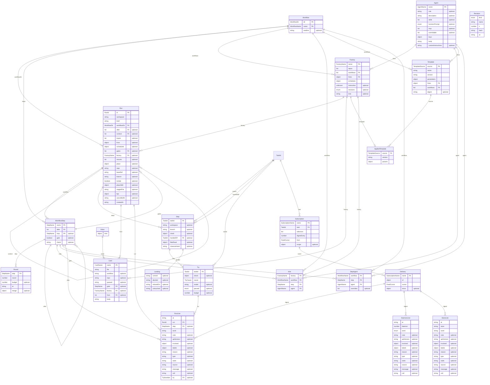

# The orchestrator's model

The orchestrator's model is its entities as Effect Schemas, each context's beside its glossary in a `<context>.model.ts` file: run-core's
in `src/record/record.model.ts` — a run (the aggregate), its steps, their tries, a round asked of a loop, and a landing — with every
identifier branded by one helper (`src/model/brand.model.ts`), checked on create by its writer's own rule and nominal on read, so no
record already written becomes unreadable. Each aggregate's invariants are checks on its schema, each citing the line of the writer
that upholds it. A relation to another layer is an identifier only: a try names the runtime's `TaskId`, which the diagram draws as a
node known by its id and no block. A model is a declaration: in S1 nothing reads through it, and its doors adopt it slice by slice.
The diagram below is printed by the code (`src/model/diagram.model.ts`, through the printer in `src/model/er.model.ts`), never drawn.

## The seams S1 leaves

- **S2, the Run door.** `readRun` decodes a record through `Run` with `Schema.decodeUnknownEffect`, behind a `Context.Service` with a
  files layer and a memory layer, as the runtime's `Journal` is; a record an invariant refuses is then named, not read.
- **S3, the Card door**, landed: the inbox's cards and the tick's tries behind `CardDoor` (`src/cards/cards.store.ts`), rooted, its
  writes checked by `CardName.OnCreate`, the card's reader and `MissedStart`; one run per card held at the Run door's create by a `wx`
  claim under `<root>/started/`.
- **S4, the Task and its Journal**, the runtime's: its model is its own (`agent-runtime/src/core/model.ts`), and run-core keeps holding
  `TaskId` by key alone; S4 picks the pattern a task's id is checked by on create.
- **S5, the definitions**, each read and written through a door on the Run door's pattern, its files today's. **S5a**, the Factory door
  (`FactoryDoor`, `src/factories/factories.store.ts`): a factory, its level, rules and servers, rooted at the store's root a program is
  given (`rootedDoor`), its wiring judged by `wiring.ts`, whose refusals `contracts/wiring.contract.ts` proves; the callers still on its stores are
  counted in `test/factory-door.baseline.ts`. **S5b**, the Workflow door (`WorkflowDoor`, `src/workflows/workflows.store.ts`): a workflow
  and its steps (`src/folder/folder.model.ts`), addressed by its folder, `WorkflowDir`, over `folder.store.ts` and `write.store.ts`,
  rooted as S5a's, a write judged against the version it was read at by `workflowVersionRefusal`, which
  `contracts/workflow-version.contract.ts` proves; a run names the folder it started on and the steps it froze (`Run.workflow`, read
  loosely); the callers still on the folder's stores are counted in `test/workflow-door.baseline.ts`. **S5d**, the Template door
  (`TemplateDoor`, `src/templates/templates.store.ts`): a template's folder or archive read, written and packed, rooted as S5a's, each
  tree written checked by `TemplateTreeWrite`; the model's `Template` (`src/templates/templates.model.ts`) is keyed by its source, and a
  factory's `template` is an `AppliedTemplate`, whose source names it. Still to come, its own card on S5a: **S5c**, the Agent and Skill
  doors (one context, the same lookup roots). A run's `pinned` revisions, left out of `Run` today, are named there.
- **S6, the subscription, the ledger and the feed**, landed, each behind a rooted door on the pattern, its files today's. The
  Subscription door (`SubscriptionDoor`, `src/subscription/subscription.store.ts`), by `SubscriptionName`: a subscription put once
  (`wx`, a name taken is `Conflict`) and checked by `Subscription`, its delivery by the model's `Delivery`. The Ledger door
  (`LedgerDoor`, `src/revisions/revisions.store.ts`), by `RevisionOf`: an append checked by `Revision`
  (`src/revisions/revisions.model.ts`), a stored entry read nominally. The Feed door (`FeedDoor`, `src/feed/feed.store.ts`),
  append-only: each line appended decoded by `FeedLine`, a cursor read at a line's boundary, the fold's memo its caller's
  (`emitFeed`). The callers still on their module spellings are counted in `test/subscription-door.baseline.ts`,
  `test/ledger-door.baseline.ts` and `test/feed-door.baseline.ts`; the store measured after them is `tools/store-measure/baselines/s6.json`.
- **AgentOnStep** is `StepAgent` in the agents' model: the agent a step is given, and what the step overrides of it, within what the
  agent offers (`Agent.overridable`).
- **Decision 9**: the place's model names `PlaceKind` (`git` or `folder`, as a step's `place:` says it, and `MountKind` before it), beside
  the runtime's `Mount`; the follow-up intent renames the place to the runtime's mount (place → mount).
- **SQLite**: Effect's `Model.Class` (`effect/schema/Model`, the class `effect/sql`'s repositories read and write) takes these branded
  fields as they are, so a store kept in a database keeps the same ids.

## The diagram

<!-- diagram:orchestrator-model:begin — generated, from the repository's root: node -e "import('./packages/agent-orchestrator/src/model/diagram.model.ts').then((m) => console.log(m.orchestratorModelDiagram()))" -->

<!-- diagram:orchestrator-model:end -->
