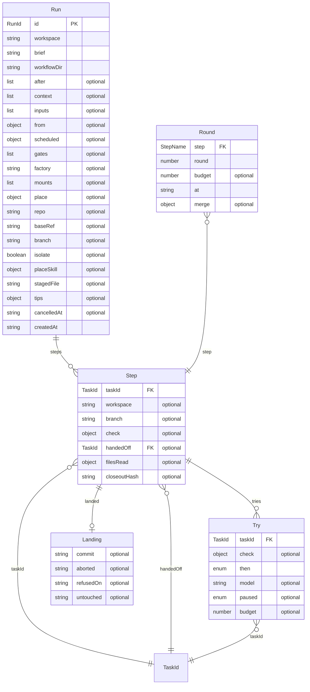

# The orchestrator's model

The orchestrator's model is its entities as Effect Schemas, each context's beside its glossary in a `<context>.model.ts` file: run-core's
in `src/record/record.model.ts` — a run (the aggregate), its steps, their tries, a round asked of a loop, and a landing — with every
identifier branded by one helper (`src/model/brand.model.ts`), checked on create by its writer's own rule and nominal on read, so no
record already written becomes unreadable. Each aggregate's invariants are checks on its schema, each citing the line of the writer
that upholds it. A relation to another layer is an identifier only: a try names the runtime's `TaskId`, which the diagram draws as a
node known by its id and no block. A model is a declaration: in S1 nothing reads through it, and its doors adopt it slice by slice.
The diagram below is printed by the code (`src/model/diagram.model.ts`, through the printer in `src/model/er.model.ts`), never drawn.

## The seams S1 leaves

- **S2, the Run door.** `readRun` decodes a record through `Run` with `Schema.decodeUnknownEffect`, behind a `Context.Service` with a
  files layer and a memory layer, as the runtime's `Journal` is; a record an invariant refuses is then named, not read.
- **S3, the Card.** The inbox's model (`src/inbox/inbox.model.ts`) behind a door of its own, as S2 puts the run's.
- **S4, the Task and its Journal**, the runtime's: its model is its own (`agent-runtime/src/core/model.ts`), and run-core keeps holding
  `TaskId` by key alone; S4 picks the pattern a task's id is checked by on create.
- **S5, the definitions**: a workflow, an agent and a skill, read from their folders through models of their own; a run's frozen
  `workflow` and its `pinned` revisions, left out of `Run` today, are named there.
- **S6, the subscription, the ledger and the feed**, each behind a door on the feed's model.
- **The held AgentOnStep card** fills `StepAgent` in the agents' model, the agent a step is given.
- **Decision 9**: the place's `PlaceService` becomes `MountKind`, the place's model, beside the runtime's `Mount`.
- **SQLite**: Effect's `Model.Class` (`effect/schema/Model`, the class `effect/sql`'s repositories read and write) takes these branded
  fields as they are, so a store kept in a database keeps the same ids.

## The diagram

<!-- diagram:orchestrator-model:begin — generated, from the repository's root: node -e "import('./packages/agent-orchestrator/src/model/diagram.model.ts').then((m) => console.log(m.orchestratorModelDiagram()))" -->

<!-- diagram:orchestrator-model:end -->
