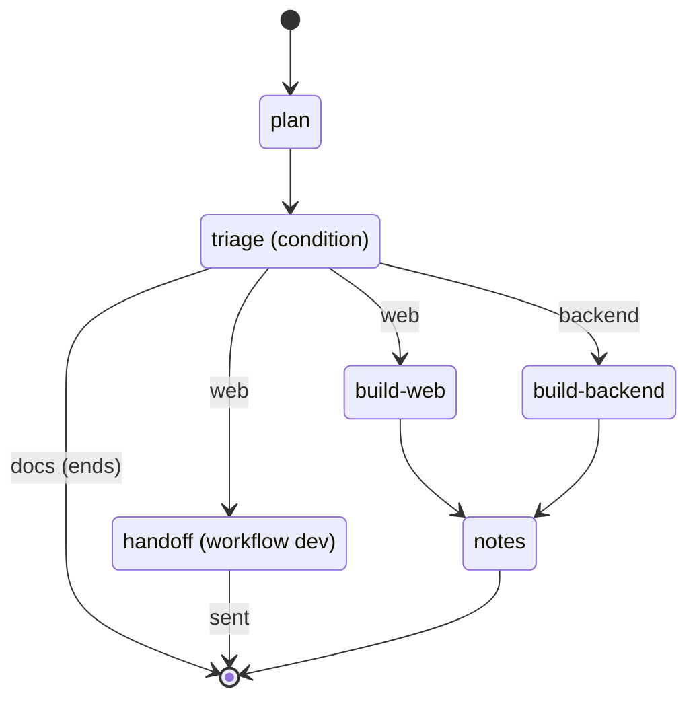

# The orchestrator's model

The orchestrator's model is its entities as Effect Schemas, each context's beside its glossary in a `<context>.model.ts` file: run-core's
in `src/record/record.model.ts` — a run (the aggregate), its steps, their tries, a round asked of a loop, and a landing — with every
identifier branded by one helper (`src/model/brand.model.ts`), checked on create by its writer's own rule and nominal on read, so no
record already written becomes unreadable. Each aggregate's invariants are checks on its schema, each citing the line of the writer
that upholds it. A relation to another layer is an identifier only: a try names the runtime's `TaskId`, which the diagram draws as a
node known by its id and no block. A model is a declaration: in S1 nothing reads through it, and its doors adopt it slice by slice.
The diagram below is printed by the code (`src/model/diagram.model.ts`, through the printer in `src/model/er.model.ts`), never drawn.

## The seams S1 leaves

- **S2, the Run door.** `readRun` decodes a record through `Run` with `Schema.decodeUnknownEffect`, behind a `Context.Service` with a
  files layer and a memory layer, as the runtime's `Journal` is; a record an invariant refuses is then named, not read.
- **S3, the Card door**, landed: the inbox's cards and the tick's tries behind `CardDoor` (`src/cards/cards.store.ts`), rooted, its
  writes checked by `CardName.OnCreate`, the card's reader and `MissedStart`; one run per card held at the Run door's create by a `wx`
  claim under `<root>/started/`.
- **S4, the Task and its Journal**, the runtime's: its model is its own (`agent-runtime/src/core/model.ts`), and run-core keeps holding
  `TaskId` by key alone; S4 picks the pattern a task's id is checked by on create.
- **S5, the definitions**, each read and written through a door on the Run door's pattern, its files today's. **S5a**, the Factory door
  (`FactoryDoor`, `src/factory/door/factories.store.ts`): a factory, its level, rules and servers, rooted at the store's root a program is
  given (`rootedDoor`), its wiring judged by `wiring.ts`, whose refusals `contracts/wiring.contract.ts` proves; no file of `src` but the door's calls
  its stores (`src/factory/door/factories.store.test.ts`). **S5b**, the Workflow door (`WorkflowDoor`, `src/workflows/workflows.store.ts`): a workflow
  and its steps (`src/folder/folder.model.ts`), addressed by its folder, `WorkflowDir`, over `folder.store.ts` and `write.store.ts`,
  rooted as S5a's, a write judged against the version it was read at by `workflowVersionRefusal`, which
  `contracts/workflow-version.contract.ts` proves; a run names the folder it started on and the steps it froze (`Run.workflow`, read
  loosely); no caller is left on the folder's stores (`src/workflows/workflows.store.test.ts` refuses one). **S5d**, the Template door
  (`TemplateDoor`, `src/template/door/templates.store.ts`): a template's folder or archive read, written and packed, rooted as S5a's, each
  tree written checked by `TemplateTreeWrite`; the model's `Template` (`src/template/door/templates.model.ts`) is keyed by its source, and a
  factory's `template` is an `AppliedTemplate`, whose source names it. **S5c**, the Agent and Skill doors (`AgentDoor`,
  `src/agents/agent-door.store.ts`; `SkillDoor`, `src/skills/skill-door.store.ts`): one context read through the same lookup roots, the
  model's `Skill` beside its `Agent`, whose `skills` are `SkillName`s (a skill as its door writes it: its `applies:` line and its
  `rules.json`, which no write of the door sets, are left out), rooted as S5a's, which root a name is read from decided by
  `lookedUp` (`contracts/lookup.contract.ts`) and a write judged against the version it was read at by `definitionVersionRefusal`
  (`contracts/definition-version.contract.ts`); no caller is left on their stores (`src/agents/agent-door.store.test.ts` refuses one). A run's `pinned` revisions, left out of `Run` today, are named there.
- **S6, the subscription, the ledger and the feed**, landed, each behind a rooted door on the pattern, its files today's. The
  Subscription door (`SubscriptionDoor`, `src/subscription/subscription.store.ts`), by `SubscriptionName`: a subscription put once
  (`wx`, a name taken is `Conflict`) and checked by `Subscription`, its delivery by the model's `Delivery`. The Ledger door
  (`LedgerDoor`, `src/revisions/revisions.store.ts`), by `RevisionOf`: an append checked by `Revision`
  (`src/revisions/revisions.model.ts`), a stored entry read nominally. The Feed door (`FeedDoor`, `src/feed/feed.store.ts`),
  append-only: each line appended decoded by `FeedLine`, a cursor read at a line's boundary, the fold's memo its caller's
  (`emitFeed`). No caller is left on the subscriptions' module spellings (`src/subscription/subscription.store.test.ts` refuses one); those
  still on the ledger's and the feed's are counted in `test/ledger-door.baseline.ts` and `test/feed-door.baseline.ts`; the store measured after them is `tools/store-measure/baselines/s6.json`.
- **AgentOnStep** is `StepAgent` in the agents' model: the agent a step is given, and what the step overrides of it, within what the
  agent offers (`Agent.overridable`).
- **Decision 9**: the place's model names `PlaceKind` (`git` or `folder`, as a step's `place:` says it, and `MountKind` before it), beside
  the runtime's `Mount`; the follow-up intent renames the place to the runtime's mount (place → mount).
- **SQLite**: Effect's `Model.Class` (`effect/schema/Model`, the class `effect/sql`'s repositories read and write) takes these branded
  fields as they are, so a store kept in a database keeps the same ids.

## The diagram

```mermaid
erDiagram
  RepositoryRun {
    RunId id FK
    string workspace
    string brief
    WorkflowDir workflowDir FK
    list after FK "optional"
    list context FK "optional"
    list inputs "optional"
    list cards "optional"
    string workflowFiles "optional"
    string carriedFiles "optional"
    object from "optional"
    object scheduled "optional"
    list gates FK "optional"
    object models "optional"
    FactoryName factory FK "optional"
    list mounts "optional"
    list volumes "optional"
    object harnessSettings "optional"
    number costLine "optional"
    object tips "optional"
    string cancelledAt "optional"
    object labels "optional"
    object saidBefore "optional"
    string slotHeldAt "optional"
    list gatesTimed "optional"
    list deniedCounted "optional"
    list settlesCounted "optional"
    boolean runTimed "optional"
    list approvals "optional"
    list acceptances "optional"
    object pruned "optional"
    object hold "optional"
    object pause "optional"
    list pinned "optional"
    string createdAt
    unknown place "optional"
    string repo
    string baseRef
    string branch
    boolean isolate
    object placeSkill "optional"
    string stagedFile "optional"
  }
  FolderRun {
    RunId id FK
    string workspace
    string brief
    WorkflowDir workflowDir FK
    list after FK "optional"
    list context FK "optional"
    list inputs "optional"
    list cards "optional"
    string workflowFiles "optional"
    string carriedFiles "optional"
    object from "optional"
    object scheduled "optional"
    list gates FK "optional"
    object models "optional"
    FactoryName factory FK "optional"
    list mounts "optional"
    list volumes "optional"
    object harnessSettings "optional"
    number costLine "optional"
    object tips "optional"
    string cancelledAt "optional"
    object labels "optional"
    object saidBefore "optional"
    string slotHeldAt "optional"
    list gatesTimed "optional"
    list deniedCounted "optional"
    list settlesCounted "optional"
    boolean runTimed "optional"
    list approvals "optional"
    list acceptances "optional"
    object pruned "optional"
    object hold "optional"
    object pause "optional"
    list pinned "optional"
    string createdAt
    object place
    unknown repo "optional"
    unknown baseRef "optional"
    unknown branch "optional"
    unknown isolate "optional"
    unknown placeSkill "optional"
    unknown stagedFile "optional"
  }
  Step {
    TaskId taskId FK
    object route "optional"
    object sent "optional"
    list pinned "optional"
    string workspace "optional"
    string branch "optional"
    object check "optional"
    TaskId handedOff FK "optional"
    object filesRead "optional"
    string closeoutHash "optional"
    list declared "optional"
  }
  Try {
    TaskId taskId FK
    object check "optional"
    TryCause cause
    string model "optional"
    enum paused "optional"
    number budget "optional"
  }
  Round {
    StepName step FK
    number round
    number budget "optional"
    string at
    object merge "optional"
  }
  Landing {
    string commit "optional"
    string aborted "optional"
    string refusedOn "optional"
    string untouched "optional"
  }
  Workflow {
    WorkflowDir dir PK
    WorkflowName name PK
    string readme "optional"
  }
  WorkflowStep {
    StepName name PK
    list after FK
    StepName loop PK "optional"
    boolean gate "optional"
    string check "optional"
  }
  Inbox {
    object tries
  }
  Card {
    CardName name PK
    string file
    string workflow "optional"
    string repo "optional"
    string queued "optional"
    StepName gate FK "optional"
    object model "optional"
    FactoryName factory FK "optional"
    list from FK "optional"
    object labels "optional"
    string body
  }
  Factory {
    FactoryName name PK
    list repos
    list workflows FK
    object hires FK
    object schedules
    unknown instruction "optional"
    enum revisions "optional"
    string tree "optional"
    object harnessSettings "optional"
    object costLines "optional"
    object origins "optional"
    number generation "optional"
  }
  AppliedTemplate {
    TemplateSource source FK
    string version
    object params
  }
  Hire {
    FactoryName factory FK
    WorkflowName workflow FK
    StepName step FK
    AgentName agent FK
  }
  Volume {
    string path
    boolean readOnly
    string name "optional"
  }
  Template {
    TemplateSource source PK
    string name
    string version
    object parameters
    object hires FK
    list workflows FK
    string digest "optional"
  }
  Agent {
    AgentName name PK
    string role "optional"
    string description "optional"
    list skills FK "optional"
    enum harnessPrompt "optional"
    list mcp "optional"
    list overridable "optional"
    object keys
    string body
    string customInstructions "optional"
  }
  Skill {
    SkillName name PK
    string title "optional"
    string description
    list tags "optional"
    list examples "optional"
    boolean preload
    string body
  }
  StepAgent {
    WorkflowName workflow FK
    StepName step FK
    AgentName agent FK
    list overrides "optional"
  }
  Subscription {
    SubscriptionName name PK
    TaskId task FK
    list selectors
    number digestEvery
    FeedCursor from
    object scope "optional"
  }
  Delivery {
    SubscriptionName name FK
    object of
    FeedCursor cursor
    object since "optional"
  }
  RunLine {
    string at
    RunId run FK
    StepName step FK "optional"
    string word
    string note "optional"
    string apiVersion "optional"
    object involved "optional"
    object labels "optional"
    string reason "optional"
    string type "optional"
    string waits "optional"
    string source "optional"
    string message "optional"
    string call "optional"
    TryNumber try FK "optional"
  }
  DaemonLine {
    string at
    number daemon
    enum word
    string note "optional"
    string apiVersion "optional"
    object involved "optional"
    object labels "optional"
    string reason "optional"
    string type "optional"
    string waits "optional"
    string source "optional"
    string message "optional"
    string call "optional"
  }
  StoreLine {
    string at
    string store
    string word
    string note "optional"
    string by "optional"
    string why "optional"
    string apiVersion "optional"
    object involved "optional"
    object labels "optional"
    string reason "optional"
    string type "optional"
    string waits "optional"
    string source "optional"
    string message "optional"
    string call "optional"
  }
  FactoryLine {
    string at
    string factory
    string word
    string note "optional"
    string apiVersion "optional"
    object involved "optional"
    object labels "optional"
    string reason "optional"
    string type "optional"
    string waits "optional"
    string source "optional"
    string message "optional"
    string call "optional"
  }
  Revision {
    enum kind
    string name
    number n
    string hash
    string at
  }
  Run ||--o{ RepositoryRun : id
  Workflow ||--o{ RepositoryRun : workflowDir
  RepositoryRun ||--o{ WorkflowStep : workflow
  Run ||--o{ RepositoryRun : after
  Run ||--o{ RepositoryRun : context
  WorkflowStep ||--o{ RepositoryRun : gates
  Factory ||--o{ RepositoryRun : factory
  RepositoryRun ||--o{ Step : steps
  Run ||--o{ FolderRun : id
  Workflow ||--o{ FolderRun : workflowDir
  FolderRun ||--o{ WorkflowStep : workflow
  Run ||--o{ FolderRun : after
  Run ||--o{ FolderRun : context
  WorkflowStep ||--o{ FolderRun : gates
  Factory ||--o{ FolderRun : factory
  FolderRun ||--o{ Step : steps
  TaskId ||--o{ Step : taskId
  Step ||--o{ Try : tries
  TaskId ||--o{ Step : handedOff
  Step ||--o| Landing : landed
  TaskId ||--o{ Try : taskId
  WorkflowStep ||--o{ Round : step
  Workflow ||--o{ WorkflowStep : steps
  WorkflowStep ||--o{ WorkflowStep : after
  Inbox ||--o{ Card : cards
  WorkflowStep ||--o{ Card : gate
  Factory ||--o{ Card : factory
  Run ||--o{ Card : from
  Workflow ||--o{ Factory : workflows
  Agent ||--o{ Factory : hires
  Factory ||--o| AppliedTemplate : template
  Factory ||--o{ Volume : volumes
  Template ||--o{ AppliedTemplate : source
  Factory ||--o{ Hire : factory
  Workflow ||--o{ Hire : workflow
  WorkflowStep ||--o{ Hire : step
  Agent ||--o{ Hire : agent
  Agent ||--o{ Template : hires
  Workflow ||--o{ Template : workflows
  Skill ||--o{ Agent : skills
  Workflow ||--o{ StepAgent : workflow
  WorkflowStep ||--o{ StepAgent : step
  Agent ||--o{ StepAgent : agent
  TaskId ||--o{ Subscription : task
  Subscription ||--o{ Delivery : name
  Delivery ||--o{ RunLine : digest
  Delivery ||--o{ DaemonLine : digest
  Delivery ||--o{ StoreLine : digest
  Delivery ||--o{ FactoryLine : digest
  Run ||--o{ RunLine : run
  WorkflowStep ||--o{ RunLine : step
  Try ||--o{ RunLine : try
```

<!-- diagram:orchestrator-model:begin — generated, from the repository's root: node -e "import('./packages/agent-orchestrator/src/model/diagram.model.ts').then((m) => console.log(m.orchestratorModelDiagram()))" -->

<!-- diagram:orchestrator-model:end -->

## A workflow's own machine

A workflow is a machine of its own: its steps are the states, and `after`, a condition's routes, a loop and the ways a run ends are
its moves. The graph every client draws (`graphOf`, `src/summary/graph.ts`) carries a `route` edge from a condition to each node that
runs on one of its routes (`when:`), in place of the `after` edge between them, and, on a workflow with a condition or a workflow node,
each node with its kind: `step`, `condition` (with the routes in its `ends:`) or `workflow` (with the workflow it files a card for).
Gates are a property of a node, not an edge. Below is the tests' `triage` workflow (`test/fixtures/team/triage`), printed by
`routedDiagram`; `src/summary/graph.test.ts` holds the data it is drawn from equal to that folder. On `web`, `build-backend` is skipped
and `notes` runs after `build-web` alone; on `docs`, every node after `triage` is skipped and the run ends there, and succeeds.

<!-- diagram:workflow:begin — generated, from the repository's root: node -e "import('./packages/agent-orchestrator/src/summary/graph.ts').then((m) => console.log(m.routedDiagram()))" -->

<!-- diagram:workflow:end -->
