# ae — an engine for agent sessions

A scheduler for agent sessions on your own machine. It does **one thing**: take a brief, run one
agent session to completion, and let you follow it — surviving its own death while it happens.

The part you must read to understand it is `src/core/domain.ts`, and `decide` in it is a screen long; the lifecycle it moves a task
along is `src/core/lifecycle.ts`, a statechart ([The lifecycle](#the-lifecycle-a-statechart-used-as-a-function)).

```bash
npm test                 # no money spent
AE_LIVE=1 npm test       # adds the one test that runs a real Claude Code session, and spends some
npm run typecheck
node bin/ae.ts           # the verbs
```

`test/readme.test.ts` holds this file to the code: it fails when this README names an environment
variable nothing reads, a file that does not exist, an `ae` verb the CLI lacks, or a count of tests
or lines — and when a source file or a brief key goes unmentioned here.

## Where this stops

**The engine runs one workload on one harness. Anything that knows about a *second* workload is
the upper layer.** "Implement, then review" knows about two — so do DAGs, boards, columns and
pull requests. They are built *on* this, through `src/index.ts`, and none of them needs `decide`
to change.

Definition of done — a closed list, and it is closed:

- [x] run a workload on a harness: durably, observably, to completion
- [x] any harness, chosen per task (`claude`, `codex`, `claude-detached`, `command`)
- [x] attempts, stop, logs — as text, each stream of a process whole (`output`), and as the conversation to follow (`transcript`)
- [x] a person's words into a session while it runs, on the record (`say`)
- [x] queued and admitted — a task waits for a word before it starts: `admit`'s, or the engine's own under its ceiling
      (`maxConcurrent`), per pool, the highest `priority` first
- [x] the feed — a cursored stream of everything that happened
- [x] resume — a task filed with `resumeFrom` continues that session; one attempt per start, and nothing tried again here
- [x] deadline — the time the machine was up since an attempt started, or a held-open turn's first one: on the monotonic
      clock within a boot, which does not run while the machine sleeps, and on the wall clock across a reboot; also the only
      thing that ends a `blocked` session, which waits on a person forever — and is not counted at work while it waits
- [x] isolation — `--worktree`, declared per task, cut by the harness

**The engine is finished.** The next thing to build is a consumer of it, not more of it. If a
change seems to belong in here, check it against the boundary above first: it almost certainly
knows about a second workload. A knob on the workload is a field carried on the task and read by a runner, never a callback
into `decide`. The harness's own — `model`, `permissionMode`, `tools`, `allowedTools`, `disallowedTools`, `effort`, `mcp`,
`contextTokens`, `worktree`, `background`, `budgetUsd`, `mounts`, `callAdmission`, Claude Code's own flags under `claude`, and Codex's own under `codex` — are one object, the task's `config` (`HarnessArgs`, `src/harness/args.ts`):
the adapter's configuration, which `domain.ts` and `engine.ts` hand to the runner without opening, and
`test/core-reads.test.ts` refuses either the day it reads one — or names a budget at all. `queued` is the task's own, read by
`decide`: whether its turn waits for `admit`.

**No named field per harness flag** (the owner, 2026-09-25). A flag only Claude Code has goes under `claude`, and one only Codex has
under `codex` (`trustFrom`, below); a key is named
on `HarnessArgs` only when more than one harness is given it (the model, the effort, the tools, the fence, `mcp`, the budget),
another harness translates it (`worktree`, which Codex turns into a worktree of its own and the A2A release carries), a spec
declares it or a layer above judges it (`contextTokens`), or it chooses the runtime's own process (`background`). A key moved
into the bag is read at its old place off a journal (`upgrade` in `src/core/engine/journal.ts`) and refused there, naming
the new place (`FORMER_ARGS`): `remoteControl` moved on 2026-09-25.

### Mounts

A task reaches folders beyond its `cwd` through `config.mounts`, as a Pod's container is given its `volumeMounts`: each an absolute
path and whether the session may only read it — `[{ "path": "/srv/notes", "readOnly": true }]` (`Mount`, `src/harness/mounts.ts`).
A local process sees the disk as it is, so a mount's source and its place are one path. `readOnly` is required: a mount left
unmarked is refused, never silently writable. `file()` refuses a value that is not a list, an entry that is not
`path` and `readOnly` alone, a path that is not absolute and resolved or holds a NUL, and a path given twice (`mountsRefusalOf`).

Each harness renders them its own way, and one that cannot hold a mount's mode refuses the task before it is journalled, naming
the harnesses that do (`HarnessSpec.mounts`, `mountsMisplaced` in `src/service/harness-refusal.ts`):

- **Claude Code** (a job, `claude-detached`, `claude --bg`) holds both modes. Each mount is `--add-dir <path>`, and a read-only one
  is also `Edit(//<path>/**)` in the one `--disallowedTools` list (`claudeMountArgs`, `claudeDenies`). `--add-dir` grants writes
  as well as reads where the mode lets a session write; the deny holds the folder read-only in `dontAsk`, `acceptEdits`, `auto`
  and `bypassPermissions`, a Bash redirection into it included. A path a permission rule cannot carry — a parenthesis, a
  glob's `*`, `?` or bracket, a backslash, a whitespace other than a space (`CLAUDE_UNRULED`) — is refused; a space, a comma and braces
  are carried. The vocabulary door answers the same characters (`unruledIn`), for a caller that builds a rule from a path.
  `--add-dir` also lists the folder's own `.claude/skills` in the session; its `CLAUDE.md` is not read. The vocabulary door
  names the folders a harness reads so as its own configuration (`CONFIG_FOLDERS`, `configFolderIn`), for a caller that puts
  files into a folder it mounts.
- **Codex** holds a read-only mount and is given nothing for it: its `read-only` and `workspace-write` sandboxes read the whole
  disk and write only the workspace. It refuses a read-only mount in `danger-full-access`, which writes everywhere, and a writable
  one, which only `--add-dir` would give and `exec resume` rejects.
- **The command harness and a remote agent** hold none: a command reads the disk it runs on as it is, and a remote agent has none
  of this machine's disk. A `RunnerOps` brought as its own is handed them.

### Admission

A task asks a command before each of its session's calls to some tools through `config.callAdmission`, as a Pod's probe gives the kubelet
an `exec` to run: `{ "command": ["my-admit"], "tools": ["Bash"] }` (`Admission`, `src/harness/admission.ts`). The command reads the
call on its stdin, `{ tool, input, cwd }` (`AdmissionCall`), and prints `{ decision, reason }` (`AdmissionAnswer`): `allow`, `ask`
the person, or `deny`; or nothing, for no opinion, and the call meets the session's own rules. A command that fails, runs past 20
seconds or prints what is no answer answers `ask`: a fault goes to the person, never through. A call to a tool `tools` does not name
pays no process. `file()` refuses a value that is not `command` and `tools` alone, a command that is not a list of strings with no NUL,
and `tools` that names no tool (`admissionRefusalOf`); and admission on a harness that runs no command before a call — Codex, the
command harness, a remote agent, a `HarnessSpec` that does not declare `callAdmission` — naming those that do (`admissionMisplaced`).

- **Claude Code** (a job, `claude-detached`, `claude --bg`) runs it as a `PreToolUse` hook matched to `tools`, merged into the task's
  `claude.settings` after the hooks they hold (`admittedFlags`); settings given as a file beside admission are refused, since the
  runtime rewrites no file. The hook runs the runtime's own adapter, `ae admission -- <command…>` (`admitCall`, loaded with no engine), which turns Claude
  Code's hook input into the call and the answer into its `permissionDecision`. A hook's `ask` prompts over the session's allow
  rules, a person's "don't ask again" among them; its `allow` does not lift an `ask` rule (`CLAUDE.md`, *Claude Code, as a harness*).

### One attempt per start

The engine starts one attempt at a task, and whatever ends it settles the task: `succeeded` when its harness ended it done,
`failed` when it failed, was lost, could not start or ran out of time, `stopped` when it was asked to stop.
Nothing here tries again. Whether to — and whether to continue the session or start clean — is a judgement about the work,
so it is the caller's: file the task again, with `resumeFrom` the session's id to continue it. In a workflow the orchestrator
does it, as `retries:` after a check refuses a step and as `wf retry` for a try that failed, was lost or could not start.

`EndReason` is recorded on the `ended` event rather than inferred later, because by the time anyone decides, the evidence is
gone, and *lost* and *failed* are different facts: a lost session's transcript is real work nobody judged, and a failed one is
a conclusion that dropping a model back into its context tends to reproduce. An attempt the harness refused before a session
ran (`unstartable`) keeps the `resumeFrom` it was filed with on its record, so a caller that continues it continues that chain
(open issue 5).

Until stage 4a part 2 the engine decided this itself: `maxAttempts` counted attempts and a `resume` policy (`interrupted`,
`always`, `never`) chose between continuing and starting clean. Nobody used it — the orchestrator filed every task
`maxAttempts: 1` — and both are retired: `file()` and `ae start` refuse either, at any value, saying where trying again went. A
journal written before still folds, and one with several attempts reads as it did.

Verified against the live harness, when the engine still continued attempts itself: attempt 2 resumed attempt 1 under
**its own name**, got a fresh session id from the harness, and genuinely continued the conversation (`COUNT.txt` came back
`1\n2`). Two rows on the board, one thread of work — which a filing with `resumeFrom` does the same way.

## The model

```
DESIRED   what you asked for      →  the journal, append-only JSONL      (ours)
OBSERVED  what the machine does   →  claude agents --all --json          (the harness's)
JOIN KEY  a name we choose        →  claude --name ae/<task>/<attempt>
                                        ↓
                            decide(desired, observed) → one action
```

That's the whole engine. `decide()` is pure, total, and returns exactly one step; everything
effectful is the four verbs of `Runner`, and four optional ones: one that finds a session by its name for less than observing them all, one that lets a finished session go, one that reads its conversation, and one that hands a running session a person's words. Kubernetes' control plane for the loop, durable
execution's journal for the memory, and the local harness as the kubelet.

**The engine never holds a session.** A step on `claude` runs as a job — one session on the Agent SDK in a process of its own
(`bin/ae-claude-job.ts`), in a worker the engine detaches, whose run file is its registry; a session filed with `config.background: true` runs as `claude --bg`, which hands it
to the harness, which already owns resume, stop, logs and a registry that outlives us. Either way the session outlives the engine. So a three-hour session is not a three-hour
process here — the engine can be killed, upgraded or restarted at any point in it.

### The lifecycle: a statechart used as a function

Since thin runtime stage 5 (2026-09-25) `decide` is three readings and a move. `lifecycleOf` reads where a task stands off
its journal alone; `observe` reads one event off the journal and the pass's sightings — the harness let the session go, the
deadline passed, nothing runs and the turn ended `failed`; and the lifecycle, an [XState](https://stately.ai/docs/xstate)
machine in `src/core/lifecycle.ts`, names the edge for that event in that state: the next state and the one action. **The machine
never runs.** No actor, no interpreter, no timer: XState's pure `transition(machine, snapshot, event)` is asked what an edge
does, from a snapshot built for the state the journal gave. The journal stays the state, a pass carries nothing, and a
restart reads the same state off the same journal — adoption after a crash is the `starting` state's self-edge on a
session found under the name.

The states are A2A's `TaskState` — `submitted`, `working`, `input-required`, `completed`, `failed`, `canceled` — and three
of the runtime's own: `starting` (an attempt's intent journalled, no spawn: the crash window), `stopping` (a person asked it
to stop) and `ending` (no attempt runs and the record says how the turn ended). A2A's `rejected` is an attempt's
`unstartable` end. A person's word — `stop`, `answer`, `close` — enters a state by the journal entry its verb writes; the
machine's edges are what a pass does. The phases a person reads on `ae show`, `wf ls` and the board are `viewOfState`'s,
and did not change.

**A sighting speaks the same names** (since 2026-09-25). `Sighting.state` is `SessionState`, a literal union of A2A's
eight `TaskState` names in `src/core/session.ts`: the SDK stays out of the pure core. Each driver translates its harness's words
once, at its own edge, and says why there: Claude Code's registry in `claudeStateOf` (`done` is `completed`, `stopped`
`canceled`, and `blocked` is `auth-required` when what it waits for names signing in, `AUTH_WAIT`, else `input-required`);
the detached worker's run file, which keeps the worker's words, in `detachedStateOf`; a remote agent passes its Task's
state through; a `RunnerOps` brought as its own reports A2A's names, and `formerStateOf` reads the five former words where a
remote registry entry an older runtime wrote still says them. `observe` gives the three names no harness spoke before no event of their own, since each asks nothing
the journal can tell apart: `submitted` is at work (`SESSION_LIVE`, or quiet), `auth-required` waits on a person as
`input-required` does (`SESSION_BLOCKED`, `waitingFor` says which), and `rejected` is an end recorded `failed`. So the
machine and its diagram did not change. The journal keeps its three end words (`Ended`: `done`, `failed`, `stopped`,
`endOf`), so a journal written before folds as it did, and a view prints each name in the words views always printed
(`phaseWordOf`: `running (working)` is what admission compares). `test/session-state.test.ts` holds the corpus as it
stood before the names changed, translated, to the action `decide` answered then in every case
(`test/fixtures/decide-corpus.json`), and each of the three names to the one it joins.

**An event with no edge is refused, never guessed.** `decide` answers `nothing` with the refusal on it (`refused`), the
pass reports every one on its `TickReport` (`refused`: task, state, event), `ae tick` prints each, and the orchestrator's
`wf up` logs each once while it lasts. A settled task is asked nothing (`settledQuiet`, `decide`'s first line), so the
store's settled tasks are never refused. `src/core/lifecycle.test.ts` walks a corpus of every journal shape under every
sighting and holds that each move is an edge that lands where the journal it writes then says, and that every edge is
taken. This diagram is the machine's, generated by `diagram()` in `src/core/lifecycle.ts`, never drawn: the repository's
diagram test (`tools/guards/test/diagrams.test.ts`) fails when it differs, naming the command on its marker.

```mermaid
stateDiagram-v2
  state "input-required" as input_required
  [*] --> submitted
  submitted --> starting: READY / start
  submitted --> submitted: QUEUED / nothing
  submitted --> submitted: PREVIOUS_LIVE / stop
  submitted --> failed: NO_SESSION_TO_CONTINUE / settle
  starting --> starting: SESSION_LIVE / nothing
  starting --> starting: SESSION_IDLE / nothing
  starting --> starting: SESSION_RESPAWNING / nothing
  starting --> ending: RESPAWN_OVERDUE / record-end
  starting --> starting: SESSION_BLOCKED / nothing
  starting --> input_required: SESSION_QUIET [holds] / record-end
  starting --> ending: SESSION_QUIET / record-end
  starting --> input_required: SESSION_ENDED [holds] / record-end
  starting --> ending: SESSION_ENDED / record-end
  starting --> ending: SESSION_STOPPED / record-end
  starting --> starting: DEADLINE_PASSED [live] / stop
  starting --> ending: DEADLINE_PASSED / record-end
  starting --> working: UNSPAWNED / spawn
  starting --> starting: UNREAD / nothing
  starting --> ending: SPAWN_REFUSED / record-end
  working --> working: SESSION_LIVE / nothing
  working --> working: SESSION_IDLE / nothing
  working --> working: SESSION_RESPAWNING / nothing
  working --> ending: RESPAWN_OVERDUE / record-end
  working --> working: SESSION_BLOCKED / nothing
  working --> input_required: SESSION_QUIET [holds] / record-end
  working --> ending: SESSION_QUIET / record-end
  working --> input_required: SESSION_ENDED [holds] / record-end
  working --> ending: SESSION_ENDED / record-end
  working --> ending: SESSION_STOPPED / record-end
  working --> working: DEADLINE_PASSED [live] / stop
  working --> ending: DEADLINE_PASSED / record-end
  working --> working: UNSEEN_IN_GRACE / nothing
  working --> working: UNREAD / nothing
  working --> ending: LOST / record-end
  input_required --> input_required: AWAITING_INPUT / nothing
  stopping --> stopping: SESSION_LIVE / stop
  stopping --> stopping: SESSION_IDLE / stop
  stopping --> stopping: SESSION_BLOCKED / stop
  stopping --> stopping: SESSION_QUIET / stop
  stopping --> stopping: SESSION_ENDED / record-end
  stopping --> stopping: SESSION_STOPPED / record-end
  stopping --> stopping: UNSPAWNED / record-end
  stopping --> stopping: UNSEEN_IN_GRACE / record-end
  stopping --> stopping: LOST / record-end
  stopping --> stopping: UNREAD [overdue] / record-end
  stopping --> stopping: UNREAD / nothing
  stopping --> canceled: NOTHING_OPEN / settle
  ending --> completed: CLOSED [lastDone] / settle
  ending --> failed: CLOSED / settle
  ending --> failed: DEADLINE_SPENT / settle
  ending --> completed: ATTEMPT_ENDED [endedDone] / settle
  ending --> canceled: ATTEMPT_ENDED [endedStopped] / settle
  ending --> failed: ATTEMPT_ENDED / settle
  ending --> ending: UNREAD / nothing
  ending --> ending: PREVIOUS_LIVE / stop
  ending --> ending: BACKING_OFF / nothing
  ending --> starting: RESTART_DUE / start
  submitted --> stopping: requestStop [stoppable] (by person)
  starting --> stopping: requestStop [stoppable] (by person)
  working --> stopping: requestStop [stoppable] (by person)
  input_required --> stopping: requestStop [stoppable] (by person)
  ending --> stopping: requestStop [stoppable] (by person)
  input_required --> submitted: answer [awaitsWord] (by person)
  input_required --> ending: close [awaitsWord] (by person)
  completed --> [*]
  failed --> [*]
  canceled --> [*]
```

<!-- diagram:lifecycle:begin — generated, from the repository's root: node -e "import('./packages/agent-runtime/src/core/lifecycle.ts').then((m) => console.log(m.diagram()))" -->

<!-- diagram:lifecycle:end -->

The guards: `holds`, a task held open whose attempt ends `done`, waits on a person; `live`, a session past its deadline
still running is stopped rather than ended; `overdue`, a person's stop whose harness could not be read (`UNREAD`) ends
the attempt once its deadline has passed, and waits for a read until then; `lastDone`, `endedDone` and `endedStopped`, the
end a task settles on. A person's verbs are no edges, since no pass takes them: `VERBS` declares each, drawn above with
who writes it and no action — `requestStop` from any state not final and not `stopping` under `stoppable`, `answer` and
`close` from `input-required` under `awaitsWord` — and each refusal asks its guard first (`verbTakes`, `VERB_GUARDS`), which
`src/core/verbs.test.ts` holds to the data. `UNREAD` is a pass that could not read the attempt's harness (`Observation.unread`): nothing is
known of the session, so nothing is done in `working` — where the deadline, read first, still ends it — and it never
counts toward `LOST`; in `starting` it is read before the missing spawn, so an intent a crash left with a session running
under its name is neither spawned a second time nor cut until a pass reads the harness. XState
is a dependency of this package alone, imported by `src/core/lifecycle.ts` alone (`test/xstate-boundary.test.ts`), and no
entry exports the machine or its move, as none exports `decide`. `agent-runtime` exports its graph as plain data
(`lifecycleGraph`: the states, the edges, the verbs, the first and the final states), which the board draws on its `/machines` page.

**A task's path through it is read, never kept.** `engine.path(taskId)` replays the journal entry by entry (`pathOf`,
`src/core/path.ts`): for each, the state `lifecycleOf` reads off the journal up to it, the entry's kind and its `at`, from the
filing to now. It writes nothing and asks no harness. The event is the journal's word — `spawned`, `ended`, `input` — and never
the machine's, which a pass computes from its sightings and does not journal; a person's verbs (`stop-requested`, `input`,
`closed`) move a task where `VERBS` says and no pass does, and the path shows the move all the same. A task this engine has no record of has an
empty path.

### Letting a finished session go

Claude Code keeps every `--bg` session in `claude agents` until something removes it, and one that
has given its closeout stays there `working/idle` for good — every run used to leave its sessions
behind, to be cleared by hand. So once an attempt's end is on the record, the engine **releases** its
session: `claude stop` if it still runs, then `claude rm`. Whether it still runs is the registry's
word: a session whose end is on the record because it went quiet, or gave its closeout, is still
working as far as `claude agents` is concerned. It is I/O applied to the record, not a
decision — `decide` is not asked — and it is level-triggered: asked on every pass that still sees such
a session, so a crash between writing the end and releasing is repaired by the next pass, and a
release the harness refuses is asked again. A session listed `done` whose process still runs is stopped before it is
removed too, and what it cost is read once it is stopped: Claude Code writes a session's cost only as its process exits
([What an attempt consumed](#what-an-attempt-consumed)).

**Measured before relying on it** (`test/live.test.ts`, Claude Code 2.1.270): a session told a word
settled and was released in the same pass; it was gone from `claude agents`, `ae logs` still read its
transcript, and a second task filed with `resumeFrom` its id said the word back. `ae logs` finds a released session by the id recorded when its attempt ended, or when its task
settled with the attempt still open, and asks the task's own harness for it.

A task stopped by a person, or past its deadline, ends its open attempt — reason `operator` or `deadline` — before it
settles, and that end carries its session's id (since 2026-09-19; below). A journal from before settled over the open
attempt, and has the id on its `settled` entry instead, so that session is released like any other and `ae logs` still
reads it. One kind is left listed: a task that asked for a `worktree` has its session
stopped and not removed, because `claude rm` deletes the worktree with the session and the task's work
is in it. (So is a session whose task settled before its id was recorded: removed, it could not be
read.) `release` is optional on `Runner`: the detached runner has none, because its run files are the
record `logs` reads.

### Why there are no leases

Because we do not own the thing being leased. "Is it still running" is a question we *ask*
(`observe`) rather than a claim we *hold*. That deletes the lease table, the renewal timer, the
liveness probe, the expiry reclaim and the abort plumbing — most of the version of this that tried
to own the process.

## Using it

The engine is an Effect service, `Engine`, and `agent-runtime` its one face: `Engine.layer(options)` takes the engine's options,
whose `root` — where the file-backed store lives — is required and has no default, so an engine built with none does not compile:
whoever composes the program says where its records go (`ae` reads `AE_ROOT` once, in `src/cli/main.ts`, and hands the root down),
and each verb is an Effect whose refusal is a tagged error (`FileRefused`, `TickRefused`, `ListRefused`, …) whose message says
what to do instead, with no verb in front. A program is run at its edge — `ae`, the api's server, a test — with `Effect.runPromise`;
a caller that writes no Effect reaches the system through the api. Keep your `effect` version aligned with this package's: Context
tags are identity-based, and two copies in one tree do not see each other's services. The examples further down are lines of such a
program, `engine` the service it yields (`const engine = yield* Engine`).

```ts
import { Effect } from 'effect'
import { codex, Engine } from 'agent-runtime'

const layer = Engine.layer({ root, harnesses: { claude: 'claude-bg', codex } })

const { entries, cursor } = await Effect.runPromise(
  Effect.gen(function* () {
    const engine = yield* Engine
    yield* engine.file({ brief, cwd, harness: 'codex' })
    yield* engine.tick()
    return yield* engine.feed(0)
  }).pipe(Effect.provide(layer)),
)
```

Bring your own store — a `StoreOps`, each method an Effect, `list` an Effect value, and `subscribe(onChange)`, optional, to wake
`watch`:

```ts
import { JournalError } from 'agent-runtime'

const tried = <A>(taskId: string, f: () => Promise<A>) =>
  Effect.tryPromise({ try: f, catch: (e) => new JournalError({ taskId, message: String(e) }) })

Engine.layer({
  root, // still required: the engine's runners write under it, whatever store keeps the records
  journal: {
    append: (taskId, event) => Effect.asVoid(tried(taskId, () => db.event.create({ data: { jobId: +taskId, payload: event } }))),
    read:   (taskId) => tried(taskId, async () => (await db.event.findMany({ where: { jobId: +taskId } })).map(r => r.payload)),
    list:   tried('', async () => (await db.job.findMany()).map(j => String(j.id))),
    feed:   (after) => tried('', async () => { /* WHERE id > after ORDER BY id */ }),
  },
})
```

Bring your own harness — three ways, in order of how much you have to write:

| | |
|---|---|
| `'claude'` | Claude Code as the engine runs it by default: a step as a job (one session on the Agent SDK, in a process of its own), and a background session (`claude --bg`) when its task asks with `config.background: true` |
| `'claude-bg'` | Claude Code's background sessions alone; it keeps the registry |
| a `HarnessSpec` | any CLI that runs a prompt and exits — a command and an exit code |
| a `RunnerOps` | four Effect methods, and six optional ones, `find`, `output`, `release`, `transcript`, `say` and `refuses`, for anything else at all; its own `refuses` is asked by `file` |

**`src/cli/main.ts` builds its engine from `Engine.layer(…)` once and runs each verb as an Effect**, a refusal worded by the runtime's
`refusalWords` — exit code 2, the message led by the verb — through the entries alone. `test/verb-refusals.test.ts` pins the
`Engine` service's verbs and holds each verb's refusal to a tagged error that `refusalWords` words so.

The bare `file` building block (`src/core/engine/filing.ts`) refuses what `Engine`'s `file` refuses of the task itself, in the same
sentence — `refusalOf` in `src/core/engine/filing.ts` for the task's own fields, and `argsRefusalOf` in `src/harness/args.ts` for the
checks every harness shares of its `config`, which `file` asks and every `Runner` made by `Runner.layer` asks too, so a runner built
with `Runner.of` alone is no way round them; `test/refusal.test.ts` holds both — and fails with `FileRefused`, a tagged error beside
`JournalError`, with nothing journalled. It refuses no harness's words: it has no harnesses to ask, so an unknown harness or a
permission mode the harness rejects is still journalled there (open issue 6). `Engine`'s `file` has them, and refuses them in that
harness's words (`harnessRefusalOf` in `src/service/harness-refusal.ts`).

## Several harnesses, one board

A task picks its harness in the brief. Verified live, concurrently, on one board:

```
t-mtxodj74  claude    succeeded  1/1  Write a JavaScript function isPalindrome(s)
t-mtxodjd4  codex     succeeded  1/1  Write a file REVIEW.md containing three bullet
```

```md
---
cwd: /path/to/repo
harness: codex        # claude (default) | codex | claude-detached
---
Review the diff on this branch for race conditions.
```

Four are wired:

| harness | how it runs | who keeps the registry |
|---|---|---|
| `claude` | a job: `query()` in `bin/ae-claude-job.ts`, in a worker we detach, printing the SDK's messages as the stream `claude -p --output-format stream-json` printed; with `config.background: true`, `claude --bg --name` | a job: **us**, a run file; a background session: **the harness** — `claude agents --json`, free |
| `codex` | `codex exec --json`, in a worker we detach | **us** — a directory of run files |
| `claude-detached` | `claude -p --output-format json`, same worker | us (there to compare the two paths) |
| `command` | the process a task's `config.command` names, same worker — no agent at all | us |

**Why two mechanisms and not one.** Claude Code keeps a registry of background sessions and will
answer questions about them from any process. Codex has no such thing: `codex exec` runs in the
foreground and exits. So for Codex we detach a worker per session and keep the registry ourselves
(`bin/ae-worker.ts` writes it, `src/harness/detached/detached.ts` reads it).

That costs exactly one thing: **a heartbeat**. A worker that gets killed leaves a run file saying
`working` forever, and nothing on disk tells that apart from a session thinking hard. So the worker
beats every 5s and `observe` calls a stale beat dead — which is a lease, in the only form a lease
has ever taken. It is the price of not having somebody else's registry to read, and therefore the
price of running more than one harness. It is a handful of lines, because the engine already had a
journal and a seam.

The beat is written on two clocks: `heartbeatAt` on the wall clock, and `beat`, `{ boot, ms }`, on the monotonic clock every
process of a boot shares. The lease is measured on `beat` when it was written in this boot, so a wall clock stepped forward
(NTP, a VM's time sync) never reads a live worker dead; a beat of another boot, or none, is measured from `heartbeatAt`
(`elapsedMs`, `src/core/clock.ts`).

The other way round, the run file removed is a stop: `stop` finds the worker by it, so a worker whose run file is gone,
alone or with its store, ends its harness and exits at its next write, and never writes the file again (open issue 32).

**Adding a harness is a value, not code** — `HarnessSpec` is a command, an optional start event, and
optionally the words it refuses, a reader of what it prints, and where it keeps its conversation. Given to
`Engine.layer`, it may name a `pool` to share the engine's ceiling with another harness (*Queued and admitted*):

```ts
export const codex: HarnessSpec = {
  name: 'codex',
  command: (r) => ({ cmd: 'codex', args: ['exec', '--json', '-C', r.cwd, ..., r.brief] }),
  refuses: (task) => /* a sentence when the task asks for a sandbox or effort Codex lacks */,
  start: { event: { type: 'thread.started' }, id: 'thread_id' },
}
```

The start event is where the session's own id is read, by the worker, off whole lines of stdout: the first JSON object whose keys
hold `event`'s values, its `id` field a string of hex and dashes, 16 or more. A start printed with anything else there is refused
(`startRefused` on the run file): that session is unread while its process runs, and read as failed, with no id, once it has
ended, so its task settles and `ae forget` can let it go; the harness's others are read. An output its spec's `readOutput` refuses
— a `codex exec --json` line that does not decode — is read the same way, with why said as a warning on every look (`lookOf`).

Exit 0 is success, anything else is failure. That is all a generic harness has to say, and it is
enough. `decide` never learns that harnesses exist — adding all of this changed it by zero lines,
which is the test of whether the seam was in the right place.

### A process as a harness: `command`

A check — `npm test`, a build — is a process, not an agent, and runs on the same worker as one (`commandHarness`,
`src/harness/command/command.ts`). A task gives it three arguments of its `config`, the fields a Pod's container has:

| key | what it is |
|---|---|
| `command` | the program and its arguments, a list of strings, the program first, no shell between: `["sh", "-c", "npm test"]` |
| `env` | variables laid over the worker's own environment, names to strings: `{ "CI": "1" }`. Journalled with the task, so it carries no secret |
| `niceness` | 0 to 19: above 0 the process runs under `nice -n`, and in the idle IO class (`ionice -c3`) where the machine runs that — asked once a process, as the command would run it |

Each is refused at `file()` when it is not what it says, and on any harness but one whose spec says `commandArgs: true`, which
would run its own session without it; the command harness refuses a task without `command`, one that carries an agent's
argument (`model`, `permissionMode`, …), a `closeoutSchema` and a `resumeFrom`. The brief is not read: the command is the work.

Its exit code is its verdict, on the attempt: 0 succeeded, anything else failed. A command a stop ended has none, whatever it
exited with. Its stdout and its stderr each go whole to a file of their own beside the run's log (a spec that says
`streams: true`), cleared when the name is spawned again, and are read by `output`, never off the run directory:

```ts
const id = yield* engine.file({ brief: 'test', cwd, harness: 'command', config: { command: ['npm', 'test'], niceness: 10 } });
// … ticked to its end
yield* engine.output(id, 'stdout');        // all of it
yield* engine.output(id, 'stderr', 4096);  // its last 4096 bytes, starting on a whole character
```

`output` asks the task's latest attempt, observes nothing, and answers `undefined` before an attempt or for a run that kept
no streams. It refuses (`OutputRefused`, exit 2 in `refusalWords`) a stream that is neither, a `lastBytes` that is not a whole
number above 0, a task the board does not have, and a harness that keeps no whole streams, whose `logs` is what it has. On
the command line, `ae output <task> [stdout|stderr]`, which says on stderr when there is nothing kept to print.

### Beneath the harnesses: an A2A seam

Each harness is an [A2A](https://a2a-protocol.org) agent of its own, and the engine reaches it through the
`@a2a-js/sdk` client, in this process, with no HTTP between them. A session is an A2A Task named for it, `ae/<task>/<n>`,
whose `contextId` is the harness's own id for the conversation — the `nativeId` that `--resume` takes — or empty until
something has seen it; a spawn is a user Message marked with the runtime's extension (`urn:agent-runtime:session:v1`), the
brief its one text part, the session it continues (`resumeFrom`) its `contextId`, and the rest of the request — `config`
whole and unopened — its metadata; `observe` is a listing, `stop` a cancel, and `say` a plain follow-up message on the
session's Task, in no context or the session's own. What A2A
has no call for is the extension's methods: `findSession`, `sessionLogs`, `releaseSession`, `sessionTranscript` and `observeSessions` (an
`observe` told the sessions the journal expects, below), and `harnessQuota`, the one that is no session's (`quota`, below). The harness's card lists
the ones its driver answers, and whether its sessions take words, and a verb the card leaves off is offered to nobody.
What a harness says comes back in
the same words: a spawn it refused is `REJECTED` and ends the attempt `unstartable`, one that may have started is
`SUBMITTED` and waits out the grace window, as before.

The agent (`src/a2a/handler.ts`) holds nothing. Every answer is read afresh off the harness and the journal, so a runtime
restarted mid-session answers for a session it never started, before its first tick, and an attempt the harness has let
go is answered from the journal (`test/restart.test.ts`). It is not the SDK's `DefaultRequestHandler`, whose task store
would be a second record beside the journal. Streaming, push notifications and an extended card are refused in the SDK's
own errors, never taken and ignored.

What a Task says (stage 2 part 5). **Its context is the conversation**, so a listing filtered by `contextId` is every
attempt that continued one: a Claude Code job keeps its id on `-p --resume` (M12), so a step's tries and a held task's turns
share one, while a `claude --bg` resume starts under a new id and so in a context of its own. A job's context is empty until
its first `stream-json` line names the session. **What the workload closed with is the Task's one Artifact**, `closeout`:
a `data` part, or `text/plain` for prose (Codex's), and the time it was given in its metadata when the harness said. A
listing carries it only when it asks (`includeArtifacts`, A2A's default being no); `getTask` always does; the sighting
`observe` reads is unchanged. **A signed session whose task is held open is `INPUT_REQUIRED` on `getTask`**, whether its
harness still lists it `done` — a job is never let go — or not at all: the journal is read for that, once per read of a
session listed `done`. A listing keeps the harness's `COMPLETED` of the same session, since `observe` reads the harness's
word; the two differ on purpose. `answer` and `close` stay the engine's verbs, journalled; the agent reads the journal and
never writes it. Not done: no collected files as Artifacts (they are the orchestrator's, for its own Task, stage 6); and a
Task is still one attempt, not one runtime task.

**Streaming is done** (`SubscribeToTask`, `a2a/follow.ts`). A harness whose runner follows a session (`follow`) says
`capabilities.streaming: true` on its card and answers a subscription with the Task, then each moment as a status or an artifact
update, until the session settles; one whose runner does not says `false`, and a subscription is refused in the SDK's own error.
Nothing above the runtime reads a session again on a timer: the api relays what the runtime streams, and a step whose session is
not streamed is sent what it has said and told so. What each harness gives:

| harness | streams | what a follower is handed |
|---|---|---|
| `claude`, a job | yes | its state, the text of each message in pieces as it is written (`--include-partial-messages`, `claudePartials`), and each whole event of its transcript once (`followOf`, `test/follow.test.ts`) |
| `claude`, `--bg` | yes | its state from `claude agents`, read once a second for every follower, and each whole line of its transcript once, across its turns and respawns (`bgFollowOf`, `test/follow-bg.test.ts`) |
| `codex` | yes | its state, and each event of its rollout once and in order as Codex writes it, its stdout decoded as it comes; no pieces of text: `exec --json` prints each message whole (`followOf`, `codexPartials`, `test/codex-follow.test.ts`) |
| `claude-detached` | no | nothing while it runs: `claude -p --output-format json` names its session only as it exits; its transcript is read once it has |
| `command` | no | nothing: a process keeps no conversation; its output is `logs` and `output` |
| a remote A2A agent | yes | its Task's own stream where its card says it streams; else, and after five drops in a row, its Task read whole every second at the runtime's edge, each event once (`a2a/remote-follow.ts`, `test/remote-follow.test.ts`) |

**Codex as an A2A agent** (stage 3). The detached `codex exec` driver answers in the same shape, through the real worker
and the SDK's client, with a fake `codex` (`test/codex-agent.test.ts`) and once live (M13, open issue 31):

| A2A | Codex | Proven by |
|---|---|---|
| `contextId` | the thread id from `thread.started`; empty until that line is printed | a Task found by `listTasks({ contextId })` |
| a held task's turns | `codex exec … resume <thread> <words>`, the same thread id and the same rollout file | M13, codex-cli 0.154.0 |
| the `closeout` Artifact | the `-o` file: a `data` part under a schema, `text/plain` without one parsed | a listing without `includeArtifacts` carries none |
| `cancelTask` | SIGTERM to the worker, which ends the harness's process group, then `CANCELED` | the harness and its grandchild end; a done session is refused |
| `INPUT_REQUIRED` | only a signed attempt of a held task, between turns | the answered turn is `WORKING`, then waits again |

What `codex exec` cannot do, said rather than faked: **it takes no words while it runs** — the card says `say: false`, and a
follow-up is refused in A2A's own terms, naming a spawn in the session's context, once it has ended, as the way on, while `wf` and the board keep
the harness's own words (`noChannel`); **it never asks mid-run** — the worker has no `blocked` to write, so a running Codex
Task is never `INPUT_REQUIRED`, only a held one between turns; **it keeps no spend cap**, so a budget is refused at `file`
and at `answer`; and **its context is empty until its first line** is printed. As for every detached run, a cancel that
lands before the worker has published its pid is left on disk, and the worker starts no harness (open issue 30, fixed). The `claude -p` job shares the worker and is stage 2's, unchanged.

One verb still reaches the driver directly: `refuses`, which judges a task before any session exists and so is no call to
one. A transcript is read by the session's name through `sessionTranscript`, and the agent finds the session's id as the
engine's own verbs did — the journal's, then `find` for an attempt in flight, then a listing. The same method takes a session's id
instead, which is how `Runner.transcript` reaches it under `a2aRunner`. It is not A2A's `SubscribeToTask`: a
transcript is a history read from a cursor, of a session that has often ended, and A2A refuses a subscription to a Task in
a terminal state, and opens every one with the Task, which here is a listing. The call answers once and holds nothing, so no
subscription outlives it. A test refuses any other driver call made with no A2A call in
flight (`test/driver-calls.test.ts`). A runner an Effect program provides with `Runner.layer` is direct too;
`a2aRunner(ops)` gives it the seam (open issue 27). Only `src/a2a/` imports the SDK, and neither entry exports a name of
its (`test/a2a-boundary.test.ts`).

## A remote A2A agent as a harness

A harness can be an A2A agent another party runs, reached over HTTP by its address (stage 6, part 1). It is configured
where the other harnesses are, by name, and a task picks it by that name, as it picks `codex`:

```ts
const layer = Engine.layer({
  root,
  harnesses: { reviewer: { url: 'https://agents.example/reviewer' } },
  credentials: (scheme, agentUrl, harness) => (scheme === 'token' ? process.env.REVIEWER_TOKEN : undefined),
  missingCredential: (scheme) => `set REVIEWER_TOKEN for \`${scheme}\``, // optional: the end of the refusal's words
});
await Effect.runPromise(
  Engine.use((e) => e.file({ harness: 'reviewer', brief: 'Review this diff …', cwd: '/repo', closeoutSchema })).pipe(Effect.provide(layer)),
);
```

The configuration is `{ url }` — the agent's base URL, whose card is read at `.well-known/agent-card.json` beneath its path
(`https://agents.example/reviewer/.well-known/agent-card.json` above), or the URL itself when it names a `.json` file — or `{ card }`, the card as the JSON the agent would serve. Nothing else:
`Engine.layer` refuses, with exit 2, another key, both or neither, an address that is not `http:` or `https:`, one that
carries a user name or password, and a card that does not decode (below). A task on a remote agent
carries no `config`: the agent runs as its operator configured it, and `file` refuses every harness argument, naming it.
Nothing of the task but its brief, the session it continues (`resumeFrom`, as the message's `contextId`) and its closeout
schema (in the message's metadata, under the runtime's extension) is sent; `cwd` stays here.

**What the verbs are.** A spawn is one SendMessage, asked to return at once; `observe` is one GetTask per open session;
`stop` is a CancelTask; `logs` is a GetTask with its history. The session is the agent's Task, named by its id, and its
context is the attempt's `nativeId`, so `answer` on a task held open is a new Task in the same context, as A2A continues
a conversation. A Task's state is the session's, under its own name (`submitted`, `input-required`, …): `INPUT_REQUIRED`
and `AUTH_REQUIRED` are the view's `needs-human`, `waitingFor` `input` or `authentication`, and a state no version of A2A
this runtime knows is `working`, which a deadline bounds. A registry entry written before 2026-09-25 says how its Task was
last seen in the runtime's former words, and is read in A2A's names, in `remote/` and in `remote/done/` alike. The closing statement is the data part of the last artifact that has one, read only once the Task has
completed; a completed Task with none ends `stated: false`, which the orchestrator reads as unsigned, and a remote agent
is free to ignore the schema it was sent. An agent that answers the message with a Message and makes no Task has given
the whole session in its reply: it ends at once, its data part the statement, and its logs are its words. `say` reaches a
Task that asks for input, as a follow-up on it, and is refused while the Task is at work, since A2A gives a running Task
no words. What the in-process seam's extension answers — `findSession`, `sessionLogs`, `releaseSession`,
`sessionTranscript`, `harnessQuota` — is never asked of another party: `find` and `release` are the registry's, and there is no
`transcript` and no `quota`.

**The registry, and what a restart does.** The driver keeps one file per session, `<root>/remote/<session name>.json`,
written whole and renamed. The intent — the name, the harness it went through, the message's id and when, and the process
sending it with the time it gives up (`sending: { pid, until, mono }`) — is on disk before the message is sent, and the Task's
id and context are written as the answer comes back. So a spawn asked again for a name that has an entry never sends a
second message: an entry with a Task adopts it, and the next pass reads it by GetTask; an entry still being sent by a
process that lives is left to it; any other is a send whose answer never came back, so whether a Task exists is not
known, and the spawn fails in words that are no refusal, which the grace window reads `lost` with nothing sent again. A crash between the agent's answer and that write leaves a Task nothing owns (open issue 34). A Task that has ended
is written into its entry and read from there, with no call, and a session let go of moves to `remote/done/`, so a pass
asks nothing about a settled task. A GetTask that fails reads the session as it was last seen: an agent unreachable for a
moment is not a session gone, and a deadline bounds one gone for good. The entry names the harness, never the address.

**A request is bounded.** A pass waits on every harness's observe, so an agent that holds a request would hold the whole
runtime: each request, the card's included, is given up after `REQUEST_MS` (10 s). A GetTask given up reads the session as
last seen; a card not read refuses the spawn.

**The send leaves the pass** (stage 6 part 2). A spawn runs inside the pass, task by task, so a send it awaited held every
other task as long. The card and the auth are still read in the pass, so what can refuse before anything is sent still
does; then the spawn waits `SPAWN_WAIT_MS` (1 s) for the answer. An agent that answers by then is recorded before the spawn
returns, and its refusal — a 401, a redirect, a content type it does not take — is still `unstartable`. One that has not is
left to answer within `SEND_MS` (15 minutes), in this process: until it does, every process reads its entry as a Task
`submitted` (the view's `running (working)`) while the sending process lives, and the answer is written as before — its
Task, or its reply ended. A refusal that comes after the spawn returned ends the session `rejected`, a `harness` end, its
words on `logs`; a send that fails on the way, is not answered within `SEND_MS`, or whose process died is in doubt, never
sent twice, and `lost` past the grace window. The `SEND_MS` lease is measured on the monotonic clock from the send's own
stamp (`mono`, `{ boot, ms }`) within its boot, and on the wall clock from `sentAt` for an entry with none or across a reboot
(`sendHeld`, `a2a/sending.ts`), so a wall clock stepped forward does not put a live send in doubt; `until` stays on the wall clock. A `stop` of a session still being sent cuts the send in the process that makes
it, and the task settles `stopped`; a Task the agent makes of a send let go of is cancelled when its answer comes. A
one-shot process that exits at once after its pass (`process.exit`) cuts its sends with it: in doubt, never sent twice. What
is left of open issue 34 is the crash: a process that dies while a send is under way leaves a Task nobody owns.

**Which binding.** The card's interfaces are read in its order, and the first one this runtime speaks is used for every
call: JSON-RPC (`JSONRPC`) or REST (`HTTP+JSON`), at A2A 1.0. A card that offers only gRPC, or only a version before 1.0,
ends the attempt `unstartable`, in words that name what is spoken; so does a card that cannot be read, since nothing was
sent. A card served as A2A's JSON and one served as the SDK's own objects stringified are both read, security schemes
included (`cardOfJson` in `a2a/card.ts`).

**The card is decoded where it enters**, served or configured, by one schema (`CardSchema`), before the SDK's parser, which
coerces anything. What the runtime reads is held, in A2A's camelCase JSON: at least one interface, each with a string `url`
and `protocolBinding` (and a string `protocolVersion` or `tenant` if given); the security schemes, each of the five kinds
A2A 1.0 defines with the fields the runtime sends (`scheme` for HTTP, `location` and `name` for an API key); and the
requirements, each naming schemes with their string scopes. Every other key is kept and not checked, so a card with no
`name` or `skills` is still taken. A field the runtime reads spelled in snake_case (`supported_interfaces`,
`protocol_binding`, `http_auth_security_scheme`, …) is refused, naming the camelCase key to write. A scheme of a kind
A2A 1.0 does not define is kept and never sent: a requirement that names it is unmet, and the spawn is refused only when
no requirement is met. A card that does not decode is refused in words that name its first wrong field by its path
(`supportedInterfaces.0.url`) and what is there instead: served, the spawn ends `unstartable` with nothing sent, the card
named by its origin and path; configured, `Engine.layer` refuses it with exit 2, and the orchestrator leaves the entry of
`a2a-agents.json` out.

For an agent given by its URL, only an interface on that URL's origin is used: a card that names
its interfaces elsewhere ends the attempt `unstartable` with nothing sent, since the secret goes where the requests go.
Give such an agent by its card, whose interfaces are the caller's own word.

**Auth, and where a secret lives.** As the card declares it: of its security requirements, the first whose every scheme
the caller's secrets meet, each asked of `credentials` by the scheme's name on the card, the agent's address and the harness's name, on every
request, and sent as a header — HTTP `Bearer`, HTTP `Basic` (the secret as `user:password`), an OAuth 2 or OpenID Connect
token as a bearer (the runtime runs no flow), and an API key in a header. An API key in a query or a cookie, mutual TLS,
another HTTP scheme, or a secret `credentials` does not give refuses the spawn before any request, the attempt ending
`unstartable` in words that name the scheme and the fix; a 401 or 403 from the agent does the same, and so does a
redirect, which is never followed: a key in a header of its own would go with it to any origin. A secret is held by
the caller's function alone: it is on no filing, journal, registry entry or feed line, which a test reads byte for byte.

**Following a remote session.** An agent whose card says `capabilities.streaming: true` is followed through its Task's own
stream (`SubscribeToTask`): `follow` relays each answer as the moments a `--bg` session's follow gives — the state, each message once,
an artifact's chunks as they come and the artifact whole at its last — and `transcriptOf` reads the Task (GetTask) from a cursor,
each event under the id the follow gave it. A card that does not say it streams is followed all the same, here at the runtime's
edge: its Task is read whole every second (`READ_EVERY_MS`), each event given once, until it settles or is gone; six reads in a row
that fail refuse the follow, saying its session cannot be followed live. A subscription that drops before the turn is over is read
whole, which gives what the drop missed, and subscribed to again; after five drops in a row that give nothing new the Task is read
every second instead, to its end; one silent for 60 s is read whole and subscribed to again without counting; a Task the agent no
longer has ends the follow. The subscription's headers are bounded as any request is; its body is not. A session followed while its
message is still being sent is `submitted` until the agent answers: then its reply, under the transcript's id, and its state; a
refusal, as `rejected`; or its Task, followed; a send that falls into doubt leaves no Task to follow, and refuses the follow
(`a2a/remote-follow.ts`, `test/remote-follow.test.ts`).

**What a pass costs.** One GetTask per open remote session, in parallel, and none for a settled one: the pass's meter
reads one observe of the harness per pass, `listed` the open sessions (`test/remote-agent.test.ts` prints what it
measured).

**A workflow step on a remote agent** is agent-orchestrator's (part 2): its README's *A remote A2A agent as a step*.

**Not done yet.** The gRPC binding (part 3). Later: the runtime's own adapters mounted over HTTP.

## What a task may say, and what is refused

A brief is markdown: `key: value` frontmatter, one line per key, and the body is the prompt. `#`
after a space starts a comment. The keys are a closed list:

| key | what |
|---|---|
| `cwd` | the directory the session works in; default, where you run `ae` |
| `harness` | `claude` (default), `codex`, `claude-detached` |
| `model` | the harness's model name |
| `permissionMode` | the harness's own words — see below; default `auto` for Claude Code, `workspace-write` for Codex |
| `deadlineSeconds` | the time the machine was up since the attempt started — the turn's first, when held open — above 0, on the monotonic clock within a boot and the wall clock across a reboot; absent, no deadline |
| `resumeFrom` | a session id to continue, instead of starting cold |
| `worktree` | `true`, `false`, or a name — the harness cuts it |
| `closeoutSchema` | a JSON Schema file — the workload ends by answering in that shape |
| `tools` | `Read, Grep, Glob` — the only tools the session has; see below |
| `effort` | how hard the harness thinks, in its own words — see below |
| `budgetUsd` | the most one attempt may spend, in dollars, digits only — a job on `claude`, or `claude-detached`; see below |
| `contextTokens` | the session's context window, in tokens, digits only — `claude` and `claude-detached`, 100000 to 1000000; see below |
| `background` | `true` or `false` — `claude` only: `true` runs the session as `claude --bg`, which a person can attach to and bridge to claude.ai, instead of as a job (`claude -p`); either can be told something with `ae say`; see below |
| `holdOpen` | `true` or `false` — `true` has the task wait for `ae answer` or `ae close` when an attempt signs, rather than settle; see below |
| `queued` | `true` or `false` — `true` has the task wait for `ae admit <id>` before it starts: the one way to hold a task back under `ae`, which runs its engine with no ceiling; see *Queued and admitted* |
| `restartPolicy` | `Always` — with `background: true` only: the session stays open between turns, idle, until `ae stop`; see *A long-lived session* |
| `trustFrom` | `codex` only: an absolute directory you trust in `~/.codex/config.toml`, whose trust extends to the `cwd` — name it to work in a worktree of a repository you trust; see *Letting a sandboxed Codex step commit* |

A brief writes each key on a line of its own, and `ae start` files the harness's — `model`, `permissionMode`, `worktree`,
`tools`, `effort`, `budgetUsd`, `contextTokens`, `background` — under the task's `config`, and Codex's own `trustFrom`
under `config.codex`, where `file()` takes them.

**Refused, with exit code 2 and a sentence naming the fix, before anything is filed.** `ae start`
refuses a key not in that list (`afer: implement` is `` `afer` is not a key a brief has ``, with
the list), a key given twice, a line that is not `key: value`, an empty value, a count or a number
of seconds that is not one (`deadlineSeconds: 5m` used to become `NaN`, be journalled as `null`,
and stop its task on the first pass), a `budgetUsd` that is not dollars in digits (`$5` is refused), a `contextTokens` that is not tokens in digits (`200k` is refused, and written back as `200000`), a `background` or a `holdOpen` that is not `true` or `false`, a `restartPolicy` that is not `Always`, `maxAttempts` or `resume` at any value (retired: one attempt per start, above), a `cwd` or schema file that
is not there, and a brief with no prompt.

**`file()` refuses the same values at the API**, so the CLI is not the only door that checks — the harness's under
`config`, where a key that is no harness argument is refused by name, and one filed beside `config` instead of in it is
refused saying where it goes:
a harness the engine does not have (it used to run on the fallback, silently), counts and seconds
it cannot use, a retired `maxAttempts` or `resume`, an empty brief, cwd, model, resumeFrom or effort, a `cwd` that is
not absolute (the process that ticks a task need not be the one that filed it, and a detached worker
once resolved a relative one twice; `ae start` resolves it for you), a `tools` that
is not a list of names, a `disallowedTools` that is not a list of permission rules, an `mcp` that is not a map of `.mcp.json` servers (below), a `checkoutMcp` that is not a list of server names or is on a harness that loads none (below), a `budgetUsd` that is not dollars above 0 or that its harness would not keep (below), a `contextTokens` that is not a whole number of tokens its harness takes, or any on a harness with no window to set (below), a `remoteControl` that is not true or false or that its harness has no flag for (below), a `background` that is not true or false or on a harness with no such mode (below), a `claude` that is not Claude Code's flags, names one the runtime gives itself, or is on a harness that is not Claude Code (below), a `priority` that is not a whole number from -2147483648 to 2147483647 (below), and a word the
task's harness does not have. Those words belong to the
harness, so each harness says them — `refuses` on a `HarnessSpec`, the lists beside `claudeOps` —
and `domain.ts` never learns them:

| harness | `permissionMode` | `effort` |
|---|---|---|
| `claude`, `claude-detached` | `acceptEdits`, `auto`, `bypassPermissions`, `default`, `dontAsk`, `manual`, `plan` | `low`, `medium`, `high`, `xhigh`, `max` |
| `codex` | `read-only`, `workspace-write`, `danger-full-access` (and `bypassPermissions`, meaning the last) | `none`, `minimal`, `low`, `medium`, `high`, `xhigh`, `max` |

Claude Code's permission modes are what 2.1.270 accepts when it parses its arguments (`default` is
taken though its help no longer lists it). Its efforts are refused here because the CLI does not
refuse one: an unknown `--effort` gets a warning and the default. Codex's efforts are the ones its
API named when refusing a bad one, for the default model; Codex itself checks none, and a bad one
fails the session. A harness brought as a `RunnerOps` is asked only its own `refuses`, if it has one.

**A job waits on nobody, and says what it was denied.** Measured on 2.1.280 (`test/live.test.ts`, M1): `claude -p` in
`auto`, `dontAsk`, `default` and `acceptEdits`, with and without `--permission-prompts none`, told to write outside its
folder, fetch a page and run a command it was not allowed, ended on its own in every one — a call that would have asked
was denied and the session carried on. Each denial is a `permission_denied` line as it happens and an entry of
`permission_denials` on the result, so a job killed before its result still says what it was denied. The job is given
`--permission-prompts none` all the same, so a later default cannot make it wait. The attempt carries them as `denials`
(`{ tool, what }`: a file tool's path, a command's first word, a skill's name), `ae show` prints them as
`denied: Write(/elsewhere/x.txt), Bash(curl), WebFetch`,
and `decide` never reads them. A job's denials are journalled while its attempt runs: each a `denied` entry, written once
off the sighting of the working job, before its end (M14, 2.1.289: the line reached the capture about 4 s in, the result about
50 s in); `ae feed` prints it and `ae show` names a running attempt's denials so far. The end's list stands in their place.
`claude-detached`, a `--bg` session, Codex and a remote agent report none while they work, so their attempts learn them at the
end or never. `auto` on haiku ran as `default` — its `init` line said so — while sonnet kept `auto`. A
background session's denials are not read (open issue 28). The attempt also carries `skills`: each skill its session loaded,
one per call — a subagent's included — by its name without its plugin's (`write-a-spec`, not `nemia-seldon:write-a-spec`), a
denied load left out. `[]` is a session that loaded none; the key is absent where the harness cannot say: `claude -p
--output-format json`, Codex, a background session, and a job that ended before it was read. It carries `files` too: each file its
session read or wrote through its file tools (`Read`, `Edit`, `Write`, `MultiEdit`, `NotebookEdit`), a subagent's included, once,
relative to the folder its `init` line names, a denied call and a file outside that folder left out. `[]` is a session that
touched none; absent where `skills` is, and where the `init` line names no folder.

The lists are exported, from `agent-runtime` and from the pure door `agent-runtime/vocabulary` (no Effect, no I/O):
`CLAUDE_PERMISSION_MODES`, `CLAUDE_EFFORTS` and `CLAUDE_CONTEXT_TOKENS`, `CODEX_SANDBOXES` and `CODEX_EFFORTS`, with
`CLAUDE_AUTO_DROPPED`, the models Claude Code drops `auto` on. agent-orchestrator keeps no copy: `wf start` asks `configRefusal` of every
step before a run is written, and its form offers these lists.

What a fence word reaches is answered beside them: `fenceReach(harness, model?)` gives, for Claude Code (`claude`,
`claude-detached`) and Codex, whether a mode or a sandbox fences the session (`by`), how wide each word is (`rank`: plan 0;
dontAsk, default and manual 1; acceptEdits 2; auto 3; bypassPermissions 4 — read-only 0, workspace-write 1, danger-full-access 2),
the word a task naming none runs in (`given`: `auto`, `workspace-write`), the lowest rank that writes unasked (`writes`), the mode
a session held to its directory runs in (`held`: `dontAsk`), the modes a background session runs in without stopping to ask a
person (`unasking`: `dontAsk`, `bypassPermissions`; none on Codex), and the words dropped on `model` (`dropped`: `auto` on a model of
`CLAUDE_AUTO_DROPPED`). It is `undefined` for any other harness. The runtime refuses none of these itself: `{ model: 'haiku' }` is
filed in `auto` and runs in `default`, as the measure above says. `unruledIn(harness, path)` gives the first character of `path`
that a permission rule of the harness cannot carry, the set its mounts are refused by (`CLAUDE_UNRULED`), and `undefined` for a path
every rule carries or a harness whose fence takes no rule naming a path, so a caller that builds a rule from a path refuses it in its
own words first.

**A spawn that fails** is answered by what the harness can vouch for. When nothing can have
started, and waiting would not change that — the OS would not create the process for a reason that stays (no binary,
no working folder, a file the runner cannot write), a detached worker was never launched, or a brought `RunnerOps` fails
with `refused: true` — the attempt ends `failed`, reason `unstartable`, in the harness's words, and the task settles
`failed` with them: `N attempt(s), none succeeded: the last could not start: <words>; fix what it names and file the
task again`. A long-lived task settles so too, and is not restarted. The OS refusing a process for a short-lived reason
(`TRANSIENT_ERRNOS`: `EAGAIN`, `EMFILE`, `ENFILE`, `ENOMEM`, `refusedOsError`) is no refusal: the `--bg` runner leaves it
to the grace window, as below, so its attempt ends `lost` and a long-lived task is restarted. Any other failure may
have left a session behind (a launcher can create one and lose its acknowledgement), so the call is
recorded as spawned, with its error, and the grace window decides: the session is adopted if it
appears, the attempt `lost` if it never does. The grace window runs from the spawn on the monotonic clock within a boot,
as the deadline does: a stepped wall clock ends neither early. Either way the tick goes on; it used to reject, and
every task behind the failed one stalled on every pass.

## Narrowing a session: `tools`, `effort` and `mcp`

All four are fields on the task, carried on the `filed` event and `State` and read only by a runner.
`decide` never reads any of them, and a test reads `decide` to keep it so.

| harness | `tools: Read, Grep, Glob` | `effort: high` |
|---|---|---|
| `claude` | `--tools Read,Grep,Glob` | `--effort high` |
| `claude-detached` | the same | the same |
| `codex` | `-s read-only` when the list has none of Bash, Write or Edit; otherwise not narrowed | `-c model_reasoning_effort="high"` |

**`--tools`, not `--allowedTools`.** A tool that is not in the session's set does not exist for it;
an unapproved one is still there to try. The flag is variadic, so it is emitted just before
`--permission-mode`, which always follows and ends the list — directly before the prompt it would
take the prompt as a tool name, the same trap as a bare `--worktree`. An empty list is no tools.

**Verified live, not only by `--help`:** `test/live.test.ts` (`AE_LIVE=1`) files two real `--bg`
sessions told to write a file, one with `tools: Read, Grep, Glob` and one without. On Claude Code
2.1.270 the fenced one wrote nothing and still gave its closeout — `--tools` does not take away
the tool a closing statement is made with — and the control wrote the file.

**Codex has no tool list**, only one shell and three sandboxes, so the list can only take writing
away: a list with none of Bash, Write or Edit runs `read-only` whatever sandbox the task named,
and a list with any of them leaves the sandbox as the task named it.

**`disallowedTools` is the other half of the fence.** `tools` says which tools a session has;
`disallowedTools` says what it may not use of them, in Claude Code's permission rules, one per entry:
`SendMessage`, `Bash(npm run build)`. Claude Code is given the list as `--disallowedTools`, right after
`--tools` and ended by the same flag, and a deny beats every allow: the checkout's
`.claude/settings.json`, `--allowedTools`, the permission mode. So a step in `dontAsk` can be kept from
a command the settings allow for another step's sake. `file()` refuses an entry that is not one rule:
a space or a comma outside the parentheses is two rules to the harness. An empty list denies nothing
and passes no flag. Codex refuses a list that denies anything: it has no tool to take away, and the list
would be dropped without a word.

**Measured on `claude --bg` in `dontAsk`, beside a control** (`test/live.test.ts`, `AE_LIVE=1`, Claude Code
2.1.270): two sessions with `tools: Bash`, each in a checkout whose `.claude/settings.json` allows
`npm run build` and `npm run e2e`, told to run both. The control ran both. The one filed with
`disallowedTools` naming the two ran neither, refused by the deny's own message ("Permission to use Bash
with command npm run build has been denied"), and still gave its closeout. So the engine's one argument
reads as two rules, and the deny beat the settings' allow. **Run it from a checkout Claude Code trusts:**
the test makes its checkouts inside this package, because in a temporary directory a `--bg` session was
not given the directory's settings, and the control was refused too (the directory is untrusted, the
likely reason). By hand on `claude -p`, `--disallowedTools "SendMessage,CronCreate,CronDelete,RemoteTrigger"`
took those four from a session's tools, 30 to 26; no test holds that.

### MCP servers: `mcp`, and never the operator's

A Claude Code session spawned with no MCP flags loads every server the operator has: user scope
(`~/.claude.json`) and their claude.ai connectors — mail, calendar, drive — beside the checkout's
`.mcp.json` (measured on 2.1.270, from the `init` event of `claude -p`). An unattended step could
reach whatever the person who started the engine can. So every `claude` and `claude-detached` spawn
is `--strict-mcp-config`, which loads only what `--mcp-config` names — and `--no-chrome`, below. The
runner names:

| the task | `--mcp-config` | the session has |
|---|---|---|
| no `mcp`, no `.mcp.json` in its `cwd` | nothing | no MCP server at all |
| a `.mcp.json` in its `cwd` | `<cwd>/.mcp.json` — strict alone would drop it | the repository's servers |
| `mcp: { … }` | that, and a file the runner writes under its root | the repository's and the task's |
| `checkoutMcp: []` | the runner's file alone, when the task has an `mcp` | the task's, and none of the repository's |
| `checkoutMcp: ["a"]` | the runner's file alone, holding `a` and the task's `mcp` | `a` of the repository's, and the task's |

— and in no row the operator's. `mcp` maps a name (letters, digits, `-`, `_`) to a server in a
`.mcp.json` entry's shape: `{ "command": "npx", "args": [...], "env": {...} }`, or
`{ "type": "http", "url": "https://...", "headers": {...} }` (`"sse"` too). `file()` refuses any other
shape, with the fix in the sentence: a key an entry does not take, an argument or a value that is not
a string, and a `url` with no `type`, from which Claude Code loads nothing and says nothing. The
runner's file is outside the workspace, owner-only, and rewritten or cleared on every spawn; the map
itself is journalled as filed, like every field on the task, so a secret in it is on disk there too.

**An attached session names no file.** The table above is of the paths that spell a command line — a
job, `claude-detached`, `claude --bg`. An attached session's servers are the merged map itself, on the
Agent SDK's `Options.mcpServers` with `Options.strictMcpConfig` (`everyMcpServer`,
`attachedOptions`), and the SDK compiles that onto the Claude Code child's argv as inline JSON on
`--mcp-config`. So the owner-only 0600 line is the other paths': on this one a server's `env` or
`headers` value is in the child's `/proc/<pid>/cmdline`, readable by every user of the machine, and
the runner writes no MCP file at all — it clears a stale one at each spawn, for a session an older
runtime started. A `${NAME:-default}` in a server's arguments is expanded all the same
(measured on Claude Code 2.1.306: a variable the task's `env` set came back expanded, and one
nothing sets came back as its default), so the repository's own
`--output-dir ${WF_STEP_FILES:-/tmp/playwright-mcp}` still writes outside the workspace here, and an
inline map is no worse than a file for it.

A `.mcp.json` that is not JSON ends the attempt `unstartable`, naming the file: named on the command
line, it stops Claude Code before a session exists. With `worktree`, the file named is the `cwd`'s
own, not the worktree's copy of it. Both files are named by absolute path: Claude Code resolves the
flag's path from inside the session's `cwd`.

**Strict is not the whole fence.** Claude in Chrome — which drives the operator's own browser, and
whatever they are signed in to there — is switched on by a user setting
(`claudeInChromeDefaultEnabled`), named in no MCP config, and was still connecting in a `--bg` session
spawned strict. So every Claude Code spawn also passes `--no-chrome`, and a step that needs a browser
names one in `mcp` or its `.mcp.json`. A plugin can bring MCP servers too; whether strict holds those
back was not measured, because the one plugin on the machine that found this is disabled.

**Verified live:** `test/live.test.ts` (`AE_LIVE=1`) files two `--bg` sessions, each told to wait
while any MCP server is still connecting and then to name every server and MCP tool it has. On
2.1.270, on a machine with user-scope servers, claude.ai connectors and Chrome switched on, the one
with no `mcp` in an empty directory had none, and its transcript was told of no server at all; the
control, given one stdio server, had that server and its tool, and nothing else. The first run
asked without waiting, and both sessions answered while their servers were still connecting — which
is how Chrome was found.

**Codex is given the servers, but not fenced.** `codex exec` takes them per invocation as one config
override, `-c mcp_servers={"name"={"command"=...,"args"=[...],"env"={...}}}` — one value with every
name quoted, because Codex splits a dotted `-c` key on every dot, quotes or none. A `url` server's
`headers` become `http_headers`; an SSE server is refused, since Codex connects only to stdio and
streamable HTTP servers. But the override is merged into the operator's `~/.codex/config.toml`, not
put in its place — `-c mcp_servers={}` leaves every server there loaded (codex-cli 0.154.0) — and
Codex has no strict flag. **A Codex task still has the operator's Codex servers**
([open issue 9](docs/open-issues.md)). A task's server named like one in that `config.toml` is
refused at spawn, `unstartable`: Codex would merge the two, and run the task's command with the
operator's args and env.

**`checkoutMcp` says which of the checkout's servers a session loads**, as a Pod's volume gives a
ConfigMap's `items`. Absent, the whole `.mcp.json` is named, as above. `[]` leaves the file out. Names
are read from `<cwd>/.mcp.json` when the session is spawned, each entry as the file gives it, and
written with the task's own `mcp` into the runner's one file; the checkout's file is then not named.
Only the names are journalled, never an entry. A name the file does not declare, a checkout with no
`.mcp.json`, and one that is not JSON each end the attempt `unstartable`, naming the name, the file
and the fix. `file()` refuses a value that is not a list of server names, a name twice, and a name
the task's `mcp` gives too. Claude Code holds it as a job and as a background session. Codex is
handed the picked entries in its one `-c mcp_servers=` with the task's, and refuses at spawn an
entry in a shape `mcp` does not take, an SSE server, and a name its operator's config has; `[]`
adds nothing, and the operator's own servers still load. The `command` harness, which loads no
server, refuses the argument (`HarnessSpec.checkoutMcp`), and a remote agent refuses it with every
other argument.

`ae start` has no `mcp` or `checkoutMcp` key: a brief's values are one line each, so both are the API's for now.

### Settings: the checkout's, never the operator's

A job, whether it runs on `claude` or on `claude-detached`, is spawned reading the project's setting sources alone
(`settingSources: ['project']` for a job, `--setting-sources project` for `claude-detached`). It reads the
`.claude/settings.json` of its `cwd`, and neither that folder's `.claude/settings.local.json`, where Claude Code's "don't ask again" writes a
person's allow rules, so a job in a person's checkout is fenced as it would be in a worktree, nor the operator's `~/.claude/settings.json`: not their
default mode, allow and deny rules, `additionalDirectories`, enabled plugins, `~/.claude/skills`, hooks, `statusLine`, `outputStyle`, `model`,
`effortLevel`, `env`, `attribution` or `autoMode` profile. So a job does the same whoever runs the engine, and an agent's own skills do
not share Claude Code's 8,000-character skill listing with a person's (the owner's decision of 2026-09-25). What the runtime gives on the
command line still reaches it: `--permission-mode`, `--tools`, the allow and deny lists, `--mcp-config`, and `config.claude`'s `--settings`
and `--plugin-dir`. Claude Code's auto memory still loads; it is keyed by the repository.

A project's allow rules hold only in a directory Claude Code trusts. A worktree is trusted as its repository is. A setting a job needs goes in
the checkout's settings or on the task, never in `~/.claude/settings.json`. For instance, a repository whose commits carry no
`Co-Authored-By` trailer says `attribution` in its own `.claude/settings.json`. Measured on 2.1.282:
`../../docs/spike-2026-09-25-agents-skills.md`, F24.

`settingSources` is on `CLAUDE_OWNED_FLAGS`, so `config.claude` cannot give it again. A background session (`config.background`,
`claude --bg`) is not given the flag and reads the operator's settings and the checkout's local file as before: a job is what was measured, and the supervisor, which
runs as a background session, is a session a person may attach to. `test/claude-code.test.ts` holds both.

## What a session may spend: `budgetUsd`

`config: { budgetUsd: 0.25 }` is the most one attempt's session may spend, in dollars: a harness argument like `tools`,
carried on the task's `config` and read only by a runner, which hands it to the harness as its own cap. The runtime knows
no budget (stage 4b, 2026-09-25): `decide` and the engine never name one, nor judge a cost — `test/core-reads.test.ts`
reads their code to keep it so. It measures what a session spent and reports it (`usage`), and when a harness says it
*ended* a session on its cap, it carries that fact on the attempt as `limit: 'budget'`, unjudged. Whether a run went over
its budget is the orchestrator's to decide:

| harness | given | a session that reaches the cap |
|---|---|---|
| `claude` (a job), `claude-detached` | `--max-budget-usd 0.25` | ends: exit 1, and a result whose `subtype` is `error_max_budget_usd`. Its attempt ends `failed`, reason `harness`, with **`limit: 'budget'`** and what it cost, and its task settles `failed` as any failed end does |
| `claude` with `background: true` | refused at `file()`: a `--bg` session keeps no cap | — |
| `codex` | refused at `file()`: `codex exec` has no spend cap, and its stream no cost | — |

**Measured before it was built** (Claude Code 2.1.272, haiku, a $0.01 cap, a session told to read a file forty times).
`claude -p` stopped after two responses: exit 1, `is_error`, `terminal_reason: budget_exhausted`, "Reached maximum budget
($0.01)", and `total_cost_usd` $0.018 — the cap is checked after the response that crosses it, so a session spends past it
by up to one response. `claude --bg` took the same flag without a word, read the file 42 times, spent $0.19 and was listed
`done`; neither the registry nor its transcript said anything of a budget, and the flag's help says it "only works with
--print". A cap that caps nothing is a guard that is silently inert, so `file()` refuses a budget beside `background: true`, naming
a job, and on `claude-bg`. The `--bg` runner still passes the flag to a task that reaches it through the bare `file`, which refuses
no harness's words (open issue 6), and `test/live.test.ts` fails the day a `--bg` session keeps it. What that leaves unbounded is
open issue 17.

**A budget spent is spent.** An attempt that ended on its cap ends its task as any end does: it settles `failed`, noting
`1 attempt(s), none succeeded`, and the attempt carries `limit: 'budget'` — `ae show` prints it `failed (budget)`. To run it again,
file the task again with a larger budget; to continue that session, with `resumeFrom` its id: a cap on `claude -p --resume` bounds
only its own process's spend (measured on 2.1.280: a resume capped at half of what its session had spent finished). What it
prints is not its own: on 2.1.280 a resume's `total_cost_usd` and `duration_api_ms` carry its parent's on (2.1.272 printed
its own), so the runner takes off what the run it continues printed (`resumeCostCarried`, open issue 4). The harness counts one session's spend, and the engine counts none: a task filed again is handed its cap anew,
so what a chain of filings spends together is the caller's to count (the orchestrator's `budget:`).

`ae start` takes `budgetUsd: 0.25` in a brief, digits only, and files it under `config`. A journal written before stage 4b
carried the cap beside `config` and recorded a capped end with reason `budget`; the journal's reader (`upgrade`) reads both in
today's shape — the cap under `config`, the end `harness` with `limit: 'budget'` — and rewrites nothing on disk.

## How much a session keeps in mind: `contextTokens`

`contextTokens: 200000` is the context window a task's sessions are given, in tokens: past about it, Claude Code compacts
the conversation — a summary in place of what the session read — and carries on. Absent, the session runs on the model's
whole window, which on this machine was a million tokens, and none of 234 worker sessions ever compacted: every token that
entered one was read again on every call after it (the pivot measurement of 2026-09-18, open issue 26). A harness argument like
`budgetUsd`, carried on the task's `config` and read only by a runner, on every attempt's spawn — a continuation
included, since a resumed session keeps only the flags it is given. `decide` never reads it. The Kubernetes neighbour is
`resources.limits`: what a workload may hold, set by whoever files it and kept by the node, not the scheduler.

| harness | given | refused at `file()` |
|---|---|---|
| `claude` | `--autocompact 200000` | outside 100000 to 1000000, which the CLI refuses while it parses: a spawn would fail on every pass |
| `claude-detached` | `--autocompact 200000` | the same |
| `codex` | — | any: `codex exec` has no such knob |
| a `HarnessSpec` | its `command` is handed `contextTokens` | any, unless it declares the windows it takes (`contextTokens: { least, most }`), and outside them |

**Measured before it was built** (Claude Code 2.1.278, sonnet, open issue 26). A `--bg` session at `--autocompact 100k`
compacted at 64k to 84k tokens of context, wrote a `compact_boundary` line and the summary into its transcript, read on
from where it was, and — continued with the same flag — signed off through `StructuredOutput`; `claude -p` did the same
and gave its `structured_output`. The window is not part of the cached prompt: a resume given the same one, another or none
read the whole prompt from the cache. **A window too small for one turn's reads stalls a session**: reading 22k tokens a
call on a 100k window, Claude Code said "Autocompact is thrashing" after three compactions in a row and ended the turn,
and the session was listed `blocked`, which the engine leaves to a person. An attempt that compacted takes its tokens from
the `cost-state` Claude Code writes as it exits, which counts the summary's calls its transcript does not.

`ae start` takes `contextTokens: 200000` in a brief, digits only, and `ae show` prints it.

## Reachable from a phone: `claude.remoteControl`

`config: { background: true, claude: { remoteControl: true } }` bridges a task's Claude Code session to claude.ai: `claude --bg`
is given `--remote-control`, and the session is listed in the web's agents view, where it can be **driven** — typed into, its
prompts answered, stopped — from a browser or a phone, by anyone signed in to the account, and not only seen. That is why it is
never a default. Claude Code's own flag, among its others under `claude` (below), carried on the `filed` event and `State`, read
only by the Claude runner, on every attempt's spawn; `decide` never reads it. The Kubernetes neighbour is a container's `stdin`
and `tty`: whether anything may attach to the workload, declared on the workload.

| harness | `claude.remoteControl` |
|---|---|
| `claude` with `background: true` | `--remote-control`, on every attempt |
| `claude`, a job | refused at `file()`: file it with `background: true`, since a job's session is held by its own process for one prompt, and nothing serves a bridge for it |
| `claude-detached` | refused at `file()`, by its spec: `claude -p` runs a prompt and exits, and its help offers Remote Control only to an interactive session |
| `codex`, and any other `HarnessSpec` — agent-orchestrator's `check` | refused at `file()`, naming the harness and the one to file on |
| a `RunnerOps` brought as its own | asked only its own `refuses`: handed `claude.remoteControl` on the spawn, to honour or not |

**It was a harness argument of its own until 2026-09-25**, `config.remoteControl`. That place is refused, at any
value, `false` included, at the top level too, naming the new one (`FORMER_ARGS` in `src/harness/args.ts`), and a journal
filed before reads as filed under `claude` (`upgrade` in `src/core/engine/journal.ts`): `true` as the flag, first in the bag, and `false`,
which asked for nothing, dropped. Nothing on disk is rewritten. The argv did not move: `packages/agent-orchestrator/test/argv.test.ts`
pins what the shipped supervisor and dev's implement are spawned with, recorded before the move.

**Measured before it was built** (2026-09-16, Claude Code 2.1.273, three throwaway haiku sessions): a `claude --bg`
session is listed in the agents view only when its registration under `~/.claude/sessions/` carries a
`bridgeSessionId`, and it gets one only when started with `--remote-control`. Without the flag none appeared, from a
clean environment or from a daemon's. A worker of 2.1.266 carried one unasked, so Claude Code used to bridge background
sessions on its own. **Measured again under the engine** by `test/live.test.ts` (2.1.274): a session filed bridged
registered with a `bridgeSessionId`, and an identical one filed without it registered with none.

**`--remote-control [name]` takes an optional value** — the `--worktree` trap: directly before the prompt, it would take
the prompt as the session's name. The bag goes before `--permission-mode`, which always follows, so `true` names nothing and
Claude Code names the session itself; a string is the name. It is not a key a brief has. What it leaves open — nothing reads
whether a session was bridged, and what a person types into it from the web is not journalled — is open issue 23.

## Claude Code's own flags: `claude`

`config: { claude: { appendSystemPromptFile: '/…/prompt.md', pluginDir: ['/…/nemia-note'] } }` hands Claude Code flags as they
are written: a key is the long flag in camelCase (`--append-system-prompt-file`), `true` the flag alone, a string or a number
the flag and its value, and a list the flag once per entry. They go after the variadic lists and directly before
`--permission-mode`, on a job, on `claude-detached` and on a background session alike (`claudeFlagsOf`). The five
agent-orchestrator gives — `appendSystemPromptFile`, `systemPromptFile`, `pluginDir`, `settings`, and `remoteControl` (above) — are typed
(`ClaudeFlags`), and any other the CLI has is taken. It is how an agent's body reaches the system prompt and its skills a
plugin directory of the step's own, and the runtime reads none of it: `domain.ts` and `engine.ts` never open `config`.

An **attached** session has no command line of the runtime's making, so each of those keys reaches it on the Agent SDK's own
`Options` where the SDK has one (`attachedOptions`, SDK 0.3.308): `appendSystemPromptFile` and `systemPromptFile` as
`systemPrompt` — the file's text, read when the session is spawned, appended to the `claude_code` preset or in place of it, from the
task's own `cwd` where the path is relative, as Claude Code resolved the flag's path from inside the child and as `pluginDir` is
resolved —
`pluginDir` as `plugins`, and `settings` as `settings`. Giving both prompt files is refused there, naming
`claude-detached`, which takes both flags: the SDK has the one option, and what Claude Code does given both is unmeasured. What
stays raw, on `extraArgs`: `--no-chrome` and `--worktree`, which `sdk.d.ts` has no option for, and whatever else a task writes
here — a flag only Claude Code has, which is what this bag is for. The context window, which is `contextTokens` and not a
`claude` key, rides `Settings.autoCompactWindow` in those same settings, and falls back to `--autocompact` for the one task whose
`claude.settings` is a file's path: there is no settings object of the runtime's to put it in, and the runtime rewrites no
settings file. Both reach the same window (measured against Claude Code on SDK 0.3.270, and carried: 150000 asked either way,
`rawMaxTokens: 150000`; a session asked for neither got the model's 200000. `Settings.autoCompactWindow` and `--autocompact` are
both still there on 0.3.308, `sdk.d.ts:9304` and the CLI's own flag, so what moved is neither option).

`file()` refuses a `claude` that is not an object of camelCase keys, two letters or more, whose values each say one thing
on the command line (`false`, `null`, `''`, an object and an empty list do not); a flag the runtime gives itself
(`CLAUDE_OWNED_FLAGS`: `model`, `permissionMode`, `tools`, `resume`, `jsonSchema` and the rest, which are harness arguments
of their own or the runtime's to give — every spawn's argv is held to that list by `test/claude-code.test.ts`); and the
bag on a harness that is not Claude Code — `codex`, or a `HarnessSpec` that does not say `claudeFlags: true` — whose
session would start without it. There is no `codex` bag: `config.codex` is no harness argument. A flag the CLI does not
have is not refused here: Claude Code 2.1.282 exits 1 at its start with `error: unknown option '--frobnicate'` on its
stderr, the attempt ends `failed` with that exit code, and the words are in the attempt's `logs`.

## Queued and admitted: `queued`, `admit`

A task filed with `queued: true` waits for a word before it starts: a pass starts nothing of it, `view` says
`admission: 'queued'` beside a phase that stays `pending`, and `ae ls` prints `queued`. `admit(ids)` — `ae admit <id>...` —
gives the word: it journals an `admitted` entry for each task whose current turn waits for one, and returns those ids. It
reads the journal alone and asks no harness anything. The **next** pass starts an admitted task, as it starts any task not
queued, so a task admitted after a pass starts one pass (about 4 s under `ae up`) after the word. The word is per turn: a task
held open (`holdOpen`) waits for another before each later turn. `admit` does nothing for a task already admitted, filed
unqueued, or whose turn has started, and refuses one it has no record of and a settled one (exit 2, nothing written for
any task in the call). `queued` that is not true or false is refused at `file()` and in a brief, where
`queued: true` is how `ae start` files one.

**The engine admits too, under its ceiling.** `Engine.layer({ root, maxConcurrent })` is how many sessions of each pool may be
at work at once; with it, each pass ends by admitting the queued tasks its pools have room for, and the next pass starts
them (`toAdmit`, `src/core/admission.ts`, pure, called by the pass off the views it built from its one observation). A
session holds a slot while it works, starts, or is admitted and not yet started; one blocked on a person, held for an
answer or between attempts holds none. A free slot goes to the waiting task of the highest `priority` (a whole number in
int32, 0 when not given, as a Pod's), then to the earliest filed, then to the lower id. Nothing running is stopped for a
waiting task. A harness counts in a pool named as it is; one given as an object may name a `pool` (`Pooled`), so two
harnesses under one rate limit share one ceiling. With no `maxConcurrent` the pass admits nothing: a queued task waits for
`admit`, as under `ae`, which builds its engine with no ceiling and refuses `AE_MAX_CONCURRENT` (exit 2, naming the option).
agent-orchestrator files every task `queued` with its run's momentum as `priority`, and hands the engine its ceiling.

**An engine can be unschedulable**, as a node is (`Node.spec.unschedulable`): `Engine.layer({ root, unschedulable })` is a
function the pass asks before it admits, every pass, so it is never fixed when the engine is built. While it says true the
pass admits no queued task, whatever room its pools have; what is at work goes on, a task `admit` names still starts, and
so does one filed unqueued. Once it says false, the next pass admits as before. One that is not a function is refused
(exit 2). agent-orchestrator hands it a read of its store's own flag file, so no queued task starts while the store is
held, whichever process ticks it (`test/admission.test.ts`).

`file` writes the key on every filing, `false` when not asked for. **A filing with no key reads as queued**: it is a
journal from before stage 4c, and a daemon restarted onto it must start nothing it has not admitted, since the layer above
counts what is at work before it lets more start. So a task filed into an `ae` store by an older engine, and not yet
started, stays `pending` — `ae ls` says `queued` — until `ae admit` names it. A task it had already started goes on as
before. An older engine reading a store this one wrote passes over the `admitted` entries and the key, and reads each task
as it did.

A task filed with no `queued` starts on the next pass, whatever else is at work: a ceiling holds back queued tasks only.
A ceiling handed anywhere but `Engine.layer` is refused by name rather than dropped, since a ceiling taken and ignored would
start every task at once and say nothing:

- `maxConcurrent` that is not a whole number from 1, and a `pool` that is not a name (exit 2, naming the harness);
- a `priority` that is not a whole number in int32 (exit 2);
- any argument to `tick()` (`TickRefused`);
- a third argument to `step`, and a `maxSteps` to `settleTask` that is not a whole number above nought:
  each took the ceiling's `slots` third (`StepRefused`);
- `AE_MAX_CONCURRENT` in `ae`'s environment, set to anything, empty too (exit 2, before anything is read or written).

A journal may carry a `priority` that is not a whole number on its `filed` entry, `null` where JSON wrote a `NaN`: it is
read as none. `tick()` returns `running`, the sessions at work per harness (`claude`, `codex`, `claude-detached`, a harness
you add), each counted under the harness its task resolved to: an attempt open whose session is `working`, or not yet seen.

## What "done" means, and who decides it

**`state: done` is not a reliable completion signal for the work this engine is for.** Measured
across five sessions:

| session | task | attached? | outcome |
|---|---|---|---|
| probe 1 | short, one deliverable | no | **`done/idle` in 67s** |
| probe 2 | long, four steps | **yes** | stuck `working/idle`, 20 min |
| control | long, four steps | no | stuck `working/idle`, 7 min |
| two eval runs | medium | yes | stuck `working`, 11 min |
| live run | long, 9m24s, 5 files + tests | no | **`done/idle`**, straight from `working/busy` |

Twelve sessions in, sorted by how long they ran:

| session | harness | resumed | seconds | outcome |
|---|---|---|---|---|
| split/respond | claude | **yes** | 6499 | **stalled at `working`** |
| cancel/implement | claude | no | 563 | `state: done` |
| cancel/respond | claude | **yes** | 532 | **stalled at `working`** |
| split/implement | claude | no | 131 | `state: done` |
| cancel/review | codex | no | 69 | `state: done` |
| split/review | codex | no | 45 | `state: done` |
| probe a1 a2 c1 c2 | claude | no | 8–17 | `state: done` |
| probe b1 b2 | claude | **yes** | 12 | `state: done` |

`probe a/b/c` was built to test one hypothesis — *resumed sessions never reach `done`* — with four
byte-identical briefs, two carrying `resumeFrom` and two cold. **It is refuted:** both resumed
sessions reached `done` in twelve seconds.

That left an *interaction* standing — both stalls were resumed AND ran for minutes — so a second
probe went after that cell directly: a stack VM with an assembler, a disassembler, twenty tests and
three example programs, four ways, two of them resuming a session that had just built something
else. It is refuted as well:

| session | resumed | seconds | outcome |
|---|---|---|---|
| split/respond | yes | 6499 | **stalled** |
| VM e2 | no | 943 | `state: done` |
| VM e1 | no | 722 | `state: done` |
| **VM d1** | **yes** | **569** | **`state: done`** |
| cancel/implement | no | 563 | `state: done` |
| cancel/respond | yes | 532 | **stalled** |
| VM d2 | yes | 473 | `state: done` |

`VM d1` was resumed and ran 569 seconds — longer than the stalled `cancel/respond`, longer than the
succeeding `cancel/implement` — and reached `done` cleanly. Over 300 seconds the score is: resumed
n=4, stalled 2; cold n=3, stalled 0.

**Twenty sessions in, nothing we have tested predicts it.** Not resume, not duration, not the two
together. Two resumed long sessions stalled and two did not, under briefs that differed in nothing
but their working directory. That intermittency is the finding, and it reads more like a race in
how the harness records a terminal state than like a rule about the work.

Which is the case for the predicate, made better than an argument could make it: **a trigger you
cannot characterise is a trigger you cannot design around.** The only untested cell left is
resumed × git worktree — both stalls were workflow steps in one, and no probe has been — but that
is fitting a shape to two points, and a timeout already covers it either way.

The controlled pair — same task, one attached and one not — rules out the obvious suspect: **being
watched changes nothing.** The docs agree ("attaching does not change the session's recorded
state"), and a snapshot taken mid-attach showed `kind`, `state` and `status` all unmoved. Task
shape looked like the correlate — short single-deliverable work reaching `done`, long multi-step
work stalling at `working` with its transcript frozen and its files written. **The fifth session
refutes that**: nine and a half minutes, five files, tests written and run, and it went
`working/busy → done/idle` directly, never once passing through `working/idle`. So the stall is
real but not predicted by task shape, and we still cannot say what triggers it. The predicate below
is therefore a **safety net, not the normal path** — this run settled on `state: done` and never
started the clock.

Which is the honest reason to keep it: `working` also covers *"between steps of work it drives on
its own"*, so a session that stops there is indistinguishable from one that is thinking. Something
has to break the tie, and only the harness's own vocabulary can.

**`status` is the signal that holds.** It flipped to `idle` at the exact second the transcript took
its final write, in every probe. Claude Code's own web UI tracks `status` for its liveness dot
rather than `state` — the same conclusion, reached independently by the people who wrote it.

Two fields, two questions. Reading them as `state ?? status` discarded the useful one, and also let
an interactive session's `status: idle` be recorded as a *failure*, since `idle` is not a state at
all. `busy` is likewise a status, and no longer sits in the sighting's state (`SessionState`) pretending otherwise.

So `claudeOps` answers the half of the question that is its harness's vocabulary — whether a session has stopped:

```
done   ⟸  state = done
quiet  ⟸  state = working AND not busy AND nothing written for 90 seconds,
          counted from its last write or its own start, whichever is later
quiet  ⟸  state = working AND busy AND the last word in its conversation is its OWN
          closeout's tool result, with nothing written since for those 90 seconds
```

and reports quiet as a fact, `quietMs`, with the state left `working`. What quiet means is `decide`'s (below).

**Quiet is counted on both clocks, and the shorter wins.** The transcript's mtime is stamped on the wall clock, so a wall clock
stepped forward an hour would make every working session quiet at once. The runner records, per attempt under its root, when it
first saw the transcript at its current mtime on the monotonic clock (`<root>/quiet/<name>.json`, `{ mtimeMs, boot, ms }`,
`harness/claude/quiet.ts`), rewritten only when the mtime or the boot differs and cleared at spawn; quiet is the wall-clock age
bounded by the monotonic time since that sighting. So a forward step cannot report a working session quiet, a backward step only
delays it, a sighting survives a daemon's restart within its boot, and a mtime first seen — after a reboot, or by a fresh root —
waits the floor from then. A machine with no boot id has the wall clock alone.

**The second quiet rule is for a session held by something that is not the work.** A step signed off with
`StructuredOutput`, every commit in, and left a `run_in_background` loop running; its registration read `status: shell`,
the registry listed it busy, and seventy-seven minutes later nothing had read its closeout — no end, no check, no
review — until a person killed the shell by hand (issue 24, measured 2026-09-17; its journal shows the gap, and its
transcript not one line in it). `busy` is what held it: it stops the runner reading a statement at all, and stops the
engine acting on one. So `busy` no longer answers the question by itself. When a busy session's transcript has been
cold for the floor, the runner reads it: if the conversation ends with the result of that session's own
`StructuredOutput` call, the work is over, whatever its process is still doing, and the attempt ends on the statement.
Three things have to hold, and each has a test that makes it refuse — the floor (a session mid-turn writes something),
the last word (a session that spoke after its closeout is still going), and *its own* (a resumed session inherits its
parent's closing turn, and has said nothing of its own until it writes). Everything else about a busy session is
unchanged: with no statement it is left to the deadline exactly as before.

**What that read costs, and why it is kept.** A busy session costs its transcript's mtime and nothing else until that
has been cold for ninety seconds — which every tool call longer than ninety seconds is, `npm ci` and this repository's
own suite included. The read that follows is then kept for as long as the transcript stays as it found it, by the same
mtime machinery every look's read uses, so a long call costs one read rather than one per pass: measured on a
39.5 MB transcript, a read is 174–282 ms against 17–60 ms for the mtime. Keeping it changes no answer, because the
branch is only reached while nothing has been written — which is exactly the condition under which reading again would
say the same thing.

**What the registry's words are.** `status` is one of `busy`, `shell`, `idle` and `waiting` (2.1.274's own list), and
Claude Code's view renders `busy` and `shell` alike as working. The engine reads only `busy` as busy: `shell` is not a
turn, so the first quiet rule already ends such a session. The reading rests on a registry field and a transcript's
shape, which is [issue 13's caveat](docs/open-issues.md) — a release that renames either makes the rule silent, and
`AE_LIVE=1` is what would notice. A background loop with a bound is the courtesy that keeps it from mattering.

**The clock is the transcript's, not the observer's.** A session that speaks pushes its own
deadline out, which is what keeps a pause between self-driven steps from being mistaken for an
ending — the one direction where this predicate is dangerous, because a false completion is
invisible and a stall is not. The first version instead remembered when *we* first saw a session
idle, and that was wrong in a way tests could not see: the verdict depended on the observer living
long enough to reach it. Measured, with a one-second window and a month-cold transcript —

| driver | verdict |
|---|---|
| one long-lived process (`wf up`) | `working` → `done` |
| three one-shot processes (`wf tick`, cron, a shell loop) | `working`, `working`, `working` — forever |

— so anyone driving the engine a tick at a time got a predicate that could never fire. Reading the
transcript's own mtime needs no memory, survives a restart by construction, and gives every driver
the same answer.

What that costs: the rule no longer requires 90 seconds of *observed* idleness, so a single `idle`
sighting over a cold transcript is enough. Only `busy` stands between that and a session in the
middle of a long tool call — which writes nothing for minutes at a time (35 seconds, on a live
session we sampled). It is one gate rather than two, held deliberately, and pinned by a test. A
session whose transcript cannot be read gets no verdict at all; the deadline is for those.

### Quiet, when a closing statement was asked for and none came

Quiet used to be `done`, for every task, with nothing more said. A task that had asked for a closeout, and whose session
ended its turn without one — a crash, a rate limit, a model that forgot — settled `succeeded` with nothing said, and
whatever waited on it ran: a false completion, the one failure worse than a stall. Measured at shipped defaults before the
fix, with a fake `claude` listing the session working and idle over a transcript quiet for ten minutes: `ended: done`,
`reason: harness`, `settled: succeeded`, no closeout. Only the journal knows whether a statement was asked for, so the
runner reports how long a session has been quiet, and `decide` records what came of it:

| the task | quiet — or its harness's `done` — ends the attempt |
|---|---|
| asked for no `closeoutSchema` | `done`, reason `harness`: quiet is all such a task has |
| asked for one, and this attempt gave one | `done`, with the statement, and **`stated: true`** |
| asked for one, and none came — or only one made before the attempt began | `done`, reason `harness`, and **`stated: false`** |

**`stated` is a fact, and the engine does not judge it** (stage 4a, 2026-09-23). Whether an end without its statement is
a failure, and whether its session is told to sign off, is the workload's question, so it is the layer above's: the
orchestrator reads `stated: false` as `unsigned`, and continues the session once a round with a sign-off nudge
(`closeoutAsked` and `endWords` in `agent-orchestrator/src/views/`, `retriesDue` in its `retry/retry.ts`). The task here settles
as its harness ended it: it is not retried, not continued, and nobody is nudged. `ae show`
and `ae feed` print such an end `done (no statement)`. The key is written only on an end read off a sighting of a task
that asked for a statement; an end with no `stated` key — a journal written before, or a task that asked for nothing — is
not read as unsigned by anyone.

Until then, the engine judged it itself: such an end was recorded `failed`, reason **`unsigned`**, continued with a
nudge while attempts remained, and settled `failed` when they ran out. A journal written in that time folds as it was
written — `fold` reads an end as recorded, never re-derives it — and a task whose last attempt ended `unsigned` settles
`failed` with the note it always had, `N attempt(s), none succeeded: the last ended without the closing statement it was
asked for`, whatever attempts it has left. It is not continued: the nudge is the orchestrator's now, and a session nudged
from both layers would be told twice. An attempt started with a nudge keeps it on its `starting` entry, and is spawned
with those words.

**The harness's `done` is the second door, and it is reported the same way.** A session its harness lists `done` with no
statement was journalled `done`, reason `harness`, and settled `succeeded` until 2026-09-19, with nothing to say it had
not signed: of the 344 tasks filed with a schema in this machine's store that day, 5 had ended so. It carries
`stated: false` now, as a quiet end does — held by `src/core/decide.test.ts`, and a fake `claude` listing the session `done`
in `test/unsigned.test.ts`.

**The nudge names the tool.** It asked for "your closing statement" and named nothing until 2026-09-17, and twice that
did not get a finished step to sign off: each had done all its work and ended its turn with a prose summary, and each
signed off within thirty seconds of a person's `wf retry --message` naming `StructuredOutput` and saying to change
nothing (issue 25). The nudge that replaced it, the orchestrator's `SIGNOFF`, names the tool too, in its own words.

Quiet is counted from the later of the transcript's last write and the session's own start in `claude agents`: a
continuation `--resume`s a transcript that may have been cold for an hour, and measured by the transcript alone it
would end the moment the registry listed it idle.

**What is not measured.** `test/unsigned.test.ts` holds all of this with a fake `claude`; no live session has gone
quiet without its statement under it. On the record on the machine this was written on, 144 Claude Code tasks asked for a closeout,
and 2 of their attempts ended `done` without one — both the read fixed in `00e301b`, not a session that said nothing —
so the case has not been seen live either way. Claude Code 2.1.271's bundle has a retry count for structured output
(`MAX_STRUCTURED_OUTPUT_RETRIES`) and an error for running out of it. Whether a `--bg` session is nudged by the harness
when its turn ends without the call, and whether it then ends itself `done` with nothing said — a way to a success
without a statement that quiet does not cover — is what `test/live.test.ts` measures (`AE_LIVE=1`), and it has not been
run.

### Every ended attempt carries its statement or the reason it has none

The contract, over every runner and every way an attempt ends: an `ended` entry carries **the agent's statement** —
`closeout`, the payload its session gave, untouched — or **the machine's reason** it has none, in `reason`. Never
neither, and never words the machine wrote in the agent's name: the engine writes no `closeout` of its own, and a
statement it read is recorded as read.

| `reason` | recorded | the attempt |
|---|---|---|
| `harness` | the harness's own state | its harness ended it, or it went quiet: `done` with the statement, where one was asked for; `failed` or `stopped` as the harness said; `done` with nothing — `stated: false` where a statement was asked for (above) |
| `unsigned` | `failed` | only in a journal written before stage 4a: the engine judged an end without its statement (above) |
| `lost` | `failed` | vanished, or its worker stopped beating: nobody said anything |
| `unstartable` | `failed` | its spawn was refused, and nothing ran |
| `budget` | `failed` | only in a journal written before stage 4b, and read as `harness` with `limit: 'budget'`: the runtime judged its harness's cut at the task's spend cap. A cut is now carried on the attempt, unjudged, and the end is the harness's own |
| `operator` | `stopped` | a person stopped its task, and the session was stopped before its harness ended it |
| `deadline` | `failed` | its task ran past `deadlineSeconds`, and the session was stopped before its harness ended it |

A statement given before the cut is carried on `operator` and `deadline` ends too; a session its harness had already
ended when the cut came is recorded as its harness ended it, and a task past its deadline settles on that end: the
deadline stops a session that runs and refuses an attempt that would start, and never overrules one that finished.
Until 2026-09-24 it did: a pass steps a task until nothing moves, so the end it recorded was read again past the
deadline in the same pass, and a check that exited 0 at 607 s of 600 settled `failed`, `deadline exceeded after 607s`.

**Two ends left neither, until 2026-09-19.** A stop and a deadline settled the task over its open attempt, with no
`ended` at all: 4 of the 511 settled tasks in this machine's store, all stopped by a person, every one on a task that
had asked for a statement. `decide` now ends the attempt first (`cut`, beside `endOf`), and the task settles on the next
step as before. (Until stage 4b, an attempt its harness cut at its budget while listing it `done` was recorded `done`,
reason `budget`, and settled `succeeded` past the rule the runtime then kept, that a spent budget settles `failed`. The
runtime keeps no such rule now: a `limit` is carried and changes no decision.) `src/core/decide.test.ts`'s CONTRACT walks every
sighting, with and without a schema, a statement, a harness's limit and a cut, to its settle, and fails on either — and on
a limit that changes what `decide` does.

A check (agent-orchestrator's `check:`) keeps its verdict in its exit code, not a statement: one cut at its deadline is
`deadline`, and its exit code, if its process left one, says how it died, not what it found.

### The workload's own word

Everything above is us guessing from outside. A task may instead declare `closeoutSchema` — a JSON
Schema — and the harness asks the workload for a final answer in that shape. **The moment it gives
one, the attempt is over:** no ninety-second wait, no stall to characterise, because the workload
said so. That holds when the harness then marks the session `blocked` as much as when it stays
`working` — a step that called `StructuredOutput` and ended its turn has been seen `blocked`, idle,
and until that was fixed it waited on a person for ever and held its slot.

How each harness is asked — `claude` and `codex` verified live:

| harness | how | where the answer lands |
|---|---|---|
| Claude Code | `--json-schema`: the session gets a `StructuredOutput` tool and calls it to finish. Works under `--bg`, though documented only for `-p` (2.1.270). | the session's transcript |
| `claude-detached` | `-p --json-schema --output-format json`: `claude -p` prints one `result` object, and the answer is its `structured_output` (one live `-p` call, 2.1.270; under the engine, a fake `claude` only) | the worker's capture of its output, with no time: the spawn cleared it before the run began |
| Codex | `exec --output-schema`, with `-o` at a file the runner chose outside the workspace (0.154.0, strict schema) | that file |

A detached run's end is written only once the harness's pipes have closed and its output is in the
log. `exit` can come first, and the pass that records the end would then miss an answer still in the
pipe — for good, since an end is written once. Two seconds at most: a child the harness leaves behind
can hold a pipe open for as long as it likes.

Runners report the statement **and when it was made**, unless it cannot be another attempt's. The
engine decides whether it belongs to this attempt, records it on the attempt
(`state.attempts[n].closeout`), and never reads it. Two rules guard that decision, both learned from
real runs:

- **Made before the attempt began, it was inherited, not said.** A resumed Claude Code session's
  transcript holds its parent's entire conversation under the child's own session id — 460 entries,
  measured — so the parent's `StructuredOutput` call arrives looking exactly like the child's. Only
  the time tells them apart, and only the journal knows when the attempt started.
  A runner whose session cannot carry another attempt's statement gives no time, and the engine then
  keeps the statement whatever the clock says. A remote A2A agent is one: its Task was made by this
  attempt's message. A time stamped when the runner read it would fall before the attempt's start
  once the wall clock stepped back, and the statement would be dropped from a completed task.
  The detached runner is another, though it resumes a session: its spawn clears the attempt's
  closeout file and output before it launches the run, and a resumed run's parent wrote its own
  under its own name, so whatever it reads there its own process wrote. A file's mtime is no
  better than a clock: stepped back about a second every thirty seconds under load, it fell before
  a 1.4 s attempt's start, and the statement was dropped. Leaving out the time skips this check.
  Claude Code's `--bg` runner, whose resumed transcript holds its parent's calls, tells them by the
  call's id: a flagged `--bg --resume` starts a copy under a new session id that carries the parent's
  `tool_use` ids verbatim, and gives each new call a new one (measured on 2.1.288). Its spawn records
  the parent's last StructuredOutput call id (`harness/claude/parent.ts`) before `claude` runs; a
  statement with that id is inherited and not reported, and another is the session's own and carries
  no time. Only a session with no record — spawned before the record was kept, or whose parent's
  transcript could not be read — or a call with no id still gives a time.
- **From a busy session, it is not final.** A step once declared itself done, carried on, found it
  could not commit, and revised its verdict eleven seconds later.

Claude Code's runner reads the statement and the usage from the transcript in one read a look, in any state — a busy
session's once its transcript is cold, above. What it read it keeps for that attempt only — the row's name, its session, and the start `claude agents` gave it — and
only while the transcript has not been written since, as a turn writes it: its mtime, a stat (`transcriptWrittenAt`), asked
again, equals the one asked just before that read, and that one was older than the read by `MTIME_SLOP_MS` — an equality, so a write stamped after a wall clock
stepped back is read again.
Kept by session id, for good, a read went wrong twice on one step. A `view` saw the session listed
final at least ten seconds before its — inferred from the pinned usage, not observed — `StructuredOutput`, and "nothing said" was kept. Then a nudged retry,
which `--resume` runs under the same id, was handed that nothing and its first try's usage, to the
byte. A resume changes both facts, so neither may live in a daemon's memory (`test/resume.test.ts`).

It replaced a file the workload wrote into its own directory (`doneFile`), and that file is why the
design looks like this. A file in the workspace travels down a git branch: the next step was cut a
worktree that already said it was finished, two steps settled `succeeded` in six seconds each having
done nothing, and the board called the run healthy. A statement made to the harness lives in the
session, not in the repository.

It layers UNDER the harness's own answer rather than replacing it. An agent kanban solves the same
problem with a terminal "complete" tool call, which it can require because every worker is its own.
Here a structured final answer is the fast path and observation is the floor: a workload
that never gives one ends by quiet — `stated: false`, where one was asked for (above).

**It lives in the runner, not in `decide`.** `working` and `idle` are one harness's vocabulary; the
engine's is `working | blocked | done | failed | stopped`, and translating between them is the whole
job of a runner. What a quiet session means is `decide`'s, since only the journal knows whether a statement was
asked for. Codex, which ends by exiting, needs none of this and gets
none of it. And because it is a translation rather than a judgement, it tests with an injected clock
and an injected transcript (`test/completion.test.ts`) — no harness, no spend.

## What an attempt consumed

Every attempt records `usage` — `{ turns?, toolCalls?, inputTokens?, uncachedTokens?, cacheWriteTokens?, cacheReadTokens?,
peakContextTokens?, firstContextTokens?, firstCacheWriteTokens?, compactions?, outputTokens?, costUsd?, apiMs?, toolMs?, unpricedModel? }` — and `exitCode`, copied from the sighting that ended it, or, for what a harness writes only as its
session exits, read once the session was let go (`measured`, below). **Each is `null` when nothing measured it,
never `0`**: a zero that means "nobody counted" reads as "cost nothing". A count its runner could not
see is absent from `usage` in the same way, and `ae show` names it not measured. `decide` reads neither.
An attempt also keeps when it ran — `startedAt` and `endedAt`, the times of its `starting` and
`ended` entries, `endedAt` being `null` while it runs — so how long it took is on the record.

| runner | `usage` | `exitCode` |
|---|---|---|
| `claude`, a job | as `claude-detached`, from its stream's result, less what its parent printed on a resume | the worker's record of the process |
| `claude` with `background: true` | from the transcript it already reads: responses, tool calls, tokens in their three classes and the peak context since the session's own start; its cost, API time and tool time from the `cost-state` Claude Code writes as the session's process exits, read once the engine has let it go | `null` — the process is the harness's |
| `codex` | from its `exec --json` stream, as the worker captured it: tool calls, and tokens and their classes from `turn.completed`; no peak, no turns — a Codex turn is a prompt, not a model response — and no cost: the stream carries none (seventeen runs of codex-cli 0.154.0 read) | the worker's record of the process |
| `claude-detached` | its cost and API time, from the result `claude -p` prints (`total_cost_usd`, `duration_api_ms`), and its tokens in their classes from the same result's `usage`; no peak, turns or tool calls ([open issue 4](docs/open-issues.md)) | the worker's record of the process |
| `sdkRunner()` | from the SDK's result message: tokens, their classes when it gives all three, and cost when it gives one; no peak | `null` |

**What a session cost is the harness's figure, never a price worked out here.** Claude Code writes it into a `--bg`
session's transcript as a `cost-state` line — `totalCostUSD`, `totalAPIDuration`, `totalToolDuration`, `startTime`,
`hasUnknownModelCost` — and, measured on this machine's transcripts from 2.1.246 to 2.1.272 and by stopping sessions by
hand, writes it **twice as the session's process exits, and never per turn**; `claude stop` returns once it has. A session
that gives its closeout or goes quiet still has its process when the engine writes its end — so does one listed `done` —
so that end has no cost. The engine's release of the session stops it and reads the transcript again, and the pass
journals what it read as a **`measured`** entry for the attempt, which `fold` merges into its `usage`. Once: a session left
listed is released on every pass, and a second read says nothing the record lacks. A session that had exited before its end
was written has its cost on the end itself.

**A resumed attempt's cost is its own.** `--resume` carries a session's count on: one session continued twice wrote
$28.32, $43.04 and $47.21, each under its first process's `startTime`. So an attempt records the total its session exited
with, less the total it had when the attempt began — the last `cost-state` before the attempt's first line — and not the
session's total. That makes a cost mean what the attempt's tokens already mean, only what came after its start, and what a
resumed `claude -p` reports, its own process's spend. A `cost-state` has no time of its own, so it belongs to the attempt
whose lines it follows, and lines after the session was continued under another name (an `agent-name` line) are not the
attempt's. No cost is given, rather than a wrong one: while no line has been written since the attempt began; when the
count was carried on from a total the transcript does not show; and, for `costUsd` alone, when Claude Code could not price
a model the session used — `unpricedModel: true`, since a total too low reads as the whole.

**A long-lived attempt's spend is journalled as it grows.** A session that runs for days writes no cost until a process of it
exits, so each pass that reads more of a long-lived attempt in flight (`restartPolicy: 'Always'`) than its record holds
journals a **`counted`** entry: its turns, tool calls and tokens, never a cost, which `fold` puts in place of the attempt's
`usage` whole, since a compacted attempt's reading drops tokens the last one had. The same reading on later passes writes
nothing; a reading with fewer turns than the record is no count of this attempt and writes nothing either; a job's spend is
written at its end, as before. Its end keeps what was counted when it carries no usage, and its cost is measured as any
attempt's is. The pass tells the runner when the attempt began (`ExpectedSession.since`), and `--bg` counts from then across
every process Claude Code respawned it in; a `cost-state` begun more than a few seconds after the attempt's first line is a
respawn's own count, too low for the attempt, so it gives no cost ([open issue 18](docs/open-issues.md)).

**What a session read, by price.** Measured over 234 worker sessions on 2026-09-18: 96.9% of input tokens were read
from the cache, 3.1% written to it, almost none uncached — a read priced $0.50 a million and a write $10, a
twenty-fold spread that `inputTokens` adds into one number. So an attempt records its input in its three classes as its
runner measured them, and `inputTokens` stays their sum, so a journal written before they were still folds:

| field | Claude Code's count | `claude --bg` (transcript) | `claude -p` (result) | `codex exec` (stream) |
|---|---|---|---|---|
| `cacheReadTokens` | `cache_read_input_tokens` | each response's, summed | its `usage`'s | `cached_input_tokens` |
| `cacheWriteTokens` | `cache_creation_input_tokens` | each response's, summed | its `usage`'s | `cache_write_input_tokens`: 0 in every run |
| `uncachedTokens` | `input_tokens` | each response's, summed | its `usage`'s | `input_tokens` less the cached |
| `peakContextTokens` | the three on one response | the largest response, or compaction | **absent** | **absent** |
| `firstContextTokens`, `firstCacheWriteTokens` | the first response's | its first response's three, and its write | **absent** | **absent** |
| `compactions` | `compact_boundary` lines | the attempt's own, absent when none | **absent** | **absent** |

Measured by running each on this machine, 2026-09-19. `claude -p` (2.1.278) prints its session's totals in `usage` —
the process's own, for a `--resume` too — and in `usage.iterations` the last response alone, which is not the largest: no
peak. `codex exec` (0.154.0) counts `cached_input_tokens` inside `input_tokens`, and a `turn.completed` totals a prompt's
responses: no peak, though its rollout's `token_count` events carry each response's, unread. A class a runner cannot see
is absent, never 0, and a Codex turn whose cache writes are not 0 gives no input count at all, as before.

**How large a session's context got** is `peakContextTokens`: the largest input — the three classes together — any one
of the attempt's responses read. A compaction's summary call writes no response line, and Claude Code writes the context
it summarised on the boundary (`compactMetadata.preTokens`, at or a few thousand past the last response before it on 25
boundaries read), so that counts as one. It is what a task's `contextTokens` caps: the median worker of 2026-09-18
peaked at 173k tokens and the largest at 831k. It does not say a session reached its window: Claude Code compacts well
short of it — at 173,584 and 173,254 tokens under `--autocompact 200000`, and 63k to 84k under 100k (open issue 26) —
and a compaction's context is the peak. So an attempt counts its own compactions, `compactions`, and that is what says it
got there.

**A resumed attempt's numbers are its own**, as its cost is: its classes and its peak are counted over its own lines.
Its first response reads its parent's whole conversation, so its peak starts where its parent ended, and nothing is
taken off it — that is the context it carried. That first response is kept apart, `firstContextTokens` and
`firstCacheWriteTokens`: a continuation whose cache still holds its parent's conversation reads it there and writes only
what is new, and one whose cache missed writes the whole of it again, at twenty times a read — 43 did on 2026-09-18, 200k
to 640k tokens each, and one number hid it for a week. The attempt's writes in all cannot tell them apart: a warm
continuation that grows from 60k to 150k writes some 90k over its responses. The engine records the counts; the reading
is a caller's (`wf`, the board).

**None of it is priced here.** `costUsd` is the harness's own figure; the engine turns no token into a dollar.

Two measured traps shape the transcript count. A response is written as one line per content block,
each repeating its message id and usage, so responses are counted once, by id. And a resumed
transcript holds its parent's conversation with the parent's timestamps, so only what came after
the session's `startedAt` in `claude agents --json` is counted; a row with no start reports no
usage rather than a wrong one. A count is kept as the statement is, off the same read: for
that start, while the transcript is unchanged. So a look at an idle or blocked session, or a long-lived one between turns,
reads none of its transcript until a turn writes it, and the next look sees what that turn said and spent. `ae show` prints one line per attempt — when it ran, then what it
consumed, naming what was not measured, and its cost to the cent (`<$0.01` under one: `$0.00` would read as free) — and an
attempt still running as `running since <start>`. After the cost, what the attempt read by class and its peak context, each named not measured where its runner could not see it. `ae ls` prints the latest attempt's cost beside its turns, `$3.01 · 12t`:

```
attempt 1  done  09:00:01 → 09:05:00 (4m 59s)  <turns> turns · <calls> tool calls · <in> in · <out> out · $4.87 · read <r> · wrote <w> · uncached <u> · peak <p>
attempt 2  failed  09:05:02 → 09:05:40 (38s)  exit 1  usage not measured
attempt 3  failed (budget)  09:05:41 → 09:05:44 (3s)  exit 1  turns not measured · tool calls not measured · tokens not measured · $0.02
```

Codex's stream is read by the same rule. Tokens are given only when every turn that started completed
with them, and tool calls only while every item in the stream is of a type seen before —
`command_execution` and `file_change` are calls, `agent_message` is not. Nothing is added to
`input_tokens` or `output_tokens`: in every run measured (codex-cli 0.154.0), cached tokens were a part
of the first and reasoning tokens a part of the second. `cache_write_input_tokens` was 0 in all of
them, so whether `input_tokens` counts it is unknown, and a stream where it is not 0 gives no input
count:

```
attempt 1  done  09:00:01 → 09:02:10 (2m 09s)  exit 0  turns not measured · <calls> tool calls · <in> in · <out> out · cost not measured · read <r> · wrote 0 · uncached <u> · peak not measured
```

## Following a session: `transcript`

`logs` flattens a session to lines of text. `transcript` gives the same session's conversation as
events a board can draw — messages, thinking, tool calls and their results — in one shape for every
harness:

```ts
const { events, cursor } = yield* engine.transcript(taskId)   // from the start
const since = yield* engine.transcript(taskId, cursor)        // only what was written after

type TranscriptEvent = {
  id: string                                   // the harness's own; a tool_result carries its call's
  at: string                                   // ISO 8601: the time on the harness's record
  role: 'assistant' | 'user' | 'system'
  kind: 'text' | 'thinking' | 'tool_use' | 'tool_result' | 'system'
  text?: string
  tool?: { name: string; input: unknown }      // on a tool_use
  result?: { text: string; isError: boolean }  // on a tool_result
}
```

**Pull-only, like everything here.** Nothing is pushed and nothing is remembered between reads: the
caller polls with the cursor the last read returned, and something that streams to a browser does that
polling itself (the api, in plan §4 S). The cursor is a byte offset after the last whole line read, and
a hash of the bytes before it. A line still being written waits for the next read. A cursor from a file
that shrank or was replaced — or from an attempt whose session has since changed — reads again from the
start, rather than from the middle of something else, or nothing for ever; so a caller keys what it
holds by `id` and `kind`, and one handed an event it already has has been read from the start.

**A result pairs to its call by `id`**, so the two can fold into one line, and an event is unique by `id`
and `kind` together. A tool result is `user`, as the model receives it. **The closeout is not hidden:**
Claude Code's `StructuredOutput` is a `tool_use` like any other, and Codex's final answer is its last
message. **Times are the record's**, never the read's: a resumed Claude Code session's transcript holds
its parent's conversation with the parent's times, `at` keeps them, and the caller — which knows when
the attempt began — decides what to show.

| harness | read from | what it cannot give |
|---|---|---|
| `claude` | the session's transcript — a job's while it runs, found by the id its stream names first: the raw JSONL the closeout is read from, not `getSessionMessages`, whose messages carry no time | the text of thinking Claude Code wrote empty — three blocks in four, in the transcripts measured — which is a thinking event with no `text` |
| `codex` | the thread's rollout, `$CODEX_HOME/sessions/YYYY/MM/DD/rollout-…-<thread id>.jsonl`, found by the thread id the worker reads off `exec --json` | below |
| `claude-detached` | the same transcript as `claude` | anything before the session exits: its id is in the one object `claude -p --output-format json` prints, last |
| a `RunnerOps` brought as its own | its own `transcript`, when it has one | — |

Claude Code's lines are read as it writes them, measured on the 150 transcripts last written on this
machine: one event per content block; a `system` line as a `system` event; a line Claude Code put into
the conversation itself (`isMeta` — "Continue from where you left off.") as `system` too; a subagent's
lines left to its own transcript, as the SDK leaves them; a block of a type not read named, as `logs`
names one. Words said to a session while it works are a `queued_command` attachment: another session's (origin `peer`)
a `system` event, and its own user's — a person typing into it, or a job's next line on its stdin, with no origin at
all (2.1.280) — a `user` text event, as the words that started its turn are.

**Codex, as far as its records allow** (codex-cli 0.154.0, read on the 37 rollouts on this machine, 2026-10-06). A
rollout says most things twice — as the model was given them, and as the thread items Codex itself
shows — and the items are read: the prompt without the instructions and context Codex puts around it,
each command with its exit code, each file change with its status. The model's own call is an `exec`
script that runs commands, and its output said "Script completed" around a command that exited 2, so it
could not say whether a result was an error. What the records do not give, and so is not given:

- **Thinking text.** Reasoning is written encrypted, and every summary was empty: a thinking event with no `text`.
- **When a command began, or one still running.** An item is written once it has completed, so a
  command's `tool_use` and `tool_result` carry that one time, and a command in flight is not there yet.
- **A Claude Code tool name.** A call is named for its item, `CommandExecution` or `FileChange`, not
  `Bash` or `Edit`; its input is the command and its cwd, or the changes.
- **Anything before the worker has the thread id**, and any item of a type not in those rollouts beyond
  a `system` event naming it.

A record the runtime reads — an `event_msg` whose payload is `task_complete` or `item_completed` — is decoded by its
schema in `ROLLOUT` (`src/harness/codex/rollout.ts`) before any of its fields is read; all 428 in those rollouts decode.
An absent field means what it always has; a field there in another shape refuses the `transcript` verb with words that
name the line by its byte offset and the rollout, its kind, its first wrong field and the fix, so a rollout whose format
moved is never read as saying nothing. Any other record passes undecoded.

**Which session is read.** An attempt that has ended — or whose task settled with it open — is read by the
session id the journal recorded, and no registry is asked: a board that re-reads a finished step costs no
`claude agents`, and a registry that cannot be read does not stop it. An attempt in flight is found by
name when its task's harness can `find` it — for Claude Code, from the session's registration, with no `claude
agents` call — and by observing that harness alone when it cannot, or finds none (below). A registry that cannot be read this time counts as nothing observed
here: a view is read again. A pass, which acts on what it reads, does not count it so (`observeFor`, below). So does a session not started yet: no events, and the cursor asked with (or one from
the start). Neither is a refusal: ask again.

**Refused, with exit code 2** and the fix in the sentence: a task the engine has no record of, a harness
that keeps no conversation this engine can read — a brought `RunnerOps` or a `HarnessSpec` without
`transcript` — whose tasks have `logs`, and, for the engine's own readers (`claude-bg` and a
`HarnessSpec`), a cursor none of them gave. **A brought `RunnerOps`'s cursor is its own**: the engine passes it
through as the runner gave it, and hands the runner none of its own. The start a read of no session
returns reaches the runner as no cursor at all.

## Telling a running session something: `say`

`kubectl attach` speaks to a running container and leaves an audit line; `say` is that. It hands a person's
words to the session of a task's attempt in flight, through the task's own harness, and journals them:

```ts
const said = yield* engine.say(taskId, 'Widen the scope to apps/api too.')
// { at: '2026-09-14T16:06:19.851Z', attempt: 1, text: 'Widen the scope to apps/api too.' }
(yield* engine.view(taskId)).state.said   // every one, in the order said
```

```bash
node bin/ae.ts say <id> Widen the scope to apps/api too.   # the words are everything after the id
```

**Why it exists.** A step steered mid-flight by cross-session message left nothing on its run, so its reviewer
could not tell a change a person had authorised from a step overstepping. Now the words are a `said` entry on
the task's journal — `at`, `attempt`, `text`, `after` — in the feed, in `ae show`, and on `state.said`. **`decide` never
reads it**, and a test pins that: what was said to a session is a fact for whoever reviews the work, not a
judgement on it.

**Where the transcript stood.** `after` is the last event of the session's transcript, `{ kind, id }`, read just
before the words are handed over (`transcriptEndOf`, `src/service/transcript-end.ts`), or null when it held none,
its harness keeps none, or the read failed, which never stops the words. Whatever the session writes of them
stands after that event in its own record, so a reader finds their arrival by the transcript's order, never by
comparing `at`, the engine's clock, with the session's times, another process's clock that may read seconds off.

**The words go first, the entry after.** A `said` on the record is words a harness took, and a `say` that
rejects has journalled nothing. The price is a crash window: a process killed between the two has delivered
words and left no trace. The other order leaves a trace of words that may never have been delivered, on a
record whose whole use is to be believed.

**How the words reach a Claude Code session**, measured on 2.1.270 before relying on it. Every session listens
on its own inbox socket: the one another session's `SendMessage` reaches, and the one Claude Code documents for a
script to post into. The runner finds it through the session's registration, `~/.claude/sessions/<pid>.json` and
its `messagingSocketPath`, by the pid `claude agents` lists, and posts one line —
`{"type":"user","session_id":…,"message":{"role":"user","content":…}}` — with the words as given. No token: on
macOS and Linux the inbox does not ask for one, and the key beside the registration is another session's
credential, not the engine's. The `session_id` makes the inbox drop the words if the socket has passed to
another session since it was observed. A registration this user does not own, a socket path that is a symlink
or not a socket, or a socket another user owns, is refused before anything is sent. A busy session reads the
words between tool calls; an idle one starts a turn with them. Either way Claude Code tells the model they came
from another session and not from its user — so words cannot approve a permission prompt, and a session may
decline what it judges out of bounds. `transcript` gives them as a `system` event.

**Taken is not read.** The inbox writes nothing back. A `crossSessionInbound` of `hold` or `refuse` in the
operator's settings, a burst past its rate limit, or the same words twice inside its repeat window, set them
aside where the engine cannot see, and the entry is written all the same: `said` means handed over.

**A `blocked` session is told, and may never read.** Measured on 2.1.270: a `--bg` session waiting on a
permission prompt queued the words and did not read them while it waited; stopped, it had not read them; and
continued as B8's Continue and `wf retry` continue one — a new session resuming its id — its conversation did not
have them. So words said to a session blocked on a prompt nobody answers are on the record for that attempt and
reached no model: say them again to the attempt that continues it, or carry them in its brief. A session the
harness itself holds up is another matter — one stalled on a login refresh (2026-09-13) moved on when a
cross-session message reached it — and `claude agents` does not say which wait a session is in, so neither is
refused (`docs/open-issues.md`, issue 16).

**How the words reach a job.** A job reads its messages on its stdin (`--input-format stream-json`): its worker writes
the brief there as the first user message, keeps stdin open, and writes each word said to it as another, which the job
takes into the turn it is working (M6, measured on 2.1.280). `say` appends the line to the run's inbox,
`runs/claude/<name>.inbox.jsonl`, which the worker only reads — within half a second — so the file has one writer, the
engine's `say`, as the run file has one, the worker. A job reads its stdin until it ends, so the worker ends it at the job's
first `result` line and the job exits; its closeout, its spend cap and what it is denied are as they are under a prompt
(M8–M10, 2.1.280). Words said once the result is out are refused by the runner (`has given its result and reads no more
words`); the job is still `working` until it exits, so the rejection comes with no exit code, and the next tick settles
the task. Claude Code tells the model the words are its user's, sent while it worked, and `transcript` gives them as a
`user` event.

**A worker says no word twice.** How far into the inbox it has written on is on the run file (`inputAt`), written before
each line is: a worker started again on its run file goes on from there, and a run spawned again under the name starts
at the inbox's end as it was then (`input.from`). So a word is written on at most once, never twice. What a worker
started again cannot give its new harness is the words the one before heard, and words appended in the half second
before the result are journalled and never written on (open issue 29).

| harness | how | refused |
|---|---|---|
| `claude`, a job | a user message on the job's stdin, by way of its worker's inbox | none of its own: a job's words need no approval, and its stdin reads a line of any length Claude Code takes. Once it has given its result, rejected (above) |
| `claude` with `background: true` | a line on the session's inbox socket | a task in `bypassPermissions` — Claude Code holds a message into such a session for a person to approve, and a background session nobody attached to holds it for ever; and words that make a line longer than the inbox reads (1,048,576 characters) |
| `codex` | — | always: `codex exec` reads its prompt once and takes nothing while it runs |
| `claude-detached` | — | always: its session's id is known only once `claude -p` exits |
| a `RunnerOps` brought as its own | its own `say`, when it has one | when it has none |

**Refused, with exit code 2**, nothing sent and nothing journalled, and the fix in the sentence: empty words; a
task the engine has no record of; a harness with no channel, in its own words; what the harness cannot carry; a
task that has settled, or has been asked to stop; one with no attempt in flight; and one whose attempt its
harness does not list running — `working` or `blocked`, since a session waiting on a person is running, and is told (above). Where
the fix is to continue a session that has ended, the sentence says so: a new task with `resumeFrom`, which is
what `wf retry --message` does. A registry that cannot be read, or words the harness did not take, reject
without an exit code: nothing was said, so ask again.

## A long-lived session: `restartPolicy: 'Always'`

A task is a job by default: its session runs to its end, and the task settles on it. A task filed with
`restartPolicy: 'Always'` is long-lived — a Pod's `restartPolicy`, of which this is the one value taken today: its session
stays open between turns, and only a `stop` ends it. The end of a turn, a session listed `blocked` and waiting on nobody, one
listed `done` whose process is still held, and 90 s of silence are each **idle** (`idleOf`, `SESSION_IDLE`): the pass does
nothing, `view` says phase `idle`, and nobody is asked anything. A restarted engine reads the same off the record and the
listing, so the session outlives the process that ticks it. `say` gives an idle session its next words, and `stop` stops
it, however it is listed: the seam takes words and a stop for a session listed done whose process its harness still holds
(`held`), and refuses them, as A2A does a terminal Task, once the process is gone.

```ts
const id = yield* engine.file({ brief: 'Watch the queue.', cwd, restartPolicy: 'Always', config: { background: true } })
// … its turn ends: view(id).phase is 'idle', and the session is still there
yield* engine.say(id, 'Look again.')
yield* engine.stop(id)       // the next passes stop it, record the end `operator`, and settle it stopped
```

**Idle is read off the sighting.** A sighting carries `held`, whether the harness still holds the session's process
(Claude Code's `claude agents` lists a `pid`); an idle session is held, not busy, and either listed waiting on nobody (no
`waitingFor`), listed done, or quiet. A wait on a person — a permission prompt, authentication — is still `needs-human`,
a busy one is at work, and a session listed done or stopped with no process has ended.

**A process its harness respawns is waited out.** Claude Code restarts a `--bg` session whose process died, on the same
conversation, some ten seconds later; meanwhile it lists the session `blocked` with no `pid`. A long-lived session listed live
and not held is **respawning** (`respawning`, `SESSION_RESPAWNING`): the pass does nothing, `view` says phase `restarting`,
and nobody is asked anything. The engine journals what the listing says before it decides (`sightingFacts`): a `gap` the
first time the session is seen with no process, and a `process`, with its pid, once it is held again — or held in a process
it had not been seen in. So Claude Code's own crash loop is on the record and in the view, and never acted on. A gap open
`RESPAWN_GAP_MS` (two minutes) is a respawn that is not coming (`RESPAWN_OVERDUE`): the attempt ends `lost`. The gap is
journalled on both clocks, and its two minutes run on the monotonic clock within a boot, the wall clock across one (`elapsedMs`).

**An end no stop asked for is restarted, after a back-off.** A long-lived session that ends — done, failed, lost, or
stopped at its harness (`claude stop`, claude.ai) — with no `stop` on the record is started again as a new
attempt, `ae/<task>/<n+1>`, resuming the latest session an attempt recorded and told `RESTART_WORDS` instead of the brief
(`restartOf`; with none recorded, it starts on the brief). Its old session, if its harness still holds it, is stopped first
(`PREVIOUS_LIVE`), and nothing starts while its harness cannot be read (`UNREAD`). The wait is a kubelet's
(`RESTART_BACKOFF`, `backoffOf`): 10 s after one end, doubled for each end in a row, at most 300 s; an attempt that ran
600 s counts them again. It is read off the journal's times and `now` alone (`BACKING_OFF`, then `RESTART_DUE`), so a
restarted daemon waits the same; the wait and the 600 s run on the monotonic clock between moments journalled in one boot,
so a stepped wall clock restarts nothing early and holds no restart that is due, and on the wall clock across a reboot.

**Two things end the task.** `ae stop`: it settles `stopped`, and nothing restarts it. And a spawn its harness refused,
which is no end of a session but its absence, and which waiting would not change: the attempt ends `unstartable` and the
task settles `failed` in the refusal's words and the fix (*A spawn that fails*), on its first attempt as on a restart's.
A launch the OS could not make for a short-lived reason is no refusal: its attempt ends `lost` and is restarted.

**Refused, with exit code 2**, nothing journalled: a `restartPolicy` other than `'Always'`; beside it, `holdOpen` (a turn's
end is idle here, not a wait), `deadlineSeconds` (only a stop ends a session that runs) and `closeoutSchema` (a statement would end its
attempt); and, at the engine's `file`, a harness that ends its session with its turn — `claude` without
`config.background: true`, Codex, `claude-detached`, a remote agent. A consumer's own runner is asked only its own `refuses`.

## What a session exports: `telemetry` and `labels`

An engine given a collector, `Engine.layer({ root, telemetry: { endpoint } })` (the absolute http(s) URL of an OTLP/HTTP collector,
refused otherwise), tells each spawn where to export, and a harness that can export hands it to its session; an engine given none hands
nothing. A task filed with `labels`, a Pod's `metadata.labels` — at most 16, each a lowercase word to a text of 1 to 256 characters
with no control character — is journalled with them, and each of its sessions says them on its resource beside the key the runtime says
itself, `task`, the task's id (a label `task` is refused). The engine also hands a spawn the W3C trace context of the span the task was
filed in, journalled with it, so a session that reads it joins the trace of whoever filed it.

```ts
const engine = yield* Engine // built with Engine.layer({ root, telemetry: { endpoint: 'http://localhost:4318' } })
yield* engine.file({ brief: 'do it', cwd, labels: { team: 'a' } }) // its sessions' resource: team=a, task=<id>
```

Claude Code is handed its metrics, events and spans over `http/json` (`claudeTelemetryEnv`, `harness/claude/telemetry.ts`): a job in
its environment, with `TRACEPARENT`; a background session in its `--settings`' `env`, since the session runs in Claude Code's own
process and carries none of the environment it was asked from — and joins no trace there. A process the runtime starts — the detached
worker, a `claude` verb, an admission command, the quota's ask — is started without the engine's own telemetry (`withoutTelemetry`,
`harness/telemetry.ts`): OpenTelemetry's variables, the trace context and Claude Code's switches. So a `command` or Codex session
exports nothing, and a Claude Code session exports only as its runner tells it.

A session's tools' inputs — a command's text, a file's path, an error's words — stay off unless the collector asks for them:
`Engine.layer({ root, telemetry: { endpoint, toolDetails: true } })` (any `toolDetails` but `true` is refused). Claude Code is then handed
`OTEL_LOG_TOOL_DETAILS=1` beside the rest, in a job's environment and in a background session's `--settings`' `env`. Measured on 2.1.293:
it adds `full_command` (Bash) and `file_path` (Read) to each `claude_code.tool` span, an error's text to `claude_code.tool.execution`'s
`error` (its class otherwise), and `tool_parameters`, `tool_input` and `error` to the `tool_decision` and `tool_result` events; without
it no command, path or error text leaves the session.

## A harness's quota: `quota`

A subscription has limits of its own — Claude Code's plan, five hours and a week — that no session's spend says. `quota(harness?)`
asks a harness for them, the default harness when none is named, and answers what it said (`HarnessQuota`): the plan's limits, each
with its key, its use in percent and its reset (`windows`), or why there are none — no plan, a plan the usage service gave nothing for,
an answer in a shape the runtime does not read, no harness binary, a timeout, a process that ended before it answered.

```ts
const q = yield* engine.quota('claude')
if (q.kind === 'windows') for (const l of q.limits) console.log(l.key, l.usedPercentage, l.resetsAt)
```

Claude Code answers it, as `claude` and as `claude-bg`: the ask is the Agent SDK's own usage question, put to the `claude` on PATH —
the Claude Code the sessions run on, named as `QUOTA_COMMAND` — with no prompt (`claudeQuota`, `harness/claude/quota.ts`), so no model
is called and no token spent. Each call is one ask, one query of its own, and the SDK owns the process: `claudeQuota` closes that query
before it returns, whatever ended it — an answer, the timeout, an interruption — and no `claude` is left behind by the time it does
(`test/quota.boundary.test.ts`). Through the engine the ask runs behind the A2A seam, which an interruption does not cross: a caller
that interrupts `quota()` gets control back at once, and the ask it left ends at its own timeout at the latest (`QUOTA_TIMEOUT_MS`,
15 s), its process with it. Nothing is journalled and nothing kept, so a caller that reads
often keeps the answer itself. A
harness with no quota — Codex, a remote agent, a brought `RunnerOps` — is refused in words (`QuotaRefused`, worded with exit code 2 by `refusalWords`, as `ae` does),
naming the harnesses that have one; so is a harness the engine does not have, and any argument but one name.

## Waiting for a person: `holdOpen`, `answer` and `close`

A task filed with `holdOpen: true` does not settle when an attempt signs. It waits, with nothing running, until a
person answers it or closes it — A2A's `TASK_STATE_INPUT_REQUIRED`, which is what `view` says: phase `input-required`.
An answer is the task's next **turn**: an attempt that continues the session that signed (`--resume`), told the words in
place of the brief. A close settles it `succeeded`, note `closed`. It is how a plan waits at its gate without a process
kept alive for it, and how its next turn keeps the conversation that made the plan.

```ts
const id = yield* engine.file({ brief: 'Draft the plan.', cwd, holdOpen: true, closeoutSchema })
// … it signs: view(id).phase is 'input-required', and its session is let go as any ended attempt's is
yield* engine.answer(id, 'Cut step 3; keep the rest.', { config: { budgetUsd: 2 } })
// { at: '…', text: 'Cut step 3; keep the rest.', config: { budgetUsd: 2 } } — the next tick resumes the session, told that
yield* engine.close(id)      // once it signs again and waits: the next tick settles it succeeded
```

```bash
node bin/ae.ts answer <id> Cut step 3, keep the rest. --budget 2   # the words are everything after the id
node bin/ae.ts close <id>
```

**On the journal.** `filed` carries `holdOpen: true`; an answer is an `input` entry — `at`, `text`, and `config` when
given, the turn's own harness arguments laid over the filing's (`configForTurn`; only `budgetUsd` today, `TURN_ARGS`) — and a close is `closed`. Each attempt folds with the `turn` it belongs to: the number of `input`s journalled before
its `starting`, absent for the first turn, so a journal written before any of this folds and decides as it did. `decide`
reads the three, and nothing else about them: the task waits while its current turn's last attempt signed; an `input`
after it starts the next turn; a `closed` settles it. Level-triggered like the rest — a restarted engine reads the wait,
the answer or the close off the record.

**A turn is one attempt.** `deadlineSeconds` runs from the current turn's attempt, and the budget is the answer's `config` if it gave
one, the filing's if not. So a task may wait on a person for as long as they take — the deadline times work, not reading —
and a turn whose attempt fails, is lost or cannot start settles the task `failed`, noting the turn, as a first turn's does;
nothing is retried within the task. A caller that wants the conversation to go on files a task again with `resumeFrom`: on
Claude Code that holds the failed attempt too, since `-p --resume` keeps the session's id (M12, open issue 28). A later turn continues only the session that signed the turn before it: where its harness recorded none, an
answer is refused, and one journalled all the same settles the task `failed` rather than start a session cold on it.
Two answers journalled before the next turn starts are told to it both, in order, and the last budget given is its own:
nothing serialises two writers of one journal, so the record says both and the turn reads both. A `stop` settles a
waiting task `stopped`, as it does any other.

**Refused, with exit code 2**, nothing journalled, and the fix in the sentence: empty words; a `config` that is not an object, or gives a turn any key but `budgetUsd`; a budget that is not dollars
above 0, or one the task's harness would not keep (as `file` refuses one: `claude --bg` and `codex` keep none); a task the
engine has no record of; one not filed to be held open; one settled, closed or asked to stop; and one that is not waiting —
not started, an attempt running (`say` reaches a running session; `stop` ends it), between attempts, or answered already
and its next turn not begun. An answer, not a close, is refused too where the attempt that signed has no session recorded. The engine's `answer` and `close` (and the bare ones from `agent-runtime`) refuse in the same words, as
`InputRefused`. A close is a verdict on a signed turn, so it is refused while one runs, not queued behind it.

**Through the seam** (stage 2 part 5), the attempt that signed is `TASK_STATE_INPUT_REQUIRED` on `getTask` while the task
waits, its closeout its Artifact, and each turn's attempt is a Task of its own in one context, the session's. A held task is
not yet one A2A Task across its turns. Measured live on Claude Code jobs (M12, open issue 28) and on Codex threads (M13,
open issue 31); not on a `--bg` session.

## What a read asks of the harness: `observe` and `find`

`observe` lists every session a harness has, and for Claude Code that is `claude agents --all --json`: about a third
of a second a call on the machine this was measured on (2.1.271, 231 rows). A pass needs it, since it decides for every
task at once. A person's read needs less, and used to pay the same: every `view` observed, so a board's open stream on a
running step made two such calls a second (its `view` and its `transcript`), and the api's list of runs one for every
step on every poll (plan §4 S2).

So a harness may also answer `find(name)`: the one session running under a name the engine chose, found without
observing every other — which session it is, and nothing of its state. Claude Code's runner reads it off the session's
registration, `~/.claude/sessions/<pid>.json`, which a running session writes for itself with its `pid`, `sessionId`,
`name` and `kind`: the file `say` finds an inbox through. Each read asks only what it needs:

| read | needs | Claude Code asks |
|---|---|---|
| `tick` | every session's state | `observeFor`, once a pass: `claude agents` only when a session expected is no job |
| `list()` | every task's phase | `observe`, once |
| `list(ids)` | the phase of those tasks: the api's list of runs, for the runs it has not kept | `observeFor` the last attempt of each in flight among them, once: `claude agents` only for a background session; nothing when none is in flight |
| `view(id)`, attempt in flight | its session's state — working, idle, blocked — and, for a blocked one, what the harness says it waits for | `observeFor` its own sessions: `claude agents` for a background session |
| `view(id)`, any other task | its phase, and its session's id once an attempt has ended: both on the record | nothing; `find` for a session whose id the record lacks |
| `logs(id)` | the session's id | as `view(id)` |
| `transcript(id)`, attempt in flight | which session it is | `find`; `observe` when no registration names it |
| `transcript(id)`, attempt ended | the id on the record | nothing |
| `say(id)` | its state, and its process | `observe`, then the registration by the pid listed |

`list()` and `list(ids)` answer `{ views, unreadable }`: a task whose journal does not read is left out of `views` and named once in
`unreadable`, with why in the words the pass says it with (`TickReport.unreadable`), so one bad journal costs the tasks that read it and
not the list. Any other failure rejects the call.

A harness may also answer `observeFor(expected)`: `observe`, told the sessions the journal expects it to list — every attempt of every
task the pass folds, by name, with the harness its task was filed on, and of every settled task its memo keeps whose harness listed a
finished session of it on the last pass that looked — and answering at least those. A release the harness refuses is so asked again on
every pass while the session is listed, and a session seen gone is looked for no more. A pass that folds no task a harness
has is no reason for that harness to read its registry, and Claude Code's runs its steps as jobs, each known by a run file of ours: its
`observeFor` lists the jobs, and asks `claude agents` only when a name expected is no job's — a background session, one filed as `--bg`
before jobs were the default, or a job whose run file is gone. So a pass with only jobs in flight spawns no `claude agents`, and one with
background sessions spawns one (measured at 0.2-0.4 s a call, 2026-09-25). Nothing is remembered of what a pass did: `expected` is read
off the journal and the last observation, so a session started before a restart is expected on the first pass after it. The composite tells each harness the names
routed to it, as a spawn is routed, and observes a harness without the verb in full.

`observeFor` answers an `Observation`: the sessions it listed (`seen`), and the names expected that it could not read (`unread`). A
harness whose read fails — `claude agents` timing out, a directory that cannot be listed — leaves every name routed to it unread, and
the composite still merges what the others listed; Claude Code, which reads its jobs and its registry apart, leaves unread only the names
the failed read could have listed. A name unread is neither there nor gone, and the pass reads it so (since 2026-09-25; before, a failed
read was an empty listing): its attempt is not counted toward `lost` (`UNREAD` in the lifecycle — a person's stop is cut once the deadline
has passed), and a settled task whose finished session was listed stays looked for, so a release the harness refused is asked again on the
next pass that reads it. A harness's `unread` crosses the A2A seam beside its Tasks (`observeSessions`), and each observe that left
something unread is counted (`ObserveCount.unread`, which `wf up --stats` prints). The full `observe`, which views and verbs read, still
reads an unread harness as nothing.

A session left unread alone — a `--bg` transcript or a detached run's output or start event that does not decode, while it runs — is
said why, in its harness's words, on the `Observation` that left it so (`unreadWhy`, by name, across the A2A seam too), and on its task's
view (`TaskView.unreadWhy`) by its last attempt, off the pass's look, `list`'s and `view`'s. Rebuilt on every look and kept by none:
the first look that reads the session drops it, and the full `observe` says none. The warning is still logged on every look.

What `claude agents --all --json` prints is decoded where it is read (`registryOf`, `harness/claude/registry.ts`). A row is ours when it
is an object named `ae/` with a `state` key; another program's row, an interactive session's (no `state`) and an element that is no object
are skipped unread. Each row of ours is decoded by `RegistryRowSchema`: a non-empty `sessionId` and `state`, and `status`, `waitingFor`,
`startedAt` and `pid` of their type or absent (`null` is absent). A listing that is no JSON array, or holds one row of ours that does not
decode, fails `observe` with a `RunnerError` naming the row, the field, at most 60 characters of what it found, and the fix; so every
background session it would have listed is unread, never gone, and none is ended `lost` or spawned again until the listing decodes.

A Claude Code transcript line is decoded where the runtime reads it (`decodeLine`, `harness/claude/lines.ts`): a `user`, `assistant`,
`system` or `attachment` line read as the session's conversation, the `StructuredOutput` call read as its statement and the line after
it, and the `cost-state`, `agent-name`, `compact_boundary` and response lines read as its usage. Only `type`, and `message` on a `user`
or `assistant` line, must be there; a field that is there has the shape the runtime reads. A line that does not decode fails the read
with words naming the transcript, the line, the field, at most 60 characters of what it found, and the fix: the `transcript` verb
refuses, and a `--bg` look leaves that session alone unread, never read as having said nothing, its other background sessions read
beside it; the refusal is kept while the transcript is unchanged. A transcript found and then not read (`TranscriptUnread`) is read
the same way, and read again on the next look. Once the session has ended — listed finished, or working and idle, its transcript
unwritten for the quiet floor, or listed finished with no transcript — it reads as `failed`, as a refused start does, with why said
as a warning on every look, so its task settles and `stop`, `release` and `forget` reach it (`endedOf`, `harness/claude/bg.ts`). A
line torn mid-write, one that is no JSON object, and a line of a type the reader does not read pass undecoded.

What `claude -p` prints is decoded where the runtime reads it (`printedLinesOf`, `harness/claude/print.ts`): a `result` line, a
`system` line of subtype `permission_denied` or `init`, and an `assistant` line with its `tool_use` blocks, each by its schema in
`PRINTED`. Every field the readers read may be absent, and an absent one means what it always has; a field that is there has the shape
the runtime reads: a cost or an API time a number of 0 or more, a token count an integer, `permission_denials` a list whose entries name
their tool, a call's id and tool non-empty strings. An output with one such line that does not decode is refused as a whole, in words
naming the line, its kind, the field, at most 60 characters of what it found, and the fix: that session alone is unread while its
process runs and failed once it has ended (`lookOf`, `harness/detached/detached.ts`), never a job that said nothing. Stderr captured
beside it, a line torn mid-write, and a line of any other type or subtype pass undecoded. Measured 2026-10-06 over the store's 2,346
kept captures (2,392 `result`, 962 `permission_denied` and 2,416 `init` lines, 78,605 `tool_use` blocks): none refused, each read as
before.

What a Claude Code job's capture keeps once it has ended is what those readers read, and nothing more of the conversation
(`claudeStreamKept`, `harness/detached/output.ts`): Claude Code keeps the conversation in its own transcript, which `transcript`
reads. Kept whole: a line that is no JSON object (stderr, the worker's words, a torn line), the `result` line (the final answer, usage,
cost, the denials and their inputs), the `system` `init` line (the session id, the folder) and each `permission_denied` line. An
`assistant` line is cut to its `tool_use` blocks, each its id, its tool and its input: whole for a call the stream says was denied,
which is the runtime's own fact, kept as it was called; for any other, only the key a reader reads (`READ_INPUT_KEYS`: a command, by
its first word; a skill; a file tool's path). Every other line goes: text and thinking, tool results, partial messages
(`stream_event`), other `system` lines, rate limits. The capture and its stdout kept whole (`.stdout`) are rewritten so at the read that
keeps what was read (`.said`), once the run file says its worker wrote its end, a lease gone not counting, through a file renamed over
each, its times kept, and only when the reader reads the kept text as it read the whole (`keepCapture`, `harness/detached/said.ts`);
`.stderr` is left. So a kept capture says what its whole stream said, field for field, and `SAID_VERSION` (`said.ts`) stays the
readers': the digest of the readers over the corpus kept so is `SAID_DIGEST` (`test/said.test.ts`).

What the runtime can no longer re-read of a capture kept so, and accepts: an assistant's text and thinking, a tool's result or output,
any key of a call's input but the one a reader reads (a command past its first word, unless the call was denied; a file's content, an
edit's strings, a search's pattern), the partial messages (so `follow` of an ended job shows no open block, and `logs` of one shows the
calls, denials, result and stderr, not the assistant's words), a response's own usage, and every `system` line but `init` and
`permission_denied`. A reader that starts reading one of these reads it from Claude Code's transcript, or only from captures written
after `claudeStreamKept` keeps it. The captures written before are rewritten once by `ae compact [--yes]` (`Engine.compact`,
`compactSessions` across the A2A seam, `compactRuns` in `harness/detached/compact.ts`): it counts, and with `--yes` rewrites, each
capture of a run whose worker has ended (its run file says so, or says `working` with a pid no longer there), one at a time, keeping
what was read anew under the kept key; it leaves whole and names a capture at work, one no run file names, one its reader refuses
and one read otherwise once kept. Measured 2026-10-15 on the owner's store, a count with nothing written: 4,247 captures (3,388
`.log`, 3.71 GB; 859 `.stdout`, 1.77 GB), 5,475,575,931 bytes before and 143,325,314 after (97.4% less), two left at work, none
refused; 42 s, 844 MiB at most.

A task whose journal names a harness this engine does not have — filed by an engine that had it, a remote agent whose entry was since
refused or removed — is routed to none, never to the fallback: the composite reads its names unread, so an attempt in flight is held,
neither there nor gone, and followed again by an engine that has the harness; a spawn is refused (`unstartable`, in words that name the
harness and the ones the engine has), so nothing starts; and a view of it is read off the record, asking no harness. Before 2026-09-25 it
ran on the first harness: a queued remote task was spawned as a Claude Code job in its workspace, and one at work on the agent was looked
for in Claude Code's listing and ended `lost` (found in review of thin runtime stage 6, part 2, round 3).

What a blocked session waits for is the harness's own word, carried and never judged: Claude Code prints
`waitingFor: 'permission prompt'` beside `state: 'blocked'`, `observe` puts it on the sighting, and `view` puts it
on the task as `waitingFor` where the phase is `needs-human`. It is a container's `state.waiting.reason`, not an
enum of the engine's — `decide` never reads it, and a harness that says nothing leaves it unset. The detached
harnesses say nothing and cannot: `ae-worker.ts` writes `working | stopped | done | failed` and never `blocked`,
so a codex or `claude-detached` session never reaches `needs-human` at all.

Where a session can be reached from a browser or a phone is the view's `bridge`, carried the same way. Claude Code opens a bridge
to claude.ai for a `--bg` session filed with `claude.remoteControl`, and writes its id, `bridgeSessionId`, in the registration it
keeps for the process (`<sessions>/<pid>.json`), which `claude agents --json` does not list; `observe` reads that file for each
session it lists with a process, under the same guards as `find` (`claudeRegistration`), and puts `{ url }` or `{ url: null, why }`
on the sighting (`claudeBridge`, `harness/claude/bridge.ts`). The view tells three cases apart (`bridgeOfTask`): a task that
asked and is up carries `{ url }`; one that asked and is not up carries `{ url: null, why }` — no `bridgeSessionId` yet, a
registration not taken, an id not of the form `session_…`, no process seen, or a session ended; one that did not ask carries none.
An absent link is never read as not bridged.

A view of a task with no attempt in flight carries no `usage`: an ended attempt's is on `state.attempts`. Measured on
a loop of twenty reads each against that machine's board (236 tasks), before and after:

| read | before | after |
|---|---|---|
| `view` of a settled task | 320 ms | 0.2 ms |
| `transcript` of a running task, read whole | 334 ms | 14 ms, most of it the transcript |
| `view` of a running task | 323 ms | about the same: it observes |
| `list()` | 339 ms | about the same: it observes |

So the open stream on a running step makes one `claude agents` call a second, not two, and a list of runs asks
`claude agents` only for the Claude Code steps still running. Every read asks the task's own harness and no other —
`view` as `transcript` and `logs` do — so a view of a `check` or a Codex task still running, whose harnesses cannot
`find`, observes that harness's run files and never runs `claude agents`. Until plan §6 item 27 such a view observed
every harness, and so cost a `claude agents` call and a Codex listing on every read, settled or not.

A settled task is viewed off its record on every harness, since 2026-09-25: its phase is its outcome, and the one thing a
sighting gave it — its session's id — is on the record too, the handle its harness reported when the attempt ended, which
a check's `logs` (its verdict) are read by. Before, a harness that cannot `find` was observed on every view of a task settled
days ago: with 192 runs in the store, a pass of the tick made 183 observes, 171 of them the `check` harness listing about
300 run files each — 52,497 listings and about 1.5 s every 4 s. A pass now observes the `check` harness once, and once
more for each check in flight (`test/settled-view.test.ts`). `find` itself took about 2 ms to find
a session and 6 ms to find none among the 21 registrations there.

**A registration outlives its process** — 18 of those 21 had none — so one is taken only when it is a file this user
owns, named for the pid it holds, of a `bg` session (an interactive one is never the engine's); a process this user may
signal runs under that pid; and, where there is `/proc`, that process started when the registration says
(`procStart`), so a pid another process has taken since is not the session. Without `/proc` (macOS) that last check is
not made. A registration refused, or not there, refuses nothing: the read observes, as it did before.

**Where a registration and the registry disagree, every read that observes takes the registry's word** — a view's phase
and session, `say`, and the pass, which never uses `find`. `transcript` of an attempt in flight is the one read that
takes a registration's, and only for which session to read: every live registration on that machine named the session
`claude agents` listed for its pid, under the same name. A brought `RunnerOps` without `find` is observed as it always was,
on its own and no other harness; a task whose harness the engine no longer has is viewed on the fallback, where its
`logs` are read (`test/find.test.ts`).

## Letting a sandboxed Codex step commit

Codex's `workspace-write` sandbox keeps `.git` read-only on purpose — including the real git
directory behind a worktree's `.git` pointer — because a writable `.git/hooks` would let an agent
plant code that runs outside the sandbox the next time anyone runs git. No writable-root flag
changes that: `--add-dir` was tried against a real run and removed ([openai/codex#27418](https://github.com/openai/codex/issues/27418)).

What does work is a Codex **rule** plus **trust**. A repository that ships
`.codex/rules/git-commit.rules`

```
prefix_rule(pattern = ["git", ["add", "commit"]], decision = "allow")
```

lets exactly `git add` and `git commit` run outside the sandbox. `git push`, `git -c … commit` and
`rm -rf .git` do not match and stay inside it. Codex loads a project's rules only when the project is
trusted, and the one configuration measured to let a step commit from a worktree had the repository
**and** the worktree trusted.

So the Codex spec **extends trust and never grants it.** When the directory a task extends trust from
is already trusted in your own `~/.codex/config.toml`, the task's `cwd` is trusted for that run too
(`codex.prepare`). That directory is the task's `config.codex.trustFrom`, written `trustFrom:` in an `ae`
brief; a task that names none is extended no trust, and no git is asked.
A directory you have not trusted gets nothing, because trusting it would also load whatever other
Codex settings it ships — not a decision an engine gets to make for you.

A step that still cannot commit is not stuck. Committing is the workflow layer's job: it commits
what a step leaves behind. The rule is what lets Codex do it itself.

## Which runner: CLI or Agent SDK

**`ae` always uses the CLI runners, and so does `Engine.layer` until its process takes `hold()`**: then a Claude Code task runs
attached on the Agent SDK (*Attached*, below). No environment variable selects another.
`sdkRunner()` exists, but only as a `Layer`: you compose it yourself, and tick
in the same long-lived process that spawned the sessions, because they die with it.

```ts
import { Effect, Layer } from 'effect'
import { Journal, sdkRunner, file, tick } from 'agent-runtime'

const board = Layer.mergeAll(Journal.layer(Journal.filesOps(root)), sdkRunner())
await Effect.runPromise(file({ brief, cwd }).pipe(Effect.provide(board)))
// then, in this same process: tick() on a timer, provided the same `board`
```

The engine does not change between them — only what is true after a crash does. That is the whole
reason `Runner` is a seam and not an import.

| | `Runner.claude()` (`claude-bg`, and `claude` with `background: true`) | `sdkRunner()` |
|---|---|---|
| how | `claude --bg --name …` | Agent SDK `query()` |
| owns the session | the **harness** | **this process** |
| engine dies mid-session | session runs on, next tick adopts it | session dies with it |
| run state | `claude agents --json` | an in-memory map |
| usage | turns, tool calls and tokens from the transcript, once the session is idle; its cost once the engine lets it go, from the `cost-state` Claude Code writes as the process exits | from the SDK's result, cost included |
| narrow the tools | `tools` → `--tools`: a tool not in the list does not exist for the session; `disallowedTools` → `--disallowedTools` | not wired: it passes only `model` and `permissionMode` |
| a spend cap | refused: a `--bg` session keeps no `--max-budget-usd` (measured) — `claude-detached` keeps one | not wired |
| MCP servers | `--strict-mcp-config`: the checkout's `.mcp.json`, or the entries `checkoutMcp` names of it, and the task's `mcp`, never the operator's | not wired |
| the conversation as events | `transcript`, from the session's transcript | not wired: no `transcript` |
| one session by its name | `find`, from the session's registration | not wired: every read observes |
| telling a running session something | `say`, a line on the session's inbox socket | not wired: no `say` |
| good for | the fleet, long work, unattended | one task in the foreground, with a human watching |

The Agent SDK is a typed wrapper around the same CLI, but the wrapping is over **stdio
stream-json**: `query()` owns a child process and streams from it for the life of the iterator.
The docs say so directly:

> The SDK does **not** support detached or background sessions that outlive the calling process.
> All `query()` and `startup()` sessions are foreground and tied to the calling process lifecycle.
> **No background process API.**

Measured here too: `extraArgs: { bg: null }` does not escape it — the flag detaches the child, the
SDK waits for messages that never arrive, and nothing is created at all. Streaming-input mode
("persistent, interactive") is persistent *within your process* — multi-turn with interruption, not
detached. So `--bg` has no SDK equivalent, and neither does the background-session registry.

**What the SDK is used for regardless of which runner is selected**: `getSessionMessages` reads a
transcript as typed messages and works on sessions it never started — including the `--bg` ones.
That is `ae logs`. `getSessionInfo` also sees our join key, as `customTitle`.

**The missing piece, if you want the SDK runner for real work**: `options.resume`. The transcript
is durable even when the execution is not, so a lost attempt can be resumed at its last completed
turn rather than restarted. That is a policy decision — which failures resume and which start
clean — so `decide` does not make it yet.

### Attached: Claude Code on the Agent SDK, durable by resume

A third way to run a Claude Code task to its end, beside the job and `--bg`: `query()` in the process that holds the engine's
attached sessions (`harness/claude/attached.ts`). The process takes `hold()` in a scope; while it holds, a `claude` task that is
no `background` session spawns attached, and any other engine, or the same one before `hold`, runs it as a job in a process of
its own. The Claude Code either road drives is the Agent SDK's own bundled CLI, or the command `EngineOptions.claudeExecutable`
names — a held session is given it here, a job's own process as `AE_CLAUDE_EXECUTABLE`; a `--bg` session runs the `claude` on the
PATH, whatever it says.

- **Who holds them.** One process: the one whose engine took `hold()`. It spawns, adopts and resumes; another engine reads the
  run files under `<root>/runs/attached/` and writes a stop (`<name>.stop`) or words to say (`<name>.say.jsonl`) beside one, which
  the holder's next look reads; the words a session has heard are counted on its run file (`heard`), so a resume hears none twice.
  A holder is its pid and its start time (`ownerStart`): a pid another process has taken since is a holder gone.
- **What it keeps.** Its run file (state, Claude Code's session id, the process group, the call in flight) and a capture of the
  messages a reader reads, appended as they come: a denial reaches the attempt while it works, and the statement and the usage
  at the result, less what the session it resumed had spent (`carried`, as the job's `resumeCostCarried`). The conversation is Claude Code's own transcript (`transcript`), and a follow of the session reads its whole events from that
  same file, with the cursor `transcript` takes back, beside its state and the pieces of the text it is writing
  (`follow`, `attached-follow.ts`): a follower in the holder's own process, from the moment it joins, or one in another process,
  over the port the hold serves.
- **What the hold serves.** `hold()` answers an address and a bearer token — or `null`, where the engine has no harness configured
  as the literal `'claude'`, as every engine but a holder has not. While it holds, a `node:http` server is bound on `127.0.0.1` at a
  port the machine chooses, speaking A2A's JSON-RPC over a reading surface alone — the card, `GetTask` and `SubscribeToTask` — for
  each such harness and no other: those sessions are the ones this process holds attached, and the only ones a second engine cannot
  read live for itself. Every other method of A2A is refused in the SDK's own error (`a2a/listener.ts`, `a2a/served.ts`). One token is minted per hold, kept `0600` under `<root>/a2a/holder-token`, never printed, and checked on every
  request, the card's read included: without it, or with a wrong one, the answer is HTTP 401. Whoever took the hold hands the
  address, the token and a harness's card to whoever should read it — the runtime writes no file of another layer's. An engine
  given a holder for that harness (`holder: { <harness>: () => ({ card }) }`, refused before it builds for a harness it does not
  run as `'claude'`, and for an entry that is not a function) and a `credentials` that answers for the card's `bearer` scheme
  follows a session of the holder's through the port, and spawns, says, stops and reads every transcript from the files itself, so
  a viewer still reads the conversation with the holder gone (`a2a/holder-follow.ts`).

  The entry is a function, asked at **every** follow of that harness's sessions, and never a card captured when the engine was
  built: a layer above may build its engine once for its whole process — the api does — while a holder's port is ephemeral, so a
  captured card would be whichever holder was up at startup, and a viewer would dial a dead port after any restart of the holder.
  Answering `undefined` means no one holds those sessions now, and that follow reads the files, exactly as an engine given no
  holder at all does; a card it answers that this runtime cannot read is refused at that follow, in words, with nothing dialled.
  The port goes with the scope: the server stops, every open socket is destroyed, and the token's file is forgotten
  (`holderTokenOf` reads it while it is there, for whoever hands a viewer its credentials).
- **The fence.** `claude -p`'s, fact for fact (`attachedOptions`, held to `claudePrintFlags` by its test, and the one translation
  a job's own process uses too), each fact on the SDK's own
  `Options` where it has one — the servers as `mcpServers` with `strictMcpConfig`, the agent's prompt as `systemPrompt`'s `append`
  on the `claude_code` preset, the context window as `autoCompactWindow` in the one `settings` object — and on `extraArgs` where it
  has none. A call that would ask a person is answered in the holder (`canUseTool`): denied, and written as a denial.
- **Let go.** As the holder's scope closes, new calls wait at their `PreToolUse` hook, it waits with no bound for each call in
  flight, then writes each session `parked` and stops it; a call still held at its hook then is never written in flight.
- **Taken up.** On a look, a holder adopts a session parked, or one whose holder's process is gone: it kills what is left of
  its Claude Code's process group, unless that pid is another process's now (`childStart`), then resumes it under the same id (`--resume=<id>`, no fork), told it was paused, or, after a
  crash, which call did not finish. A non-holder reads such a session as `working`.
- **The drain.** `drain(pid)` writes a file naming a holder and when it started: its new calls wait until `drain(null)`, so a
  restart can wait for the calls in flight before it signals. A drain naming a process that is gone holds nothing, nor one left
  for a process whose pid a later one was given.

### Why the name is the key

We choose it before the session exists, so a crash cannot lose it. Three cases, one rule:

| crashed after | next tick finds | does |
|---|---|---|
| journalling `starting` | no session named `ae/t/1` | spawns it |
| the spawn call | a session named `ae/t/1` | **adopts it** |
| journalling `spawned` | a session named `ae/t/1` | adopts it |

Verified live: kill the journal entry that records a spawn, restart, tick three times — one
session, adopted, ran to completion. This is Kubernetes adopting an orphaned Pod by label
selector, and it is why no attempt can ever run twice.

## Files

Folders by feature, held by path in `test/layout.test.ts`: the two entries alone sit flat in `src/`; `core/` is the
judgement and `core/engine/` its shell; `harness/` is the seam and each harness's driver; `a2a/` alone imports the A2A SDK;
`service/` is the engine as an Effect service, and `cli/` the `ae` command. A folder another folder reads has a face, `index.ts`, and a test
of pure code sits beside it.

| file | what |
|---|---|
| `src/vocabulary.ts` | the vocabulary door's export list, pure: what `agent-runtime/vocabulary` gives |
| `src/testing.ts` | the testing entry's export list: what `agent-runtime/testing` gives a test of a layer above, the engine's stand-in and the wait |
| `src/waits/index.ts` | the wait's face: `until`, `bell` and `WAITED`, as a test of this package and the testing entry read them |
| `src/waits/waits.ts` | the one copy of the wait a test makes on the event it counts, never on a length of time (`until`), the bell its source rings (`bell`) and the bound a waiting test takes (`WAITED`) |
| `src/index.ts` | the export list of `agent-runtime`, by name, all Effect — the boundary; `decide` is not on it |
| `src/core/session.ts` | a session's state in A2A's names, the end each records and the word a person reads (`endOf`, `phaseWordOf`): read by both `domain.ts` and `lifecycle.ts`, so neither imports the other's values |
| `src/core/domain.ts` | events, `fold`, **`decide`** and what it reads — `lifecycleOf`, `observe` — pure, no I/O, the whole judgement, and the session name read back (`nameParts`) |
| `src/core/lifecycle.ts` | the lifecycle as an XState statechart, used as a pure transition function: its states, the edge for each event and the one action it names, the refusal of an event with no edge, and the diagram generated from it |
| `src/core/path.ts` | a task's path through the lifecycle, replayed off its journal (`pathOf`): the state after each entry, the entry's kind and its time, for the `path` verb — pure, a reader's, never a pass's |
| `src/core/event-schema.ts` | every event a runtime has written, as an Effect Schema, former shapes included: `Journal.layer` checks what any store gives back against it before `upgrade`, and fails a task's read with a `JournalError` naming its file, the entry and the field (`entryWords`); a feed entry it refuses is skipped and said (`FeedRefusal`) |
| `src/core/quote.ts` | how a sentence quotes what it did not write, pure: a value cut to 60 characters, another party's address, status text or words to 200, the cut marked `…` (`quote`), and a long list shown by its first three and how many more (`firstOf`) |
| `src/core/clock.ts` | how a duration the runtime decides on is measured, pure (`elapsedMs`): on the monotonic clock when both moments were read in one boot, on the wall clock otherwise |
| `src/core/labels.ts` | a task's labels, a Pod's `metadata.labels`: what the runtime refuses of them (`labelsRefusalOf`), and the key it says itself beside them, the task's id (`TASK_LABEL`) |
| `src/core/index.ts` | the face of `core/`: what the other folders and the entries take of it; nothing of `core/engine/` |
| `src/core/engine/engine.ts` | applies one decision, then the pass over every task |
| `src/core/engine/counted.ts` | what a long-lived attempt in flight has consumed so far, journalled as it grows (`counted`), off the pass's sighting |
| `src/core/engine/denied.ts` | what the harness denied an attempt in flight, each call journalled once as the sighting names it (`denied`) |
| `src/core/engine/filing.ts` | filing a task, admitting, stopping, answering and closing it, each with what it refuses (`refusalOf`): a fact journalled for the pass to act on |
| `src/core/engine/journal.ts` | append-only JSONL per task, plus the board-wide feed; `upgrade`, which reads a line written before an event's shape changed in today's, whoever's store it is — nothing on disk is rewritten |
| `src/core/engine/feed.ts` | the files store's feed: read from a cursor that keeps its place for ever (`readFeed`), rotated so a forgotten task's lines go (`rotateFeed`: a head with its first cursor, `feed.jsonl`, and the lines before it kept in `feed.sealed.jsonl`), and every append and rotation one at a time under `feed.lock` (`withFeedLock`, `FEED_LOCK_WAIT_MS`) |
| `src/core/engine/bodies.ts` | a journal's long texts kept once, as bodies named by the sha256 of their text (`BodyOps`, `<root>/bodies/<ref>`): an entry cut into its stored shape (`split`), read back whole and checked against its name (`resolver`), and the references an entry holds (`refsOf`) |
| `src/core/engine/sweep.ts` | removing a body nothing names, the one way a body goes (`sweep`, `removeBody`): every journal and the feed read for its references, a day's grace for a put whose line is on its way |
| `src/core/engine/kept.ts` | what the store keeps of each task, measured (`journalsKept`): its journal and the bodies it is first to name, in bytes on disk (`diskBytesOf`), and the sessions its journal names, read off the stored entries so no body is read |
| `src/core/engine/memo.ts` | the settled tasks an engine's passes may skip until the feed names them, and the cursor into the feed: a cache of `fold`, rebuilt by a fresh engine, never written down |
| `src/core/engine/now.ts` | now on both clocks (`instantNow`): `Date.now()`, and `process.hrtime` under the boot's id read from `/proc/sys/kernel/random/boot_id`, with no monotonic reading where there is none |
| `src/core/engine/tally.ts` | what the runtime's own reads and spawns have cost the process, as running totals (`Engine.io()`): a thin wrapper around its readers and `sh`, not a syscall tracer |
| `src/core/engine/index.ts` | the face of `core/engine/`: the engine's verbs, journal, memo and tally, as the face takes them |
| `src/harness/seam.ts` | the compute seam — `spawn`/`observe`/`stop`/`logs`, and the optional `find`, `release`, `transcript`, `say`, `forget` and `kept` — the `Runner` service, the free harness `testOps`, and `composite`: dispatch by harness, merge what they all see |
| `src/harness/forget.ts` | what every harness's `forget` and `kept` share (`forgetFiles`, `keptOf`): the files it keeps of a session, removed or, dry, listed, what it leaves that is not its own, and the same files named for a measure |
| `src/harness/error.ts` | `RunnerError`, beneath the seam and Claude Code's `--bg` runner: `Runner.claude` needs `claudeOps` as a value, and `claudeOps` builds `RunnerError`, so neither file imports the other for it |
| `src/harness/args.ts` | a task's harness arguments, `HarnessArgs`: the adapter's configuration, carried as one `config`, and the checks every harness shares of it (`argsRefusalOf`), asked through every `Runner` |
| `src/harness/reach.ts` | what a harness's fence words reach, `fenceReach`: each word's rank, the one a task naming none runs in, the held and unasking modes, the modes Claude Code drops on a model, the words that refuse what no allow rule reaches and the tools that need none; and `unruledIn`, the first character of a path its permission rules cannot carry |
| `src/harness/choices.ts` | the words each default harness takes per key of a task's config, `HARNESS_CHOICES`: its efforts, its permission modes or its sandboxes, the lists `configRefusal` judges by |
| `src/harness/config-folders.ts` | the folders a harness reads as its own configuration inside a folder it is given to read, `CONFIG_FOLDERS`, and the first a path passes through, `configFolderIn`: pure, for a caller that puts files into a mounted folder |
| `src/harness/mounts.ts` | a task's mounts, `Mount`: the folders beyond its `cwd` a session may reach, each read-only or writable, and the check of their shape every harness shares (`mountsRefusalOf`) |
| `src/harness/admission.ts` | a task's admission, `Admission`: the command run before each call to the tools it names, the call it reads and the answer it gives (`AdmissionCall`, `AdmissionAnswer`), and the check of its shape every harness shares (`admissionRefusalOf`) |
| `src/harness/settings.ts` | a harness's own project configuration in a directory, as a session started there gets it: `projectAllows`, the allow rules it grants, `[]` where the file is absent or names none and `undefined` for a harness that reads none |
| `src/harness/trust.ts` | a harness's trust of a folder, off the harness's own file: whether it is given (`trustedFolder`), what it is in a person's words (`folderTrust`) and the act of giving it (`trustFolder`), each `undefined` for a harness that keeps no trust |
| `src/harness/telemetry.ts` | where an engine's sessions export (`Telemetry`), the runner that tells each spawn (`telemetered`), the trace context of the span that filed a task (`traceparentOf`), and the variables no child inherits from the engine's process (`withoutTelemetry`) |
| `src/harness/mcp.ts` | a task's MCP servers: what is refused, the configs written, and Claude Code's flags for them; for Codex, the server names its config already has and a task's servers as its `mcp_servers` table |
| `src/harness/mcp-state.ts` | the state of each server a caller hands — connected, needs-auth, failed, pending, disabled — read in one short-lived Claude Code session (`mcpServersRead`), with a look that failed and a state word this runtime does not know both answering unread |
| `src/harness/transcript.ts` | the one transcript reader behind every harness's `transcript`, and its cursor |
| `src/harness/sdk.ts` | the same four verbs on the Agent SDK, with the tradeoff written down |
| `src/harness/index.ts` | the face of the seam, as the A2A seam and the face take it; `core/` imports `seam.ts` and `args.ts` by their own path |
| `src/harness/claude/bg.ts` | Claude Code's `--bg` runner (`claudeOps`), and `sh`, the one way it shells out |
| `src/harness/claude/bg-follow.ts` | a `--bg` session followed live at message level (`bgFollowOf`): its transcript read on from a byte offset, each whole line once, its state from `claude agents`, read once a second for every follower (`sharedListing`), across its turns and Claude Code's respawns |
| `src/harness/claude/quiet.ts` | when a working `--bg` session's transcript was first seen at its mtime, on the monotonic clock, per attempt under the root: written by a look only when the mtime or the boot differs, cleared at spawn, read fresh on every look |
| `src/harness/claude/parent.ts` | what a resumed `--bg` session's spawn records of its parent: the id of the parent's last StructuredOutput call, and whose a statement is by it |
| `src/harness/claude/trust.ts` | Claude Code's trust of a folder in its `.claude.json` (`claudeConfigFile`, in `CLAUDE_CONFIG_DIR` when set): read by `claudeTrusts`, and one key set by `claudeTrust`, which keeps every other key and a write that lands meanwhile |
| `src/harness/claude/code.ts` | Claude Code as the engine runs it by default: a step as a job (`claudeJobSpec`, the bin), attached while the process holds (`withAttached`), or a background session (`claude --bg`) when the task asks, each verb routed by the session id's shape and its run file; and `claude -p`'s argv and the `claude-detached` spec |
| `src/harness/claude/job-env.ts` | the environment a session run to its end is given, a job's or an attached one's (`CLAUDE_JOB_ENV`) |
| `src/harness/claude/attached.ts` | Claude Code attached on the Agent SDK (`attachedSessions`): the holder's `hold`, adoption and resume, and the runner's verbs over the run files |
| `src/harness/claude/attached-bridge.ts` | the claude.ai bridge of an attached session, behind one door: the SDK's undeclared `enableRemoteControl` read off the `query()` object, its answer decoded, and refused in words where it is absent |
| `src/harness/claude/attached-session.ts` | one attached session over `query()`: its input, its hooks for the call in flight and the drain, `canUseTool`, its capture |
| `src/harness/claude/attached-follow.ts` | an attached session followed live (`pushesOf`): the fan-out its message loop feeds, what each follower is said — its state, its text as it is written, its transcript's events with their cursor — and when a follow ends |
| `src/harness/claude/attached-file.ts` | an attached session's run file, its stop, the drain, and the two notes a resumed session is told |
| `src/harness/claude/attached-options.ts` | a task as the SDK's `Options` (`attachedOptions`): the job's fence, folders, servers, model, budget and schema |
| `src/harness/claude/quota.ts` | Claude Code's quota (`claudeQuota`): the Agent SDK's usage question put to the `claude` on PATH with no prompt, and its answer read (`quotaOfUsage`) or its refusal (`quotaOfRefusal`) |
| `src/harness/claude/registry.ts` | the rows `claude agents --all --json` prints, decoded: which are ours, and why a listing is refused; a row's state in A2A's names (`claudeStateOf`) |
| `src/harness/claude/lines.ts` | the transcript lines the runtime reads (`LINES`), each decoded where it is read, and why a line is refused |
| `src/harness/claude/print.ts` | the lines of `claude -p`'s output the runtime reads (`PRINTED`), decoded, and why an output is refused |
| `src/harness/claude/inbox.ts` | words said into a running Claude Code session: its inbox, and its registration, read under its guards (`claudeRegistration`) and found by name |
| `src/harness/claude/bridge.ts` | a `--bg` session's Remote Control link, off its registration's `bridgeSessionId` (`claudeBridge`), or why there is none |
| `src/harness/claude/transcript.ts` | a Claude Code session's transcript: where it is, its closeout, its lines as events, and its usage and cost |
| `src/harness/claude/admission.ts` | admission as Claude Code runs it: a `PreToolUse` hook merged into `--settings` (`admittedFlags`), and the adapter `ae admission` runs (`admitCall`, `admissionHook`), which `bin/ae.ts` loads alone, before any engine |
| `src/harness/claude/memory.ts` | auto-memory off in every session the runtime starts: the setting (`AUTO_MEMORY_OFF`) merged into the settings a task gives, for the SDK (`memorylessSettings`) and in a job's or a background session's flags (`memorylessFlags`) |
| `src/harness/claude/telemetry.ts` | a session's telemetry as Claude Code reads it: its variables, its tools' details only when asked, in a job's environment (`claudeTelemetryEnv`) and in a background session's `--settings` (`telemeteredFlags`) |
| `src/harness/claude/vocabulary.ts` | Claude Code's modes, their ranks, efforts and context windows, the models it drops `auto` on, and what it refuses to be asked for |
| `src/harness/claude/index.ts` | the face of `harness/claude/`, as the face takes it |
| `src/harness/command/command.ts` | a process as a harness: the program a task's `config.command` names, its `env` and `niceness`, its streams kept whole, and what it refuses |
| `src/harness/codex/codex.ts` | Codex through `codex exec`: the trust it is extended, and its spec |
| `src/harness/codex/vocabulary.ts` | Codex's sandboxes, narrowest first, its efforts and its default sandbox, with no I/O |
| `src/harness/codex/stream.ts` | what a Codex session prints under `exec --json`: each event the runtime reads decoded by `CodexEventSchema`, a stream that does not decode refused, its usage, and what a follow reads of it (`codexPartials`: no pieces of text, its lines decoded) |
| `src/harness/codex/rollout.ts` | the Codex rollout records the runtime reads, each decoded by its schema in `ROLLOUT`, a record that does not decode refused |
| `src/harness/codex/transcript.ts` | a Codex thread's rollout: where it is, and its records as events |
| `src/harness/detached/detached.ts` | a runner for any harness that runs a prompt and exits: `HarnessSpec`, the detached worker's run files, the lease, the four verbs over them, and `output`, a stream kept whole |
| `src/harness/detached/detached-options.ts` | how a detached runner's workers run, beside its spec (`DetachedOptions`): their stop grace and heartbeat, each defaulted to the shipped bound, and a beat the lease would read as dead refused (`workerBoundsOf`) |
| `src/harness/detached/worker-bounds.ts` | the detached worker's two shipped bounds, named once (`WORKER_STOP_GRACE_MS`, `WORKER_BEAT_MS`), importing nothing, as the worker it is read by imports nothing else |
| `src/harness/detached/looked.ts` | what a detached look at the names it was told found: each sighting, the names left unread and why each was (`unreadWhy`), and every warning to log |
| `src/harness/detached/follow.ts` | a detached session followed live (`followOf`): its run file, its whole stdout lines read for the text being written, and its transcript, each read on from where the last read stopped, on a watch's wake or each second |
| `src/harness/detached/output.ts` | what a detached session's output says: `claude -p`'s result and stream, decoded by `print.ts` or refused, read for closeout, usage, cost, a spent budget and denials, and the stream for the skills loaded and the files touched |
| `src/harness/detached/spawn-files.ts` | the files a spawn clears and writes beside a run before the worker is launched, and what they say to the harness (`spawnFiles`, `HarnessIO`): the closeout's schema, the MCP config, what the spec prepares, and the spawn request a spec that reads one is given (`needsRequest`); and the stdin the worker writes (`spawnInput`) |
| `src/harness/detached/run-file.ts` | a detached run's file as the worker and the spawn write it: its schema (`RunFileSchema`), its read (`runFileIn`), the first one a spawn writes, and its state as a sighting says it, its heartbeat's lease (`STALE_MS`) included |
| `src/harness/detached/said.ts` | what was read of a finished run's output, kept beside its log keyed by the log's size and mtime and the readers' version — or a former one they only added fields to (`SAID_EXTENDED`) — so each process reads a log once per change of it; and an ended run's capture rewritten there to what its spec keeps (`keepOutput`, `keepCapture`), only when it reads the same |
| `src/harness/detached/compact.ts` | the captures already on disk rewritten once to what their readers read (`compactRuns`), a detached runner's `compact`: a run whose worker ended, one capture at a time, each left whole and named where it is at work, has no run file, or does not read the same |
| `src/a2a/map.ts` | the runtime's words in A2A's and back, pure: a session is a Task named for it, a spawn a user Message marked with the runtime's extension and `config` in its metadata, words said to a session a follow-up on its Task, a sighting or a journalled attempt a Task, its context the harness's id for the conversation and its closeout its one Artifact |
| `src/a2a/follow.ts` | a session followed through A2A's `SubscribeToTask`: the handler's answer over a driver's `follow` (`subscription`), each moment a status or an artifact update, and the client's read of it back (`followThrough`) |
| `src/a2a/handler.ts` | one harness as an A2A agent: the SDK's `A2ARequestHandler` over its driver, and the runtime extension's methods (`SESSION_METHODS`), `forgetSession` and `sessionKept` among them, holding nothing — every answer read afresh off the harness and the journal |
| `src/a2a/served.ts` | what a holder serves on its own port: the card it declares — one JSONRPC interface at that port, and the bearer scheme a client reads the requirement off — and the reading surface over `HarnessHandler`, which serves the card, `GetTask` and `SubscribeToTask` and refuses every other method of the SDK's handler (`REFUSED`) |
| `src/a2a/listener.ts` | the port itself: a `node:http` server bound ephemerally on `127.0.0.1`, the bearer token checked before anything and refused in HTTP 401, the JSON-RPC road and the card's path per harness, the event stream framed by hand, and the server, its sockets and the token let go with the scope (`servedOf`, `Served`) |
| `src/a2a/holder-token.ts` | the holder's bearer token: minted at the hold, kept 0600 in a 0700 folder under `<root>/a2a/`, compared in constant time, and forgotten as the hold ends |
| `src/a2a/holder-follow.ts` | the viewer's side: one live session of a holder's followed across processes over that port and nothing else dialled (`holderSeamOf`, which replaces `follow` alone), and what `Engine.layer` refuses of a `holder` entry (`holderRefusal`) |
| `src/a2a/client.ts` | the engine's side of that seam: an in-process `Transport` to the handler, and a harness's verbs as calls through the SDK's `Client` and the extension's methods, as its card offers them; `transcript` and `refuses` passed through |
| `src/a2a/card.ts` | a remote agent's card as it enters, served or configured: `CardSchema` decodes what the runtime reads of it before the SDK's parser, a card that does not decode is refused naming its first wrong field, and a configuration is judged (`remoteConfigRefusal`) |
| `src/a2a/remote-client.ts` | a remote agent's connection: its card read and held to its origin, the interface chosen, auth as the card asks it, and a `fetch` that bounds each request (a subscription's headers alone) and follows no redirect |
| `src/a2a/remote-events.ts` | a remote agent's Task as a transcript (`transcriptOfTask`), and a subscription's answers as the moments a follow gives (`followedOfRemote`), each event once |
| `src/a2a/remote-follow.ts` | a remote agent's session followed through its Task's own stream, a dropped subscription read whole and made again, its Task read every second where it does not stream or keeps dropping, and its conversation read by id or by name |
| `src/a2a/remote.ts` | a remote A2A agent as a harness: its card read and the binding chosen, auth as the card declares it, the registry under `remote/` (the intent before the send, the Task on its answer, never a second send), and the verbs as SendMessage, GetTask and CancelTask |
| `src/a2a/entry.ts` | the remote harness's registry entry: its shape, an older one read in today's words, its file under `remote/`, and the remote `forget`, which removes the entry and names the Task the agent keeps (`forgetEntryOf`), and the remote `kept`, which names the entry and no record (`keptEntryOf`) |
| `src/a2a/sending.ts` | a send under way: its lease (`sendHeld`), `SEND_MS` on the monotonic clock from its stamp within a boot and on the wall clock from `sentAt` otherwise, and whether the process making it lives |
| `src/a2a/said.ts` | the remote harness's own words told from another party's: the errors it throws in its own words, the A2A errors that refuse a send, and any other error's words quoted to 200 characters (`wordsOf`) |
| `src/a2a/index.ts` | the face of `a2a/`, as the face takes it: it imports no name of the SDK's |
| `src/service/engine.ts` | the engine as an Effect service, `Engine`: `Engine.layer(options)` assembles each harness behind its A2A agent, the store and the memo, and its verbs are Effects that fail with tagged errors (`ListRefused`, `TranscriptRefused`, `say.ts`'s `SayRefused` and `SayUnsent`, and the core's) |
| `src/service/test-engine.ts` | the engine's stand-in, `testEngine()`: the `Engine` service kept by hand in a layer, with what it was asked to read back and `settle` to move a task; it keeps `file`, `view`, `stop`, `logs`, `feed`, `output`, `say`, `forget` and `kept`, whose sizes a test plants with `keeps`, held to the real engine by `test/engine-walks.ts` |
| `src/service/forget.ts` | the engine's `forget` verb, `forgetVerbOf`, and `ForgetRefused`: every guard asked of every id first, then each session's files through its harness, the feed's lines and the journal; without `yes`, a count (`ForgetReport`) |
| `src/service/kept.ts` | the engine's `kept` verb, `keptVerbOf`, and `KeptRefused`: what the store and the harnesses keep on the disk by task (`KeptReport`), each harness asked once with every session, a path counted once, nothing removed |
| `src/service/compact.ts` | the engine's `compact` verb, `compactVerbOf`, and `CompactRefused`: each harness with a `compact` asked to count, or with `{ yes: true }` rewrite, its ended sessions' captures (`CompactReport`) |
| `src/service/bodies.ts` | the engine's verbs over the store's bodies, `sweep` and `removeBody`, behind a refusal of an argument they do not take (`BodyRefused`) |
| `src/service/mcp-state.ts` | the engine's `mcpState` verb, `mcpStateVerbOf`, and `McpStateRefused`: the state of each server a caller hands, read through Claude Code's own `query()` inside one short-lived session at the engine's root, and refused before one is opened where the record is no record of remote servers or no harness reads one |
| `src/service/watch.ts` | the engine's `watch`, on its `feed`: each entry in order, at least once, drained on the store's push and on a timer |
| `src/service/options.ts` | what `Engine.layer` is built from and answers with — `HarnessConfig`, `Pooled`, `EngineOptions`, `TaskSpec`, `TickReport`, `EngineIo` — and what the engine refuses of its options before it builds anything (`optionsRefusalOf`) |
| `src/service/harness-refusal.ts` | `harnessRefusalOf`: what the engine refuses of a task on the harness it names, in that harness's words — a knob the harness lacks, an argument only another takes (`mountsMisplaced` among them), a session that would not stay open, and the harness's own `refuses` |
| `src/service/interrupt.ts` | the engine's `interrupt` verb, `interruptVerbOf`, and `InterruptRefused` and `InterruptUnsent`: the turn the attempt in flight is in ended through its harness, the session left open, and nothing journalled |
| `src/service/answer.ts` | the engine's `answerAsk` verb, `answerVerbOf`, and `AnswerRefused` and `AnswerUnsent`: a question of the attempt in flight's session, held open waiting on a person, answered through its harness so the held call returns the answer, and nothing journalled |
| `src/service/say.ts` | the engine's `say` verb, `sayVerbOf`, and `SayRefused` and `SayUnsent`: words handed to the attempt in flight through its harness, then journalled with where its transcript stood (`after`) |
| `src/service/transcript-end.ts` | `transcriptEndOf`: the last event of a session's transcript as a `TranscriptMark`, or null when there is none to read; never fails |
| `src/service/follow.ts` | the engine's `follow` verb, `followVerbOf`, and `FollowRefused`: the session of a task's latest attempt, followed live by its harness |
| `src/service/output.ts` | the engine's `output` verb, `outputVerbOf`, and `OutputRefused`: one stream of a task's latest attempt, kept whole by its harness |
| `src/service/default-harnesses.ts` | `DEFAULT_HARNESSES`, the harnesses an engine runs when its options name none, where the options and the engine both read them |
| `src/service/harnesses.ts` | `configRefusal`, what the default harnesses refuse of a task's configuration, exported for the layers above to ask before they file |
| `src/service/refusal.ts` | `refusalWords`: a verb's refusal in words — an `Error` led by the verb whose `exitCode` is 2 — for a caller that answers with a sentence and an exit code: `ae` and the orchestrator |
| `src/service/index.ts` | the face of `service/`, as the face takes it |
| `src/cli/main.ts` | the verbs, and the brief: parse (closed keys), call, print |
| `src/cli/compact.ts` | what `ae compact` is asked (`--yes` or nothing) and the lines it prints: per harness its captures, their bytes before and after, and each left with why |
| `src/cli/lines.ts` | the lines `ae` prints for a person: a task, an attempt, a journal entry, a usage, the limits a task was filed with |
| `bin/ae.ts` | the `ae` entry point: a refusal prints its sentence and exits 2 |
| `bin/ae-worker.ts` | the detached worker: babysits one harness process, keeps the run file |
| `bin/ae-claude-job.ts` | a Claude Code job's own process: one session on the Agent SDK's `query()`, built from the spawn request the runner wrote, printing each message as one line of the stream a job's readers read |
| `src/core/decide.test.ts` | every branch of the decision, no harness needed |
| `test/engine.test.ts` | the crash cases, what a pass reports (`running` per harness) and that it chooses no order, the pass refusing an argument, the fields carried, against a fake harness |
| `test/completion.test.ts` | Claude Code's "done" and "quiet", its argv and its usage, with a fake `claude` on `PATH` |
| `test/unsigned.test.ts` | a session gone quiet, or `done`, without the closing statement its task asked for: ended with `stated: false`, and continued by nothing; quiet with none asked for still succeeds with no such key — a fake `claude` that keeps a registry, at shipped defaults |
| `test/shell.test.ts` | a session held busy by a background shell it left running: its own closeout as the last word in a cold transcript ends the attempt, an advancing one or no statement does not — a fake `claude` that keeps a registry, at shipped defaults |
| `test/resume.test.ts` | a resumed session read as its new attempt's, and a final read taken again once its transcript grows — a fake `claude` that keeps a registry, at shipped defaults |
| `test/command.test.ts` | the command harness against the real worker: a long stdout read back whole, stderr apart, the exit code, `env`, `niceness`, a stop, a lingering child, a respawn, and its refusals |
| `test/detached.test.ts` | the worker, the lease, the composite, each spec's argv and refusals — `sh` as the harness |
| `test/mcp.test.ts` | what each harness is given for MCP, at shipped defaults — fake `claude` and `codex` on `PATH` |
| `test/io.test.ts` | what a pass costs as the runtime reports it: a tick's `ms` and each harness's observes, and `io()`'s bytes read and processes started |
| `test/engine-verbs.test.ts` | the engine's verbs as a caller of `agent-runtime` drives them, over a store and a harness of its own (`test/promise-runner.ts`), and every refusal at `file()` at shipped defaults; the engine refusing `maxConcurrent` and a harness's `pool`, and `tick()` refusing an argument |
| `test/verb-refusals.test.ts` | the `Engine` service's verbs, pinned (`VERBS`): each verb's answer, the same from an engine built once and one provided per call, and each refusal a tagged error that `refusalWords` words as `verb: …` with exit code 2 |
| `test/forget.test.ts` | forgetting settled tasks on the files store: the count and the removal, each guard made to refuse with nothing removed, a forget cut short finished, an append to a forgotten task refused, another engine's pass, `sweep` after it, a detached run's files, and `ae forget` and `ae feed` |
| `test/kept.boundary.test.ts` | `kept` on the files store and a real harness folder: a task's harness, and its journal, bodies, output, files and records in bytes on disk, a detached session's streams apart, a person's own transcript in the same folder never counted, a body counted once, no body read, the parts no more than a walk of the root, a harness with no `kept`, one that fails, and what a forgotten task leaves |
| `test/feed-rotation.test.ts` | the feed rotated under its lock: readers parked before it read on, the forgotten counted; a feed with no header; a rotation stopped between its renames, and two racing; a stopped holder failing an append after `FEED_LOCK_WAIT_MS`, a dead one broken; a stopped writer keeping a rotation out; and what an append counts |
| `test/release.test.ts` | letting a finished Claude Code session go, and reading what it cost once stopped, at shipped defaults — a fake `claude` that keeps a registry and writes a `cost-state` as it stops a session |
| `test/budget.test.ts` | a spend cap, at shipped defaults — fake `claude`s: a `claude -p` that stops at its cap ends its attempt `failed` with `limit: 'budget'` and settles its task as any failure, the note naming no budget; the flag reaches both Claude runners on every attempt |
| `test/admit.test.ts` | queued and admitted: the wait, the word, the pass after it, the pre-4c reading, `admit`'s refusals at shipped defaults, and a count proving the word asks no harness |
| `test/telemetry.test.ts` | what a session is handed to export: the collector, the labels with the task's id and the filing's trace through the engine, Claude Code's variables in a job's environment and a background session's settings, no child inheriting the engine's own, and each refusal — the real worker, a scratch collector and a stub `claude` on `PATH` |
| `src/core/engine/counted.test.ts` | a long-lived attempt's counts journalled once a reading, none for a job, and how `fold` and the view read them |
| `src/core/engine/journal.test.ts` | the store and the feed's cursor, and a journal written before the harness's arguments were one `config`, read in today's shape |
| `test/harness-args.test.ts` | the checks every harness shares of a task's `config`, made to refuse in their own file and through a `Runner` |
| `test/core-reads.test.ts` | `domain.ts` and `engine.ts` read no harness argument: the `config` they carry is handed on unopened |
| `test/brief.test.ts` | the brief parser, made to refuse; `ae start` exits 2, and `ae` exits 2 with `AE_MAX_CONCURRENT` set |
| `test/usage.test.ts` | the transcript count and cost — a resumed session's own share, from its `cost-state` lines — and "not measured" rather than 0 |
| `test/transcript.test.ts` | a session's conversation as events, from a transcript file and a rollout the test writes: the cursor, words sent in, and each refusal at shipped defaults |
| `test/hold-open.test.ts` | a task held open, through the engine and the Effect layers: it waits with its session let go, an answer after a restart resumes it, a close settles it, and every refusal of `answer` and `close` |
| `test/say.test.ts` | telling a running session something, at shipped defaults — a fake `claude` that keeps a registry, a real socket for the inbox: the words and the entry, every refusal, the inbox's guards, `ae say` |
| `test/follow-bg.test.ts` | a `--bg` session followed live, a fake `claude` on PATH and transcripts the test grows: each line once and every byte read once, the cursor a read gives, turns, a respawn's gap, a `--resume` copy not said again, a listing not read, the end, each refusal, and through A2A |
| `test/find.test.ts` | finding one session by its name, at shipped defaults — a fake `claude` that counts its `agents` calls, and registration files: found, gone, not registered, and the registry's word taken where the two disagree; a view that asks its task's own harness and no other |
| `test/a2a.test.ts` | the A2A mappings round-tripped, and a harness driven through the SDK's `Client`: its words, its refusals and its defects reach the engine unchanged |
| `test/a2a-handler.test.ts` | a harness's A2A agent called directly: every refusal made to refuse with the harness asked nothing, paging, and answers from the journal |
| `test/codex-follow.test.ts` | a Codex session followed live, its run file, stdout and rollout written by the test: its state, each rollout event once and in order, no piece of text, the end, and a stdout line that does not decode refused |
| `test/codex-agent.test.ts` | Codex as an A2A agent through the real worker and the SDK's client, a fake `codex` on PATH: its context, its closeout Artifact, a cancel that ends what it started, a held task's turns in one context, no words while it runs, and a subscription to a working session answered |
| `test/restart.test.ts` | the seam's task store is a view: a runtime restarted mid-session answers for a session it never started before its first tick, stops it through its agent and settles it; a spawn it died inside is adopted, never started twice |
| `test/driver-calls.test.ts` | a task taken through every verb the engine has, with the harness's A2A agent marked: no driver call is made outside an A2A call but `transcript` — made to refuse part 2's shape, which named four |
| `src/a2a/map.test.ts` | a remote agent's Task in the runtime's words and a spawn in A2A's, pure: every state, where a statement is read, and none before completion |
| `test/remote-agent.test.ts` | a remote agent end to end against the SDK's own server over HTTP (`test/remote-server.ts`), on each binding and in each order: every refusal at shipped defaults with nothing sent, a restart that never sends twice, the secret on no file, and what a pass costs |
| `test/real-trust-file.test.ts` | the text that sets one folder's trust, run over this machine's own `.claude.json` in memory: equal but for the one key, nothing written |
| `test/a2a-boundary.test.ts` | only `src/a2a/` imports the A2A SDK, its face left out, and neither entry exports an SDK name or value — each made to refuse planted source |
| `test/journal-words.test.ts` | the journal's words for six runs through `builtEngine` (`test/engine.ts`), pinned: the seam beneath the harnesses changes none of them |
| `test/readme.test.ts` | this file, held to the code |
| `test/live.test.ts` | the `--tools` fence, the `--disallowedTools` deny (run from a checkout Claude Code trusts), `--strict-mcp-config`, what a released session still has, `say` into a working session, a session that ends its turn without its closing statement, a `claude -p` session stopped at its budget, a `--bg` session spending past one, its cost read once let go, and a session bridged by `remoteControl` beside one that is not, against real Claude Code — `AE_LIVE=1` only |
| `docs/harness.md` | what Claude Code does as the steps meet it, measured |
| `docs/open-issues.md` | what is still wrong or half-verified |
| `docs/hkb-migration.md` | notes toward moving hkb onto this engine |

If a change wants an `if` in `engine.ts`, it probably belongs in `decide`. That line is what keeps
this small, and it is the one rule worth defending.

## Use it

```bash
cat > brief.md <<'MD'
---
cwd: /path/to/repo
permissionMode: acceptEdits
---
Fix the failing parser test. Do not change the test.
MD

node bin/ae.ts start brief.md    # file it
node bin/ae.ts up                # reconcile on a timer — this is the daemon
node bin/ae.ts ls                # every task, desired vs observed
node bin/ae.ts show <id>         # the journal, then one line per attempt, with what it cost
node bin/ae.ts logs <id>         # the session's own output
node bin/ae.ts say <id> "…"      # tell its running session something; journalled
node bin/ae.ts admit <id>        # let a task filed queued start, on the next pass
node bin/ae.ts stop <id>
node bin/ae.ts sweep            # count the bodies no journal names; --yes removes them
node bin/ae.ts forget <id>       # count what a settled task keeps; --yes removes it
node bin/ae.ts compact          # count what ended sessions' captures would keep; --yes rewrites them
```

```bash
node bin/ae.ts feed 0            # everything that has happened; prints the next cursor
node bin/ae.ts watch             # the same, followed
```

**The feed is the engine's API to whatever is built on top of it.** A workflow layer files a task,
watches for its `settled` event, and files the next one — it never reads a task journal and never
learns what `decide` is:

```ts
import { Effect } from 'effect'
import { Engine } from 'agent-runtime'

const next = Effect.gen(function* () {
  const engine = yield* Engine
  const { entries, cursor } = yield* engine.feed(lastCursor)
  for (const { taskId, event } of entries) {
    if (event.kind === 'settled' && event.outcome === 'succeeded') {
      yield* engine.file({ brief: `Review what ${taskId} did`, cwd, harness: 'codex' })
    }
  }
  return cursor
})
const cursor = await Effect.runPromise(next.pipe(Effect.provide(Engine.layer({ root }))))
```

The cursor is a byte offset into the feed as it was ever written, and never expires: a consumer that was away for a
week replays rather than being told to start over. A forget rotates the feed (`src/core/engine/feed.ts`): `feed.jsonl`
starts with a header naming the cursor its first line is at, the lines before it move to `feed.sealed.jsonl`, and a
forgotten task's lines leave both. A reader at any cursor ever handed out gets what is still there, in order and never a
line twice, and `forgotten`, how many lines after its cursor went; `ae feed` prints it as "N lines of forgotten tasks
were here, after cursor C". Every append and every rotation takes `feed.lock` (`FEED_LOCK_WAIT_MS`, then it fails naming
the process that holds it, and a holder that died is broken): `io()` counts the store's `writes`, its `locks` and the
milliseconds it waited (`lockWaitMs`).

`AE_ROOT` points at a different board, the way a kubeconfig points at a different cluster. With it unset the board is
`~/.agent-engine`, which keeps the package's former name on purpose: the package became `agent-runtime` on 2026-09-23,
and a new default would orphan every task's journal and the feed already there. `AE_ROOT` and the `ae` command kept
their names too.
There is no ceiling: `ae tick` starts every task filed without `queued`, and `ae` refuses to run at all with
`AE_MAX_CONCURRENT` set, which was the ceiling until stage 4c part 2 (*Queued and admitted*, above). To hold tasks
back, file them `queued: true` in the brief and start each with `ae admit <id>` when it may run. The pass walks the
board in the order the store lists it and chooses nothing; `decide` is handed one task and the time. The bracket
counts the sessions at work per harness:

```
$ ae tick
2 action(s) over 4 task(s)  [claude:2]
$ ae ls
t-mtxp3z06  claude    running (working)   cost not measured  Write the number 1 into N1.txt
t-mtxp3z5p  claude    running (working)   cost not measured  Write the number 2 into N2.txt
t-mtxp3zb3  claude    pending             queued  Write the number 3 into N3.txt
t-mtxp3zgs  claude    pending             queued  Write the number 4 into N4.txt
```

### Bodies: a long text kept once

The files store keeps each long text of an entry once, under `<root>/bodies/<sha256 of its text>`, and the entry names it
(`src/core/engine/bodies.ts`): a filing's brief in its parts (`briefParts`, given on the filing, which must join into its `brief`;
else the brief as one part), the schema its end is held to, a `starting` nudge and an `input`'s text. A text under 1024 bytes stays
in its line. Every read resolves each name, so the journal, the feed, `view` and `ae show` give the event as it was appended, key for
key; a line written before bodies reads as it always did, and a store that keeps no bodies (`PlainJournalOps`, the in-memory one
with `bodies: false`) appends whole events as before.

A body goes only through `ae sweep --yes` (`Engine.sweep({ yes: true })`, or `removeBody` for one), which reads every journal and
the feed from its start first and keeps a body any of them names, or one put in the last day. A task forgotten
(*Forgetting a settled task*, below) leaves its bodies for the next sweep, which keeps any another task still names; removing a body by hand makes every task that names it unreadable, its read failing with a
`JournalError` that names the body's path: restore it from a backup.

### Forgetting a settled task: `forget`

A settled task's journal, the files its harness keeps of each session and its lines in the feed go only through
`ae forget <id>... [--yes]` (`Engine.forget(ids, { yes: true })`, `src/service/forget.ts`). Without `--yes` it counts, per
task: its journal's bytes, its lines in the feed, each session's files, and what its harness keeps that is not the
runtime's to remove (a conversation Claude Code or Codex keeps, the Task a remote agent keeps), named. With it, each
session's files go through its harness (`RunnerOps.forget`, `forgetSession` across the A2A seam), then the feed's lines and
the journal in one call to the store (`JournalOps.forget`), the journal last, so a forget cut short is finished by asking
again. The feed is read once either way: the files store counts each task's lines off its raw lines (`feedLines`), and with
`--yes` its rotation answers the lines it forgot of each (`ForgottenFeed.linesByTask`). So a line of the task that no runtime
wrote, which a read of the feed skips and the rotation removes, is counted, and a count says what `--yes` removes; a store with
neither is counted off its feed read whole, decoded lines alone. An append to a forgotten task, but a new filing, is refused: nothing writes to it again.

Every guard is asked of every id before anything is removed, and a refusal (`ForgetRefused`, exit 2) ends "nothing was
forgotten": an id the store does not list; a journal that cannot be read; a task not settled (stop it, let it settle,
then forget it); a task filed on a harness the engine does not have, whose files could not be found; and a session its
harness still holds — at work, or its process kept (`held`) — or could not be read for. A session listed ended and let go
is no refusal: the pass lets a finished session go first. A store with no `forget` refuses too.

### What is kept on the disk, by task: `kept`

`Engine.kept()` (`src/service/kept.ts`) answers, for every task the store lists, what is kept on the disk for it, in bytes as
the file system counts them (`lstat().blocks * 512`), and removes nothing: `harness`, the harness its journal says it was filed
on; `journal`, its journal's file; `bodies`, the bodies it is the first task in the store's order to name, each body counted
once; `output`, its sessions' streams the runtime keeps whole (a detached session's `.log`, `.stdout` and `.stderr`,
`SessionKept.output`); `files`, the rest its harness keeps of its sessions (a run file, what was read of it, a registry entry),
both of which `forget` would remove; and `records`, the harness's own record of each session, which `forget` leaves. A harness says which paths are a session's through `RunnerOps.kept` (`sessionKept` across the A2A seam),
asked once an ask with every session of its tasks, from the list its `forget` uses. A journal is read as the store holds it:
no body is read to measure.

Which record is the runtime's to count: only one found by a session id a task's journal names (an attempt's `nativeId`), never
one found by its folder. Claude Code keeps every session of a folder together, a person's own beside a task's, so a
transcript under an id no journal names is a person's and is never counted. A harness that keeps no record, or a session whose
record was not found, answers no `records` key, never a zero. A journal names a session's id only on the attempt's end, or on the
task's settling for an attempt left open: the record of an attempt still at work, a long-lived session's for as long as it runs, is
in no `records` byte until then. What could not be measured of a task is said on its `unread`.

What a forgotten task leaves: `forget` removes the journal and the harness's `files`, and leaves the harness's record. With
its journal gone nothing names that record, so it is counted for no task from then on, though it is still on the disk:
`records` falls at a forget and the disk does not (`test/kept.boundary.test.ts`). No `ae` command prints `kept`.

### `tick` and `up`, and why both

`up` is `tick` on a timer — `engine.start()`, with a guard so a slow pass never overlaps the next.
So the question is not why `tick` exists but why `up` does, and the answer is only convenience:
somewhere has to hold the timer, and a shell loop pays a Node start per pass.

**`tick` is the one that earns its place, because it is the conformance test for level-triggering.**
A level-triggered engine reads the world, decides, and acts — carrying nothing between passes. If
repeated one-shot `tick` cannot drive a task to completion but `up` can, some state is hiding in
the process, and that is a bug however well the suite passes. It is not a hypothetical: the
quiescence clock was exactly this, and `up` hid it completely.

So: `up` for a daemon, `tick` for cron, CI, a git hook, or one deterministic pass while debugging —
and `tick` in a loop as the thing that must keep working, or the claim at the top of this file is
not true. The **one** exception is `sdkRunner()`, whose sessions live in the process that started
them; there a long-lived ticking process is required and one-shot `tick` genuinely cannot work.

`ae watch` follows the journal. It is `engine.watch` — the store pushes (the file journal watches
the feed) and the timer is only a backstop — not a poll loop, which is what it used to be while
the *workflow* layer above it used the good API. A CLI should be the best consumer of its own
engine, not the worst.

## Deliberately missing

Not "todo" — *excluded*, so the core stays legible: no board, no DAG or dependencies, no worktree
management (the harness cuts worktrees; the engine only asks for one), no pull requests, no spend
ceilings across tasks (one attempt's own cap is a harness argument on its task, `config.budgetUsd`), no approvals, no multi-machine anything. Each is a kind built **on** this one, the way
`tekton.dev` is built on `batch/v1`. None of them requires changing `decide`, which is the test of
whether this core is the right size.

## What is left

**Watch instead of poll.** `ae up` ticks on a timer. The harness's registry changing is the hint
that skips the wait; the tick stays as the fallback that makes missing one free. Worktrees and
sequencing, once listed here, are done — sequencing as `agent-orchestrator`, a consumer of this engine.
Everything else that is still wrong or only half-verified is in `docs/open-issues.md`.

Anything that makes `decide` longer than a screen is a second kind wearing a disguise.
