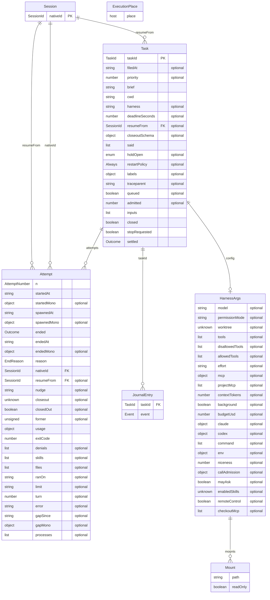

# The runtime's model

The runtime's words as Effect Schemas, at its door beside its glossary (`src/core/model.ts`, exported as `RuntimeModel` from
`src/index.ts`): a task and its attempts, the session each runs, the entries of its journal, the arguments it gives its harness and
the folders it may reach. Each id comes in two forms, from one helper (`src/core/brand.ts`): checked on create (`TaskId.create`,
`TaskId.OnCreate`) and nominal on read (`TaskId.OnRead`), and every stored field holds the read form, so a journal written before a
check still reads. A task's id is what its journal file can be named (`taskIdRefusal`), which every id in use is. The task is the
aggregate, and its invariant is that its attempts number from 1 with no gap, as `decide` starts each at `attempts.length + 1`. A
journal entry carries the journal's own schema of an event (`StoredEventSchema`, `src/core/event-schema.ts`), not a copy, and the
model's mount is held to the harness's `Mount` by `src/core/model.test.ts`. A relation to another layer is an id alone: the
orchestrator holds a `TaskId` by its key, with no import.

Nothing reads through the model yet, and nothing is reshaped by it. It leaves three seams. The Task and Journal door (S4) decodes
what it reads through these schemas, and holds a new id to `TaskId`'s create form at `file`, where today any id is taken. A store
kept in SQLite takes the branded schemas as its `Model.Class` fields. The place a session runs, `ExecutionPlace`, is the host and
nothing else, so a task holds no field for it (decision Q17); it gains one only when a second place exists.

<!-- diagram:runtime-model:begin — generated, from the repository's root: node -e "import('./packages/agent-runtime/src/core/model.ts').then((m) => console.log(m.runtimeModelDiagram()))" -->

<!-- diagram:runtime-model:end -->
